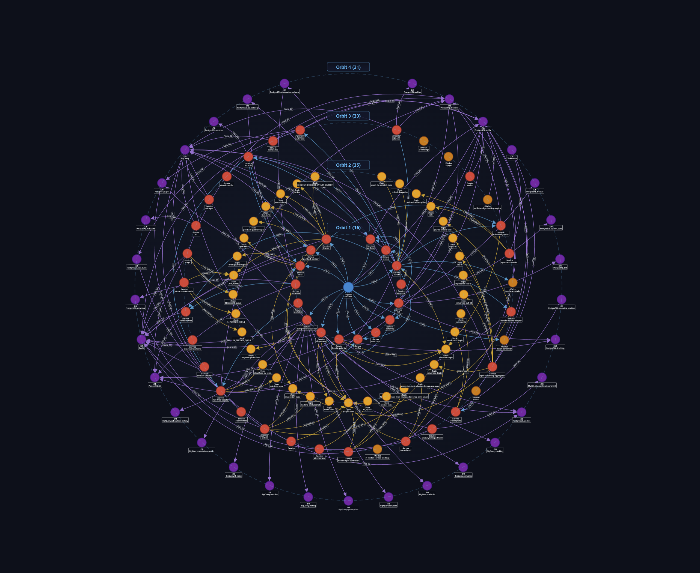
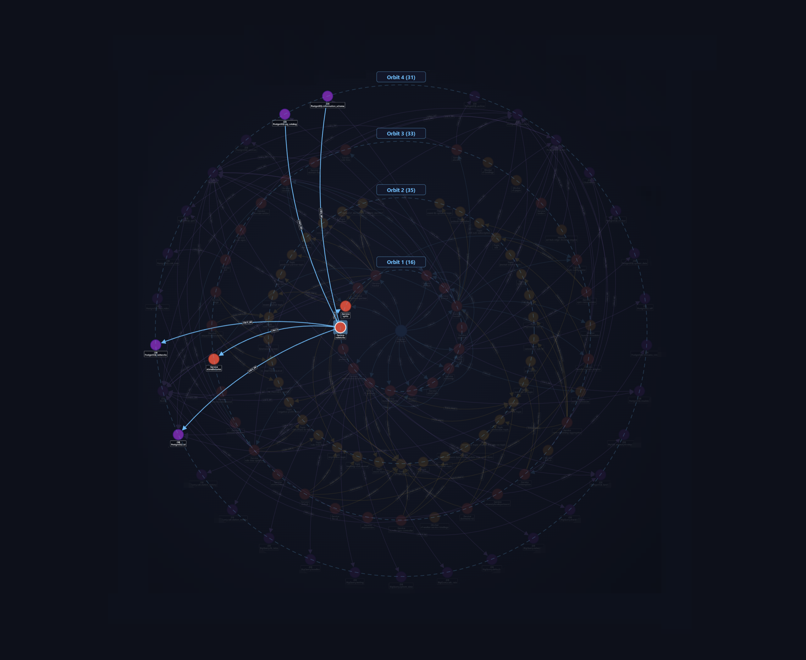
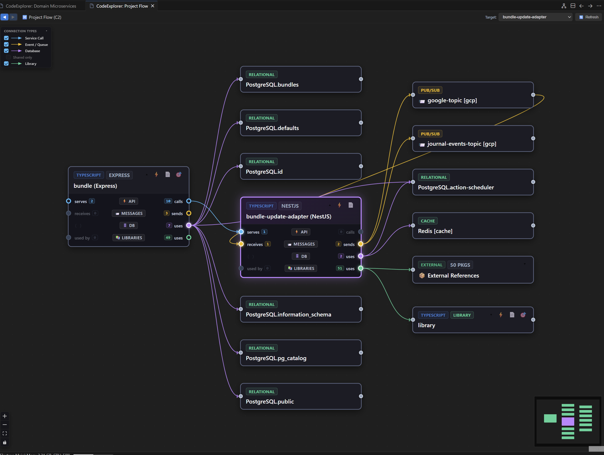

# CodeExplorer (`ce`)

[](https://github.com/vmikhailov/code-explorer/blob/main/LICENSE)
[](https://github.com/vmikhailov/homebrew-tap)
[](https://dotnet.microsoft.com/download)
[](https://www.nuget.org/packages/CodeExplorer.Cli)
[](https://marketplace.visualstudio.com/items?itemName=vmikhailov.code-explorer-vscode)
[](https://open-vsx.org/extension/vmikhailov/code-explorer-vscode)
[](https://github.com/vmikhailov/code-explorer)

**Architecture Intelligence for AI Agents & Engineers**

CodeExplorer compiles polyglot codebases, HTTP endpoints, message queues, and databases into a unified, queryable dependency graph. It supplies structural ground truth to AI coding agents via a native Model Context Protocol (MCP) server, enforces architectural rules in CI with Semantic Invariant Gates (SIG), and renders interactive visual architecture projections directly inside VS Code.

---

<p align="center">
  
</p>
<p align="center">
  <em>Figure 1: Full-system microservice topology projected across 5 Concentric Architectural Orbits (Tiers 0–4: Ingress Gateways, Public Services, Message Brokers, Domain Services, and Databases) with live transitive dependency routing.</em>
</p>

<p align="center">
  <a href="#1-ground-truth-for-ai-coding-agents-mcp-server"><b>AI Ground Truth (MCP)</b></a> •
  <a href="#2-semantic-invariant-gates-sig"><b>Architectural Gates (SIG)</b></a> •
  <a href="#3-interactive-visual-architecture-vs-code"><b>Visual Studio Cockpit</b></a> •
  <a href="#automated-diagram-generation"><b>Diagrams</b></a> •
  <a href="#key-features"><b>Key Features</b></a> •
  <a href="#quick-installation"><b>Installation</b></a> •
  <a href="#quick-start-workflow"><b>Quick Start</b></a> •
  <a href="#cli-command-reference"><b>CLI Reference</b></a> •
  <a href="#mcp-tools-reference"><b>MCP Tools</b></a>
</p>

---

## Architecture Intelligence Hierarchy

CodeExplorer addresses codebase complexity through a deterministic 3-tier architecture:

1. **Deterministic Ground Truth for AI Coding Agents**: Solves context bloat and architectural hallucination. AI agents query an embedded OpenCypher graph via MCP to obtain call graphs, entry points, and blast radiuses instead of blindly scanning raw text.
2. **Semantic Invariant Gates (SIG in CI/CD)**: Solves architectural drift and erosion. Executable OpenCypher invariants act as CI ratchets to lock in layer boundaries, API contracts, and structural rules with clickable 2D terminal navigation.
3. **Interactive Visual Cockpit (VS Code Extension)**: The human counterpart to the agent graph. Visualizes concentric orbits, synthesizes transitive broker flows, and allows click-to-code navigation across distributed architectures.

---

## 1. Ground Truth for AI Coding Agents (MCP Server)

AI coding assistants (Claude Code, Cursor, Copilot, Hermes, Antigravity) struggle in large polyglot systems because flat file search (`grep`, ripgrep) cannot trace cross-service RPC calls, interface implementations, or message broker topologies. Feeding entire repositories into context windows wastes tokens and leads to architectural hallucinations.

CodeExplorer acts as a local architectural memory and structural ground truth engine:
* **Zero-Token Hallucination Protection**: Agents query exact semantic entities (controllers, database tables, message topics, call chains) via standard MCP tools.
* **Precise Blast Radius Analysis**: Before modifying code, agents run `analyze_code_impact` or `inspect_data_lineage` to compute all downstream files and callers affected.
* **Low-Token Outlines**: Agents inspect file structure via `get_file_outline` without consuming token budget on full file contents.
* **Arbitrary OpenCypher Queries**: Agents execute complex structural queries via `execute_custom_read_cypher` to answer questions no linear search can solve.

### MCP Configuration

#### Cursor
Add to `~/.cursor/mcp.json` or Cursor Settings -> MCP:
```json
{
  "mcpServers": {
    "code-explorer": {
      "command": "ce",
      "args": ["mcp"]
    }
  }
}
```

#### Claude Desktop
Add to `claude_desktop_config.json`:
```json
{
  "mcpServers": {
    "code-explorer": {
      "command": "ce",
      "args": ["mcp"]
    }
  }
}
```

#### VS Code (Roo Code / Continue / Cline)
Configure the tool executable as `ce` with arguments `["mcp"]`.

#### HTTP / Remote Mode
```bash
ce mcp --port 8085   # Exposes standard MCP endpoint at http://localhost:8085/mcp with SSE streaming
```

### AI Agent Rules (`.cursorrules` / `CLAUDE.md` / `AGENTS.md`)

Add the following instructions to your project agent rules file to ensure agents use CodeExplorer:

```markdown
# Architecture Intelligence via CodeExplorer (`ce`)

This repository uses CodeExplorer (`ce`) as an embedded SQLite knowledge graph and MCP server.

## Mandatory MCP Tool Usage Rules:

1. Architecture Discovery (Start of Task):
   - DO NOT run blind file searches or recursive grep to understand architecture.
   - Call `get_architecture_map` to obtain projects, dependencies, database nodes, Ingress, and Egress.
   - Call `get_project_entry_points` to discover HTTP endpoints, routes, CLI commands, and message listeners.

2. Symbol & File Inspection (Low-Token Context):
   - DO NOT read large files into context to check declarations.
   - Call `get_file_outline` with `filePath` to inspect classes, methods, and line numbers.
   - Call `find_symbol` to locate symbol definitions and signatures.
   - Call `resolve_call_target` to locate concrete implementations of an interface method.

3. Refactoring & Blast Radius Analysis:
   - Before modifying or deleting a symbol, call `analyze_code_impact` to identify all downstream callers.
   - Before altering database schema or queries, call `inspect_data_lineage` with `tableName`.
   - Call `find_refactoring_opportunities` to detect dead code or tightly coupled objects.

4. Multi-Hop Graph Queries:
   - Use `execute_custom_read_cypher` to execute read-only Cypher queries for complex structural dependencies.
```

---

## 2. Semantic Invariant Gates (SIG)

Linters check syntax inside individual files; they cannot verify cross-project layer boundaries, detect illegal transport calls, or prevent architectural erosion. **Semantic Invariant Gates (SIG)** elevate architectural rules into executable, automated gates running **OpenCypher graph queries** directly against the codebase graph.

### 1. Fractal Orthogonal Invariant Matrix (FOIM)

Every architectural rule occupies a coordinate in the FOIM space, crossing an architectural **Scope** with a structural **Dimension**:

| Code | Scope | Granularity | Example Entities Enforced |
| :--- | :--- | :--- | :--- |
| **A** | **System** | Entire distributed topology | Cross-service calls, gateway bypasses, cloud resources |
| **S** | **Service** | Executable / deployment unit | `Service`, `App`, `Worker`, message broker isolation |
| **P** | **Module** | Compilation unit / Project | `Project`, `Library`, layer dependencies, acyclicity |
| **C** | **Class** | Type / Interface / Struct | `Type`, inheritance trees, visitor I/O purity |
| **M** | **Method** | Function / Procedure / Endpoint | `Function`, `Endpoint`, `CallLiteral`, argument constraints |

| Code | Dimension | Architectural Focus | Question Answered |
| :--- | :--- | :--- | :--- |
| **C** | **Contract** | Typing, interfaces, API protocol fidelity | Are contracts explicit, valid, and type-safe? |
| **I** | **Rules** | Implementation constraints & hygiene | Are constants hardcoded? Are AST visitors I/O-pure? |
| **R** | **Resources** | Resource & complexity control | Are methods within length/complexity limits? |
| **B** | **Boundaries** | Scope boundaries, encapsulation, layer isolation | Who may talk to whom? (e.g. No direct DB calls from UI) |

**Identifier Convention**: `SIG-<Scope>-<Dimension>-<Index3Digits>`
* `SIG-P-B-001`: Module Scope x Boundaries (Domain cannot reference Infrastructure)
* `SIG-M-I-001`: Method Scope x Rules (No hardcoded API endpoints or magic strings)
* `SIG-M-R-001`: Method Scope x Resources (Method length ceiling: <= 500 lines of code)
* `SIG-C-I-001`: Class Scope x Rules (In-memory AST visitor purity: no direct disk I/O)

### 2. The Zero-Match Contract & Clickable 2D Navigation

Gates operate on a strict **Zero-Match Contract**:
* **0 rows returned**: **PASS** (Invariant holds across the entire codebase).
* **>= 1 rows returned**: **FAIL** (Each matching row is an architectural violation).

Violations emit standardized 2D coordinates (`file:line:column`) for instant navigation in VS Code, Cursor, and terminal emulators:

```text
FAIL: SIG-P-B-001 [Project Layer Boundary: Core cannot depend on Infrastructure]
  src/Core/Services/OrderService.cs:42:15: OrderService -> SqliteConnection
    Violation: Domain Core module directly references Infrastructure driver.
```

### 3. Ratchet Baselines: Zero-Drift CI for Legacy Codebases

To adopt architectural governance on existing codebases without breaking current builds, CodeExplorer uses **Ratchet Baselines** (`.codeexplorer/baselines/*.json`):
1. **Freeze Existing Debt**: Capture historical violations into a baseline snapshot with SHA-256 fingerprinting. Existing violations become *tolerated debt*.
2. **Block New Regressions**: `ce gate check` fails strictly if *new* un-baselined violations appear.
3. **Lock In Improvements (The Ratchet)**: As developers refactor legacy code, run `ce gate ratchet --update`. The baseline threshold decrements and locks in progress. Technical debt can only decrease, never increase.

### 4. Declarative YAML Gate Manifests

Define custom architectural rules in `.codeexplorer/gates/*.yaml` using OpenCypher:

```yaml
id: SIG-P-B-001
name: Clean Architecture Layer Isolation
category: Architectural
platform: agnostic
scope: Module
dimension: Boundaries
severity: Error
description: Domain Core projects must never reference Infrastructure or UI projects.
query: |
  MATCH (source:Project)-[:DEPENDS_ON]->(target:Project)
  WHERE source.name CONTAINS "Core" AND target.name CONTAINS "Infrastructure"
  RETURN 
    coalesce(source.path, "workspace") AS file,
    1 AS line,
    1 AS column,
    source.name AS symbol,
    target.name AS target,
    "Core domain project '" + source.name + "' cannot depend on infrastructure '" + target.name + "'" AS message
```

### 5. CI Integration Example

```yaml
# GitHub Actions Step
- name: Evaluate Architectural Invariant Gates
  run: |
    ce scan
    ce gate check --format markdown >> $GITHUB_STEP_SUMMARY
```

---

## 3. Interactive Visual Architecture (VS Code)

CodeExplorer includes an interactive visual cockpit inside VS Code (`Code Graph`). Designed for high-density architectures, it provides visual insight into distributed microservices and modular monoliths:

### 1. Focused Neighborhood & Transitive Contraction

<p align="center">
  
</p>
<p align="center">
  <em>Figure 2: Focused sub-graph inspection with live HUD metrics, orbit reordering, edge curvature sliders, and dashed transitive links resolving broker-mediated message flows.</em>
</p>

* **Smart Transitive Contraction**: When intermediate message topics or broker nodes are toggled off in the HUD, CodeExplorer detects that Service A publishes to Topic X and Service B subscribes to Topic X, automatically synthesizing a direct `[SUBSCRIBES (via Topic X)]` dashed connection.
* **Custom Orbit Legend Controls**: Reorder orbital tiers by dragging legend badges to highlight edge gateways, flip database tiers, or group domain boundaries.
* **Edge Curvature Tuning**: Interactive bezier curvature factor slider (-200 to +200) with automatic collision avoidance for cross-orbit calls.
* **Live HUD Filter**: Multi-criteria filtering by node category (Gateways, Services, Topics, Databases, External APIs), search query, and neighborhood depth.

### 2. Project Flow & C1 System Context

<p align="center">
  
</p>
<p align="center">
  <em>Figure 3: Project Flow view showing structured service cards, inbound/outbound connection counts, database dependencies, framework tags, and Click-to-Code navigation.</em>
</p>

* **Interactive Service Cards**: Each project node displays incoming callers, outgoing dependencies, registered databases, and framework metadata.
* **Click-to-Code Jump**: Double-click any node or click "Jump to Code" in the inspector drawer to navigate immediately to the exact declaration line in your workspace.
* **Multi-Projection Layouts**:
  * Concentric Orbits (Equispaced, Polar Force, Domain Sectors)
  * Architectural Swimlanes (Horizontal echelons: Ingress -> Core -> Data)
  * Bounded Context Islands (Clusters based on inferred Domain-Driven Design boundaries)
  * Hive Plots & Dependency Matrices
  * COSE Physics Force Layout

---

## Automated Diagram Generation

Export visual representations directly from the graph database into Mermaid or C4 syntax via CLI or MCP:

* **System Architecture**: High-level C1/C2 project flow and microservice topology diagrams.
* **Data Lineage**: Maps ORM entities directly to their underlying database tables.
* **Event Pipelines**: Visualizes CQRS patterns and event-driven flows (Producers -> Topics -> Consumers).

```bash
# Export system architecture
ce export --format mermaid -o architecture.mmd

# Export C4 container diagram
ce export --format c4 -o c4_containers.mmd

# Export ORM data lineage
ce export --type lineage -o data_lineage.mmd

# Export CQRS & event pipelines
ce export --type cqrs -o event_pipeline.mmd
```

---

## Key Features

* **Zero-Dependency Single-File Executable**: Distributed as a self-contained binary (`ce.exe` / `ce`) for Windows, Linux, and macOS. No external runtime, database, or container required.
* **Embedded SQLite Graph with Cypher**: High-performance embedded SQLite database compiled with custom graph indices and an optimized AST-to-SQL Cypher compiler.
* **Multi-Language AST Parsing**: Full AST-level parsing powered by Tree-sitter and Microsoft SQL ScriptDom:
  * C# (`.cs`)
  * Java (`.java`, Maven `pom.xml`, Gradle `build.gradle` / `build.gradle.kts`)
  * TypeScript / JavaScript (`.ts`, `.tsx`, `.js`, `.jsx`)
  * Go (`.go`)
  * Python (`.py`)
  * ColdFusion (`.cfc`, `.cfm`)
  * SQL & Embedded SQL (`.sql` scripts, and inline SQL queries in C#, Java, JS, TS, Python, Go)
* **5-Layer Structural Ontology**: Maps codebases across a decoupled graph architecture:
  * *Physical Layer (Layer 1)*: Workspace, projects (`.csproj`, `pom.xml`, `go.mod`, `package.json`), folders, files, configuration files, git topology.
  * *Project Layer (Layer 2)*: Logical compilation units, project boundaries, package dependencies.
  * *Syntactic Layer (Layer 3)*: Classes, interfaces, methods, functions, structs, fields, calls.
  * *Semantic Layer (Layer 4)*: Ingress endpoints (REST, gRPC, GraphQL, WebSocket) with security boundaries, Egress callers, Code-First ORM entities mapped to `:Table` nodes, message queues.
  * *Late-Bound Layer (Layer 5)*: Cross-project call chains, interface implementations, service-to-service links, CQRS event pipelines.
* **Local Architectural Intent Inference**: Automatically infers business domains, architectural patterns, and capability tags using an embedded GGUF model via native `llama.cpp` (Vulkan GPU acceleration & CPU fallback). File contents are SHA-256 fingerprinted and cached; subsequent scans apply intents in <50ms.
* **Built-in & Custom Query Catalog**: 22 built-in queries covering architecture maps, entry points, dependencies, CQRS pipelines, refactoring, and symbol lookup. Extensible via `.codeexplorer/queries/*.cypher`.

---

## Quick Installation

CodeExplorer is available as a **VS Code Extension** and as a **single-file self-contained CLI/MCP binary** with embedded Tree-sitter parsers and SQLite engine.

### 1. Homebrew (macOS & Linux)

```bash
brew install vmikhailov/tap/ce
```

### 2. VS Code Extension

Install from the [Visual Studio Marketplace](https://marketplace.visualstudio.com/items?itemName=vmikhailov.code-explorer-vscode) or [Open VSX](https://open-vsx.org/extension/vmikhailov/code-explorer-vscode):

```bash
code --install-extension vmikhailov.code-explorer-vscode
```

*Or install from VSIX:*
1. Download `code-explorer-*.vsix` from [GitHub Releases](https://github.com/vmikhailov/code-explorer/releases/latest).
2. Extensions view (`Ctrl+Shift+X` / `Cmd+Shift+X`) -> `...` -> **Install from VSIX...**
3. Open any workspace and click **`Code Graph`** in the status bar or run `CodeExplorer: Show Architecture Graph` from the Command Palette (`Ctrl+Shift+P`). Native binaries for Windows, macOS, and Linux are automatically bundled.

### 3. One-Line Script Install

**macOS & Linux (Bash / Zsh):**
```bash
curl -fsSL https://raw.githubusercontent.com/vmikhailov/code-explorer/main/cli/scripts/install.sh | bash
```

**Windows (PowerShell):**
```powershell
irm https://raw.githubusercontent.com/vmikhailov/code-explorer/main/cli/scripts/install.ps1 | iex
```

### 4. .NET Global Tool

```bash
dotnet tool install -g CodeExplorer.Cli
dotnet tool update -g CodeExplorer.Cli
```

### 5. Manual Binary Download

Download pre-compiled binaries from [GitHub Releases](https://github.com/vmikhailov/code-explorer/releases/latest):

| Platform | Architecture | Binary Asset |
| :--- | :--- | :--- |
| **macOS** | Apple Silicon (ARM64) | `ce-osx-arm64.tar.gz` |
| **macOS** | Intel x64 | `ce-osx-x64.tar.gz` |
| **Linux** | x86_64 | `ce-linux-x64.tar.gz` |
| **Linux** | ARM64 | `ce-linux-arm64.tar.gz` |
| **Windows** | x86_64 | `ce-win-x64.zip` |

### 6. Build from Source

```bash
# Requires .NET 10.0 SDK
./cli/scripts/build.sh
./cli/scripts/publish.sh
```

---

## Quick Start Workflow

```bash
# 1. Initialize a .codeexplorer workspace
ce init MyProject

# 2. Scan and index code topology, ASTs, and dependencies
ce scan

# 3. (Optional) Download local model and enrich graph with architectural intents
ce model download
ce intent

# 4. View workspace health and statistics
ce status

# 5. List available Cypher queries
ce queries

# 6. Execute built-in or ad-hoc Cypher query
ce query -n get_architecture_map_workspace
ce query "MATCH (p:Project) RETURN p.name, p.project_type"

# 7. Start MCP server for AI coding assistants
ce mcp
```

---

## CLI Command Reference

### `ce init [name]`
Initializes a `.codeexplorer/` workspace directory in the target folder with an empty SQLite graph database and queries catalog.
```bash
ce init
ce init MyProject -d /path/to/repo
```

### `ce scan [path]` *(alias: `ce index`)*
Scans source files, parses ASTs (Tree-sitter & ScriptDom), builds structural relationships, and resolves semantic boundaries. Fast-applies cached architectural intents in <50ms without invoking the LLM.
```bash
ce scan                     # Index workspace
ce scan ./src/AuthService   # Index specific subfolder
ce scan --clear             # Clear graph topology before re-indexing
ce scan --intent            # Run LLM architectural intent distillation during indexing
```

### `ce status` *(alias: `ce info`)*
Displays workspace statistics, database size, indexed projects by language, node counts, and available queries.
```bash
ce status
ce status --json            # Output structured JSON
```

### `ce queries` *(alias: `ce query -l`)*
Displays all available Cypher queries grouped by category (`[Architecture]`, `[Refactoring]`, `[Symbols]`, `[Taxonomy]`) along with custom workspace queries.
```bash
ce queries
ce queries --format json
```

### `ce query [options]`
Executes a read-only Cypher query against the knowledge graph with formatted tabular or JSON output.
```bash
ce query -n get_architecture_map_workspace -j      # Structured JSON tree
ce query -n get_project_dependencies_all
ce query --show get_architecture_map_workspace     # Inspect query source
ce query "MATCH (t:Type {kind: 'interface'}) RETURN t.name" -j
ce query -f ./custom_audit.cypher                  # Run from file
```

### `ce gate [action] [options]`
Evaluates Semantic Invariant Gates (SIG) against the graph using OpenCypher queries with ratchet baseline tracking.
```bash
ce gate check                                      # Check all gates
ce gate check -g SIG-P-B-001 -f markdown           # Check specific gate
ce gate check --category architectural             # Filter by category
ce gate list                                       # List all registered gates
ce gate violations --group-by file                 # Inspect active violations
ce gate violations --new                           # Show only un-baselined violations
ce gate ratchet --update                           # Lock in debt improvements
```

### `ce mcp [options]`
Starts the Model Context Protocol (MCP) server.
```bash
ce mcp                      # stdio mode (default for Cursor, Claude, Antigravity)
ce mcp --port 8085          # HTTP mode with SSE endpoint at http://localhost:8085/mcp
```

### `ce export [options]`
Exports architecture and system topology diagrams directly from the knowledge graph in Mermaid or C4 syntax.
```bash
ce export --format mermaid
ce export -f mermaid -o architecture.mmd
ce export --format c4 -o c4_containers.mmd
ce export --type lineage -o data_lineage.mmd
ce export --type cqrs -o event_pipeline.mmd
```

### `ce clear [path]`
Selectively wipes a subfolder from the index or clears the entire graph database (while preserving the incremental intent cache).
```bash
ce clear ./src/OldModule    # Remove specific subfolder
ce clear -y                 # Reset entire graph database
```

### `ce intent [path]`
Runs incremental architectural intent distillation using a local GGUF model via embedded `llama.cpp` (Vulkan GPU accelerated with CPU fallback).
```bash
ce intent                   # Distill intents for all candidate files
ce intent --limit 20        # Distill up to 20 candidate files
ce intent --reset-errors    # Reset error counter
ce intent --clear           # Clear cached intent records
```

### `ce model [action]`
Manages local GGUF models used for native architectural intent distillation (powered by `ce-intent-v2-q4_k_m.gguf` running locally via `llama.cpp`).
```bash
ce model status             # Check model status and size (~940 MB)
ce model download           # Download the intent model with progress bar
ce model download --force   # Force re-download
```

---

## MCP Tools Reference

When running as an MCP server, `ce` registers the following tools for AI assistants:

| Tool Name | Parameters | Description |
| :--- | :--- | :--- |
| `get_taxonomy` | None | Structural taxonomy database schema mapping all active node types and relationship counts. |
| `get_architecture_map` | `projectName` (opt) | Workspace architecture map: projects, dependencies, database nodes, Ingress, and Egress. |
| `get_project_dependencies` | `projectFilter` (opt) | Complete dependency graph between projects, including direct and transitive links. |
| `get_file_outline` | `filePath` | AST outline of a file (classes, interfaces, functions, variables, queries) without reading full text. |
| `find_symbol` | `name`, `symbolType` (opt) | Search semantic graph for symbols (Class, Interface, Function, Struct) matching a pattern. |
| `get_call_chain` | `startFunction`, `endFunction`, `maxDepth` | Trace and return sequential invocation call graph between starting and target function. |
| `resolve_call_target` | `interfaceName`, `methodName` | Find all concrete classes implementing an interface and point to physical method implementations. |
| `analyze_code_impact` | `symbolName` | Downstream blast-radius analysis tracking all files and symbols affected by modifying a symbol. |
| `inspect_data_lineage` | `tableName` | Trace database entity blast radius: SQL queries, functions, and files referencing a table. |
| `export_architecture_diagram` | `format` (opt), `type` (opt), `projectName` (opt) | Generate visual architecture, ORM data lineage, or CQRS/Saga event diagrams in Mermaid or C4 PlantUML. |
| `get_project_entry_points` | `projectName` | Find architectural entry points (REST endpoints, GraphQL Queries/Mutations, gRPC RPCs, event listeners) with strongly-typed schemas and security boundaries. |
| `find_refactoring_opportunities` | `projectName`, `metricType` | Detect dead code, unreferenced symbols, and god objects with high coupling. |
| `list_project_queries` | None | Discover custom parameterized project queries saved in `.codeexplorer/queries/`. |
| `save_project_query` | `name`, `description`, `cypher`, `metadata` | Validate syntax/safety and persist reusable domain Cypher query into `.codeexplorer/queries/`. |
| `execute_project_query` | `name`, `parameters` (opt) | Execute a workspace custom or built-in query by name with automatic parameter binding. |
| `execute_custom_read_cypher` | `query`, `parameters` (opt) | Execute arbitrary read-only Cypher (`MATCH` only) directly against the graph database. |
| `fetch_code_snippets` | `nodesJson` | Fetch source code snippets for a list of node URN contexts (file path, start line, end line). |
| `get_node_definition` | `kind` | Retrieve documentation and schema details for an ontological Node Kind. |
| `init_workspace` | `name` (opt), `force` (opt) | Initialize a new `.codeexplorer` workspace in the target folder. |
| `scan_workspace` | `path` (opt), `clear` (opt) | Scan and index source files, ASTs, and dependencies into the graph database. |
| `get_workspace_status` | None | Get workspace health status, SQLite DB size, indexed projects by language, node counts. |
| `clear_workspace_index` | `path` (opt) | Clear indexed graph data for a specific subpath or the entire workspace database. |
| `ingest_graph_data` | `nodesJson`, `relationshipsJson` (opt) | Direct batch ingestion of custom/external nodes and relationships into SQLite graph. |

---

## Project Structure

```text
├── cli/                                  # .NET Core Engine, Graph Engine, CLI & MCP Server
│   ├── scripts/                          # Cross-platform installation and single-file build scripts
│   ├── src/
│   │   ├── Core/CodeExplorer.Core/       # SQLite graph client, ontology models, pipeline, llama.cpp intent engine, MCP tools
│   │   ├── Cypher/CodeExplorer.Cypher/   # OpenCypher parser, AST transformer, and SQLite SQL compiler
│   │   ├── Parsers/                      # Polyglot AST parsers (Tree-sitter & ScriptDom for C#, Java, TS, Go, Py, SQL, CF)
│   │   ├── Tools/CodeExplorer.OntologyGen/# Self-descriptive ontology generator
│   │   └── UI/CodeExplorer/              # Single-file 'ce' CLI tool, WebSocket server, and MCP host
│   ├── tests/
│   │   ├── CodeExplorer.Cypher.Tests/    # Cypher compiler unit & regression tests
│   │   └── CodeExplorer.Tests/           # CLI, indexing, integration, and MCP tests
│   └── CodeExplorer.slnx                 # .NET solution layout file
├── vscode-extension/                     # Interactive Architecture Visual Studio (VS Code Extension)
│   ├── src/                              # Extension host, WebSocket client, Cytoscape webview controllers
│   ├── media/                            # Webview UI styles, icons, and bundles
│   └── package.json                      # VS Code extension manifest & settings
├── site/                                 # Website & interactive playground (https://code-explorer.mikhailov.cc)
├── docs/                                 # Technical ontology reference, images, and architecture specifications
└── proto/                                # Protocol buffer contracts for high-speed streaming
```

---

## License

This project is licensed under the [MIT License](LICENSE).
