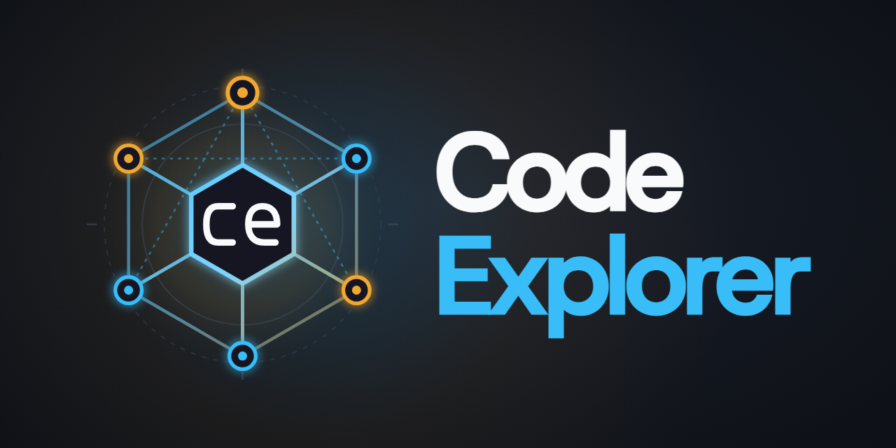
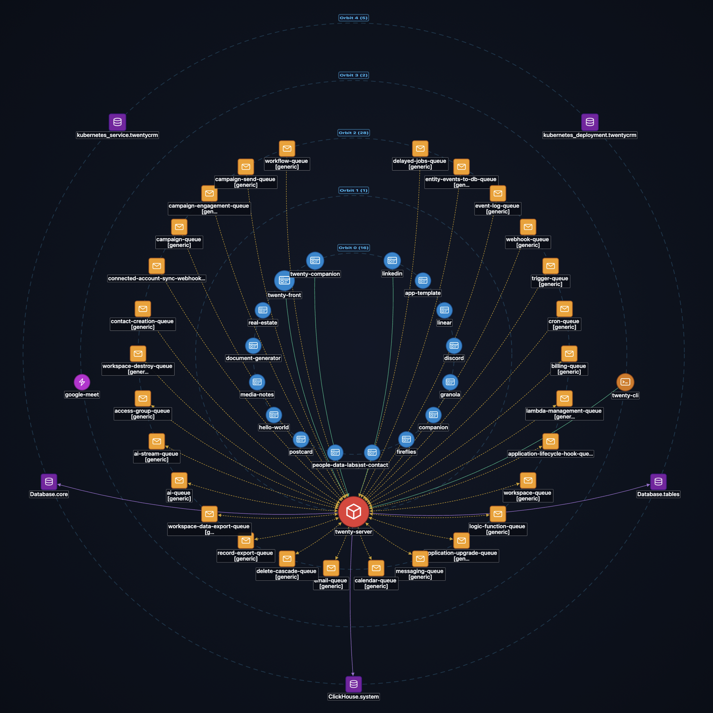
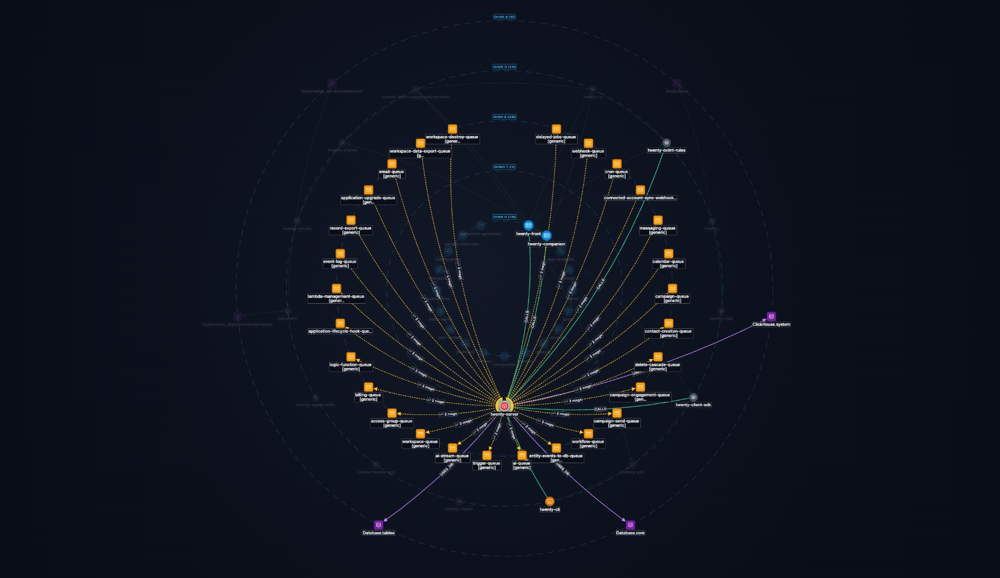
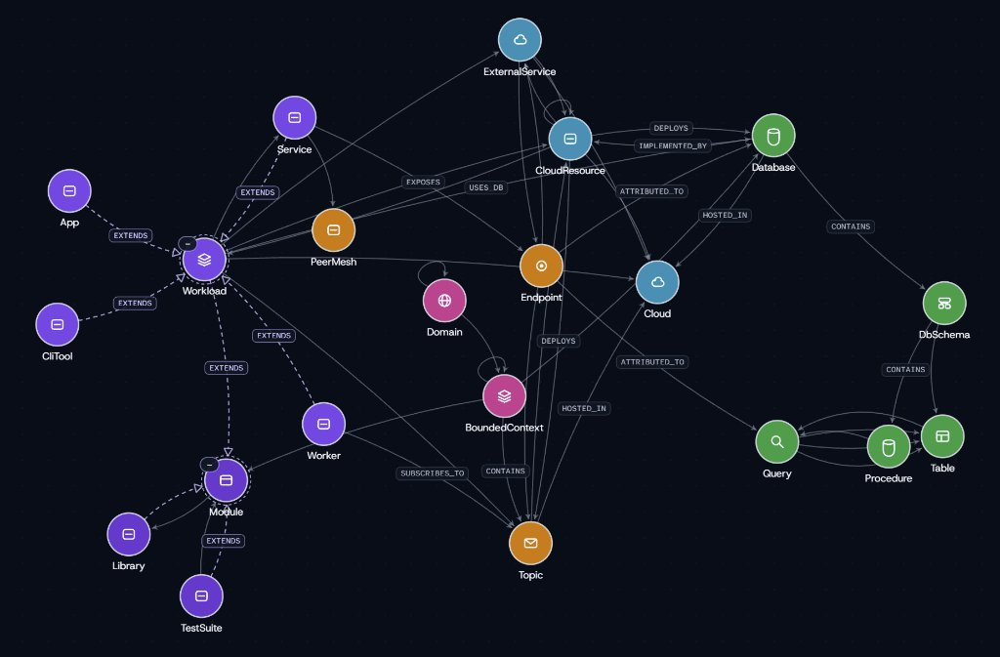

<div align="center">
  

[](https://code-explorer.app)
[](https://github.com/vmikhailov/code-explorer/blob/main/LICENSE)
[](https://github.com/vmikhailov/homebrew-tap)
[](https://www.nuget.org/packages/CodeExplorer.Cli)
[](https://marketplace.visualstudio.com/items?itemName=vmikhailov.code-explorer-vscode)
[](https://open-vsx.org/extension/vmikhailov/code-explorer-vscode)
[](https://glama.ai/mcp/servers/vmikhailov/code-explorer)

</div>

## Understand, query, and guard your codebase architecture — for you and your agent.

CodeExplorer compiles polyglot repositories into a single local SQLite graph (`.codeexplorer/graph.db`) with an embedded OpenCypher-to-SQL engine. It ships as a standalone native binary and a VS Code extension — no external runtime, Docker container, or graph database server required, and nothing leaves your machine.

1. **Understand It Yourself (`VS Code`)** — Interactive C1–C3 service maps, HTTP/gRPC/GraphQL contracts, message broker flows, and SQL table lineage derived directly from code.
2. **Give Memory to Your AI (`CLI & MCP`)** — Query multi-hop call chains, refactoring blast radius, and data lineage in milliseconds (`ce` / `ce mcp`) instead of burning context on blind `grep`.
3. **Guard Architecture in CI (`Invariant Gates + Ratchet`)** — Enforce cross-service and layer rules in YAML/OpenCypher; freeze legacy brownfield debt in a SHA-256 baseline ratchet (`ce gate ratchet --update`) so CI blocks only net-new violations.

<p align="center">
  
</p>

<p align="center">
  <a href="#installation">Installation</a> •
  <a href="#quick-start">Quick Start</a> •
  <a href="#cli--mcp-surface">CLI &amp; MCP</a> •
  <a href="#semantic-invariant-gates">Invariant Gates</a> •
  <a href="#vs-code-extension">VS Code</a> •
  <a href="#graph-ontology--languages">Ontology &amp; Languages</a> •
  <a href="#benchmarks">Benchmarks</a> •
  <a href="#scope-limitations--privacy">Scope &amp; SDK</a>
</p>

---

## Installation

```bash
# macOS & Linux (Homebrew)
brew install vmikhailov/tap/ce

# VS Code / Cursor / Windsurf / Antigravity extension (manages 'ce' binary & MCP setup)
code --install-extension vmikhailov.code-explorer-vscode

# Standalone binary installer (macOS / Linux)
curl -fsSL https://code-explorer.app/install.sh | bash

# Standalone binary installer (Windows PowerShell)
irm https://code-explorer.app/install.ps1 | iex

# .NET Global Tool (any OS / architecture)
dotnet tool install -g CodeExplorer.Cli
```

* **Prebuilt Archives**: Standalone binaries (`osx-arm64`, `osx-x64`, `linux-x64`, `linux-arm64`, `win-x64`, `win-arm64`) are attached to [GitHub Releases](https://github.com/vmikhailov/code-explorer/releases/latest).
* **IDE Marketplaces**: [Visual Studio Marketplace](https://marketplace.visualstudio.com/items?itemName=vmikhailov.code-explorer-vscode) · [Open VSX Registry](https://open-vsx.org/extension/vmikhailov/code-explorer-vscode)
* **Agent Plugins**: Claude Code (`/plugin marketplace add vmikhailov/code-explorer` then `/plugin install code-explorer@code-explorer`) · Gemini CLI (`gemini extensions install https://github.com/vmikhailov/code-explorer`)

---

## Quick Start

```bash
# 1. Index workspace into .codeexplorer/graph.db (initializes automatically on first run)
ce scan

# 2. Explore architecture, blast radius, and SQL table lineage
ce map
ce impact OrderService.CreateOrder
ce lineage orders

# 3. Run ad-hoc OpenCypher or evaluate architectural gates
ce query "MATCH (a:Project)-[:DEPENDS_ON]->(b:Project) RETURN a.name, b.name"
ce gate check

# 4. Provision MCP + agent instructions for Cursor, Claude Code, VS Code, Windsurf, etc.
ce configure all
```

---

## CLI & MCP Surface

CodeExplorer exposes an identical **15-tool** surface across the terminal CLI (`ce <command> [--json]`) and the `stdio` Model Context Protocol server (`ce mcp`).

```json
{
  "mcpServers": {
    "code-explorer": {
      "command": "ce",
      "args": ["mcp"]
    }
  }
}
```

| CLI Command | MCP Tool | Purpose |
| :--- | :--- | :--- |
| `ce scan [path]` | `scan_workspace` | Initialize (if needed) and incrementally index workspace into `.codeexplorer/graph.db`. |
| `ce taxonomy` | `get_taxonomy` | Active graph ontology schema, node/edge specs (`--kind`), or index status (`--status`). |
| `ce map [project]` | `get_architecture_map` | Workspace overview, zoomed C1–C3 / tier topologies, and Mermaid or C4 export. |
| `ce deps [project]` | `get_project_dependencies` | Directed project-to-project and package dependencies (`all`, `runtime`, `build`). |
| `ce contracts <service>` | `get_service_contracts` | Service ingress/egress contracts, handler coordinates, and cross-service flows. |
| `ce symbol <name>` / `ce search` | `find_symbol` | Substring AST lookup and hybrid trigram + vector search across symbols, routes, and tables. |
| `ce outline [path]` | `get_file_outline` | Structural AST outline of a file or directory without reading full source text. |
| `ce snippets <file:s-e>` | `fetch_code_snippets` | Batch reader for exact 1-based source line ranges on disk. |
| `ce callers <target>` | `get_callers` | Direct inbound callers/consumers, or concrete interface/DI implementations (`-m <method>`). |
| `ce trace <start> <end>` | `get_call_chain` | Directed invocation paths between functions or cross-service flows (`trace flow`). |
| `ce impact <symbol>` | `analyze_code_impact` | Multi-hop upstream and downstream blast radius across callers, endpoints, and projects. |
| `ce lineage <table>` | `inspect_data_lineage` | End-to-end SQL queries, ORM entities, functions, and services reading or writing a table. |
| `ce test [impact\|coverage]` | `get_affected_tests` | Test Impact Analysis from diffs/symbols and static test reachability coverage. |
| `ce gate [check\|anomalies]` | `check_semantic_gates` | Evaluate Semantic Invariant Gates (`SIG-*`), baselines, or dead-code/god-object checks. |
| `ce query "<cypher>"` | `execute_custom_read_cypher` | Execute read-only OpenCypher or saved `.codeexplorer/queries/` templates. |

*Additional workspace helpers*: `ce status` (node/edge summary), `ce export` (standalone Mermaid/C4 diagrams), `ce serve` (WebSocket/HTTP server for VS Code), and `ce clear` (reset index).

---

## Semantic Invariant Gates

Linters check syntax and style within single files. Semantic Invariant Gates (SIG) verify structural and cross-service invariants across the full graph using declarative YAML rules (`.codeexplorer/gates/*.yaml`) and a **Zero-Match Contract** (`0` rows = pass; `≥1` rows = violation with `file:line:column` coordinates).

```yaml
id: SIG-P-B-001
name: Clean Architecture Layer Isolation
category: Architectural
severity: Error
query: |
  MATCH (source:Project)-[:DEPENDS_ON]->(target:Project)
  WHERE source.name CONTAINS "Core" AND target.name CONTAINS "Infrastructure"
  RETURN
    coalesce(source.path, "workspace") AS file, 1 AS line, 1 AS column,
    source.name AS symbol, target.name AS target,
    "Core project '" + source.name + "' cannot depend on '" + target.name + "'" AS message
```

To adopt strict rules in brownfield repositories without fixing legacy violations upfront, gates support **SHA-256 ratchet baselines** (`.codeexplorer/baselines/*.json`):

```bash
# 1. Freeze existing violations as tolerated baseline debt
ce gate ratchet --update

# 2. Pass when only baselined debt exists; fail (exit 1) on any net-new violation
ce gate check --format markdown >> $GITHUB_STEP_SUMMARY
```

When legacy violations are removed, re-running `ce gate ratchet --update` tightens the ceiling so resolved debt cannot return.

---

## VS Code Extension

<p align="center">
  
</p>

* **Topology Views**: Concentric service orbits, architectural tiers, project upstream/downstream flows, dependency matrices, and bounded context maps.
* **Transitive Broker Contraction**: Collapse intermediate nodes or message brokers (Kafka, RabbitMQ, SQS) while preserving dashed producer-to-consumer edges.
* **Graph Inspector**: Inspect inbound/outbound calls, SQL tables, topics, and jump directly to source declarations.
* **Inline Gate Runner**: Evaluate Semantic Invariant Gates, distinguish `[NEW]` from `[TOL]` (baselined) violations, and ratchet baselines from the sidebar.

---

## Graph Ontology & Languages

Every entity in `.codeexplorer/graph.db` belongs to a 5-layer schema (interactive reference at [code-explorer.app/ontology](https://code-explorer.app/ontology) and [`docs/ontology.md`](./docs/ontology.md)):

1. **Layer 1 — Physical**: `Workspace`, `Folder`, `File`, `ConfigurationFile`, `Script`.
2. **Layer 2 — Project**: `Project`, `Package`, `EntryPoint`, `DEPENDS_ON`.
3. **Layer 3 — Syntactic & Dataflow**: `Namespace`, `Type`, `Function`, `Field`, `Parameter`, `CALLS`, `IMPLEMENTS`.
4. **Layer 4 — Semantic Architecture**: `Workload` (`Service`, `App`, `Worker`, `CliTool`), `Module` (`Library`, `TestSuite`), `Endpoint`, `Topic`, `CloudResource`, `Database`, `DbSchema`, `Table`, `Query`, `Procedure`.
5. **Layer 5 — Cross-Service & Domain**: Resolved cross-project `CALLS`, `PUBLISHES_TO`, `SUBSCRIBES_TO`, `READS_FROM`, `WRITES_TO`, plus `Domain` and `BoundedContext` groupings.

<p align="center">
  <a href="https://code-explorer.app/ontology">
    
  </a>
</p>

Tree-sitter grammars, SQL/HCL parsers, and framework analyzers extract architectural semantics across 12 ecosystems (see [code-explorer.app/architectures](https://code-explorer.app/architectures)):

| Language | Maturity | Files & Manifests | Representative Frameworks & Semantics |
| :--- | :--- | :--- | :--- |
| **C# / .NET** | Stable | `.cs`, `.csproj`, `.sln`, `.slnx` | ASP.NET Core, Minimal APIs, gRPC, HttpClient, EF Core, Dapper, MassTransit, Wolverine, Hangfire, MediatR |
| **TypeScript / JS** | Stable | `.ts`, `.tsx`, `.js`, `.jsx`, `package.json` | NestJS (REST, GraphQL, DI, `@Module` cycles), Next.js, Express, Fastify, Hono, tRPC, Prisma, TypeORM, Kysely, BullMQ |
| **Go** | Stable | `.go`, `go.mod` | Gin, Fiber, Echo, `net/http`, gRPC, Watermill, Asynq, Kafka-Go, GORM, `sqlx`, `sqlc`, Ent |
| **Java** | Stable | `.java`, `pom.xml`, `build.gradle` | Spring Boot/Cloud, Quarkus, Micronaut, Dubbo, Kafka, JPA/Hibernate, MyBatis, jOOQ, OpenFeign |
| **Kotlin & Android** | Stable | `.kt`, `.kts`, `AndroidManifest.xml` | Spring, Ktor, Exposed, Room, SQLDelight, Coroutines, Retrofit/OkHttp, Hilt/Koin, Jetpack Compose |
| **Python** | Stable | `.py`, `pyproject.toml`, `requirements.txt` | FastAPI, Litestar, Django, Flask, SQLAlchemy, Celery, Dramatiq, FastStream, Temporal |
| **Rust** | Stable | `.rs`, `Cargo.toml` | Axum, Actix Web, Tonic gRPC, Reqwest, SQLx, SeaORM, Diesel, Tokio |
| **PHP** | Stable | `.php`, `.phtml`, `.inc`, `composer.json` | Symfony, Zend Framework 1 (PSR-0 & PSR-4), Kirby CMS, Doctrine ORM/DBAL, Nette Database, PDO, Smarty/Twig, PHP 8 upgrade risk markers |
| **Perl** | Stable | `.pl`, `.pm`, `.t`, `cpanfile`, `Makefile.PL` | Packages, cron/CLI entrypoints, `DBI` SQL & heredoc lineage, `Switch`, `LWP::UserAgent`, `Mail::Sendmail` |
| **SQL** | Stable | `.sql` & embedded SQL strings | PostgreSQL, T-SQL, MySQL, SQLite, ClickHouse, BigQuery DDL & `READS_FROM` / `WRITES_TO` lineage |
| **Terraform / HCL** | Stable | `.tf`, `.tfvars`, `terragrunt.hcl` | Resources, modules, variables, data sources, outputs, Terragrunt hierarchy, provider & infrastructure links |
| **ColdFusion** | Beta | `.cfc`, `.cfm` | Components, functions, `cfquery` SQL lineage, outbound HTTP calls |

---

## Benchmarks

Reproducible benchmarks across brownfield feature tasks, multi-hop architectural audits, and deterministic ground-truth recall (`371` verified items). Full methodology, raw agent transcripts, and scripts: [code-explorer.app/benchmarks](https://code-explorer.app/benchmarks) and [`benchmarks/README.md`](./benchmarks/README.md).

<!-- BEGIN:md.root_summary_table -->
| Case Study | Codebase | Baseline | Speed & Tokens | Recall & Governance |
| :--- | :--- | :--- | :--- | :--- |
| **[Case 09: Zero-Spoiler Coding Suite](./benchmarks/09-zero-spoiler-context-pack-vs-bare-agent/README.md)** | `twentyhq/twenty` (`36.5k` files, TS/NestJS) | `ripgrep` + `read_file` | **`1.43×` faster** (`19m 38s` vs `28m 02s`) · **`2.24×` fewer tokens** (`3.08M` vs `6.90M`) | **`15/15` Jest specs & `21/21` SIG gates** (`55` vs `104` file reads; `20` vs `41` cmds) |
| **[Case 08: 4-Task Feature Suite](./benchmarks/08-multi-task-architecture-suite-on-twenty/README.md)** | `twentyhq/twenty` (`24.5k` files, TS/NestJS) | `CBM` | **`1.29×` faster** (`34m 14s` vs `44m 6s`) · `9.75M` vs `10.03M` tokens | **`0/4` vs `4/4` violated tasks** (`14/14` unit tests pass; gates caught & fixed `4/4` copied legacy leaks) |
| **[Case 01: Monorepo Deep Audit](./benchmarks/01-agent-audit-ce-vs-cbm-on-twenty/README.md)** | `twentyhq/twenty` (`24.5k` files, TS/NestJS) | `CBM` | **`6.0×` faster** (`1m 33s` vs `9m 15s`) · **`7.0×` fewer tokens** (`242K` vs `1.68M`) | **`100%` vs `3.4%` native graph recall** (`381/381` from `graph.db`, `0` file reads) |
| **[Case 02: 324-Service Audit](./benchmarks/02-enterprise-microservices-deep-audit/README.md)** | Multi-Repo (`324` services, `13.8k` files) | `ripgrep` + Python | **`7.00×` faster** (`4m 16s` vs `29m 52s`) · **`25.07×` fewer tokens** (`686K` vs `17.19M`) | **`100%` vs `82%` recall** (`18` vs `285` turns; `rg` missed `9` services) |
| **[Case 05: .NET Monolith Audit](./benchmarks/05-polyglot-architecture-and-blast-radius/README.md)** | `OrchardCore` (`334` projects, `7.8k` files) | `ripgrep` | **`2.51×` faster** (`4m 25s` vs `11m 04s`) · **`4.12×` fewer tokens** (`3.91M` vs `16.10M`) | **`100%` vs `92.7%` recall** (`331/331` vs `307/331`; `3.25×` fewer file reads) |
| **[Cases 03](./benchmarks/03-code-explorer-vs-codebase-memory-mcp/README.md) & [04](./benchmarks/04-code-explorer-vs-graphify/README.md): Graph Engine Recall** | `immich` & `twenty` (`371` ground-truth items) | `CBM` & `graphify` | `17.6s` (`immich`) / `147.3s` (`twenty`) cold index · `4.3–4.7 ms` Cypher | **Code (`L1–L3`): `78%`** vs `38%` (`CBM`) / `18%` (`graphify`) · **DB & Queues (`L4–L5`): `97.5%`** |
<!-- END:md.root_summary_table -->

---

## Scope, Limitations & Privacy

### Where It Fits
* **vs LSP & SCIP indexers (`Sourcegraph`, `Serena`)**: LSP/SCIP provide compiler-exact symbol resolution and refactoring edits; CodeExplorer models cross-service architecture (endpoints, queues, SQL lineage, blast radius) and complements an LSP server.
* **vs Security CPGs (`CodeQL`, `Joern`)**: CodeExplorer requires no build step and unifies polyglot services in one graph, but it is not an interprocedural taint/vulnerability engine.
* **vs Single-language test libraries (`ArchUnit`, `NetArchTest`, `dependency-cruiser`)**: One declarative query language (OpenCypher) enforces boundaries across all languages, services, and databases simultaneously.

### Limitations
* **Static analysis only**: Reflection, dynamic dispatch, and URLs or topic names assembled dynamically at runtime can be missed (string constants and simple concatenations are resolved).
* **Heuristic call resolution**: Calls are resolved via Tree-sitter syntax, imports, and DI bindings rather than full compiler type-checking.
* **Single workspace**: Cross-service edges are resolved within one indexed workspace (monorepo or multi-repo root folder).

### .NET SDK Packages
To embed the indexer or query compiler directly in .NET applications:
* [`CodeExplorer.Indexing`](https://www.nuget.org/packages/CodeExplorer.Indexing) — Self-contained polyglot workspace indexer with bundled Tree-sitter native runtimes (`win/linux/osx`, `x64/arm64`) and all language parsers.
* [`CodeExplorer.Cypher`](https://www.nuget.org/packages/CodeExplorer.Cypher) — Standalone OpenCypher parser, AST, and SQLite SQL compiler.

### Privacy & License
All parsing, indexing, OpenCypher execution, gate checks, and MCP requests run locally against `.codeexplorer/graph.db` with zero telemetry. The VS Code extension connects to GitHub Releases only if it needs to download the `ce` binary on first launch.

Released under the [MIT License](LICENSE).
