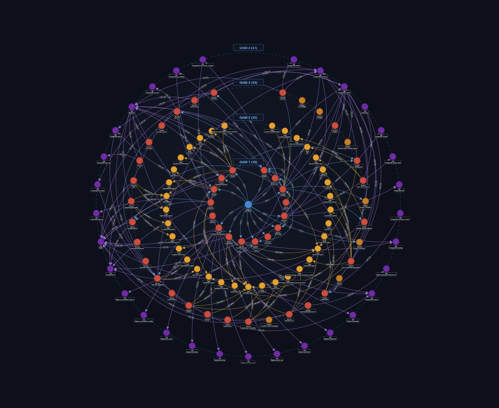
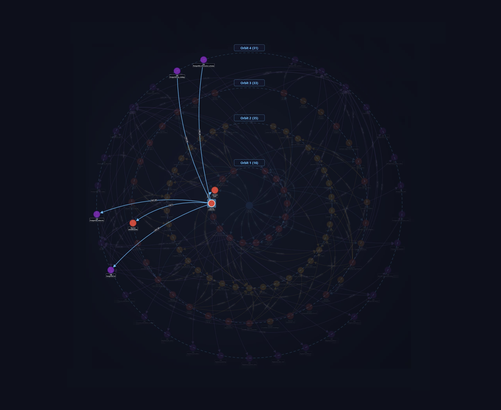
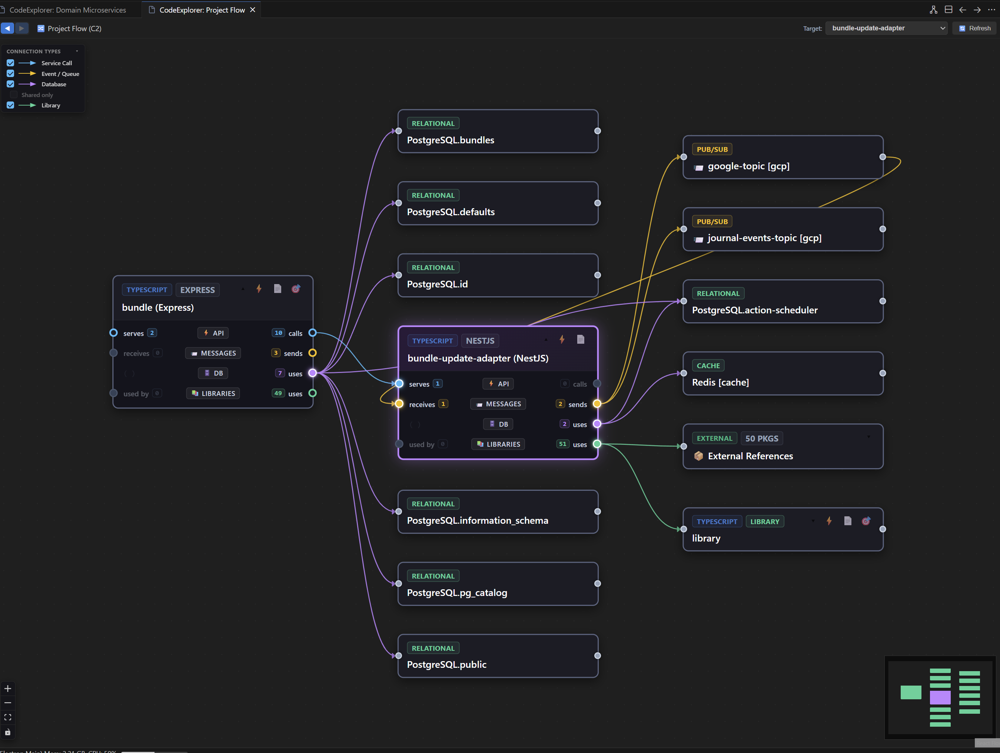

# CodeExplorer (`ce`) — a local code graph for you and your AI agent

[](https://code-explorer.app)
[](https://github.com/vmikhailov/code-explorer/blob/main/LICENSE)
[](https://github.com/vmikhailov/homebrew-tap)
[](https://dotnet.microsoft.com/download)
[](https://www.nuget.org/packages/CodeExplorer.Cli)
[](https://marketplace.visualstudio.com/items?itemName=vmikhailov.code-explorer-vscode)
[](https://open-vsx.org/extension/vmikhailov/code-explorer-vscode)

**AI agents see files, not architecture.** CodeExplorer (`ce`) gives your AI coding agents (`Claude Code`, `Cursor`, `GitHub Copilot`, `Windsurf`, `Cline`) and engineering teams a **live cross-service map of every API, queue, and database in VS Code & MCP—plus hard architectural guardrails in CI**.

**✓ Live Architecture Map in VS Code** • **✓ Graph Context for Agents (CLI + MCP)** • **✓ CI Architecture Gates** • **✓ 100% Local SQLite Graph**

It indexes polyglot source files, project manifests, HTTP/gRPC/GraphQL endpoints, message broker topologies, and SQL schemas into a single local SQLite graph (`.codeexplorer/graph.db`) powered by an embedded OpenCypher-to-SQL compiler. It ships as a single native binary: no .NET runtime, JVM, Docker, or graph database server required, and nothing leaves your machine.

1. **Live Architecture Map in VS Code**: Interactive C1/C2/C3 service topologies, concentric architectural tiers, async broker flows, and database lineage with click-to-source navigation.
2. **Surgical MCP Context for AI Agents**: Gives coding agents instant access to call chains, cross-service dependencies, data lineage, and blast-radius impact analysis without burning millions of tokens on blind `grep` searches.
3. **CI Architecture Gates (Semantic Invariant Gates)**: Enforces architectural boundaries in the IDE and CI (`ce gate check`) using declarative OpenCypher rules and SHA-256 ratchet baselines.

### Benchmarks: Autonomous AI Agents & MCP Graph Engines
*(We run two distinct types of benchmarks: **1. End-to-End AI Agent Workflows** (measuring how much time, tokens, and missed dependencies a graph saves an LLM on real tasks) and **2. Deterministic Graph Engine Head-to-Head** (cold indexing speed, RAM, MCP latency, and extraction recall across `371` verified items without an LLM). Full catalog: [benchmarks/README.md](./benchmarks/README.md) and [code-explorer.app/benchmarks.html](https://code-explorer.app/benchmarks.html).)*

| Metric | **`twentyhq/twenty` (`24.5k` files): `CBM` → `CodeExplorer`** ([Case Study 01](./benchmarks/01-agent-audit-ce-vs-cbm-on-twenty/README.md)) | **324-Service Monorepo (`13.8k` files): `ripgrep` → `CodeExplorer`** ([Case Study 02](./benchmarks/02-enterprise-microservices-deep-audit/README.md)) |
| :--- | :--- | :--- |
| **Time to Answer** | `9m 15s` → **`41s` (`13.5×` faster)** | `29m 52s` → **`3m 56s` (`7.59×` faster)** |
| **Cumulative Input Tokens** | `1.68M` → **`80.2K` tokens (`20.9×` fewer tokens)** | `17.19M` → **`393K` tokens (`43.7×` fewer tokens)** |
| **Agent Effort** | `28` turns (`8` `CBM` queries + `3` AST scripts + `10` file reads) → **`4` turns (`5` graph queries, `0` source reads)** | `285` turns (`142` shell commands, `114` file reads, `14` scripts) → **`23` turns (`18` graph queries, `0` file reads)** |
| **Blast-Radius Recall** | `3.4%` (`13 / 381`) from `CBM` graph → **`99%` (`378 / 381`) directly from `graph.db`** | `82%` *(missed 9 RTB services behind env constants)* → **`100%` recall (`0` blind spots)** |

### Head-to-Head vs. Other MCP Code Graphs (`immich` & `twenty`)
*(Evaluated on `immich-app/immich` (`3,205` files, `461k` LOC) and `twentyhq/twenty` (`24,527` files, `2.49M` LOC) against a frozen seed-42 ground-truth dataset (`371` items across `C1–C11`: `130` Group A Basic Code + `241` Group B Architecture, DB & Queues). Full reproducible reports and scripts: [Case Study 03 (`ce` vs. `codebase-memory-mcp`)](./benchmarks/03-code-explorer-vs-codebase-memory-mcp/README.md) and [Case Study 04 (`ce` vs. `graphify`)](./benchmarks/04-code-explorer-vs-graphify/README.md).)*

| Dimension | **`CodeExplorer` (`ce`)** | **`codebase-memory-mcp` (`CBM`)** | **`graphify`** |
| :--- | :---: | :---: | :---: |
| **Cold Index (`immich`, `3.2k` files)** | **`17.60 s`** (`55.1 MB` DB) | `20.60 s` (`282.0 MB` DB) | `107.60 s` (`52.3 MB` dir) |
| **Cold Index (`twenty`, `24.5k` files)** | `147.33 s` (**`784.0 MB`** DB) | **`96.90 s`** (`842.5 MB` DB) | `DNF (>45 min timeout)` |
| **Part 1 Recall (`L1–L3`: Endpoints, HTTP, Call Graph, Inheritance)** | **`78%`** (`102 / 130`, 6W/2T/0L) | `38%` (`49 / 130`; `50%` on `immich`) | `18%` (`23 / 130`; `35%` on `immich`) |
| **Part 2 Recall (`L4–L5`: Queues, DB Tables, Read/Write Lineage, Services)** | **`97.5%`** (`235 / 241`) | *Not modeled* | *Not modeled* |
| **Structured Query & CI Governance** | **OpenCypher (`3.1–4.7 ms`) + 32+ CI Gates** | Cypher subset (`38–71 ms`), snapshot diff | Keyword BFS/DFS (`334 ms`), Leiden clusters |

<p align="center">
  
</p>

<p align="center">
  <em>Service topology projected across concentric architectural tiers (Ingress, Public Services, Message Brokers, Domain Services, and Databases).</em>
</p>

<p align="center">
  <a href="#installation">Installation</a> •
  <a href="#quick-start">Quick Start</a> •
  <a href="#mcp-server">MCP Server</a> •
  <a href="#semantic-invariant-gates">Invariant Gates</a> •
  <a href="#vs-code-extension">VS Code Extension</a> •
  <a href="#supported-languages--frameworks">Languages</a> •
  <a href="#graph-ontology">Ontology</a> •
  <a href="#how-it-compares">Comparison</a> •
  <a href="#cli-reference">CLI Reference</a> •
  <a href="#mcp-tools">MCP Tools</a>
</p>

---

## Installation

CodeExplorer is distributed as a self-contained single-file binary (`ce` / `ce.exe`) with embedded Tree-sitter grammars and SQLite (no .NET runtime required), and as a VS Code extension that finds an installed `ce` or downloads the native binary for your platform on first run.

### Homebrew (macOS & Linux)

```bash
brew install vmikhailov/tap/ce
```

### VS Code Extension

Install from the [Visual Studio Marketplace](https://marketplace.visualstudio.com/items?itemName=vmikhailov.code-explorer-vscode) or [Open VSX Registry](https://open-vsx.org/extension/vmikhailov/code-explorer-vscode):

```bash
code --install-extension vmikhailov.code-explorer-vscode
```

### Install Script

**macOS & Linux:**
```bash
curl -fsSL https://raw.githubusercontent.com/vmikhailov/code-explorer/main/cli/scripts/install.sh | bash
```

**Windows (PowerShell):**
```powershell
irm https://raw.githubusercontent.com/vmikhailov/code-explorer/main/cli/scripts/install.ps1 | iex
```

### .NET Global Tool

```bash
dotnet tool install -g CodeExplorer.Cli
```

### Prebuilt Binaries (Native Standalone)

Standalone archives are available on [GitHub Releases](https://github.com/vmikhailov/code-explorer/releases/latest):

| OS | Architecture | Asset |
| :--- | :--- | :--- |
| macOS | Apple Silicon (`arm64`) | `ce-osx-arm64.tar.gz` |
| macOS | Intel (`x64`) | `ce-osx-x64.tar.gz` |
| Linux | `x64` | `ce-linux-x64.tar.gz` |
| Linux | `arm64` | `ce-linux-arm64.tar.gz` |
| Windows | `x64` | `ce-win-x64.zip` |
| Windows | `arm64` | `ce-win-arm64.zip` |

*The .NET global tool (`dotnet tool install -g CodeExplorer.Cli`) is an alternative if you already have the .NET 10 SDK.*


---

## Quick Start

```bash
# 1. Initialize .codeexplorer/ in your repository
ce init

# 2. Parse ASTs, project references, endpoints, and cross-service links
ce scan

# 3. Inspect workspace summary and node/edge counts
ce status

# 4. Run a built-in or ad-hoc OpenCypher query
ce query -n get_architecture_map_workspace
ce query "MATCH (a:Project)-[:DEPENDS_ON]->(b:Project) RETURN a.name, b.name"

# 5. Evaluate architectural gates
ce gate check

# 6. Start the MCP server (stdio)
ce mcp
```

---

## MCP Server

Text search (`grep`, `ripgrep`) works well for finding literals, but it cannot reliably trace interface implementations, cross-service HTTP/gRPC calls, message queue publishers/consumers, or SQL table usage across projects. Reading dozens of files to reconstruct call graphs consumes context window budget and degrades agent accuracy.

Running `ce mcp` exposes the indexed SQLite graph over the Model Context Protocol:
* **Architecture & Entry Points**: Query projects, dependencies, HTTP/gRPC/GraphQL endpoints, and message consumers via `get_architecture_map` and `get_project_entry_points`.
* **Low-Token File Outlines**: Inspect classes, methods, and line ranges in a file via `get_file_outline` before reading full source text.
* **Impact & Lineage Analysis**: Trace downstream callers of a symbol (`analyze_code_impact`) or all SQL/ORM readers and writers of a database table (`inspect_data_lineage`).
* **OpenCypher Queries**: Execute read-only Cypher queries (`execute_custom_read_cypher`) and save reusable project queries in `.codeexplorer/queries/`.

### Client Configuration

Add `ce` to your MCP client configuration (`.cursor/mcp.json`, `claude_desktop_config.json`, or VS Code MCP settings):

```json
{
  "mcpServers": {
    "code-explorer": {
      "command": "ce",
      "args": ["mcp"]
    }
  }
}
```

Or auto-provision your workspace MCP configuration with a single command:
```bash
ce mcp configure
```

### Recommended `AGENTS.md` / `CLAUDE.md` Snippet

```markdown
## CodeExplorer (`ce`) MCP Guidelines
- Start architectural exploration with `get_architecture_map` and `get_project_dependencies` instead of broad file searches.
- Use `find_symbol` and `get_file_outline` to locate declarations and line ranges before reading large files.
- Run `analyze_code_impact` or `get_call_chain` before changing shared interfaces or methods.
- Run `inspect_data_lineage` before modifying database tables or ORM entities.
- Use `execute_custom_read_cypher` for multi-hop structural queries.
```

---

## Semantic Invariant Gates

Linters validate syntax and style within single files. Semantic Invariant Gates (SIG) validate structural and architectural rules across the entire repository by executing OpenCypher queries against the graph.

### How Gates Work

Every gate follows a **Zero-Match Contract**:
* **0 rows returned**: Gate passes.
* **1 or more rows returned**: Each returned row is a violation with `file:line:column` coordinates, offending `symbol`, `target`, and remediation message.

```text
FAIL: SIG-P-B-001 [Clean Architecture Layer Isolation]
  src/Core/Services/OrderService.cs:42:15: OrderService -> SqliteConnection
    Domain Core module directly references Infrastructure driver.
```

### Defining a Gate (`.codeexplorer/gates/*.yaml`)

```yaml
id: SIG-P-B-001
name: Clean Architecture Layer Isolation
category: Architectural
platform: agnostic
scope: Module
dimension: Boundaries
severity: Error
description: Domain Core projects must not reference Infrastructure or UI projects.
remediation: Invert the dependency by introducing an interface in Core and implementing it in Infrastructure.
query: |
  MATCH (source:Project)-[:DEPENDS_ON]->(target:Project)
  WHERE source.name CONTAINS "Core" AND target.name CONTAINS "Infrastructure"
  RETURN
    coalesce(source.path, "workspace") AS file,
    1 AS line,
    1 AS column,
    source.name AS symbol,
    target.name AS target,
    "Core project '" + source.name + "' cannot depend on '" + target.name + "'" AS message
```

### Ratchet Baselines for Existing Codebases

To introduce strict rules into an existing repository without fixing every legacy violation upfront, gates support **ratchet baselines** (`.codeexplorer/baselines/*.json`):
1. **Baseline Existing Debt**: `ce gate ratchet --update` records SHA-256 fingerprints of current violations as tolerated baseline debt.
2. **Block Regressions**: `ce gate check` passes if only baselined violations exist, and fails immediately if any new violation is introduced.
3. **Ratchet Down**: When legacy violations are fixed, running `ce gate ratchet --update` tightens the baseline so debt cannot be reintroduced.

### CI Usage

```yaml
- name: Run Architectural Gates
  run: |
    ce scan
    ce gate check --format markdown >> $GITHUB_STEP_SUMMARY
```

---

## VS Code Extension

The VS Code extension provides an interactive workspace for exploring the graph, inspecting dependencies, and managing architectural gates.

<p align="center">
  
</p>
<p align="center">
  <em>Focused service neighborhood with transitive broker links and the unified right-hand inspector panel.</em>
</p>

### Capabilities

* **Multiple Views**:
  * **Domain Microservice Map**: Interactive graph with Concentric Orbits, Swimlanes, Domain Islands, Hive Plot, Grid, and Dependency Matrix modes.
  * **Architecture Tiers**: Layered view across Presentation, Application, Domain, and Infrastructure tiers.
  * **Project Flow**: Upstream/downstream dependency columns for a selected project, showing endpoints, database tables, and message topics.
  * **Bounded Context Map**: Visualizes domain groupings, capabilities, and domain entities.
* **Transitive Broker Contraction**: When message broker nodes (Kafka, RabbitMQ, SQS) are hidden, the graph automatically synthesizes dashed producer-to-consumer edges (`PUBLISHES_TO (via Topic)`) so asynchronous flows remain visible.
* **Unified Right-Hand Dock Panel**:
  * **Info**: Displays inbound/outbound calls, database dependencies, topics, and source links for the selected node or edge.
  * **Orbits**: Reorders concentric tiers and toggles tier visibility.
  * **Hidden**: Lists filtered nodes with search and one-click restore.
  * **Gates**: Evaluates Semantic Invariant Gates, displays new vs. tolerated violations, ratchets baselines, and jumps directly to offending lines of code.
* **Sidebar TreeView**: Browse Architecture Diagrams, Ontology Layers (Layers 1–5), Domains & Bounded Contexts, Semantic Invariant Gates, and Server/Graph status from the VS Code activity bar.

<p align="center">
  
</p>
<p align="center">
  <em>Project Flow view showing service cards, inbound/outbound dependencies, database links, and source navigation.</em>
</p>

---

## Supported Languages & Frameworks

CodeExplorer combines Tree-sitter parsers, SQL parsers, and **250 framework analyzers** across 8 languages. Maturity reflects how much real-world code each analyzer has been validated against: **Stable** means validated on large open-source and production repositories, **Beta** means coverage is still growing. If the graph looks wrong on your repository, please [open an issue](https://github.com/vmikhailov/code-explorer/issues).

| Language | Maturity | Files & Manifests | Extracted Framework Semantics (250 Library Parsers) |
| :--- | :--- | :--- | :--- |
| **C#** | Stable | `.cs`, `.csproj`, `.sln`, `.slnx` | ASP.NET Core Controllers & Minimal APIs, FastEndpoints, Carter, YARP, gRPC, HttpClient, EF Core, Dapper, Marten, Linq2Db, NHibernate, MassTransit (incl. Sagas), Wolverine, NServiceBus, Rebus, Hangfire, Quartz.NET, CAP, MediatR, Dapr, Azure/AWS SDKs, Semantic Kernel |
| **TypeScript / JS** | Stable | `.ts`, `.tsx`, `.js`, `.jsx`, `package.json` | NestJS (REST, GraphQL `@Resolver`, DI), Express, Fastify, Next.js, Hono, tRPC, Remix, SvelteKit, Astro, Cloudflare Workers, React/Vue/Angular/Svelte, Prisma, TypeORM, Kysely, MikroORM, BullMQ, Inngest, Temporal, NATS/MQTT, TanStack Query/SWR, Vercel AI SDK, Playwright/Cypress |
| **SQL** | Stable | `.sql` & embedded SQL strings | T-SQL, PostgreSQL, MySQL, SQLite, ClickHouse, BigQuery DDL & CRUD lineage (`READS_FROM`, `WRITES_TO`) |
| **Go** | Stable | `.go`, `go.mod` | Gin, Fiber, Echo, Fasthttp, Beego, Gorilla Mux, Go-Zero, Go-Kit/Kratos, `net/http`, gRPC, gRPC-Gateway, ConnectRPC/Twirp, Watermill, Asynq, Machinery/River, Kafka-Go/Franz-Go, Dapr, GORM, `sqlx`, `sqlc`, Ent, Bun, `pgx`, Temporal, Uber Fx/Wire |
| **Java** | Stable | `.java`, `pom.xml`, `build.gradle` | Spring Boot/Cloud/Batch/Integration/Gateway, Quarkus (RESTEasy, Panache, SmallRye), Micronaut, Dropwizard/Jersey, Vert.x, Akka/Pekko, Netty, Apache Dubbo, Camel, Pulsar, Axon, JPA/Hibernate, MyBatis (Annotations & XML), jOOQ, JDBI, R2DBC, OpenFeign/Retrofit, Temporal, LangChain4j/Spring AI |
| **Kotlin & Android** | Stable | `.kt`, `.kts`, `build.gradle.kts`, `AndroidManifest.xml` | Spring Web/Data, Ktor Server & Client DSL, Micronaut, http4k, gRPC-Kotlin, Apollo GraphQL, Exposed, Ktorm, Room DAO/Entities, SQLDelight, Coroutines Channels/SharedFlow, Retrofit/OkHttp, Hilt/Dagger/Koin/Kodein DI, Jetpack Compose, Voyager/Decompose, Kotest/MockK |
| **Python** | Stable | `.py`, `pyproject.toml`, `requirements.txt` | FastAPI, Litestar, Flask, Django, Sanic/Tornado/Falcon, Strawberry GraphQL, SQLAlchemy, SQLModel, Tortoise ORM, `asyncpg`/`psycopg3`, Motor/Mongo, ClickHouse, Qdrant/Milvus/Weaviate, Celery, Dramatiq, RQ, FastStream, AIOKafka, Pika/RabbitMQ, Airflow/Prefect, Temporal, OpenAI/Anthropic/LangChain/CrewAI/PydanticAI |
| **Rust** | Stable | `.rs`, `Cargo.toml` | Axum, Actix Web, Warp, Rocket, Tonic gRPC, Reqwest, SQLx, SeaORM, Diesel, Tokio, Lapin/rdkafka |
| **ColdFusion** | Beta | `.cfc`, `.cfm` | Components, functions, `cfquery` SQL extraction, HTTP calls |

---

## Graph Ontology

The graph schema is organized into five decoupled layers (see [`docs/ontology.md`](https://github.com/vmikhailov/code-explorer/blob/main/docs/ontology.md) for the full node and relationship specification):

1. **Layer 1 — Physical**: `Workspace`, `Folder`, `File`, `ConfigurationFile`, `Document`, `Script`.
2. **Layer 2 — Project**: `Project`, `Service`, `App`, `Worker`, `Library`, `Package`, `ExternalDependencies`.
3. **Layer 3 — Syntactic**: `Namespace`, `Type` (class, interface, struct, record, enum), `Function` (method, constructor), `Variable`, `Field`, `CallLiteral`.
4. **Layer 4 — Semantic**: `Endpoint` (REST, gRPC, GraphQL, WebSocket), `ExternalService`, `Database`, `Table`, `Query`, `Topic`, `Queue`.
5. **Layer 5 — Cross-Project & Analytical**: Late-bound cross-project `CALLS`, `IMPLEMENTS`, `USES_TYPE`, `PUBLISHES_TO`, `SUBSCRIBES_TO`, `READS_FROM`, `WRITES_TO`, and optional LLM-distilled `Domain` / `BoundedContext` classifications.

---

## How It Compares

CodeExplorer sits between code-intelligence indexers and architecture-testing libraries. It is not a replacement for most of the tools below, and several of them are complementary.

| Tool | What it does best | How CodeExplorer differs |
| :--- | :--- | :--- |
| **Sourcegraph** (code search, SCIP) | Compiler-accurate code navigation and search across many repositories, run as a server. | Runs locally as a single binary. Models system-level architecture (services, endpoints, topics, tables) and enforces rules on it. Its symbol resolution is less precise than SCIP indexers. |
| **GitHub CodeQL** | Deep semantic and security dataflow queries over per-language databases, built from the compiler for compiled languages. | No build required. One graph across all languages, with cross-service HTTP/gRPC/queue edges and architecture gates with ratchet baselines. Not a security dataflow engine. |
| **Joern** | Open-source Code Property Graph for vulnerability research, queried with a Scala DSL. | Architecture-level ontology instead of a low-level CPG, standard OpenCypher, and MCP / VS Code / CI integration out of the box. |
| **Serena** and other LSP-based MCP servers | Precise symbol lookup and editing for agents through language servers. | Gives agents the system view (cross-service calls, data lineage, blast radius) rather than symbol-level edits. Works well alongside an LSP-based server. |
| **`codebase-memory-mcp` (`CBM`)** | Fast Go/C Tree-sitter structural & call-graph indexing (`96.9s` on `twenty`), low RAM usage, branch graph diffing (`compare_graphs`), and runtime trace overlays (`ingest_traces`). | Adds Layer 4–5 architectural ontology (ORM/SQL database tables, `READS_FROM`/`WRITES_TO` lineage, BullMQ/Kafka queues, GraphQL/REST endpoints), NestJS DI call resolution, and CI Semantic Invariant Gates ([Case Study 03](./benchmarks/03-code-explorer-vs-codebase-memory-mcp/README.md)). |
| **`graphify`** | Unsupervised Leiden community clustering, cross-community bridge detection (`graphify://surprises`), docstring rationale extraction, GitHub PR triage, and Obsidian/HTML knowledge vault exports. | Scales to 24.5k-file monorepos (`147s` vs. `>45m` timeout on `twenty`), queries an indexed SQLite database via OpenCypher (`599ms` cold MCP init vs. `3.7s`), and models endpoints, queues, and database lineage ([Case Study 04](./benchmarks/04-code-explorer-vs-graphify/README.md)). |
| **Aider repo map** | Compact Tree-sitter summary of important symbols, placed directly into the prompt. | A persistent graph the agent can query on demand with multi-hop questions, instead of a static summary. |
| **ArchUnit**, **NetArchTest**, **dependency-cruiser** | Architecture rules written as tests inside one language ecosystem. ArchUnit can also freeze existing violations. | One rule language (OpenCypher) across languages and services, and the same graph also powers visualization and agent context. |
| **Structurizr**, C4 diagrams-as-code | Carefully authored architecture models and diagrams. | The model is derived from code, so it does not drift. Diagrams can be exported to Mermaid or C4 (`ce export`). |

## Limitations

* **Static analysis only.** Reflection, runtime-configured DI, and URLs or topic names assembled at runtime can be missed. Common constant patterns (string constants and simple concatenation) are resolved.
* **Not a type checker.** Calls are resolved from Tree-sitter syntax plus imports, DI bindings, and interface implementations. This is fast and polyglot, but less precise than compiler-based indexers for heavy overloading or dynamic dispatch.
* **Language maturity varies.** See the Maturity column in [Supported Languages](#supported-languages--frameworks).
* **One workspace at a time.** Cross-service links are resolved within one indexed workspace (for example, a monorepo).

## Privacy

Parsing, indexing, queries, gates, and the MCP server run locally, and the graph is stored in `.codeexplorer/graph.db` inside your repository. There is no telemetry. The CLI only uses the network when you explicitly run `ce model download` (fetches the optional local GGUF model) or configure `ce intent` with an OpenAI-compatible API. The VS Code extension downloads the `ce` binary from GitHub Releases if it is not already installed.

---

## CLI Reference

| Command | Description |
| :--- | :--- |
| `ce init [name]` | Initialize `.codeexplorer/` workspace directory and SQLite schema. |
| `ce scan [path]` | Parse source files, build AST and semantic layers, and resolve cross-project edges (`--clear` for full rebuild). |
| `ce status` | Show workspace statistics, database size, project counts by language, and node/edge totals (`--json` for JSON). |
| `ce query <cypher>` | Run an ad-hoc OpenCypher query (`-n <name>` for saved queries, `-j` for JSON output). |
| `ce queries` | List built-in and workspace-saved OpenCypher queries. |
| `ce gate check` | Evaluate Semantic Invariant Gates (`-g <id>` for a single gate, `-f markdown|json|console`). |
| `ce gate ratchet --update` | Create or tighten violation baseline files in `.codeexplorer/baselines/`. |
| `ce gate init` | Generate a starter gate template in `.codeexplorer/gates/`. |
| `ce export` | Export architecture, C4, data lineage, or event pipeline diagrams (`--format mermaid|c4`, `--type lineage|cqrs`). |
| `ce mcp` | Start the local MCP server over `stdio` JSON-RPC (or run `ce mcp configure` to set up IDE agents). |
| `ce intent` | Classify files into business domains and bounded contexts (supports local GGUF via `llama.cpp` or OpenAI-compatible APIs). |
| `ce model [status\|download]` | Check or download the optional local GGUF model for offline intent classification. |
| `ce clear [path]` | Clear indexed graph data for a path or reset the workspace graph (`-y`). |

---

## MCP Tools

| Tool | Description |
| :--- | :--- |
| `get_architecture_map` | High-level workspace architecture: projects, services, databases, ingress endpoints, and egress calls. |
| `get_project_dependencies` | Direct and transitive project/package dependencies (`projectFilter` optional). |
| `get_project_entry_points` | HTTP endpoints, gRPC methods, GraphQL resolvers, CLI commands, and message consumers for a project. |
| `find_symbol` | Locate types, interfaces, methods, or functions by name pattern. |
| `get_file_outline` | Return classes, methods, fields, and line ranges for a file without reading the full file. |
| `get_call_chain` | Trace invocation paths between two functions up to `maxDepth`. |
| `resolve_call_target` | Resolve concrete class implementations of an interface or abstract method. |
| `analyze_code_impact` | Compute downstream callers and files affected by changing a symbol. |
| `inspect_data_lineage` | Find all SQL queries, ORM entities, methods, and services reading from or writing to a table. |
| `find_refactoring_opportunities` | Identify unreferenced symbols, dead code, or high-coupling types. |
| `execute_custom_read_cypher` | Execute a read-only OpenCypher (`MATCH`) query against the graph. |
| `list_project_queries` | List saved parameterized queries in `.codeexplorer/queries/`. |
| `save_project_query` | Validate and save a reusable OpenCypher query to `.codeexplorer/queries/`. |
| `execute_project_query` | Run a saved or built-in query by name with parameter binding. |
| `export_architecture_diagram` | Export Mermaid or C4 diagrams for architecture, data lineage, or CQRS flows. |
| `fetch_code_snippets` | Read source snippets by file and line range from graph node results. |
| `get_taxonomy` | Return active node labels, relationship types, and counts in the workspace graph. |
| `get_node_definition` | Return schema documentation for a specific ontology node kind. |
| `init_workspace` / `scan_workspace` | Initialize or re-index the workspace graph from an MCP client. |
| `get_workspace_status` | Return index health, schema version, and node/edge counts. |

---

## Repository Layout

```text
├── cli/
│   ├── src/
│   │   ├── Core/CodeExplorer.Core/        # Graph storage (SQLite), 5-layer indexer, SIG engine, MCP tools
│   │   ├── Cypher/CodeExplorer.Cypher/    # OpenCypher parser, AST, and SQLite SQL compiler
│   │   ├── Parsers/                       # Language parsers (C#, TS/JS, Java, Kotlin, Android, Go, Python, SQL, CF)
│   │   ├── Tools/CodeExplorer.OntologyGen/# Generates docs/ontology.md from C# node/edge attributes
│   │   └── UI/CodeExplorer/               # 'ce' CLI, WebSocket/HTTP server, and MCP host
│   ├── tests/
│   │   ├── CodeExplorer.Cypher.Tests/     # OpenCypher parser & SQL compiler test suite
│   │   └── CodeExplorer.Tests/            # Indexing, cross-service, gate, and MCP integration tests
│   └── CodeExplorer.slnx
├── vscode-extension/                      # VS Code extension (TreeView, Webview UI, bundled binary manager)
├── proto/                                 # Shared WebSocket & REST protocol contracts
└── docs/                                  # Auto-generated ontology reference and diagrams
```

---

## License

[MIT License](LICENSE)
