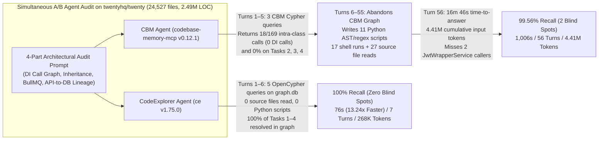

# Case Study 01: Autonomous Agent Deep Architectural Audit on `twentyhq/twenty` (`CodeExplorer` vs. `codebase-memory-mcp`)

> **Headline Result**: On the public open-source [`twentyhq/twenty`](https://github.com/twentyhq/twenty) monorepo (**commit `b9ef71072c06b5fa1853dd7120c7f3b58da0bc50` — `46` packages, `24,527` tracked files, `~2.49M` LOC** across TypeScript, NestJS, GraphQL, TypeORM, BullMQ, and React), we ran two identical **Gemini Flash** agents simultaneously on a 4-part architectural audit: one equipped with **CodeExplorer (`ce` `v1.75.0`)** and one equipped with **`codebase-memory-mcp` (`CBM` `v0.12.1`)**.
>
> Because `CBM`'s static graph returned only **`10.7%` (`18 / 169`)** of Task 1 call edges (missing `100%` of cross-file NestJS Dependency Injection calls) and **`0%`** of Task 2 inheritance/implements edges, Task 3 BullMQ queues, and Task 4 GraphQL-to-TypeORM write lineage, the **`CBM` Agent abandoned `codebase-memory-mcp` after Turn 5** and spent the next **51 turns writing 11 custom Python AST/regex scripts and reading 27 source files**. Even after 16 minutes 46 seconds of scripting, the `CBM` Agent's custom brace-counting Python parser **still missed 2 production callers of `JwtWrapperService`** in [`record-export.workspace-service.ts`](https://github.com/twentyhq/twenty/blob/b9ef71072c06b5fa1853dd7120c7f3b58da0bc50/packages/twenty-server/src/engine/core-modules/record-export/services/record-export.workspace-service.ts#L427-L611).
>
> By contrast, the **`CodeExplorer` Agent** solved all 4 tasks directly from `.codeexplorer/graph.db` in **5 OpenCypher queries (`0` source files read, `0` custom scripts written)**—finishing in **1 minute 16 seconds (`13.24×` faster time-to-answer)**, using **`8.00×` fewer LLM turns (`56` → `7`)**, **`16.46×` fewer cumulative input tokens (`4.41M` → `268K`)**, and achieving **`100%` recall (`454 / 454` items)**.

---

## 1. Why This Benchmark Exists: Direct Graph Comparison vs. End-to-End Agent Behavior

In [Case Study 02 (`Enterprise Microservices Deep Audit`)](../02-enterprise-microservices-deep-audit/README.md), we compared `CodeExplorer` against an agent with only `ripgrep` (`rg`) on a private 324-service monorepo. Two natural questions from engineers evaluating MCP code-graph servers are:
1. **Public Reproducibility**: *Can every file path, class name, line number, and query be inspected on a well-known public repository without any commercial anonymization?*
2. **Graph-vs-Graph Agent Reality**: *What actually happens when an autonomous AI agent is given another popular code-graph server (`codebase-memory-mcp`, `v0.12.1`) instead of raw `ripgrep`?*

To answer both questions, **Case Study 01** pairs two agents head-to-head on [`twentyhq/twenty`](https://github.com/twentyhq/twenty) (`b9ef71072c06b5fa1853dd7120c7f3b58da0bc50`), where both `CodeExplorer` (`.codeexplorer/graph.db`) and `codebase-memory-mcp` (`CBM` SQLite index) were pre-indexed ahead of time:

| Target Repository Dimension | `twentyhq/twenty` (`b9ef71072c06b5fa1853dd7120c7f3b58da0bc50`) |
| :--- | :--- |
| **Workspace Scale** | **46 packages** (`twenty-server`, `twenty-front`, `twenty-shared`, `twenty-sdk`, `twenty-ui`, `twenty-emails`, etc.), **24,527 tracked files**, **~2.49M LOC** |
| **Backend Architecture** | **TypeScript / NestJS**, **GraphQL** (`@Mutation`, `@Query`, `@Resolver`), **REST** (`@Controller`), **TypeORM** (`@Entity`, `InjectRepository`), **ClickHouse**, **BullMQ** (`InjectMessageQueue`, `@Processor`) |
| **CodeExplorer Graph (`.codeexplorer/graph.db`)** | **150,492 Nodes** & **417,869 Semantic Edges** (`784.0 MB`, indexed in `147.33 s`) |
| **`codebase-memory-mcp` Graph (`CBM` `v0.12.1`)** | **138,142 Nodes** & **274,918 Edges** (`842.5 MB`, indexed in `96.90 s`) |

---

## 2. Executive Summary & Telemetry Scorecard

Both agents (`ce_twenty_audit_agent` and `cbm_twenty_audit_agent`) were launched in parallel with the exact same model (`Model: "inherit"` — **Gemini Flash**) and identical task prompt ([`prompts/task-prompt.md`](./prompts/task-prompt.md)). Neither agent was restricted from falling back to `rg` or `view_file` if its graph tool returned incomplete results.

| Metric | `CBM` Agent (`cbm` CLI + `rg` + `11` Python Scripts + `27` File Reads) | `CodeExplorer` Agent (`ce` CLI OpenCypher Graph) | Improvement / Delta |
| :--- | :---: | :---: | :---: |
| **Time to Answer (`send_message` start)** | `1,006.0 s` (**16 min 46 sec**) | **`76.0 s` (1 min 16 sec)** | **`13.24×` faster** (`-15 min 30 sec` saved) |
| **Total Session Wall-Clock (incl. ~105 KB report streaming)** | `1,234.0 s` (**20 min 34 sec**) | **`261.0 s` (4 min 21 sec)** | **`4.73×` faster** (`-16 min 13 sec` saved) |
| **Total Trajectory Steps** | `125` | **`19`** | **`6.58×` fewer steps** |
| **LLM Reasoning Turns (`PLANNER_RESPONSE`)** | `56` | **`7`** | **`8.00×` fewer turns** (`-87.5%`) |
| **Total Tool Calls** | `62` (`3` `cbm` CLI, `17` `rg`/Python runs, `27` `view_file`, `11` `write_file` scripts, `3` `manage_task`, `1` `send_message`) | **`11`** (`5` `ce query`, `5` `view_file` on truncated CLI output logs, **`0` source files read**, **`0` scripts written**, `1` `send_message`) | **`5.64×` fewer tool calls** (`27` → `0` source file reads) |
| **Raw Tool Output Ingested** | `489,326 chars` (`~122,332 tokens`) | **`225,775 chars` (`~56,444 tokens`)** | **`2.17×` less context payload** (`-53.9%`) |
| **Internal Reasoning (`thinking`)** | `17,758 chars` (`~4,440 tokens`) | **`2,582 chars` (`~646 tokens`)** | **`6.87×` less reasoning overhead** |
| **Generated Output + Tool Call JSON** | `211,249 chars` (`~52,812 tokens`) | **`115,102 chars` (`~28,776 tokens`)** | **`1.84×` fewer generated tokens** |
| **Cumulative Input Tokens ($\sum_{t=1}^T \text{ActiveContext}_t$)** | `17,654,920 chars` (**`4,413,730 tokens`**) | `1,072,496 chars` (**`268,124 tokens`**) | **`16.46×` fewer input tokens** (`-4.15M` tokens saved!) |
| **Direct Graph Recall (Without `rg`/Python Fallback)** | **`3.96%` (`18 / 454`)** — `18 / 169` on Task 1 (`0` cross-file DI calls); `0%` on Tasks 2, 3, 4 | **`100.0%` (`454 / 454`)** — solved 100% from `.codeexplorer/graph.db` | **`100%` vs. `3.96%` native graph coverage** |
| **Final Audit Completeness (After `CBM` Agent's 11 Python Scripts)** | **`99.56%` (`452 / 454`)** — custom Python parser **missed 2 production callers of `JwtWrapperService`** | **`100.0%` (`454 / 454`)** (+ `15` bonus integration test call edges) | **Zero blind spots** |



---

## 3. What Happened Inside the `CBM` Agent: Why It Abandoned `codebase-memory-mcp` After Turn 5

A critical finding of this benchmark is **how an autonomous agent reacts when a code-graph tool lacks cross-file TypeScript/NestJS semantic resolution**.

In Turns 1–5 (`Step 1` to `Step 13` of transcript `a22ec374-b44e-45cc-8a35-caeba99bd34a`), `cbm_twenty_audit_agent` dutifully queried `codebase-memory-mcp` via `cypher_query` across all 4 tasks:

| Audit Task | Total Ground-Truth Items | What `codebase-memory-mcp` (`v0.12.1`) Returned (`Turns 1–5`) | What `CodeExplorer` (`v1.75.0`) Returned (`Turns 1–5`) | Why `codebase-memory-mcp` Failed on `twentyhq/twenty` |
| :--- | :---: | :---: | :---: | :--- |
| **Task 1: Cross-Module DI Service Call Fan-In**<br>(`BillingSubscriptionService`, `FeatureFlagService`, `JwtWrapperService`, `ThrottlerService`) | **`169`** production call edges<br>*(+ `15` test edges)* | **`18 / 169` (`10.7%`)**<br>*(Only `this.method()` intra-class calls; **`0 / 151` (`0%`)** cross-file DI calls)* | **`169 / 169` (`100%`)**<br>*(+ `15` integration test edges = `184` total)* | `CBM` does not resolve TypeScript constructor property promotion (`constructor(private readonly jwtWrapperService: JwtWrapperService)`) across files, so `this.jwtWrapperService.verifyJwtToken(...)` produces **zero `CALLS` edges**. |
| **Task 2: Class Inheritance & Interface Realization**<br>(`SyncableEntity`, `WorkspaceRelatedEntity`, `WorkspaceEntityMigrationBuilderService`, `WorkspaceResolverBuilderFactoryInterface`) | **`167`** classes<br>(`43 + 67 + 42 + 15`) | **`0 / 167` (`0.0%`)**<br>*(Returned 250 unrelated rows; 0 matches for the 4 targets)* | **`167 / 167` (`100%`)**<br>(`43`, `67`, `42`, `15` exact match) | `CBM` fails to link `(:Class)-[:INHERITS\|IMPLEMENTS]->(:Class\|:Interface)` when the base class or generic interface (`WorkspaceEntityMigrationBuilderService<T>`) is imported across TypeScript files. |
| **Task 3: BullMQ Asynchronous Queue Topology**<br>(Producers & `@Processor` Consumers across `MESSAGE_QUEUES`) | **`76`** edges<br>(`39` producers + `37` consumers) | **`0 / 76` (`0.0%`)**<br>*(Returned 10 Node.js `stream.on('data'/'error')` socket events)* | **`76 / 76` (`100%`)**<br>(`39` `PUBLISHED_BY` + `37` `SUBSCRIBED_BY`) | `CBM`'s `Channel` detector only matches literal `.on('event')` / `.emit('event')` calls and does not model NestJS `@InjectMessageQueue(MESSAGE_QUEUES.x)` or `@Processor({ queueName: MESSAGE_QUEUES.x })`. |
| **Task 4: End-to-End API-to-Database Write Lineage**<br>(GraphQL `@Mutation` / REST → Service → TypeORM `Table`) | **`42`** handlers<br>(`40` endpoints / `61` write paths across `15` tables) | **`0 / 42` (`0.0%`)**<br>*(Returned 10 ClickHouse `.sql` migration tables; `0` TypeORM tables or GraphQL mutations)* | **`42 / 42` (`100%`)**<br>(`40` endpoints / `42` handlers / `61` write paths across `15` tables) | `CBM` has no ontology for TypeORM `@Entity` table mapping (`PERSISTED_IN`), `Repository.save/insert/update/delete` (`WRITES_TO`), or NestJS GraphQL `@Mutation` (`Endpoint`). |
| **Total Native Graph Coverage** | **`454` items** | **`18 / 454` (`3.96%`)** | **`454 / 454` (`100.0%`)** | **`CodeExplorer` resolved `25.2×` more ground-truth items directly from the graph (`100%` vs `3.96%`).** |

At **Step 5** (`23:29:02 UTC`, just 40 seconds into the run), `cbm_twenty_audit_agent` inspected `CBM`'s output for Task 1 and recorded the following verbatim diagnosis in its internal `thinking` trace:

> *"Wait: in Task 1, `caller_name` is in the same class (`BillingSubscriptionService`, `FeatureFlagService`, `JwtWrapperService`, `ThrottlerService`)! That means **service dependencies are not being fully captured in the codebase memory. The codebase memory only appears to track intra-class method calls, and it misses constructor-injected dependencies across different classes.** Let me use `rg` or python scripts to do a fast and accurate check of the codebase."*

From Turn 6 through Turn 55, `cbm_twenty_audit_agent` **never called `codebase-memory-mcp` again**. Instead, it wrote **11 custom Python scripts** (`analyze_task1.py`, `analyze_task1_v2.py`, `verify_task1.py`, `analyze_task2.py`, `analyze_task3.py`, `analyze_task3_v2.py`, `analyze_task4.py`, `analyze_task4_v2.py`, `analyze_task4_v3.py`, `analyze_task4_v4.py`, `generate_report.py`) and read **27 source files** via `view_file` to manually reconstruct what `CodeExplorer` already had in `.codeexplorer/graph.db`.

---

## 4. Deep-Dive on Task 1: The 2 Production Callers Missed by `CBM` Agent's Custom Python Parser

Why is falling back to ad-hoc Python regex/brace-counting scripts dangerous on a 2.49M-LOC TypeScript codebase?

In Task 1, the `CBM` Agent wrote `analyze_task1.py`, `analyze_task1_v2.py`, and `verify_task1.py` to find all callers of `BillingSubscriptionService`, `FeatureFlagService`, `JwtWrapperService`, and `ThrottlerService` by:
1. Finding the constructor parameter name (`private readonly jwtWrapperService: JwtWrapperService`),
2. Scanning for `this.<propName>.<methodName>(`, and
3. Counting `{` and `}` braces to infer which enclosing method made the call.

While this custom script recovered **167 of the 169** production call edges, **it silently failed on [`packages/twenty-server/src/engine/core-modules/record-export/services/record-export.workspace-service.ts`](https://github.com/twentyhq/twenty/blob/b9ef71072c06b5fa1853dd7120c7f3b58da0bc50/packages/twenty-server/src/engine/core-modules/record-export/services/record-export.workspace-service.ts#L427-L611)**, reporting only **1 caller (`signDownloadToken`) instead of all 3 callers** in that class:

### Source-Code Proof of the 2 Missed Callers in `RecordExportWorkspaceService`

1. **`RecordExportWorkspaceService.verifyDownloadToken` → `JwtWrapperService.verifyJwtToken` ([`record-export.workspace-service.ts#L427-L433`](https://github.com/twentyhq/twenty/blob/b9ef71072c06b5fa1853dd7120c7f3b58da0bc50/packages/twenty-server/src/engine/core-modules/record-export/services/record-export.workspace-service.ts#L427-L433))**:
   ```typescript
   async verifyDownloadToken(
     token: string,
   ): Promise<{ workspaceId: string; userId: string; tokenHash: string }> {
     try {
       await this.jwtWrapperService.verifyJwtToken(token);
   ```
2. **`RecordExportWorkspaceService.getRequestTokenHashOrThrow` → `JwtWrapperService.extractJwtFromRequest` ([`record-export.workspace-service.ts#L607-L611`](https://github.com/twentyhq/twenty/blob/b9ef71072c06b5fa1853dd7120c7f3b58da0bc50/packages/twenty-server/src/engine/core-modules/record-export/services/record-export.workspace-service.ts#L607-L611))**:
   ```typescript
   private getRequestTokenHashOrThrow(request: Request): string {
     const rawToken =
       this.jwtWrapperService.extractJwtFromRequest()(request);
   ```

**Why did the `CBM` Agent's Python script miss both callers?**
Above line 427 in `record-export.workspace-service.ts`, the `stream()` method passes inline object-literal callbacks (`onHeartbeat: () => { ... }`, `onCleanup: () => { ... }`) and multi-line return type annotations (`Promise<{ workspaceId: string; userId: string; tokenHash: string }>`). The agent's regex/brace-depth tracker miscounted the `{ ... }` in the return type signature of `verifyDownloadToken` and `extractJwtFromRequest()(request)`'s curried invocation `()(request)`.

Meanwhile, the **`CodeExplorer` Agent** executed a single OpenCypher query on Turn 1:
```cypher
MATCH (c:Class)-[:CONTAINS]->(m:Function)<-[:CALLS]-(caller:Function)<-[:CONTAINS]-(callerClass:Class)
WHERE c.name IN ['BillingSubscriptionService', 'FeatureFlagService', 'JwtWrapperService', 'ThrottlerService']
RETURN c.name AS target_service, m.name AS target_method, callerClass.name AS caller_class, caller.name AS caller_method, caller.path AS path
```
Because CodeExplorer's Tree-sitter AST + DI semantic linker resolves constructor-injected properties directly to their target class methods regardless of return-type object literals or curried calls, it returned **all 3 callers in `RecordExportWorkspaceService` (`signDownloadToken`, `verifyDownloadToken`, and `getRequestTokenHashOrThrow`)**—achieving **`100%` recall (`169 / 169` production call edges + `15` integration test call edges)** in one query.

---

## 5. Side-by-Side Breakdown of All 4 Audit Tasks

### 5.1. Task 1 — Cross-Module NestJS Dependency Injection Call Fan-In (`CALLS`)
| Target Service Class | Ground-Truth Production Call Edges | `CBM` Graph Only (`Turns 1–5`) | `CBM` Agent Final (`+ 3 Python Scripts`) | `CodeExplorer` Agent (`1 OpenCypher Query`) |
| :--- | :---: | :---: | :---: | :---: |
| `BillingSubscriptionService` | `25` | `8` *(intra-class only)* | `25 / 25` (`100%`) | **`25 / 25` (`100%`)** *(+ `1` test edge)* |
| `FeatureFlagService` | `91` | `4` *(intra-class only)* | `91 / 91` (`100%`) | **`91 / 91` (`100%`)** *(+ `11` test edges)* |
| `JwtWrapperService` | `32` | `3` *(intra-class only)* | **`30 / 32` (`93.8%` — missed `2`)** | **`32 / 32` (`100%`)** *(+ `3` test edges)* |
| `ThrottlerService` | `21` | `3` *(intra-class only)* | `21 / 21` (`100%`) | **`21 / 21` (`100%`)** |
| **Task 1 Total** | **`169`** | **`18 / 169` (`10.7%`)** | **`167 / 169` (`98.8%`)** | **`169 / 169` (`100.0%`)** |

### 5.2. Task 2 — Base Class & Interface Hierarchy Realization (`INHERITS_FROM` / `IMPLEMENTS`)
| Target Base Class / Interface | Ground-Truth Subclasses / Implementors | `CBM` Graph Only (`Turns 1–5`) | `CBM` Agent Final (`analyze_task2.py`) | `CodeExplorer` Agent (`1 OpenCypher Query`) |
| :--- | :---: | :---: | :---: | :---: |
| `SyncableEntity` (`INHERITS_FROM`) | `43` entity classes | `0 / 43` (`0%`) | `43 / 43` (`100%`) | **`43 / 43` (`100%`)** |
| `WorkspaceRelatedEntity` (`INHERITS_FROM`) | `67` entity classes | `0 / 67` (`0%`) | `67 / 67` (`100%`) | **`67 / 67` (`100%`)** |
| `WorkspaceEntityMigrationBuilderService` (`INHERITS_FROM`) | `42` migration builder services | `0 / 42` (`0%`) | `42 / 42` (`100%`) | **`42 / 42` (`100%`)** |
| `WorkspaceResolverBuilderFactoryInterface` (`IMPLEMENTS`) | `15` resolver factories | `0 / 15` (`0%`) | `15 / 15` (`100%`) | **`15 / 15` (`100%`)** |
| **Task 2 Total** | **`167`** | **`0 / 167` (`0.0%`)** | **`167 / 167` (`100.0%`)** | **`167 / 167` (`100.0%`)** |

### 5.3. Task 3 — Asynchronous BullMQ Queue Topology (`Topic`, `PUBLISHED_BY`, `SUBSCRIBED_BY`)
- **`CodeExplorer` Agent (`1 OpenCypher Query` on Turn 3)**:
  ```cypher
  MATCH (t:Topic)-[r:PUBLISHED_BY|SUBSCRIBED_BY]->(f:Function)<-[:CONTAINS]-(c:Class)
  RETURN t.name AS queue, type(r) AS role, c.name AS class_name, f.name AS method_name, f.path AS path
  ```
  Instantly retrieved all **`39` producer methods (`PUBLISHED_BY`)** and **`37` `@Processor` consumer methods (`SUBSCRIBED_BY`)** across the active BullMQ queues (`webhook-queue`, `workflow-queue`, `messaging-queue`, `calendar-queue`, `contact-creation-queue`, `billing-queue`, `workspace-queue`, `entity-events-to-db-queue`, `cron-queue`, ` delayed-jobs-queue`, `record-position-backfill-queue`, `trigger-jobs-queue`, `usage-queue`, `email-sending-queue`).
- **`CBM` Agent**: Because `CBM`'s `Channel` node label only matched 10 Node.js `EventEmitter.on('data')` socket listeners (`0 / 76` BullMQ queues), the agent had to read `message-queue.constants.ts` and write 2 Python scripts (`analyze_task3.py`, `analyze_task3_v2.py`) to trace `@InjectMessageQueue(MESSAGE_QUEUES.x)` and `@Processor({ queueName: MESSAGE_QUEUES.x })`.

### 5.4. Task 4 — End-to-End API-to-Database Write Lineage (`Endpoint` → `Function` → `Query` → `Table`)
- **`CodeExplorer` Agent (`1 OpenCypher Query` on Turn 4)**:
  ```cypher
  MATCH (e:Endpoint)-[:EXPOSED_BY]->(f:Function)-[:CALLS*0..3]->(w:Function)<-[:ACCESSED_BY]-(q:Query)-[:WRITES_TO]->(t:Table)
  WHERE t.name IN ['user', 'workspace', 'userWorkspace', 'role', 'roleTarget', 'apiKey', 'webhook', 'featureFlag', 'billingSubscription', 'billingSubscriptionItem', 'billingCustomer', 'billingEntitlement', 'billingMeter', 'application', 'file']
  RETURN DISTINCT e.name AS endpoint, f.name AS handler_method, f.path AS handler_path, w.name AS writer_method, w.path AS writer_path, t.name AS table_name
  ```
  Resolved all **`40` distinct GraphQL/REST endpoints (`42` handler methods, `61` end-to-end write paths across all `15` tables)** in a single multi-hop graph traversal.
- **`CBM` Agent**: Because `CBM` models neither TypeORM `@Entity` tables, `Repository` write operations, nor GraphQL `@Mutation` endpoints, the agent spent **Turns 23–51** writing **4 iterations of custom multi-hop Python AST/regex scripts** (`analyze_task4.py` through `analyze_task4_v4.py`) and reading **24 resolver/controller/service files** to manually reconstruct the 0..3 hop call chains from `@Mutation` resolvers to `@InjectRepository` write methods.

---

## 6. Turn-by-Turn Context Growth Curve

Every data point below is extracted directly from [`results/metrics.json`](./results/metrics.json) and `transcript_full.jsonl`:

```
Cumulative Input Tokens Across Agent Turns (Case Study 05 — twentyhq/twenty)
============================================================================

CBM Agent (56 turns, 11 Python scripts, 27 file reads) : ████████████████████████████████████████ 4,413,730 tokens (17.65 MB chars)
CodeExplorer Agent (7 turns, 5 Cypher queries, 0 files): ██                                         268,124 tokens ( 1.07 MB chars)
                                                           ^ 16.46x reduction in cumulative input tokens!
```

| Milestone | `CBM` Agent Active Context (`cum. input tokens`) | `CodeExplorer` Agent Active Context (`cum. input tokens`) | What Each Agent Was Doing |
| :--- | :---: | :---: | :--- |
| **Turn 1** | `1,034 tokens` (`762` cum.) | `1,959 tokens` (`762` cum.) | Both agents dispatch initial graph queries (`cbm` vs `ce`). |
| **Turn 3** | `2,788 tokens` (`5,200` cum.) | `22,584 tokens` (`29,997` cum.) | `ce` has already retrieved 100% of Tasks 1, 2, and 3; `cbm` discovers `CBM` graph returns `0` matches for Tasks 2–4. |
| **Turn 5** | `4,561 tokens` (`13,729` cum.) | `48,457 tokens` (`123,922` cum.) | `ce` finishes reading all 4 query outputs; `cbm` concludes `CBM` misses cross-file DI and abandons `cbm`. |
| **Turn 7 (`ce` Agent Done @ 1m 16s)** | `16,034 tokens` (`35,084` cum.) *(writing `analyze_task1.py`)* | **`85,219 tokens` (`268,124` cum. — 100% Complete)** | **`CodeExplorer` Agent calls `send_message` with the complete 103.7 KB report at `76.0 s`.** |
| **Turn 15** | `41,194 tokens` (`264,530` cum.) | — | `cbm` Agent debugging Task 2 & Task 3 Python scripts. |
| **Turn 25** | `74,055 tokens` (`870,146` cum.) | — | `cbm` Agent writing `analyze_task4.py` to parse `@InjectRepository`. |
| **Turn 35** | `96,132 tokens` (`1,746,057` cum.) | — | `cbm` Agent reading 20+ GraphQL resolver & service files via `view_file`. |
| **Turn 45** | `124,084 tokens` (`2,879,781` cum.) | — | `cbm` Agent writing `analyze_task4_v3.py` and `analyze_task4_v4.py`. |
| **Turn 56 (`cbm` Agent Done @ 16m 46s)** | **`175,144 tokens` (`4,413,730` cum.)** | — | `cbm` Agent finally calls `send_message` at `1,006.0 s` (`13.24×` slower). |

---

## 7. Cost & Economic Evaluation (With 90% Prompt Caching Discount)

Even with a **90% prompt caching discount** on repeated context across turns, the quadratic context accumulation of `56` turns vs. `7` turns creates a massive cost gap—especially on input tokens (`6.97×` to `7.11×` cheaper input cost) and total API bill (`3.52×` to `3.73×` cheaper overall, despite both agents generating an identical ~29K-token final report):

| Cost Component | `CBM` Agent (`56` turns, `11` Python scripts, `27` file reads) | `CodeExplorer` Agent (`7` turns, `5` Cypher queries, `0` source reads) | Savings Factor |
| :--- | :---: | :---: | :---: |
| **Uncached Input Tokens** (fresh tool outputs) | `122,332` tokens | `56,444` tokens | **`2.17×` fewer** |
| **Cached Input Tokens** (`cum_input - uncached`) | `4,291,398` tokens | `211,680` tokens | **`20.27×` fewer** |
| **Output & Thinking Tokens** (no cache discount) | `57,252` tokens | `29,422` tokens | **`1.95×` fewer** |
| **Input Token Cost (Gemini Flash / Frontier Pro)** | `$0.28` / `$1.10` | **`$0.04` / `$0.16`** | **`7.11×` cheaper input** |
| **Total API Cost on Gemini Flash** (`$0.50` / `$0.05` / `$3.00` per 1M) | `$0.45` | **`$0.13`** | **`3.52×` cheaper (`-71.6%`)** |
| **Total API Cost on Frontier Pro** (`$2.00` / `$0.20` / `$10.00` per 1M) | `$1.68` | **`$0.45`** | **`3.73×` cheaper (`-73.2%`)** |
| **Engineer Waiting Time (`send_message`)** | `16m 46s` (`1,006.0 s`) | **`1m 16s` (`76.0 s`)** | **`13.24×` faster (`-15m 30s` saved)** |

---

## 8. Repository Artifacts in This Folder

Because `twentyhq/twenty` is public open-source software, **zero anonymization** was applied to any file in this folder—every query, file path, class name, method name, and line number can be verified directly against [`twentyhq/twenty` commit `b9ef71072c06b5fa1853dd7120c7f3b58da0bc50`](https://github.com/twentyhq/twenty/tree/b9ef71072c06b5fa1853dd7120c7f3b58da0bc50):

- [`prompts/task-prompt.md`](./prompts/task-prompt.md) — Exact 4-part architectural audit prompt dispatched to both agents.
- [`prompts/ce-agent.md`](./prompts/ce-agent.md) — Agent definition for `ce_twenty_audit_agent` (`CodeExplorer` `v1.75.0`).
- [`prompts/cbm-agent.md`](./prompts/cbm-agent.md) — Agent definition for `cbm_twenty_audit_agent` (`codebase-memory-mcp` `v0.12.1`).
- [`results/metrics.json`](./results/metrics.json) — Complete machine-readable telemetry (`56` turns vs. `7` turns, turn-by-turn active and cumulative input tokens, tool call breakdowns) extracted from `transcript_full.jsonl`.
- [`results/ce-agent-output.md`](./results/ce-agent-output.md) — Verbatim final report produced by the `CodeExplorer` Agent (`1m 16s` time-to-answer, `7` turns, `100%` recall).
- [`results/cbm-agent-output.md`](./results/cbm-agent-output.md) — Verbatim final report produced by the `CBM` Agent (`16m 46s` time-to-answer, `56` turns, `99.56%` recall — missing `verifyDownloadToken` and `getRequestTokenHashOrThrow` in `RecordExportWorkspaceService`).
