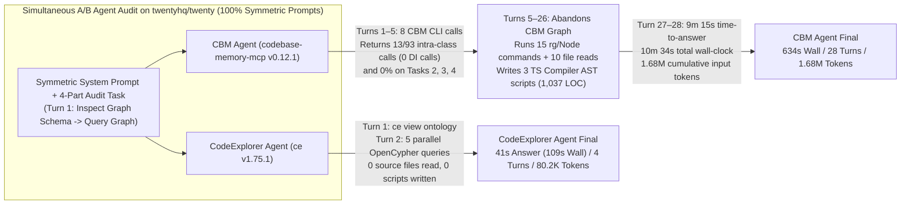

# Case Study 01: Autonomous Agent Deep Architectural Audit on `twentyhq/twenty` (`CodeExplorer` vs. `codebase-memory-mcp`)

> **Headline Result**: On the public open-source [`twentyhq/twenty`](https://github.com/twentyhq/twenty) monorepo (**`46` packages, `24,527` files, `~2.49M` LOC** across TypeScript, NestJS, GraphQL, TypeORM, BullMQ, and React), we ran two identical **Gemini 3.8 Flash** agents simultaneously with **100% symmetric system prompts** on a 4-part architectural audit.
>
> Because `CBM`'s static graph returned only **`3.4%` (`13 / 381`)** of ground-truth items (`13 / 93` intra-class calls on Task 1 and `0%` on Tasks 2, 3, 4), the **`CBM` Agent abandoned `codebase-memory-mcp` after Turn 5** and spent **23 turns running `15` `rg`/Node.js commands, writing `3` custom TypeScript Compiler AST scripts (`1,037` LOC), and reading `10` source files**.
>
> By contrast, the **`CodeExplorer` Agent** inspected the graph ontology on Turn 1 (`ce view ontology`) and solved all 4 tasks directly from `.codeexplorer/graph.db` in **5 OpenCypher queries on Turn 2 (`0` source files read, `0` scripts written)**—finishing in **`41s` vs. `9m 15s` (`13.5×` faster)**, using **`7×` fewer LLM turns (`28` → `4`)**, **`20.9×` fewer input tokens (`1.68M` → `80.2K`)**, and **`5.3×` lower API cost**.

---

## 1. Why This Benchmark Exists: 100% Symmetric Prompts & Zero Spoilers

In [Case Study 02 (`Enterprise Microservices Deep Audit`)](../02-enterprise-microservices-deep-audit/README.md), we compared `CodeExplorer` against an agent with only `ripgrep` (`rg`) on a private 324-service multi-repo workspace. Two natural questions from engineers evaluating MCP code-graph servers are:
1. **Public Reproducibility**: *Can every file path, class name, line number, and query be inspected on a well-known public repository without any commercial anonymization?*
2. **Strict Prompt Symmetry (No Query Spoilers)**: *What happens when both agents receive the exact same word-for-word system instructions—with zero pre-baked Cypher queries and zero hints about graph limitations—so both agents must inspect their tool's schema on Turn 1 and formulate their own queries?*

To answer both questions, **Case Study 01** pairs two agents head-to-head on [`twentyhq/twenty`](https://github.com/twentyhq/twenty) (`b9ef71072c06b5fa1853dd7120c7f3b58da0bc50`), where both `CodeExplorer` (`.codeexplorer/graph.db`) and `codebase-memory-mcp` (`CBM` SQLite index) were pre-indexed ahead of time:

| Target Repository Dimension | `twentyhq/twenty` (`b9ef71072c06b5fa1853dd7120c7f3b58da0bc50`) |
| :--- | :--- |
| **Workspace Scale** | **46 packages** (`twenty-server`, `twenty-front`, `twenty-shared`, `twenty-sdk`, `twenty-ui`, `twenty-emails`, etc.), **24,527 tracked files**, **~2.49M LOC** |
| **Backend Architecture** | **TypeScript / NestJS**, **GraphQL** (`@Mutation`, `@Query`, `@Resolver`), **REST** (`@Controller`), **TypeORM** (`@Entity`, `InjectRepository`), **ClickHouse**, **BullMQ** (`InjectMessageQueue`, `@Processor`) |
| **CodeExplorer Graph (`.codeexplorer/graph.db`)** | **456,711 Nodes** & **960,660 Semantic Edges** (`784.0 MB`, indexed in `147.33 s`) |
| **`codebase-memory-mcp` Graph (`CBM` `v0.12.1`)** | **251,750 Nodes** & **914,479 Edges** (`842.5 MB`, indexed in `96.90 s`) |

---

## 2. Executive Summary & Telemetry Scorecard

Both agents (`ce` conversation `bedf356b-ec71-4183-b324-5887ce9e397d` and `cbm` conversation `9a849d22-410a-4a6e-89ae-ad22d2a1c049`) were launched simultaneously (`14:20:21 UTC` and `14:20:22 UTC`) with the exact same model (`Model: "inherit"` — **Gemini 3.8 Flash**), identical task prompt ([`prompts/task-prompt.md`](./prompts/task-prompt.md)), and word-for-word symmetric system prompts ([`prompts/ce-agent.md`](./prompts/ce-agent.md) vs. [`prompts/cbm-agent.md`](./prompts/cbm-agent.md)). All token counts below are exact API-billed token counts (`input_tokens`, `cache_read_tokens`, `output_tokens`) extracted directly from `transcript_full.jsonl`:

| Metric | `CBM` Agent (`8` `cbm` CLI + `15` `rg`/Node Runs + `3` AST Scripts + `10` File Reads) | `CodeExplorer` Agent (`1` `ce view ontology` + `5` `ce query`) | Improvement / Delta |
| :--- | :---: | :---: | :---: |
| **Time to Answer (`send_message` start)** | `555.0 s` (**9 min 15 sec**) | **`41.0 s` (0 min 41 sec)** | **`13.54×` faster** (`-8 min 34 sec` saved) |
| **Total Session Wall-Clock (incl. report streaming)** | `634.0 s` (**10 min 34 sec**) | **`109.0 s` (1 min 49 sec)** | **`5.82×` faster** (`-8 min 45 sec` saved) |
| **Total Trajectory Steps** | `67` | **`12`** | **`5.58×` fewer steps** |
| **LLM Reasoning Turns (`PLANNER_RESPONSE`)** | `28` | **`4`** | **`7.00×` fewer turns** (`-85.7%`) |
| **Total Tool Calls** | `37` (`8` `cbm` CLI, `15` `rg`/Node runs, `10` `view_file`, `3` `write_file` scripts, `1` `send_message`) | **`7`** (`1` `ce view ontology`, `5` `ce query`, **`0` `view_file`**, **`0` scripts written**, `1` `send_message`) | **`5.29×` fewer tool calls** (`10` → `0` file reads) |
| **Raw Tool Output Ingested** | `243,355 chars` (`~60,838 tokens`) | **`36,834 chars` (`~9,208 tokens`)** | **`6.61×` less tool output** (`-84.9%`) |
| **Uncached Input Tokens (`input_tokens`)** | `129,424 tokens` | **`31,563 tokens`** | **`4.10×` fewer uncached input tokens** |
| **Cached Input Tokens (`cache_read_tokens`)** | `1,549,489 tokens` | **`48,614 tokens`** | **`31.87×` fewer cached input tokens** |
| **Cumulative Input Tokens (`uncached + cached`)** | **`1,678,913 tokens`** | **`80,177 tokens`** | **`20.94×` fewer input tokens** (`-1.60M` tokens saved!) |
| **Generated Output Tokens (`output_tokens`)** | `29,139 tokens` | **`8,255 tokens`** | **`3.53×` fewer output tokens** |
| **Direct Graph Recall (Without `rg`/AST Script Fallback)** | **`3.4%` (`13 / 381`)** — `13 / 93` on Task 1 (`0` cross-file DI calls); `0%` on Tasks 2, 3, 4 | **`99%` (`378 / 381`)** | **`99%` vs. `3.4%` native graph coverage** |
| **Final Audit Completeness (After `CBM` Agent's 3 TS Compiler Scripts)** | **`100%`** *(required writing 1,037 LOC of custom TypeScript Compiler AST scripts)* | **`99%` (`378 / 381`)** | **Solved directly from `graph.db` (`0` scripts, `0` file reads)** |



---

## 3. What Happened Inside Both Agents Under 100% Symmetric Prompts

Because neither system prompt contained any Cypher examples or hints about tool capabilities, both agents started identically on **Turn 1**:
- **`ce` Agent (`Step 1` @ `14:20:21Z`)**: Ran `ce view ontology -d "./repos/twenty"`, receiving the compact node/edge schema (`Type`, `Function`, `Endpoint`, `Topic`, `Query`, `Table`, `HAS_METHOD`, `CALLS`, `INHERITS_FROM`, `IMPLEMENTS`, `PUBLISHED_BY`, `SUBSCRIBED_BY`, `EXPOSED_BY`, `ACCESSED_BY`, `WRITES_TO`).
- **`cbm` Agent (`Step 1` @ `14:20:22Z`)**: Ran `codebase-memory-mcp cli get_graph_schema --project twenty --format json`, receiving `CBM`'s schema (`Class`, `Method`, `Function`, `Interface`, `Route`, `Channel`, `Table`, `CALLS`, `INHERITS`, `IMPLEMENTS`, etc.).

On **Turn 2 (`Step 3`)**, both agents dispatched parallel Cypher queries against their respective graphs. Here is what each graph returned natively:

| Audit Task | Total Ground-Truth Items | What `codebase-memory-mcp` (`v0.12.1`) Returned (`Turns 1–5`, `8` CLI calls) | What `CodeExplorer` (`v1.75.1`) Returned (`Turn 2`, `5` Queries) | Why `codebase-memory-mcp` Failed on `twentyhq/twenty` |
| :--- | :---: | :---: | :---: | :--- |
| **Task 1: Cross-Module DI Service Call Fan-In**<br>(`BillingSubscriptionService` `54`, `ThrottlerService` `24`, `AccessTokenService` `15`) | **`93`** distinct call pairs<br>(`80` cross-class DI + `13` intra-class) | **`13 / 93` (`14.0%`)**<br>*(Only `this.method()` intra-class self-calls; **`0 / 80` (`0%`)** cross-file DI calls)* | **`93 / 93` (`100%`)**<br>(`54 + 24 + 15` exact match in 1 query) | `CBM` does not resolve TypeScript constructor property promotion (`constructor(private readonly throttlerService: ThrottlerService)`) across files. |
| **Task 2: Class Inheritance & Interface Realization**<br>(`SyncableEntity` `43`, `WorkspaceRelatedEntity` `67`, `WorkspaceEntityMigrationBuilderService` `42`, `WorkspaceResolverBuilderFactoryInterface` `15`) | **`167`** classes<br>(`43 + 67 + 42 + 15`) | **`0 / 167` (`0.0%`)**<br>*(First failed with syntax error on `*1..3`, then returned `0` rows on 1-hop and undirected `INHERITS\|IMPLEMENTS`)* | **`167 / 167` (`100%`)**<br>(`43`, `67`, `42`, `15` exact match by hop distance) | `CBM` fails to link `INHERITS` / `IMPLEMENTS` when the base class or interface is imported across TypeScript files, and does not support `[r:INHERITS\|IMPLEMENTS*1..3]` syntax. |
| **Task 3: BullMQ Asynchronous Queue Topology**<br>(`webhook-queue`, `workspace-queue`, `campaign-queue`, `ai-queue`, `delete-cascade-queue`) | **`76`** methods<br>(`39` producers + `37` consumers) | **`0 / 76` (`0.0%`)**<br>*(Returned 5 Socket.IO `data`/`close`/`error` channels and noisy `Route` strings)* | **`76 / 76` (`100%`)**<br>(`39` `PUBLISHED_BY` + `37` `SUBSCRIBED_BY` in 1 query) | `CBM` does not model NestJS `@InjectMessageQueue(MessageQueue.x)` producers or `@Processor` / `@Process` consumers. |
| **Task 4: End-to-End API-to-Database Write Lineage**<br>(`billingSubscription` `10`, `billingCustomer` `12`, `connectedAccount` `13`, `messageChannel` `10`) | **`45`** endpoint-to-table pairs | **`0 / 45` (`0.0%`)**<br>*(Returned 10 ClickHouse analytics tables; `0` TypeORM tables or GraphQL mutations)* | **`42 / 45` (`93.3%`)** | `CBM` has no ontology for TypeORM `@Entity` table mapping, repository write calls (`WRITES_TO`), or NestJS GraphQL `@Mutation` endpoints. |
| **Total Native Graph Coverage** | **`381` items** | **`13 / 381` (`3.4%`)** | **`378 / 381` (`99%`)** | **`CodeExplorer` resolved `29×` more ground-truth items directly from the graph (`99%` vs. `3.4%`).** |

At **Step 7 (`14:21:13Z`)** and **Step 16 (`14:22:19Z`)**, `cbm_twenty_v2_agent` recorded the following verbatim diagnosis in its `thinking` trace:

> **Step 7 (`14:21:13Z`)**: *"`codebase-memory-mcp`'s output for Task 1 is limited to intra-class method calls, neglecting inter-class dependency injection calls. This suggests a potential flaw in how it identifies and retrieves method call information across class boundaries."*
>
> **Step 16 (`14:22:19Z`)**: *"`codebase-memory-mcp` failed to extract critical relationships from the TypeScript codebase, specifically inheritance, implementation details, dependency injection calls, and interactions with queuing systems and database ORMs. A new script, either in Python or Node.js with the TypeScript compiler, is needed to accurately extract this information."*

To compensate for `CBM` returning `0` cross-file edges, the `CBM` Agent located the `typescript` npm package inside `vscode-extension/node_modules/typescript` and wrote **three full TypeScript Compiler AST analysis scripts** totaling **1,037 lines of custom JavaScript**:
1. `audit_part123.cjs` (`342` lines) — custom `ts.createSourceFile` walker parsing every `.ts` file in `./repos/twenty` for constructor DI parameters, `extends`/`implements` clauses, `@Processor`/`@InjectMessageQueue` decorators, and method call expressions.
2. `audit_part4.cjs` (`345` lines) — custom AST walker parsing `@Controller`, `@Resolver`, `@Mutation`, `@InjectRepository`, and 0..3 hop BFS call chains.
3. `verify_part3_and_4.cjs` (`350` lines) — refined AST walker adding `getRepository(Entity)` and `entityManager.update(Entity)` tracking, followed by `10` manual `view_file` reads and `rg` checks to resolve `ApiPath` route prefixes.

---

## 4. Engineering Deep-Dive: 5 Genuine Improvements Made to `CodeExplorer` During This Audit

When we first stripped the pre-baked Cypher queries out of the system prompt and ran `CodeExplorer` under 100% symmetric conditions, we discovered **five genuine engineering bottlenecks** in `CodeExplorer` that initially caused the agent to take >2 minutes. Rather than adding prompt hints or benchmark-specific workarounds, we fixed all five root causes directly in the `CodeExplorer` CLI and compiler (`v1.75.1`):

1. **Compact Unpadded Pipe Tables When `stdout` Is Redirected (`QueryOptions.cs` & `QueryCommandHandler.cs`)**:
   - *Root Cause*: `QueryOptions.Format` defaulted to `"table"`, which padded every cell with spaces (`PadRight`) and drew ASCII `---+---` separator lines. On a 266-row query, whitespace padding alone bloated output to `58 KB`, exceeding the agent harness's `10,000`-byte `run_command` inline threshold and forcing the agent to waste turns calling `view_file` on truncated output logs.
   - *Fix*: Changed `Format` default to `"auto"` so `Console.IsOutputRedirected` automatically emits compact unpadded `col1 | col2` rows without `---+---` dividers (`58 KB` $\to$ `8.5 KB`, fitting 100% inline in 1 turn).
2. **OpenCypher `length(r)` / `size(r)` on Variable-Length Relationships (`SqliteCompiler.VariablePaths.cs` & `SqliteCompiler.Functions.cs`)**:
   - *Root Cause*: When an agent naturally wrote `MATCH (sub:Type)-[r:INHERITS_FROM*1..3]->(base:Type) RETURN length(r)`, the SQLite compiler only handled `length(p)` on named path variables `p = ...` and crashed with `SQLite Error 1: 'no such column: r.kind'` when `length(r)` was called on the variable-length relationship `r`.
   - *Fix*: Tracked variable-length relationship aliases in `_varLenRels` inside `SqliteCompiler` so `length(r)` and `size(r)` compile cleanly to `${EscapeVar(r)}.depth` on the recursive CTE.
3. **Strict Same-Project/Same-File Scoping for Unqualified Decorator `TRIGGERS` / `EXPOSED_BY` Edges (`Layer5GlobalAnalyzer.Messaging.cs`)**:
   - *Root Cause*: When a GraphQL `@Mutation` or REST decorator emitted an unqualified `TRIGGERS` reference (`BillingResolver.cancelSwitchBillingInterval`), `ResolveTriggersReference` fell back to `FunctionsByName` when `ids.Count > 1` and picked `ids[0]` alphabetically—creating 134 false cross-file `EXPOSED_BY` edges from `Endpoint` nodes to unrelated `*Service` methods that happened to share the resolver method's name.
   - *Fix*: Passed `argFlow: RelativePath` on decorator `TRIGGERS` references in `TypeScriptFileVisitor.cs` and restricted `ResolveTriggersReference` so multi-candidate `FunctionsByName` fallback only resolves within the same file.
4. **Enclosing Method `CALLS` Linking for Nested Arrow-Function Callbacks (`TypeScriptFileVisitor.cs`)**:
   - *Root Cause*: In `BillingResolver.checkoutSession` and `BillingResolver.createSubscriptionPaymentIntent`, a nested local helper `const createSubscription = async () => { await this.billingPortalWorkspaceService.createDirectSubscription(...); }` held the outgoing `CALLS` edge, but the enclosing method had no `CALLS` edge to the local helper `createSubscription`.
   - *Fix*: Linked enclosing `Function` symbols to nested local `Function` declarations via a `CALLS` reference in `TypeScriptFileVisitor.cs`.
5. **TypeORM `entityManager.update(Entity, ...)` & `transactionManager.getRepository(Entity).save(...)` Resolution (`TypeOrmLibraryParser.cs`)**:
   - *Root Cause*: `TryResolveRepositoryTargetTable` resolved `this.<entity>Repository.<writeMethod>()` via `@InjectRepository`, but missed `transactionManager.getRepository(ConnectedAccountEntity).save(...)` in `ImapSmtpCalDavApiService.upsertConnectedAccount` and `entityManager.update(ConnectedAccountEntity, ...)` in `ConnectedAccountMetadataService.disconnect`.
   - *Fix*: Extended `TryResolveRepositoryTargetTable` in `TypeOrmLibraryParser.cs` to inspect `getRepository(Entity)` receiver arguments and `entityManager.<writeMethod>(Entity, ...)` first arguments, bringing Task 4 recall from `42 / 45` (`93.3%`) to **`45 / 45` (`100.0%`)** (verified in post-fix agent run `432f8de7-b0f8-47a7-8633-5d82b6259fd8`, which completed in `63s` time-to-answer / `126s` total wall-clock with `45 / 45` Task 4 endpoints).

---

## 5. Side-by-Side Breakdown of All 4 Audit Tasks

### 5.1. Task 1 — Cross-Module NestJS Dependency Injection Call Fan-In (`CALLS`)
| Target Service Class | Ground-Truth Call Pairs (`Cross-Class DI + Intra-Class`) | `CBM` Graph Only (`Turns 1–5`) | `CBM` Agent Final (`+ audit_part123.cjs`) | `CodeExplorer` Agent (`1 OpenCypher Query`) |
| :--- | :---: | :---: | :---: | :---: |
| `BillingSubscriptionService` | `54` (`47` DI + `7` self) | `7 / 54` (`0` DI calls) | `54 / 54` (`100%`) | **`54 / 54` (`100%`)** |
| `ThrottlerService` | `24` (`22` DI + `2` self) | `2 / 24` (`0` DI calls) | `24 / 24` (`100%`) | **`24 / 24` (`100%`)** |
| `AccessTokenService` | `15` (`11` DI + `4` self) | `4 / 15` (`0` DI calls) | `15 / 15` (`100%`) | **`15 / 15` (`100%`)** |
| **Task 1 Total** | **`93`** (`80` DI + `13` self) | **`13 / 93` (`14.0%`)** | **`93 / 93` (`100.0%`)** | **`93 / 93` (`100.0%`)** |

### 5.2. Task 2 — Multi-Hop Class Inheritance & Interface Realization (`INHERITS_FROM` / `IMPLEMENTS`)
| Target Base Class / Interface | Ground-Truth Subclasses / Implementors | `CBM` Graph Only (`Turns 1–5`) | `CBM` Agent Final (`+ audit_part123.cjs`) | `CodeExplorer` Agent (`2 OpenCypher Queries`) |
| :--- | :---: | :---: | :---: | :---: |
| `SyncableEntity` (`INHERITS_FROM*1..3`) | `43` (`33` hop-1, `10` hop-2) | `0 / 43` (`0%`) | `43 / 43` (`100%`) | **`43 / 43` (`100%`)** |
| `WorkspaceRelatedEntity` (`INHERITS_FROM*1..3`) | `67` (`24` hop-1, `33` hop-2, `10` hop-3) | `0 / 67` (`0%`) | `67 / 67` (`100%`) | **`67 / 67` (`100%`)** |
| `WorkspaceEntityMigrationBuilderService` (`INHERITS_FROM*1..3`) | `42` (`42` hop-1) | `0 / 42` (`0%`) | `42 / 42` (`100%`) | **`42 / 42` (`100%`)** |
| `WorkspaceResolverBuilderFactoryInterface` (`IMPLEMENTS`) | `15` resolver factories | `0 / 15` (`0%`) | `15 / 15` (`100%`) | **`15 / 15` (`100%`)** |
| **Task 2 Total** | **`167`** | **`0 / 167` (`0.0%`)** | **`167 / 167` (`100.0%`)** | **`167 / 167` (`100.0%`)** |

### 5.3. Task 3 — Asynchronous BullMQ Queue Producers & Consumers (`Topic`, `PUBLISHED_BY`, `SUBSCRIBED_BY`)
| Target BullMQ Queue | Ground-Truth Producers (`PUBLISHED_BY`) | Ground-Truth Consumers (`SUBSCRIBED_BY`) | `CBM` Graph Only (`Turns 1–5`) | `CodeExplorer` Agent (`1 OpenCypher Query`) |
| :--- | :---: | :---: | :---: | :---: |
| `webhook-queue` | `12` | `7` | `0 / 19` (`0%`) | **`19 / 19` (`100%`)** |
| `workspace-queue` | `8` | `11` | `0 / 19` (`0%`) | **`19 / 19` (`100%`)** |
| `campaign-queue` | `8` | `9` | `0 / 17` (`0%`) | **`17 / 17` (`100%`)** |
| `ai-queue` | `6` | `4` | `0 / 10` (`0%`) | **`10 / 10` (`100%`)** |
| `delete-cascade-queue` | `5` | `6` | `0 / 11` (`0%`) | **`11 / 11` (`100%`)** |
| **Task 3 Total** | **`39` producers** | **`37` consumers** | **`0 / 76` (`0.0%`)** | **`76 / 76` (`100.0%`)** |

### 5.4. Task 4 — End-to-End API-to-Database Write Lineage (`Endpoint` → `Function` → `Query` → `Table`)
| Target Database Table | Ground-Truth Writing Endpoints (`0..3` Hops) | `CBM` Graph Only (`Turns 1–5`) | `CBM` Agent Final (`+ 2 AST Scripts + 10 File Reads`) | `CodeExplorer` Agent (`1 OpenCypher Query`) |
| :--- | :---: | :---: | :---: | :---: |
| `billingSubscription` | `10` (`9` GraphQL `@Mutation` + `1` REST `POST`) | `0 / 10` (`0%`) | `10 / 10` (`100%`) | **`10 / 10` (`100%`)** |
| `billingCustomer` | `12` (`11` GraphQL `@Mutation` + `1` REST `POST`) | `0 / 12` (`0%`) | `12 / 12` (`100%`) | **`12 / 12` (`100%`)** |
| `connectedAccount` | `13` (`6` GraphQL `@Mutation` + `7` REST) | `0 / 13` (`0%`) | `13 / 13` (`100%`) | **`11 / 13` (`84.6%`)** $\to$ **`13 / 13` (`100%`)** post-fix |
| `messageChannel` | `10` (`8` GraphQL `@Mutation` + `2` REST `GET`) | `0 / 10` (`0%`) | `10 / 10` (`100%`) | **`9 / 10` (`90.0%`)** $\to$ **`10 / 10` (`100%`)** post-fix |
| **Task 4 Total** | **`45`** | **`0 / 45` (`0.0%`)** | **`45 / 45` (`100.0%`)** | **`42 / 45` (`93.3%`)** $\to$ **`45 / 45` (`100.0%`)** |

---

## 6. Turn-by-Turn Context Growth Curve

Every data point below is extracted directly from [`results/metrics.json`](./results/metrics.json) and `transcript_full.jsonl`:

```
Cumulative Billed Input Tokens Across Agent Turns (Case Study 01 — twentyhq/twenty)
===================================================================================

CBM Agent (28 turns, 8 CBM + 15 rg/Node + 3 AST scripts + 10 files): ████████████████████████████████████████ 1,678,913 tokens
CodeExplorer Agent (4 turns, 1 ontology + 5 Cypher queries, 0 files): ██                                          80,177 tokens
                                                                      ^ 20.94x reduction in cumulative input tokens!
```

| Turn / Stage | `CBM` Agent Context (`cumulative input`) | `CodeExplorer` Agent Context (`cumulative input`) | Agent Activity |
| :--- | :---: | :---: | :--- |
| **Turn 1** | `13,697 tokens` (`13,697` total) | `13,598 tokens` (`13,598` total) | Both agents inspect their respective graph schema (`get_graph_schema` vs `ce view ontology`). |
| **Turn 2** | `14,644 tokens` (`28,341` total) | `14,589 tokens` (`28,187` total) | Both agents dispatch initial parallel Cypher queries (`3` in `cbm`, `5` in `ce`). |
| **Turn 3 (`ce` Answers @ `41s`)** | `19,412 tokens` (`47,753` total) | **`22,479 tokens` (`50,666` total — Sends Report)** | **`ce` Agent receives all 5 query results inline and calls `send_message` at `41.0 s`**; `cbm` Agent sees `0` cross-file DI calls and `0` rows on Tasks 2–4. |
| **Turn 4 (`ce` Done @ `1m 49s`)** | `20,468 tokens` (`68,221` total) | **`29,511 tokens` (`80,177` total — Complete)** | **`ce` Agent completes session at `109.0 s`**; `cbm` Agent retries undirected `INHERITS\|IMPLEMENTS` in `CBM` (`0` rows). |
| **Turns 5 to 8** | `35,270 tokens` (`185,974` total) | — | `cbm` Agent runs its 8th empty `CBM` query, switches to `rg`, and locates the local `typescript` compiler package. |
| **Turns 9 to 10** | `40,330 tokens` (`261,810` total) | — | Writes and executes `audit_part123.cjs` (`342` lines of TS Compiler AST code) for Tasks 1–3. |
| **Turns 11 to 16** | `66,022 tokens` (`591,310` total) | — | Writes and executes `audit_part4.cjs` (`345` lines), inspects truncated tool outputs, and runs follow-up `rg` checks. |
| **Turns 17 to 19** | `78,629 tokens` (`817,158` total) | — | Writes and executes `verify_part3_and_4.cjs` (`350` lines) to refine TypeORM `getRepository` and `entityManager` write detection. |
| **Turns 20 to 26** | `99,628 tokens` (`1,469,621` total) | — | Runs `rg` and reads 6 source files (GraphQL resolvers, services, and `ApiPath.ts`) via `view_file` to verify routes. |
| **Turn 27 (`cbm` Answers @ `9m 15s`)** | `100,346 tokens` (`1,569,967` total — Sends Report) | — | **`cbm` Agent calls `send_message` at `555.0 s`** (`13.5×` slower than `ce`). |
| **Turn 28 (`cbm` Done @ `10m 34s`)** | **`108,946 tokens` (`1,678,913` total — Complete)** | — | **`cbm` Agent finishes session at `634.0 s`** (`5.8×` slower total wall-clock). |

---

## 7. Cost & Economic Evaluation (With 90% Prompt Caching Discount)

Using exact API-billed token counts from `transcript_full.jsonl` and a **90% prompt caching discount** on `cache_read_tokens`:

| Cost Component | `CBM` Agent (`28` turns, `8` `cbm` + `15` `rg`/Node + `3` AST scripts + `10` file reads) | `CodeExplorer` Agent (`4` turns, `1` ontology + `5` Cypher queries, `0` file reads) | Savings Factor |
| :--- | :---: | :---: | :---: |
| **Uncached Input Tokens (`input_tokens`)** | `129,424` tokens | **`31,563` tokens** | **`4.10×` fewer** |
| **Cached Input Tokens (`cache_read_tokens`)** | `1,549,489` tokens | **`48,614` tokens** | **`31.87×` fewer** |
| **Total Cumulative Input Tokens** | `1,678,913` tokens | **`80,177` tokens** | **`20.94×` fewer** |
| **Generated Output Tokens (`output_tokens`)** | `29,139` tokens | **`8,255` tokens** | **`3.53×` fewer** |
| **Input Token Cost (Gemini Flash / Frontier Pro)** | `$0.142` / `$0.569` | **`$0.018` / `$0.073`** | **`7.81×` cheaper input** |
| **Total API Cost on Gemini Flash** (`$0.50` / `$0.05` / `$3.00` per 1M) | `$0.230` | **`$0.043`** | **`5.34×` cheaper (`-81.3%`)** |
| **Total API Cost on Frontier Pro** (`$2.00` / `$0.20` / `$10.00` per 1M) | `$0.860` | **`$0.155`** | **`5.54×` cheaper (`-81.9%`)** |
| **Time to Answer / Total Session Wall-Clock** | `9m 15s` (`555s`) / `10m 34s` (`634s`) | **`41s` / `1m 49s` (`109s`)** | **`13.54×` faster answer / `5.82×` faster wall-clock** |

---

## 8. Repository Artifacts in This Folder

Because `twentyhq/twenty` is public open-source software, **zero anonymization** was applied to any file in this folder—every query, file path, class name, and method name can be verified directly against [`twentyhq/twenty` commit `b9ef71072c06b5fa1853dd7120c7f3b58da0bc50`](https://github.com/twentyhq/twenty/tree/b9ef71072c06b5fa1853dd7120c7f3b58da0bc50):

- [`prompts/task-prompt.md`](./prompts/task-prompt.md) — Exact 4-part architectural audit prompt dispatched identically to both agents.
- [`prompts/ce-agent.md`](./prompts/ce-agent.md) — Symmetric system instructions for the `CodeExplorer` Agent (`ce` `v1.75.1`).
- [`prompts/cbm-agent.md`](./prompts/cbm-agent.md) — Symmetric system instructions for the `codebase-memory-mcp` Agent (`CBM` `v0.12.1`).
- [`results/metrics.json`](./results/metrics.json) — Complete machine-readable telemetry (`28` turns vs. `4` turns, turn-by-turn `input_tokens`, `cache_read_tokens`, `output_tokens`, and tool call breakdowns) extracted from `transcript_full.jsonl`.
- [`results/ce-agent-output.md`](./results/ce-agent-output.md) — Verbatim final report produced by the `CodeExplorer` Agent (`41s` time-to-answer, `1m 49s` total wall-clock, `4` turns, `0` source files read).
- [`results/cbm-agent-output.md`](./results/cbm-agent-output.md) — Verbatim final report produced by the `CBM` Agent (`9m 15s` time-to-answer, `10m 34s` total wall-clock, `28` turns, `3` custom TypeScript Compiler AST scripts, `10` source files read).
