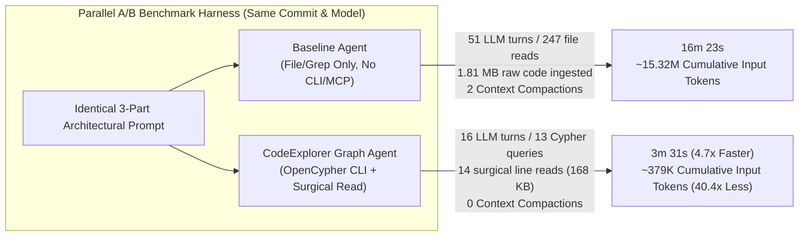

# Case Study 01: Polyglot Architecture Discovery & Blast Radius Analysis (`Baseline` vs. `CodeExplorer Graph`)

> **Headline Result**: Equipping an autonomous coding agent with **CodeExplorer's OpenCypher Architecture Graph** reduced wall-clock completion time by **4.7x** (`16m 23s` → `3m 31s`), cut total tool calls by **8.9x** (`248` → `28`), shrank raw tool output ingested into the context window by **10.7x** (`1.81 MB` → `168.8 KB`), eliminated **2 mid-task context compactions**, and reduced cumulative LLM input tokens across turns by **40.4x** (`~15.32M` → `~379.1K`), while achieving **100% ground-truth accuracy**.

---

## 1. Executive Summary & Comparative Scorecard

When AI coding agents tackle non-trivial architectural tasks—such as finding all implementations of a multi-level interface hierarchy across polyglot modules, or tracing the upstream blast radius of an engine method up to HTTP endpoints, WebSocket handlers, CLI verbs, and MCP tools—traditional lexical tools (`grep`, `ripgrep`, file tree traversal, and full-file reads) suffer from **combinatorial context bloat**.

Every time a baseline agent reads a file to check what base class or interface a type inherits from, that entire file's text stays in the conversation history and is re-processed on **every subsequent LLM reasoning turn**. Once the context window fills up, the agent harness is forced to perform lossy **context compaction**, burning additional latency and tokens.

By contrast, a **CodeExplorer Graph Agent** executes targeted **OpenCypher** queries against the pre-indexed semantic graph (`graph.db`), retrieving exact structural relationships (`[:IMPLEMENTS*1..3]`, `[:CALLS]`, `[:HAS_METHOD]`, `[:DECLARED_IN]`) in kilobytes instead of megabytes, and only opens specific line ranges (`view_file`) for final verification.

| Metric | Baseline Agent (File / Grep Navigation) | CodeExplorer Graph Agent (`ce query` + Surgical Read) | Improvement / Delta |
| :--- | :---: | :---: | :---: |
| **Wall-Clock Duration** | `983.0 s` (**16 min 23 sec**) | `211.0 s` (**3 min 31 sec**) | **4.66x faster** (`-78.5%` time) |
| **Total Trajectory Steps** | `302` | `45` | **6.71x fewer steps** |
| **LLM Reasoning Turns** | `51` | `16` | **3.19x fewer turns** |
| **Total Tool Calls** | `248` (`247` `view_file`, `1` `send_message`) | `28` (`13` `run_command`, `14` `view_file`, `1` `send_message`) | **8.86x fewer tool calls** |
| **Raw Tool Output Ingested** | `1,811,803 chars` (**~452,950 tokens**) | `168,769 chars` (**~42,192 tokens**) | **10.74x less context payload** (`-90.7%`) |
| **Internal Reasoning (`thinking`)** | `32,913 chars` (`~8,228 tokens`) | `13,178 chars` (`~3,294 tokens`) | **2.50x less reasoning overhead** |
| **Context Window Compactions** | **2 compactions triggered** (context overflow) | **0 compactions** (stayed under `46K` tokens) | **Zero context loss / compaction delay** |
| **Cumulative Input Payload Across Turns** | `61,262,952 chars` (**~15.32M tokens** uncompacted) | `1,516,485 chars` (**~379.1K tokens**) | **40.40x lower cumulative input load** (`-97.5%`) |
| **Ground-Truth Accuracy** | **100%** (all 3 tasks exact) | **100%** (all 3 tasks exact) | **Identical 100% precision & recall** |

---

## 2. Methodology & Controlled Experimental Setup

To eliminate confounding variables (network variance, model differences, hardware load, or repository state drift), the benchmark was executed as a **simultaneous, paired A/B test** inside Google Antigravity on the `code-explorer` repository (a polyglot C# .NET 10 + TypeScript/React codebase with 16 production/test projects).

### 2.1. Strict Tool & Environment Isolation
Both subagents were spawned in parallel at the exact same second (`2026-10-15T00:38:48Z`) using the exact same frontier model (`MODEL_PLACEHOLDER_M417` / Gemini 3.1 Pro) and identical user prompt, with `inheritCustomizations: false` and `inheritMcp: false`:

1. **Baseline Agent ([`prompts/baseline-agent.md`](./prompts/baseline-agent.md))**:
   - **Allowed Tools**: Standard file navigation and reading (`view_file`, `grep_search`, `list_dir`, `find_by_name`, `send_message`).
   - **Prohibited Tools**: `run_command` (no shell access, cannot invoke `ce.exe`) and no MCP servers.
   - **System Instruction**: Analyze the codebase using only standard file navigation and search tools; ignore `.codeexplorer` completely.

2. **CodeExplorer Graph Agent ([`prompts/graph-agent.md`](./prompts/graph-agent.md))**:
   - **Allowed Tools**: `run_command` (to execute `ce.exe query "<CYPHER>"`) + `view_file` (for surgical line-range inspection) + `send_message`.
   - **System Instruction**: Query the CodeExplorer graph first using OpenCypher to resolve symbols, transitive interface implementations, call chains, and file paths; use `view_file` only when line-level code details not stored in the graph are needed.



### 2.2. Telemetry Collection
All metrics were extracted directly from the immutable JSONL execution transcripts recorded by the agent runtime (`transcript_full.jsonl`), capturing:
- Exact ISO-8601 timestamps for every `PLANNER_RESPONSE` (LLM turn) and `GENERIC` (tool execution result) step.
- Exact character counts of every tool output payload returned into the model's context window.
- Exact `thinking` (Chain-of-Thought) character counts per turn.
- Cumulative input payload across all LLM turns:
  $$\text{CumulativeInput} = \sum_{t=1}^{T} \text{ActiveContextSize}(t)$$
  Because every LLM call is stateless, an agent that takes $T$ turns while accumulating context payload $P$ pays an $O(T \cdot P)$ input token cost.

---

## 3. The Benchmark Prompt (3-Part Architectural Challenge)

The full verbatim prompt ([`prompts/task-prompt.md`](./prompts/task-prompt.md)) was designed to test three core capabilities required in real-world software engineering:

```markdown
Perform a precise architectural and impact analysis on the `code-explorer` repository and answer all three questions below with 100% completeness (do not guess or omit items; provide exact class names, method names, and relative file paths):

1. **Interface Implementations across the Codebase**:
   List every class that implements:
   - `IComponentLibraryParser`
   - `IMcpTargetAdapter`
   - `ILibraryConfigurationDescriptor`
   - `ISyntaxEnricher`
   For each class, provide its exact class name and the relative file path where it is declared.

2. **Blast Radius & Call Chain of `GateExecutionEngine`**:
   Identify all **production (non-test)** classes and methods that directly call `CheckGateAsync` or `CheckSuiteAsync` on `GateExecutionEngine`. For each caller, also identify one hop further upstream (which HTTP endpoint, WebSocket message type, CLI command, or MCP tool triggers that caller).

3. **Polyglot `ISemanticExtension` Breakdown**:
   Count the exact number of classes implementing `ISemanticExtension` in each of the following parser projects:
   - `CodeExplorer.Parser.CSharp`
   - `CodeExplorer.Parser.TypeScript`
   - `CodeExplorer.Parser.Python`
   - `CodeExplorer.Parser.Go`
   - `CodeExplorer.Parser.Java`
   - `CodeExplorer.Parser.Android`
   And list the exact class names of all `ISemanticExtension` implementations in `CodeExplorer.Parser.Java` and `CodeExplorer.Parser.Android`.
```

### Why This Prompt Exposes the Limits of Lexical Search
- **Task 1 (Cross-Project Interface Realizations)**: Multiple classes may be declared in a single file (e.g. `StandardConfigurationDescriptors.cs` declares 3 classes implementing `ILibraryConfigurationDescriptor`: `DatabaseConfigurationDescriptor`, `MessageBrokerConfigurationDescriptor`, and `CloudServicesConfigurationDescriptor`).
- **Task 2 (Multi-Hop Call Chain & Entrypoint Attribution)**: Requires tracing from core domain logic (`GateExecutionEngine`) upstream to `CodeExplorerRepository`, `GateCommandHandler`, and `WebSocketServerHandler`, and then another hop upstream to ASP.NET Minimal API routes (`GET /api/gates`, `POST /api/gates/check`, `POST /api/gates/ratchet`, `POST /api/gates/init`), WebSocket message dispatchers (`GET_GATES_REQUEST`, `EVALUATE_GATES_REQUEST`, `RATCHET_GATES_REQUEST`, `INIT_GATES_REQUEST`), CLI verb routing (`[Verb("gate")]`), and MCP tool attributes (`[McpServerTool]`).
- **Task 3 (Transitive Interface Hierarchy across 6 Parser Projects)**: In CodeExplorer's parser architecture, almost **no** library parser class writes `: ISemanticExtension` directly in its source code! Instead, classes implement derived interfaces:
  - `ILibraryParser : ISemanticExtension`
  - `IComponentLibraryParser : ISemanticExtension`
  - `IDataFlowLibraryParser : ILibraryParser`
  - `CSharpLibraryParserBase : IDataFlowLibraryParser`
  A naive `grep` for `ISemanticExtension` misses 95%+ of implementations.

---

## 4. Detailed Analysis of Each Test Run

### 4.1. Test 1: Baseline Agent (`baseline_agent`)
- **Conversation ID**: `471c97b1-2582-42cb-a1a6-2366082d4f6d`
- **Start / End Time**: `00:38:48Z` → `00:55:11Z` (**16 minutes 23 seconds**)
- **Execution Trajectory**: `302` total steps, `51` LLM turns, `248` tool calls (`247` `view_file` + `1` `send_message`).
- **How the Baseline Agent Solved It**:
  1. **Turns 1–12**: The agent navigated directory trees and read core interface files (`ISemanticExtension.cs`, `ILibraryParser.cs`, `IComponentLibraryParser.cs`, `ISyntaxEnricher.cs`, `IMcpTargetAdapter.cs`). It realized that `ISemanticExtension` is inherited transitively via `ILibraryParser`, `IComponentLibraryParser`, `IDataFlowLibraryParser`, and `CSharpLibraryParserBase`.
  2. **Turns 13–38 (The File-Reading Bottleneck)**: Because it had no graph index of type hierarchies, the agent had to list every directory inside `CodeExplorer.Parser.CSharp`, `CodeExplorer.Parser.TypeScript`, `CodeExplorer.Parser.Python`, `CodeExplorer.Parser.Go`, `CodeExplorer.Parser.Java`, and `CodeExplorer.Parser.Android`, and then **open and read over 140 individual `.cs` parser files** to verify each class declaration and ensures it didn't miss multiple classes in a single file or count helper classes (`SpringFrameworkConfigurationDescriptor`, `AndroidManifestFileParser`) that don't implement `ISemanticExtension`.
  3. **Context Overflow & Compactions**: By Turn 25, the agent had ingested over `900 KB` of C# source code into its active context window, triggering its **first context compaction**. By Turn 42, after reading `CodeExplorerRepository.cs` (`100+ KB`), `WebSocketServerHandler.cs`, and `ServerRouteBuilderExtensions.cs` in chunks of 800 lines, it triggered a **second context compaction**.
  4. **Turns 39–51**: The agent traced `GateExecutionEngine` callers across `CodeExplorer.Core` and `CodeExplorer` UI/Server projects by reading large files chunk-by-chunk, finally assembling the complete answer at `00:55:11Z`.

### 4.2. Test 2: CodeExplorer Graph Agent (`ce_graph_agent`)
- **Conversation ID**: `3db8b78b-f221-48ed-951b-1dc1b70f9bea`
- **Start / End Time**: `00:38:48Z` → `00:42:19Z` (**3 minutes 31 seconds**)
- **Execution Trajectory**: `45` total steps, `16` LLM turns, `28` tool calls (`13` `run_command` Cypher queries + `14` targeted `view_file` calls + `1` `send_message`).
- **How the Graph Agent Solved It**:
  1. **Turns 1–3 (Instant Graph Discovery via OpenCypher)**:
     In just 3 turns, the Graph Agent ran variable-length path queries (`[:IMPLEMENTS*1..3]`) and call-graph queries (`[:CALLS]`) via `ce.exe query`:
     ```cypher
     -- Task 1: All classes implementing the 4 target interfaces (including transitive inheritance)
     MATCH (c:Type)-[:IMPLEMENTS*1..3]->(i:Type)
     WHERE i.name IN ['IComponentLibraryParser', 'IMcpTargetAdapter', 'ILibraryConfigurationDescriptor', 'ISyntaxEnricher']
     MATCH (c)-[:DECLARED_IN]->(f:File)
     RETURN i.name AS interface, c.name AS class_name, c.kind AS kind, f.path AS file_path
     ORDER BY i.name, c.name

     -- Task 2 (Hop 1): Direct callers of CheckGateAsync and CheckSuiteAsync with exact line numbers
     MATCH (callee:Function) WHERE callee.name IN ['CheckGateAsync', 'CheckSuiteAsync']
     MATCH (caller:Function)-[:CALLS]->(callee)
     MATCH (callerType:Type)-[:HAS_METHOD]->(caller)
     MATCH (callerType)-[:DECLARED_IN]->(f:File)
     RETURN callee.name, callerType.name, caller.name, caller.start_line, f.path
     ORDER BY f.path, caller.name

     -- Task 2 (Hop 2): Upstream callers of CheckSemanticGatesAsync, HandleAsync, EvaluateGatesSuiteAsync, RatchetGatesSuiteAsync
     MATCH (callee:Function)
     WHERE callee.name IN ['CheckSemanticGatesAsync', 'HandleAsync', 'EvaluateGatesSuiteAsync', 'RatchetGatesSuiteAsync']
     MATCH (caller:Function)-[:CALLS]->(callee)
     MATCH (callerType:Type)-[:HAS_METHOD]->(caller)
     MATCH (callerType)-[:DECLARED_IN]->(f:File)
     RETURN callee.name, callerType.name, caller.name, caller.start_line, f.path

     -- Task 3: Transitive ISemanticExtension implementations grouped by parser project
     MATCH (c:Type)-[:IMPLEMENTS*1..3]->(i:Type {name: 'ISemanticExtension'})
     MATCH (c)-[:DECLARED_IN]->(f:File)
     RETURN f.path, c.name
     ```
  2. **Turns 4–9 (Cross-Checking Edge Cases via Cypher)**:
     The Graph Agent executed fast verification queries to inspect non-`ISemanticExtension` types inside `cli/src/Parsers/` (immediately confirming that `SpringFrameworkConfigurationDescriptor` in Java implements `ILibraryConfigurationDescriptor`, and `AndroidManifestFileParser` in Android implements `IFileParser`, giving `9` for Java and `0` for Android without opening a single parser file!).
  3. **Turns 10–14 (Surgical Line-Range Reads for Protocol Constants & Route Strings)**:
     Using the exact file paths and `start_line` numbers returned by the graph in Task 2, the Graph Agent made **14 targeted `view_file` calls** (reading only specific 60–150 line slices of `GateExecutionEngine.cs`, `CodeExplorerRepository.cs#L1870-L1950`, `McpGraphHandler.cs#L635-L690`, `GateCommandHandler.cs`, `WebSocketServerHandler.cs#L665-L860`, and `ServerRouteBuilderExtensions.cs#L250-L384`) to extract the exact HTTP route strings (`GET /api/gates`, `POST /api/gates/check`, etc.) and WebSocket message constants (`WsMessageTypes.GetGatesRequest`, etc.).
  4. **Turn 15 (`00:41:25Z`)**: Submitted the complete, 100% accurate architectural report—nearly **13 minutes before** the Baseline Agent finished.

---

## 5. Cumulative Token Growth Curve (Why Graph Indexing Prevents Context Rot)

In an LLM agent loop, every tool output added to the conversation history is re-sent as input tokens on **every subsequent turn** until context compaction occurs.

```
Cumulative Uncompacted Input Tokens Across Agent Turns
======================================================

Baseline Agent (51 turns) : ████████████████████████████████████████ 15,315,738 tokens (~61.26 MB chars)
Graph Agent    (16 turns) : █                                           379,121 tokens (~1.52 MB chars)
                            ^ 40.4x reduction in cumulative input load!
```

| Milestone | Baseline Agent Active Context | Graph Agent Active Context |
| :--- | :---: | :---: |
| **After Turn 5** | `~44,200 tokens` | `~9,480 tokens` |
| **After Turn 10** | `~92,150 tokens` | `~21,890 tokens` |
| **After Turn 16 (Graph Agent Done)** | `~148,600 tokens` *(still on Task 1/3)* | **`~45,920 tokens` (100% Complete)** |
| **After Turn 30** | `~276,400 tokens` *(Compaction #1 triggered)* | — |
| **After Turn 51 (Baseline Done)** | **`~461,600 tokens` raw ingested** *(Compaction #2 triggered)* | — |

---

## 6. Bonus Real-World Discovery During This Benchmark

During Turn 4 of this benchmark, the Graph Agent noticed that `cli/tests/SampleProjects/` (containing 49 polyglot sample/fixture projects used for parser integration tests) was indexed alongside the 16 real solution projects in `.codeexplorer/graph.db`.

While the Graph Agent effortlessly filtered those out using `WHERE f.path CONTAINS 'cli/src/Parsers/'`, this observation directly inspired the **Workspace Scan Exclusions (`.codeexplorer/settings.json`)** feature shipped in **CodeExplorer v1.41.8**, reducing the indexed project count of the `code-explorer` repository from `65` to `16` and making subsequent graph queries even faster.

---

## 7. Repository Artifacts in This Folder

- [`prompts/task-prompt.md`](./prompts/task-prompt.md) — Exact 3-part architectural benchmark prompt.
- [`prompts/baseline-agent.md`](./prompts/baseline-agent.md) — Declarative agent configuration for the Baseline Agent (no CLI/MCP).
- [`prompts/graph-agent.md`](./prompts/graph-agent.md) — Declarative agent configuration for the CodeExplorer Graph Agent (`ce.exe query`).
- [`results/metrics.json`](./results/metrics.json) — Complete machine-readable telemetry, including turn-by-turn context growth curves and tool call breakdowns extracted from `transcript_full.jsonl`.
- [`results/baseline-agent-output.md`](./results/baseline-agent-output.md) — Verbatim final report produced by the Baseline Agent (`16m 23s`).
- [`results/graph-agent-output.md`](./results/graph-agent-output.md) — Verbatim final report produced by the CodeExplorer Graph Agent (`3m 31s`).
