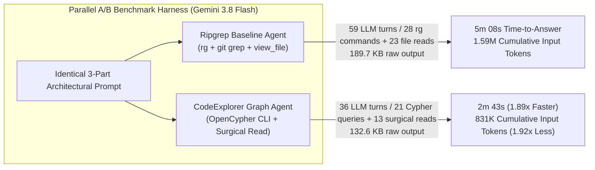

# Case Study 01: Polyglot Architecture Discovery & Blast Radius Analysis (`Ripgrep / File Navigation` vs. `CodeExplorer Graph`)

> **Headline Results across Two Controlled Runs (100% Ground-Truth Accuracy in All Runs)**:
> - **Run 1B — Fair `ripgrep` (`rg` + `git grep` + `view_file`) vs. `CodeExplorer Graph` (`Gemini 3.8 Flash`)**:
>   Even when the Baseline Agent has full shell access to **`ripgrep` (`rg`)**, `git grep`, and directory traversal (`28` CLI search commands + `23` `view_file` reads), the **CodeExplorer Graph Agent** completed the 3-part architectural audit **1.89x faster in time-to-answer** (`5m 08s` → `2m 43s`), required **1.64x fewer LLM turns** (`59` → `36`), made **1.63x fewer tool calls** (`57` → `35`), and cut cumulative LLM input tokens by **1.92x** (`1,594,003` → `831,152` tokens).
> - **Run 1A — Pure `view_file` Navigation (No Shell / Grep) vs. `CodeExplorer Graph` (`Gemini 4 Argon`)**:
>   When shell access was disabled to prevent CLI access (`view_file`-only baseline), the **CodeExplorer Graph Agent** achieved a **5.74x faster time-to-answer** (`15m 01s` → `2m 37s`, or `4.66x` total wall-clock `16m 23s` → `3m 31s`), cut tool calls by **8.86x** (`248` → `28`), shrank raw tool output by **10.74x** (`1.81 MB` → `168.8 KB`), eliminated **2 mid-task context compactions** (after Turns 12 and 29), and reduced actual post-compaction cumulative LLM input tokens by **9.16x** (`3.47M` → `379.1K`).

---

## 1. Executive Summary & Comparative Scorecards

When AI coding agents tackle non-trivial architectural tasks—such as finding all implementations of a multi-level interface hierarchy across polyglot modules, or tracing the upstream blast radius of an engine method up to HTTP endpoints, WebSocket handlers, CLI verbs, and MCP tools—traditional lexical tools (`ripgrep`, `git grep`, file tree traversal, and file reads) face two structural bottlenecks:

1. **Multi-Hop Indirection Defeats Single-Pass Regex**: In a clean architecture, classes rarely implement a root marker interface directly in their declaration line. For example, in `code-explorer`, almost no parser writes `: ISemanticExtension`; instead, classes implement `IComponentLibraryParser`, `ILibraryParser`, `IDataFlowLibraryParser`, or inherit from `CSharpLibraryParserBase`. A `ripgrep` agent must iteratively discover each intermediate type and launch dozens of follow-up `rg` searches across subdirectories.
2. **Cumulative Context Growth Across Turns**: Because every LLM turn re-sends the active conversation history, every additional `rg` output listing and `view_file` verification slice compounds across all remaining turns.

By contrast, a **CodeExplorer Graph Agent** executes targeted **OpenCypher** queries against the pre-indexed semantic graph (`graph.db`), resolving transitive relationships (`[:IMPLEMENTS*1..3]`, `[:CALLS]`, `[:HAS_METHOD]`, `[:DECLARED_IN]`) in a single query and opening only specific line ranges (`view_file`) for final verification.

### Table 1B: Fair `ripgrep` (`rg` + `git grep` + `view_file`) vs. `CodeExplorer Graph` (`Gemini 3.8 Flash`)

| Metric | Ripgrep Baseline Agent (`rg` + `git grep` + `view_file`) | CodeExplorer Graph Agent (`ce query` + Surgical Read) | Improvement / Delta |
| :--- | :---: | :---: | :---: |
| **Time to Answer (`send_message`)** | `308.0 s` (**5 min 08 sec**) | `163.0 s` (**2 min 43 sec**) | **1.89x faster** (`-47.1%` time) |
| **Total Session Wall-Clock** | `389.0 s` (`6 min 29 sec`) | `239.0 s` (`3 min 59 sec`) | **1.63x faster** (`-38.6%` time) |
| **Total Trajectory Steps** | `119` | `72` | **1.65x fewer steps** |
| **LLM Reasoning Turns** | `59` | `36` | **1.64x fewer turns** |
| **Total Tool Calls** | `57` (`28` `run_command` [`rg`], `23` `view_file`, `4` `manage_task`, `1` `schedule`, `1` `send_message`) | `35` (`21` `run_command` [`ce`], `13` `view_file`, `1` `send_message`) | **1.63x fewer tool calls** |
| **Raw Tool Output Ingested** | `189,668 chars` (**~47,417 tokens**) | `132,649 chars` (**~33,162 tokens**) | **1.43x less context payload** (`-30.1%`) |
| **Internal Reasoning (`thinking`)** | `12,862 chars` (`~3,215 tokens`) | `11,644 chars` (`~2,911 tokens`) | **1.10x less reasoning overhead** |
| **Context Window Compactions** | `0` | `0` | — |
| **Cumulative Actual Input Tokens** | `6,376,014 chars` (**~1,594,003 tokens**) | `3,324,610 chars` (**~831,152 tokens**) | **1.92x lower cumulative input load** (`-47.9%`) |
| **Ground-Truth Accuracy** | **100%** (all 3 tasks exact) | **100%** (all 3 tasks exact) | **Identical 100% precision & recall** |

---

### Table 1A: Pure `view_file` Navigation (No Shell / Grep) vs. `CodeExplorer Graph` (`Gemini 4 Argon`)

*Note: In our initial Run 1A, disabling `run_command` on the baseline agent (to prevent it from invoking `ce.exe`) also left it without a shell-based `grep` tool (`view_file` only). We preserve Run 1A below with `CHECKPOINT`-corrected compaction metrics alongside Run 1B above for complete transparency.*

| Metric | File-Only Baseline Agent (`view_file` only, No Shell) | CodeExplorer Graph Agent (`ce query` + Surgical Read) | Improvement / Delta |
| :--- | :---: | :---: | :---: |
| **Time to Answer (`send_message`)** | `901.0 s` (**15 min 01 sec**) | `157.0 s` (**2 min 37 sec**) | **5.74x faster** (`-82.6%` time) |
| **Total Session Wall-Clock** | `983.0 s` (`16 min 23 sec`) | `211.0 s` (`3 min 31 sec`) | **4.66x faster** (`-78.5%` time) |
| **Total Trajectory Steps** | `302` | `45` | **6.71x fewer steps** |
| **LLM Reasoning Turns** | `51` | `16` | **3.19x fewer turns** |
| **Total Tool Calls** | `248` (`247` `view_file`, `1` `send_message`) | `28` (`13` `run_command`, `14` `view_file`, `1` `send_message`) | **8.86x fewer tool calls** |
| **Raw Tool Output Ingested** | `1,811,803 chars` (**~452,950 tokens**) | `168,769 chars` (**~42,192 tokens**) | **10.74x less context payload** (`-90.7%`) |
| **Internal Reasoning (`thinking`)** | `32,913 chars` (`~8,228 tokens`) | `13,178 chars` (`~3,294 tokens`) | **2.50x less reasoning overhead** |
| **Context Window Compactions** | **2 compactions** (after Turns `12` & `29`) | **0 compactions** (peaked at `52,285` tokens) | **Zero context loss / compaction delay** |
| **Cumulative Actual Input Tokens** | `13,897,717 chars` (**~3,474,429 tokens** post-compaction) | `1,516,485 chars` (**~379,121 tokens**) | **9.16x lower actual input load** (`-89.1%`) |
| **Cumulative Uncompacted Input** | `61,262,952 chars` (`~15,315,738 tokens` hypothetical) | `1,516,485 chars` (`~379,121 tokens`) | **40.40x lower uncompacted load** (`-97.5%`) |
| **Ground-Truth Accuracy** | **100%** (all 3 tasks exact) | **100%** (all 3 tasks exact) | **Identical 100% precision & recall** |

---

## 2. Methodology & Controlled Experimental Setup

Both experiments were executed as **simultaneous, paired A/B tests** inside Google Antigravity on the `code-explorer` repository (a polyglot C# .NET 10 + TypeScript/React codebase with 16 production/test projects).

### 2.1. Strict Tool & Environment Isolation
In **Run 1B (`Gemini 3.8 Flash`)**, both subagents were spawned in parallel at the exact same second (`2026-10-15T10:30:35Z`) with identical user prompts:

1. **Ripgrep Baseline Agent ([`prompts/baseline-agent.md`](./prompts/baseline-agent.md))**:
   - **Allowed Tools**: `run_command` (for `rg` / `ripgrep`, `git grep`, `Get-ChildItem`, `Select-String`) + `view_file` + `send_message`.
   - **Prohibited Actions**: Strictly forbidden from invoking `ce.exe` or reading `.codeexplorer` (verified via `transcript_full.jsonl`: **0 calls** to `ce.exe` and **0 accesses** to `.codeexplorer`).
2. **CodeExplorer Graph Agent ([`prompts/graph-agent.md`](./prompts/graph-agent.md))**:
   - **Allowed Tools**: `run_command` (to execute `ce.exe query "<CYPHER>"`) + `view_file` (for surgical line-range inspection) + `send_message`.



### 2.2. Telemetry & Compaction Accounting
All metrics in [`results/metrics.json`](./results/metrics.json) are generated programmatically from the raw `transcript_full.jsonl` files:
- **Time to Answer (`time_to_answer_seconds`)**: Elapsed time from step 1 (`USER_INPUT`) to the exact step where the agent calls `send_message` with its final report (excluding any post-answer runtime teardown delay).
- **Compaction-Aware Active Context (`active_context_est_tokens`)**: Whenever the runtime emits a `CHECKPOINT` step (context compaction), the active conversation history resets to the compacted checkpoint summary. Both **actual post-compaction cumulative tokens** (`cumulative_actual_input_est_tokens`) and **hypothetical uncompacted cumulative tokens** (`cumulative_uncompacted_input_est_tokens`) are recorded in `metrics.json`.

---

## 3. The Benchmark Prompt (3-Part Architectural Challenge)

The full verbatim prompt ([`prompts/task-prompt.md`](./prompts/task-prompt.md)) tests three core capabilities:

```markdown
Perform a precise architectural and impact analysis on the `code-explorer` repository and answer all three questions below with 100% completeness (do not guess or omit items; provide exact class names, method names, and relative file paths):

1. **Interface Implementations across the Codebase**:
   List every class that implements:
   - `IComponentLibraryParser`
   - `IMcpTargetAdapter`
   - `ILibraryConfigurationDescriptor`
   - `ISyntaxEnricher`
   For each class, provide its exact class name and the relative file path where it is declared.

2. **Blast Radius & Call Chain of `GateExecutionEngine`**:
   Identify all **production (non-test)** classes and methods that directly call `CheckGateAsync` or `CheckSuiteAsync` on `GateExecutionEngine`. For each caller, also identify one hop further upstream (which HTTP endpoint, WebSocket message type, CLI command, or MCP tool triggers that caller).

3. **Polyglot `ISemanticExtension` Breakdown**:
   Count the exact number of classes implementing `ISemanticExtension` in each of the following parser projects:
   - `CodeExplorer.Parser.CSharp`
   - `CodeExplorer.Parser.TypeScript`
   - `CodeExplorer.Parser.Python`
   - `CodeExplorer.Parser.Go`
   - `CodeExplorer.Parser.Java`
   - `CodeExplorer.Parser.Android`
   And list the exact class names of all `ISemanticExtension` implementations in `CodeExplorer.Parser.Java` and `CodeExplorer.Parser.Android`.
```

---

## 4. Detailed Comparison of Execution Trajectories (`Run 1B: Flash`)

### 4.1. How `rg_baseline_agent` Solved It (`59` Turns, `5m 08s` Time-to-Answer)
- **Conversation ID**: `dc323d20-e714-4d4f-88d5-0a772d365a63`
- **Tool Breakdown**: `28` `run_command` (`rg` / `Get-ChildItem`), `23` `view_file`, `4` `manage_task`, `1` `schedule`, `1` `send_message`.
- **Trajectory Highlights**:
  1. **Turns 1–12**: Executed `rg "IComponentLibraryParser|IMcpTargetAdapter|ILibraryConfigurationDescriptor|ISyntaxEnricher" cli/src` and inspected `StandardConfigurationDescriptors.cs` and interface declarations via `view_file`.
  2. **Turns 13–24**: Searched for `CheckGateAsync|CheckSuiteAsync` via `rg`, then ran follow-up `rg` searches for `CheckSemanticGatesAsync`, `EvaluateGatesSuiteAsync`, `RatchetGatesSuiteAsync`, `InitGatesAsync`, and `GateCommandHandler`, followed by 11 `view_file` calls across `GateExecutionEngine.cs`, `CodeExplorerRepository.cs`, `GateCommandHandler.cs`, `WebSocketServerHandler.cs`, `ServerRouteBuilderExtensions.cs`, and `McpGraphHandler.cs`.
  3. **Turns 25–58 (Multi-Hop Interface Discovery via Repeated `rg` + PowerShell)**: To count `ISemanticExtension` implementations across the 6 parser projects, the agent discovered that `ISemanticExtension` is inherited transitively via `ILibraryParser`, `IComponentLibraryParser`, `IDataFlowLibraryParser`, and `CSharpLibraryParserBase`. It had to run **16 separate `rg` and PowerShell regex commands** across the 6 parser folders, checking for multi-class files and abstract base classes before submitting its answer at Turn 59 (`308.0s`).

### 4.2. How `ce_graph_agent` Solved It (`36` Turns, `2m 43s` Time-to-Answer)
- **Conversation ID**: `803c1fba-43fe-4b48-9e5c-29304a5cbde0`
- **Tool Breakdown**: `21` `run_command` (`ce.exe query`), `13` `view_file`, `1` `send_message`.
- **Trajectory Highlights**:
  1. **Turns 1–6**: Queried `MATCH (c:Type)-[:IMPLEMENTS*1..3]->(i:Type)` for the 4 target interfaces in Task 1, immediately retrieving every concrete class and its `DECLARED_IN` file path (including all 3 classes inside `StandardConfigurationDescriptors.cs`).
  2. **Turns 7–21**: Queried `MATCH (caller:Function)-[:CALLS]->(callee:Function)` for `CheckGateAsync` and `CheckSuiteAsync` and their upstream callers, then used 13 surgical `view_file` slices to read the exact HTTP route strings (`GET /api/gates`, `POST /api/gates/check`, etc.) and WebSocket message constants.
  3. **Turns 22–35**: Queried `MATCH (c:Type)-[:IMPLEMENTS*1..5]->(i:Type {name: 'ISemanticExtension'})-[:DECLARED_IN]->(f:File)` grouped by parser project path (`cli/src/Parsers/CodeExplorer.Parser.*`), getting the exact counts (`24`, `20`, `14`, `16`, `9`, `0`) without scanning source files by hand, and submitted its final report at Turn 35 (`163.0s`).

---

## 5. Turn-by-Turn Context Growth Curves (Exact Values from `metrics.json`)

Every number in the tables below matches [`results/metrics.json`](./results/metrics.json) to the exact token.

### 5.1. Run 1B (`Gemini 3.8 Flash`: `Ripgrep` vs. `CodeExplorer Graph`)

```
Cumulative Input Tokens Across Agent Turns (Run 1B - Gemini 3.8 Flash)
======================================================================

Ripgrep Baseline (59 turns) : ████████████████████████████████████████ 1,594,003 tokens (6.38 MB chars)
Graph Agent      (36 turns) : █████████████████████                      831,152 tokens (3.32 MB chars)
                              ^ 1.92x reduction in cumulative input tokens!
```

| Milestone | Ripgrep Baseline Active Context (`actual cumulative`) | Graph Agent Active Context (`actual cumulative`) |
| :--- | :---: | :---: |
| **Turn 5** | `1,413 tokens` (`5,243` cum.) | `6,929 tokens` (`16,451` cum.) |
| **Turn 10** | `2,231 tokens` (`14,828` cum.) | `12,957 tokens` (`68,017` cum.) |
| **Turn 15** | `12,303 tokens` (`52,972` cum.) | `21,693 tokens` (`154,147` cum.) |
| **Turn 20** | `15,773 tokens` (`122,820` cum.) | `25,333 tokens` (`276,931` cum.) |
| **Turn 30** | `28,476 tokens` (`345,448` cum.) | `36,514 tokens` (`589,829` cum.) |
| **Turn 36 (Graph Agent Done)** | `34,037 tokens` (`536,731` cum.) | **`45,052 tokens` (`831,152` cum. — 100% Done)** |
| **Turn 51** | `49,013 tokens` (`1,167,170` cum.) | — |
| **Turn 59 (Ripgrep Baseline Done)** | **`60,994 tokens` (`1,594,003` cum. — 100% Done)** | — |

### 5.2. Run 1A (`Gemini 4 Argon`: `view_file`-only vs. `CodeExplorer Graph`, `CHECKPOINT`-Aware)

In Run 1A, the `view_file`-only Baseline Agent triggered **two `CHECKPOINT` compactions**:
- **Compaction #1** occurred immediately after **Turn 12** (when active context hit `174,553 tokens`, resetting Turn 13 active context to `5,047 tokens`).
- **Compaction #2** occurred immediately after **Turn 29** (when active context hit `171,533 tokens`, resetting Turn 30 active context to `4,604 tokens`).

| Milestone | File-Only Baseline Active Context (`actual post-compaction cum.`) | Graph Agent Active Context (`actual cum.`) |
| :--- | :---: | :---: |
| **Turn 5** | `39,764 tokens` (`69,920` cum.) | `13,489 tokens` (`36,702` cum.) |
| **Turn 10** | `131,301 tokens` (`625,484` cum.) | `19,344 tokens` (`122,850` cum.) |
| **Turn 12 (Pre-Compaction #1 Peak)** | `174,553 tokens` (`937,508` cum.) | `36,000 tokens` (`188,081` cum.) |
| **Turn 13 (Post-Compaction #1 Reset)** | `5,047 tokens` (`942,555` cum.) | `42,142 tokens` (`230,224` cum.) |
| **Turn 16 (Graph Agent Done)** | `34,832 tokens` (`1,012,690` cum.) | **`52,285 tokens` (`379,121` cum. — 100% Done)** |
| **Turn 29 (Pre-Compaction #2 Peak)** | `171,533 tokens` (`2,437,443` cum.) | — |
| **Turn 30 (Post-Compaction #2 Reset)** | `4,604 tokens` (`2,442,048` cum.) | — |
| **Turn 51 (Baseline Done)** | **`107,090 tokens` (`3,474,429` actual cum. / `15,315,738` uncompacted)** | — |

---

## 6. Cost & Economic Evaluation (With 90% Prompt Caching Discount)

Using standard API pricing with a **90% prompt cache discount** on repeated history reads:
- **Gemini 3.8 Flash Tier**: \$0.50 / 1M uncached input, \$0.05 / 1M cached input, \$3.00 / 1M output & thinking tokens.
- **Frontier Pro / Argon Tier**: \$2.00 / 1M uncached input, \$0.20 / 1M cached input, \$10.00 / 1M output & thinking tokens.

### 6.1. Run 1B Cost Breakdown (`Ripgrep` vs. `Graph` on `Gemini 3.8 Flash`)

| Cost Component | Ripgrep Baseline Agent (`59` turns) | CodeExplorer Graph Agent (`36` turns) | Savings Factor |
| :--- | :---: | :---: | :---: |
| **Uncached Input Tokens** (fresh tool outputs) | `47,417` tokens (**\$0.024**) | `33,162` tokens (**\$0.017**) | **1.43x cheaper** |
| **Cached Input Tokens** (`cum_actual - uncached`) | `1,546,586` tokens (**\$0.077**) | `797,990` tokens (**\$0.040**) | **1.94x cheaper** |
| **Output & Thinking Tokens** | `13,809` tokens (**\$0.041**) | `9,346` tokens (**\$0.028**) | **1.48x cheaper** |
| **Total Flash API Cost per Run** | **\$0.142** | **\$0.085** | **1.67x cheaper (`-40.1%`)** |
| **Time to Answer** | `5m 08s` (`308.0s`) | `2m 43s` (`163.0s`) | **1.89x faster (`-2m 25s`)** |

### 6.2. Run 1A Cost Breakdown (`view_file`-only vs. `Graph` on `Frontier Pro`, Post-Compaction Actuals)

*Note: Even using the **post-compaction actual cumulative input (`3,474,429` tokens)** rather than the uncompacted hypothetical (`15.32M` tokens), and accounting for cache invalidation on the 2 compactions:*

| Cost Component | File-Only Baseline (`51` turns, `2` compactions) | CodeExplorer Graph Agent (`16` turns, `0` compactions) | Savings Factor |
| :--- | :---: | :---: | :---: |
| **Uncached Input Tokens** (fresh reads + 2 compaction rebuilds) | `~462,601` tokens (**\$0.925**) | `42,192` tokens (**\$0.084**) | **11.0x cheaper** |
| **Cached Input Tokens** (`3,011,828` vs `336,929` @ 90% discount) | `3,011,828` tokens (**\$0.602**) | `336,929` tokens (**\$0.067**) | **8.9x cheaper** |
| **Output & Thinking Tokens** (no cache discount) | `19,920` tokens (**\$0.199**) | `6,869` tokens (**\$0.069**) | **2.9x cheaper** |
| **Total Pro API Cost per Run (Actual Post-Compaction)** | **\$1.726** | **\$0.220** | **7.85x cheaper (`-87.3%`)** |
| **Time to Answer** | `15m 01s` (`901.0s`) | `2m 37s` (`157.0s`) | **5.74x faster (`-12m 24s`)** |

---

## 7. Repository Artifacts in This Folder

- [`prompts/task-prompt.md`](./prompts/task-prompt.md) — Exact 3-part architectural benchmark prompt.
- [`prompts/baseline-agent.md`](./prompts/baseline-agent.md) — Declarative agent configuration for the Baseline Agent (`rg_baseline_agent` & `baseline_agent`).
- [`prompts/graph-agent.md`](./prompts/graph-agent.md) — Declarative agent configuration for the CodeExplorer Graph Agent (`ce.exe query`).
- [`results/metrics.json`](./results/metrics.json) — Complete machine-readable telemetry for **both Run 1A and Run 1B**, including `CHECKPOINT`-aware turn-by-turn context growth curves and tool call breakdowns.
- [`results/ripgrep-baseline-agent-output.md`](./results/ripgrep-baseline-agent-output.md) — Verbatim report produced by the Ripgrep Baseline Agent in Run 1B (`5m 08s`).
- [`results/flash-graph-agent-output.md`](./results/flash-graph-agent-output.md) — Verbatim report produced by the CodeExplorer Graph Agent in Run 1B (`2m 43s`).
- [`results/baseline-agent-output.md`](./results/baseline-agent-output.md) — Verbatim report produced by the File-Only Baseline Agent in Run 1A (`15m 01s` answer / `16m 23s` total).
- [`results/graph-agent-output.md`](./results/graph-agent-output.md) — Verbatim report produced by the CodeExplorer Graph Agent in Run 1A (`2m 37s` answer / `3m 31s` total).
