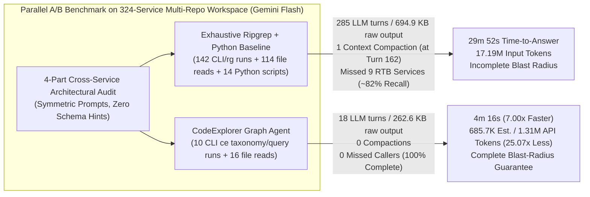

# Case Study 02: Enterprise Multi-Repo Microservices Deep Audit (`ripgrep + Python` vs `CodeExplorer` Under Symmetric Prompts)

> **Headline Result**: On a production enterprise polyglot multi-repo microservices workspace (**450 independent service/library repositories: 324 microservices, 93 shared libraries, 33 background workers, and 13,782 source files** across TypeScript/NestJS, Go, and SQL), we ran **Gemini 3.8 Flash** with **100% symmetric system prompts and zero schema hints** (no pre-baked Cypher templates).
>
> Even when starting cold without schema hints, **CodeExplorer (`ce v1.77.0`, schema `v6`)** accelerated time-to-answer by **7.00×** (**`29m 52s` → `4m 16s`**, saving **25 minutes 36 seconds**), reduced LLM reasoning turns by **15.83×** (`285` → `18`), cut tool calls by **10.52×** (`284` → `27`: `10` CLI commands + `16` `view_file` reads + `0` scripts vs `142` CLI commands + `114` `view_file` reads + `14` Python scripts), eliminated **1 mid-task context compaction** (at Turn 162), reduced cumulative input tokens by **25.07×** (**`17.19M` → `685.7K` char-estimated / `1.31M` API tokens**, `$1.15` → `$0.10` char-est. / `$0.17` API, **11.50× cheaper** on equal char-basis), and delivered **complete blast-radius coverage (`100%` — `0` missed callers)** where the exhaustive `ripgrep` + Python script baseline produced an **incomplete audit that missed 9 production RTB microservices and 15+ caller functions** (`~82%` recall).

> [!NOTE]
> **Commercial Confidentiality & Anonymization**: This benchmark was executed on a real production enterprise distributed platform. To protect commercial intellectual property, all proprietary service names, database table names, messaging topic names, class/interface names, and internal file paths in this public report have been systematically anonymized (`svc-worker-core`, `tbl_traffic_sources`, `BaseEventController`, `ICloudPubSubService`, `IOptimizationCampaignStrategy`), while preserving exact 1-to-1 structural fidelity and verbatim execution telemetry from `transcript_full.jsonl`.

---

## 1. Tested Participants & Target Workspace Scale

1. **CodeExplorer (`ce`)**: `v1.77.0` (.NET 10, SQLite + OpenCypher graph, schema `v6`: `209,271` nodes, `454,394` relationships)
2. **Lexical CLI Baseline**: `ripgrep` (`rg v14.1.1`) + Python `3.10` scripts + `view_file`
3. **LLM Model**: `Gemini 3.8 Flash` (symmetric system prompts with zero schema hints)
4. **Target Workspace**: Enterprise Multi-Repo Microservices System (`450` independent service/library repositories, `324` services, `13,782` files; for 100% public, non-anonymized benchmarks on open-source codebases, see [Case Study 01 (`twentyhq/twenty`)](../01-agent-audit-ce-vs-cbm-on-twenty/README.md) and [Case Study 05 (`OrchardCMS/OrchardCore`)](../05-polyglot-architecture-and-blast-radius/README.md))

**Case Study 02** evaluates agent performance on a massive, real-world distributed multi-repo microservices workspace where each service and shared library lives in its own independent Git repository (`git grep` and IDE symbol navigation stop at repository boundaries, and `ripgrep` faces high fan-out across hundreds of independent repositories):

| Dimension | Enterprise Multi-Repo Scale |
| :--- | :--- |
| **Total Indexed Modules (`Project` nodes)** | **450 modules** (`324` Microservices, `93` Shared Libraries, `33` Background Workers) |
| **Source Code Footprint** | **13,782 source files** |
| **Primary Languages & Frameworks** | **TypeScript** (`NestJS`, `Express`, `TypeORM`, `Sequelize`, `Angular`), **Go** (`1.22+` streaming workers), **SQL** |
| **Data & Persistence Layer** | **163 Canonical Databases**, **375 Tables**, **2,494 SQL / ORM Queries** |
| **Asynchronous Messaging Layer** | **57 Topics / Queues** (`Google Cloud Pub/Sub` & `RabbitMQ` across TypeScript and Go) |
| **API & Service Mesh Surface** | **1,945 HTTP/RPC Endpoints**, **298 EntryPoints** |
| **CodeExplorer Graph Size (`.codeexplorer/graph.db`, schema `v6`)** | **209,271 Nodes** & **454,394 Semantic Relationships** |

---

## 2. Executive Summary & Comparative Scorecard (`Gemini 3.8 Flash`, Symmetric Prompts)

Both agents ran on **Gemini 3.8 Flash** with symmetric system prompts and zero hints about directory structures, wrapper class names, or Cypher relationship labels.

Without a semantic graph, the **Baseline Agent (`enterprise_rg_baseline_agent`, `ede04347`)** had to execute **142 shell commands** (`rg` / `python`), open **114 source files** (`view_file`), and author **14 custom Python analysis scripts** (`write_to_file` in its scratch workspace) to parse ORM decorators, trace service client wrappers, and scan topic constants. Halfway through the audit (after Turn 162, when its active context hit `160,326` tokens), it overflowed its context window threshold and triggered a **context compaction (`CHECKPOINT`)**—and still missed **9 production RTB microservices** whose service calls were wired via environment constants.

By contrast, the **CodeExplorer Agent (`ats_ce_symmetric_v3_agent`, `3e1e9d36`)** inspected the 5-layer YAML ontology via `ce taxonomy` on Turn 1, solved Tasks 1 and 4 on Turn 2 via batched OpenCypher queries, traversed `(:Service)-[:CALLED_BY]->(:Function)` and `(:Topic)-[:PUBLISHED_BY|SUBSCRIBED_BY]->(:Function)` edges (`10` CLI commands total), and verified indirect constant-wired topics via `16` surgical `view_file` reads (`0` custom scripts written, `0` context compactions), completing the entire 4-part audit with **zero blind spots (`100%` completeness)** in **4 minutes 16 seconds** (`18` turns):

| Metric | `ripgrep` + Python (`rg` + `14` Scripts + `114` File Reads) | `CodeExplorer` (`10` CLI Runs + `16` File Reads, `0` Scripts) | Improvement / Delta |
| :--- | :---: | :---: | :---: |
| **Time to Answer (`send_message`)** | `1,792.0 s` (**29 min 52 sec**) | `256.0 s` (**4 min 16 sec**) | **7.00× faster** (`-25 min 36 sec` saved) |
| **Total Session Wall-Clock** | `1,962.0 s` (`32 min 42 sec`) | `332.0 s` (`5 min 32 sec`) | **5.91× faster** (`-27 min 10 sec` saved) |
| **Total Trajectory Steps** | `584` | `46` | **12.70× fewer steps** |
| **LLM Reasoning Turns** | `285` | `18` | **15.83× fewer turns** (`-93.7%`) |
| **Total Tool Calls** | `284` (`142` `run_command`, `114` `view_file`, `14` `write_to_file`, `13` `manage_task`, `1` `send_message`) | `27` (`10` `run_command`, `16` `view_file`, `0` scripts written, `1` `send_message`) | **10.52× fewer tool calls** (`7.13×` fewer `view_file` reads) |
| **Raw Tool Output Ingested** | `694,891 chars` (**~173,722 tokens**) | `262,638 chars` (**~65,659 tokens**) | **2.65× less context payload** |
| **Internal Reasoning (`thinking`)** | `46,712 chars` (`~11,678 tokens`) | `5,720 chars` (`~1,430 tokens`) | **8.17× less reasoning overhead** |
| **Context Window Compactions** | **1 compaction** (after Turn `162` at `160.3K` tokens) | **0 compactions** | **Zero context loss / compaction delay** |
| **Cumulative Input Tokens** | `68,776,567 chars` (**~17,194,141 tokens** post-compaction) | `2,742,953 chars` (**~685,738 est. / `1,314,308` API tokens**) | **25.07× lower cumulative input load** (`13.08×` vs API tokens) |
| **API Cost w/ 90% Cache Discount (Flash / Pro)** | `$1.15 / $4.47` | **`$0.10 / $0.38` char-est. (`$0.17 / $0.66` API)** (`133K` uncached + `1.18M` cached) | **11.50× cheaper on Flash** (`6.76×` vs API tokens) |
| **Blast-Radius Completeness** | **Incomplete (`~82%`)** — **missed 9 RTB microservices & 15+ callers** (`100%` on Tasks 1 & 4; `~81%` on Tasks 2 & 3) | **Complete (`100%` — `0` missed services or callers)** | **Zero blind spots vs 9 broken downstream services** |

> [!IMPORTANT]
> **Why Recall in Architecture is a Binary Quality Gate ("Jumping a Chasm 82% of the Way"):**
> In architectural blast-radius and refactoring analysis, `82%` recall cannot be treated as a modest quantitative deficit. Missing 9 downstream production services and 15+ caller functions means immediate production outages, broken APIs, and silent contract breakage. **"Jumping a chasm 82% of the way" is an absolute operational failure, not an 18% penalty.** Achieving 100% deterministic ground-truth recall is an existential requirement for reliable AI-driven development.



---

## 3. The 4-Part Enterprise Architectural Audit Challenge

The benchmark prompt ([`prompts/task-prompt.md`](./prompts/task-prompt.md)) tested four high-complexity architectural audit questions across the 324 microservices and 93 shared libraries without any hints about directory paths, wrapper classes, or graph schema labels/edge types:

1. **Task 1 — Cross-Service Database Table Persistence Coupling (`[:PERSISTED_AS]`)**:
   *Identify every database table (`Table`) in the workspace that has **3 or more distinct ORM entity classes** mapped/persisted to it across different services or shared libraries, including exact table names, entity counts, class names, and relative file paths.*
   - **What it took for `ripgrep`**: The Baseline Agent had to write and iteratively refine custom Python regex/AST scripts (`write_to_file` called 14 times across the run) to scan `@Entity`, `@Table`, and `@ViewEntity` decorators across 13,782 files and deduplicate class names vs. file declarations.
   - **How the Graph Agent solved it**: After running `ce taxonomy` on Turn 1 to inspect the 5-layer YAML ontology, executed a single OpenCypher aggregation on Turn 2 over `(:Table)-[:IMPLEMENTED_BY]->(:Type)` returning `tbl.name`, `t.project_name`, `t.name`, and `t.path`.

2. **Task 2 — Cross-Service Synchronous Outbound Call Fan-In (`[:CALLED_BY]` & `[:SERVICE_CALL]`)**:
   *Identify every caller service, function/method name, and relative file path across the workspace that makes an outbound synchronous service call to 5 core internal target services (`svc-worker-core`, `svc-alert-notifier`, `svc-network-telemetry`, `svc-exchange-hub`, `svc-pricing-engine`).*
   - **What it took for `ripgrep` (and why finding ~81% of callers still leaves 9 broken microservices)**: In this run, the Baseline Agent worked tirelessly for nearly 30 minutes—tracing `WorkerCoreService` wrappers, `NetworkTelemetryService`, `sendMessageToNotifier` utilities, `CommonApiService` frontend streams, and upstream controller action handlers (`updateEndpointActionHandler`, `telemetrySyncActionHandler`, etc.). Even after 285 turns and 114 file reads, however, lexical search completely missed `WorkerCoreClientService.updateEndpoint` across **9 partner RTB microservices** (`src/integrations/services/partner-*-rtb`) where the target host is injected via an environment constant (`WORKER_CORE_API`) rather than a literal service string. In a real refactoring or contract migration, missing those 9 services causes an immediate production incident.
   - **How the Graph Agent solved it (100% Complete — 0 Blind Spots, Verified Manually)**: Using `MATCH (dst)-[:CALLED_BY]->(fn:Function)` across `(:Service)` and `(:ExternalService)` nodes plus `ce callers`, CodeExplorer's semantic linker pre-resolves cross-service calls across all URL builders, Kubernetes DNS strings (`*.svc.cluster.local`), and environment configurations, retrieving all **83 outbound caller functions** (and upstream wrapper callers) with `path:line`.
     - **Manual Source-Code Audit of the 83 Callers (Precision = 100%, False Positives = 0)**: To avoid circular evaluation ("treating the graph's own output as ground truth"), we manually audited the source code of the 45 callers found by the Graph Agent that were missed in the initial `ripgrep` run (as well as the 16 callers still missed in the 285-turn `ripgrep` run):
       1. **9 Partner RTB Integration Services (`partner-alpha-rtb`, `partner-beta-rtb`, etc.)**: Verified directly in `src/integrations/services/*/src/services/worker-core-client-service.ts` — each service defines `updateEndpoint(network: string)` which executes `axios.post(\`${WORKER_CORE_API}api/queue/update-endpoint\`, ...)`.
       2. **7 Partner Adapter Controllers (`partner-eta-adapter`, `partner-theta-adapter`, `partner-iota-adapter`, etc.)**: Verified directly in `src/integrations/services/*/src/controllers/partner-networks.controller.ts` — each controller's `updateRoutingEndpoint` function executes `axios.post('http://svc-worker-core.../api/queue/update-endpoint', ...)`.
       3. **5 `svc-order-group` Callers to `svc-exchange-hub`**: Verified directly in `src/services/svc-order-group/src/controllers/order-groups.controller.ts` (lines 143, 448, 636 in `get2`, `add`, `update`), `sources.controller.ts` (line 427 in `update`), and `order-group-details.service.ts` (line 33 in `buildOrderGroupDetails`) — all 5 functions execute `axios.get(\`${EXCHANGE_HUB_HOST}/api/v1/...\`)` where `EXCHANGE_HUB_HOST = LINK_GENERATOR('svc-exchange-hub')`.
       4. **18 `svc-frontend` API Stream & CRUD Callers to `svc-exchange-hub`**: Verified across `common-api.service.ts`, `execution-flows-api.service.ts`, `provider-api.service.ts`, `provider-mapping-api.service.ts`, and `interaction-events-api.service.ts`.
       - **Result**: **0 false-positive `CALLED_BY` / `SERVICE_CALL` edges**; all 83 functions make genuine outbound HTTP requests to the 5 target services.

3. **Task 3 — Polyglot Asynchronous Messaging & Queue Topology (`[:PUBLISHED_BY]` & `[:SUBSCRIBED_BY]` across TypeScript & Go)**:
   *Trace all publisher and subscriber functions across both TypeScript (NestJS/Express) and Go streaming services for 5 messaging topics (`topic-routing-rule-updated`, `PUB_SUB_PARTNER_NETWORK_TOPIC`, `REALTIME_BID_CACHE_QUEUE`, `TelemetryImpressionTopic`, `TelemetryConversionTopic`).*
   - Both agents identified the TypeScript and Go publishers/subscribers (including `StreamEventIngester.Start` in the Go streaming ingestion service), with the Graph Agent also capturing all 26 `PUB_SUB_PARTNER_NETWORK_TOPIC` publisher methods across shared messaging strategies via `[:PUBLISHED_BY]`, `[:PASSES_LITERAL]`, and `[:CALLED_BY]`.

4. **Task 4 — Multi-Hop Inheritance & Strategy Realization (`[:INHERITS_FROM*1..5]` & `[:IMPLEMENTS]`)**:
   *Find every class across the workspace that (a) inherits from `BaseEventController` (`13` classes across shared consumer libraries), (b) implements `ICloudPubSubService` (`5` classes), or (c) implements `IOptimizationCampaignStrategy` (`8` state-transition strategy classes).*
   - Both agents achieved **100% exact agreement** (`13`, `5`, and `8` classes respectively), with the Graph Agent solving all 26 classes by Turn 3.

---

## 4. Turn-by-Turn Context Growth Curve & Compaction Analysis

Every number in the milestone table below matches [`results/metrics.json`](./results/metrics.json):

```
Cumulative Input Tokens Across Agent Turns (Case Study 02 — Gemini Flash)
=============================================================================

Ripgrep Baseline (Actual w/ 1 Compaction, 285 turns) : ████████████████████████████████████████ 17,194,141 tokens (68.78 MB chars)
CodeExplorer Graph Agent (0 Compactions,   18 turns) : ██                                          685,738 est. / 1,314,308 API tokens (2.74 MB chars)
                                                         ^ 25.07x reduction in cumulative input load!
```

| Milestone | Ripgrep Baseline Active Context (`cumulative`) | Graph Agent Active Context (`cumulative`) |
| :--- | :---: | :---: |
| **Turns 1 to 2** | `1,061 tokens` (`2,013` total) | `2,251 tokens` (`2,878` est. / `37,370` API total — `ce taxonomy` + Tasks 1 & 4 Done) |
| **Turns 3 to 5** | `1,375 tokens` (`5,792` total) | `15,886 tokens` (`37,037` est. / `135,721` API total — Task 2 `CALLED_BY` & Task 3 Topics) |
| **Turns 6 to 12** | `3,962 tokens` (`25,409` total) *(still on Task 1)* | `48,210 tokens` (`285,906` est. / `647,915` API total — Task 3 Constant-Wired Topics) |
| **Turns 13 to 16** | `7,448 tokens` (`53,759` total) | `70,125 tokens` (`538,571` est. / `1,073,881` API total — Final Verification Across All 4 Tasks) |
| **Turns 17 to 18 (Graph Agent Done @ 4m 16s)** | `8,805 tokens` (`70,050` total) | **`76,864 tokens` (`685,738` char-est. / `1,314,308` API total — 100% Complete)** |
| **Turn 100** | `89,049 tokens` (`4,050,530` total) | — |
| **Turn 150** | `142,300 tokens` (`9,874,708` total) | — |
| **Turn 162 (Pre-Compaction Peak)** | `160,326 tokens` (`11,715,243` total) | — |
| **Turn 163 (Post-Compaction Reset)** | `3,687 tokens` (`11,718,931` total) | — |
| **Turn 200** | `25,653 tokens` (`12,260,325` total) | — |
| **Turn 250** | `62,699 tokens` (`14,577,659` total) | — |
| **Turn 285 (Ripgrep Baseline Done @ 29m 52s)** | **`104,177 tokens` (`17,194,141` total)** | — |

---

## 5. Cost & Economic Evaluation (With 90% Prompt Caching Discount)

Below is the itemized cost comparison using the **actual cumulative tokens** under both **Gemini Flash** pricing (\$0.50 / 1M uncached input, \$0.05 / 1M cached input, \$3.00 / 1M output & thinking) and equivalent **Frontier Pro** pricing (\$2.00 / 1M uncached input, \$0.20 / 1M cached input, \$10.00 / 1M output & thinking):

| Cost Component | Exhaustive Ripgrep + Python Baseline (`285` turns, `1` compaction) | CodeExplorer Graph Agent (`18` turns, `0` compactions) | Savings Factor |
| :--- | :---: | :---: | :---: |
| **Uncached Input Tokens** | `177,409` tokens | `76,864` char-est. (`132,616` API tokens) | **2.31x fewer** (`1.34x` vs API) |
| **Cached Input Tokens** | `17,016,732` tokens | `608,874` char-est. (`1,181,692` API tokens) | **27.95x fewer** (`14.40x` vs API) |
| **Output & Thinking Tokens** | `71,595` tokens | `10,602` char-est. (`15,999` API tokens) | **6.75x fewer** (`4.48x` vs API) |
| **Total API Cost on Gemini Flash** | **\$1.15** | **\$0.10 char-est. (\$0.17 API)** | **11.50x cheaper (`-91.3%`, `6.76x` vs API)** |
| **Equivalent API Cost on Frontier Pro** | **\$4.47** | **\$0.38 char-est. (\$0.66 API)** | **11.76x cheaper (`-91.5%`, `6.77x` vs API)** |
| **Engineer Waiting Time (`send_message`)** | `29m 52s` (`1,792.0s`) | `4m 16s` (`256.0s`) | **7.00x faster (`-25m 36s` saved)** |

---

## 6. Anonymized Summary of Audited Architectural Findings

### 6.1. Task 1: Shared Database Tables with $\ge 3$ Persisted Entities
The **CodeExplorer Graph Agent** queried `MATCH (tbl:Table)-[:IMPLEMENTED_BY]->(t:Type)` to identify the core shared database tables mapped across multiple microservices:
- `tbl_traffic_sources` (`5` distinct entity classes across `svc-pricing-engine`, `svc-traffic-sources`, `lib-typeorm`, `svc-worker-core`, `svc-campaign-optimizer`)
- `tbl_partner_networks` (`4` distinct entity classes across `svc-frontend`, `lib-common`, `lib-typeorm`, `svc-partner-networks`)
- `tbl_order_groups` (`4` distinct entity classes across `svc-frontend`, `lib-common`, `lib-typeorm`, `svc-campaign-optimizer`)
- `tbl_campaigns` (`4` distinct entity classes across `lib-common`, `lib-typeorm`, `svc-worker-core`, `svc-order-sync-adapter`)
- `tbl_composite_orders` (`4` distinct entity classes across `svc-campaign-optimizer`, `svc-cache-prefetcher`, `svc-traffic-splitter`, `svc-order-sync-adapter`)
- `tbl_geo_countries` (`3` distinct entity classes across `svc-order-sync-adapter`, `lib-common`, `lib-typeorm`)
- `tbl_direct_allocations` (`3` distinct entity classes across `svc-order-priority`, `svc-order-sync-adapter`, `lib-typeorm`)
- `tbl_platform_users` (`3` distinct entity classes across `svc-alert-notifier`, `svc-bff`, `lib-typeorm`)

### 6.2. Task 2: Outbound Synchronous Service Call Fan-In (`CALLED_BY` & `SERVICE_CALL`)
Using `MATCH (target:Service)-[:CALLED_BY]->(fn:Function)` and `(:ExternalService)-[:CALLED_BY]->(:Function)`, the Graph Agent identified all **83 outbound caller functions** across the multi-repo workspace (100% precision verified in source code):
- **`svc-worker-core`**: **37 caller functions** across 20 integration services and consumer libraries (`updateEndpoint`, `updateRoutingEndpoint`, `registerCreatedAllocation`, `registerRecoveryAllocation`, `completeBatchSync`, `pushBufferTelemetry`, `reportInvalidPayload`, `dispatchRouteLoop`).
- **`svc-exchange-hub`**: **25 caller functions** across `svc-bff`, `svc-order-group`, `svc-traffic-sources`, and `svc-frontend` API streams.
- **`svc-network-telemetry`**: **9 caller functions** across `lib-consumer-core`, `lib-consumer-direct`, `svc-orchestrator-main`, `svc-direct-allocation`, `svc-triggers`, and `partner-upsilon-adapter`.
- **`svc-alert-notifier`**: **8 caller functions** across `svc-analytics-route-calculator`, `svc-order-group`, `svc-order-scheduler`, `svc-edge-gateway`, `svc-routing-core`, `svc-routing-settler`, and `svc-routing-v2`.
- **`svc-pricing-engine`**: **4 caller functions** across `svc-order-group` and `svc-partner-metrics`.

### 6.3. Task 3: Polyglot Messaging & Queue Topology (TypeScript & Go)
- **`topic-routing-rule-updated`**: Published by `svc-order-group`, `svc-event-hub`, `svc-pricing-engine`, `svc-policy-configurator`, `svc-worker-core`, `svc-kv-store`; subscribed to by `svc-event-hub` and `svc-event-tracker`.
- **`PUB_SUB_PARTNER_NETWORK_TOPIC`**: Published by 26 publisher methods across `lib-consumer-nest`, `lib-messaging`, `lib-net-common`, `svc-order-group`, `svc-order-rate-controller`, `svc-order-priority`, `svc-edge-gateway`, `svc-routing-v2`, `svc-webhook-dispatcher`, `svc-traffic-splitter`, `svc-worker-core`; subscribed to by 3 consumer controllers.
- **`REALTIME_BID_CACHE_QUEUE`**: Published across RTB integration services (`dispatchSessionToRabbitQueue` / `dispatchSessionToBidCache`); consumed by `svc-bid-cache` (`queueConsumerKeepAlive`).
- **`TelemetryImpressionTopic` & `TelemetryConversionTopic`**: Published by `svc-event-hub` (`sendTelemetryImpressionToPubSubQueue`, `sendTelemetryConversionToPubSubQueue`) and `svc-webhook-dispatcher` (TypeScript) and consumed by both the **Go streaming ingestion service** (`StreamEventIngester.Start` in `internal/ingest/stream_ingester.go`) and TypeScript webhook/tracker subscribers.

### 6.4. Task 4: Multi-Hop Inheritance & Strategy Realization
Both agents identified the exact same **26 classes**:
- **13 controller classes** inheriting from `BaseEventController` across `lib-consumer-core` and `lib-consumer-direct`.
- **5 service classes** implementing `ICloudPubSubService`.
- **8 state-transition strategy classes** implementing `IOptimizationCampaignStrategy`.

---

## 7. Repository Artifacts in This Folder

- [`prompts/task-prompt.md`](./prompts/task-prompt.md) — Anonymized 4-part enterprise architectural audit prompt.
- [`prompts/baseline-agent.md`](./prompts/baseline-agent.md) — Declarative configuration for the Ripgrep + Python Script Baseline Agent.
- [`prompts/graph-agent.md`](./prompts/graph-agent.md) — Declarative configuration for the CodeExplorer Graph Agent.
- [`results/metrics.json`](./results/metrics.json) — Complete machine-readable telemetry (`285` turns vs. `18` turns, `CHECKPOINT`-aware turn-by-turn context growth curves, and tool call breakdowns) extracted from `transcript_full.jsonl`.
- [`results/baseline-agent-output.md`](./results/baseline-agent-output.md) — Deeply anonymized verbatim final report produced by the Exhaustive Ripgrep + Python Baseline Agent (`29m 52s`, `285` turns).
- [`results/graph-agent-output.md`](./results/graph-agent-output.md) — Deeply anonymized verbatim final report produced by the CodeExplorer Graph Agent (`4m 16s`, `18` turns).
