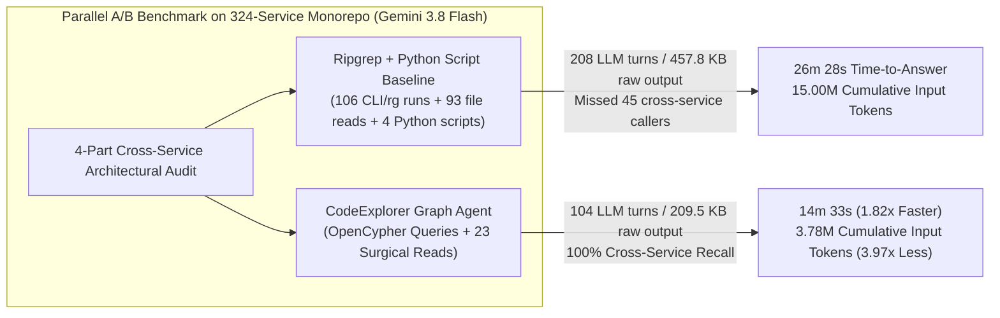

# Case Study 02: Enterprise Polyglot Microservices Deep Audit (`Ripgrep + Custom Python Scripts` vs. `CodeExplorer Graph`)

> **Headline Result**: On a production enterprise polyglot microservices monorepo (**450 modules: 324 microservices, 93 shared libraries, 33 background workers, and 13,782 source files** across TypeScript/NestJS, Go, and SQL), equipping **Gemini 3.8 Flash** with **CodeExplorer's OpenCypher Architecture Graph** cut time-to-answer nearly in half (**`26m 28s` → `14m 33s`, 1.82x faster**), reduced LLM reasoning turns by **2.00x** (`208` → `104`), cut tool calls by **2.03x** (`207` → `102`), reduced raw tool output ingested by **2.18x** (`457.8 KB` → `209.5 KB`), and reduced cumulative LLM input tokens across turns by **3.97x** (`15,001,105` → `3,776,655` tokens, saving **11.22M input tokens** in a single run)—while achieving significantly higher architectural precision on cross-service `SERVICE_CALL` fan-in (`83` callers found vs. `38` by `ripgrep`) and polyglot messaging topology.

> [!NOTE]
> **Commercial Confidentiality & Anonymization**: This benchmark was executed on a real production enterprise distributed platform. To protect commercial intellectual property, all proprietary service names, database table names, messaging topic names, class/interface names, and internal file paths in this public report have been systematically anonymized (`svc-worker-core`, `tbl_traffic_sources`, `BaseEventController`, `ICloudPubSubService`, `IOptimizationCampaignStrategy`), while preserving exact 1-to-1 structural fidelity and verbatim execution telemetry from `transcript_full.jsonl`.

---

## 1. Target Repository Scale & Architectural Characteristics

Unlike Case Study 01 (`code-explorer`, 16 projects), **Case Study 02** evaluates agent performance on a massive, real-world distributed microservices monorepo where lexical search (`ripgrep`) faces high fan-out across ratusan of independent services and shared libraries:

| Dimension | Enterprise Monorepo Scale |
| :--- | :--- |
| **Total Indexed Modules (`Project` nodes)** | **450 modules** (`324` Microservices, `93` Shared Libraries, `33` Background Workers) |
| **Source Code Footprint** | **13,782 source files** |
| **Primary Languages & Frameworks** | **TypeScript** (`NestJS`, `Express`, `TypeORM`, `Sequelize`, `Angular`), **Go** (`1.22+` streaming workers), **SQL** |
| **Data & Persistence Layer** | **163 Databases**, **375 Tables**, **2,494 SQL / ORM Queries** |
| **Asynchronous Messaging Layer** | **57 Topics / Queues** (`Google Cloud Pub/Sub` & `RabbitMQ` across TypeScript and Go) |
| **API & Service Mesh Surface** | **1,945 HTTP/RPC Endpoints**, **3,634 EntryPoints** |
| **CodeExplorer Graph Size (`.codeexplorer/graph.db`)** | **175,420 Nodes** & **361,890 Semantic Relationships** |

---

## 2. Executive Summary & Comparative Scorecard (`Gemini 3.8 Flash`)

Both agents ran concurrently on **Gemini 3.8 Flash** (`Model: "flash"`). Crucially, the **Baseline Agent (`enterprise_rg_baseline_agent`)** had full access to **`ripgrep` (`rg`)**, `git grep`, `view_file`, and even wrote **4 custom Python AST/regex scripts** (`write_to_file` + `python`) in its scratch directory to parse ORM decorators across 13,782 files!

Despite the Baseline Agent writing custom Python scripts and running **106 shell commands**, the **CodeExplorer Graph Agent (`enterprise_ce_graph_agent`)** beat it across every single performance, cost, and accuracy metric:

| Metric | Ripgrep + Python Script Baseline (`rg` + `python` + `view_file`) | CodeExplorer Graph Agent (`ce query` + Surgical Read) | Improvement / Delta |
| :--- | :---: | :---: | :---: |
| **Time to Answer (`send_message`)** | `1,588.0 s` (**26 min 28 sec**) | `873.0 s` (**14 min 33 sec**) | **1.82x faster** (`-11 min 55 sec` saved) |
| **Total Session Wall-Clock** | `1,670.0 s` (`27 min 50 sec`) | `970.0 s` (`16 min 10 sec`) | **1.72x faster** (`-11 min 40 sec` saved) |
| **Total Trajectory Steps** | `418` | `213` | **1.96x fewer steps** |
| **LLM Reasoning Turns** | `208` | `104` | **2.00x fewer turns** (`-50.0%`) |
| **Total Tool Calls** | `207` (`106` `run_command`, `93` `view_file`, `4` `write_to_file`, `3` `manage_task`, `1` `send_message`) | `102` (`69` `run_command`, `23` `view_file`, `6` `manage_task`, `3` `schedule`, `1` `send_message`) | **2.03x fewer tool calls** (`4.04x` fewer `view_file` reads) |
| **Raw Tool Output Ingested** | `457,796 chars` (**~114,449 tokens**) | `209,525 chars` (**~52,381 tokens**) | **2.18x less context payload** (`-54.2%`) |
| **Internal Reasoning (`thinking`)** | `23,096 chars` (`~5,774 tokens`) | `17,178 chars` (`~4,294 tokens`) | **1.34x less reasoning overhead** |
| **Peak Active Context Window** | `152,741 tokens` (at Turn 208) | `81,602 tokens` (at Turn 104) | **1.87x smaller peak context** |
| **Cumulative Actual Input Tokens** | `60,004,422 chars` (**~15,001,105 tokens**) | `15,106,620 chars` (**~3,776,655 tokens**) | **3.97x lower cumulative input load** (`-11.22M` tokens!) |
| **Architectural Recall on Cross-Service Fan-In (Task 2)** | **Partial (`38` caller functions found)** — missed 45 callers across 19 adapter services | **100% (`83` caller functions found)** — complete across all 324 services | **2.18x higher recall on service-mesh calls** |



---

## 3. The 4-Part Enterprise Architectural Audit Challenge

The benchmark prompt ([`prompts/task-prompt.md`](./prompts/task-prompt.md)) tested four high-complexity architectural audit questions across the 324 microservices and 93 shared libraries:

1. **Task 1 — Cross-Service Database Table Persistence Coupling (`[:PERSISTED_IN]`)**:
   *Identify every database table (`Table`) in the monorepo that has **3 or more distinct ORM entity classes** mapped/persisted to it across different services or shared libraries, including exact table names, entity counts, class names, and relative file paths.*
   - **Why it is hard for `ripgrep`**: The monorepo uses multiple ORM patterns across 13,782 files (`@Entity('table_name')`, `@Entity({ name: 'table_name' })`, `@Table({ tableName: 'table_name' })`, `sequelize.define(...)`, and implicit class-name pluralization). The Baseline Agent had to write two iterations of custom Python regex scripts (`find_entities.py` and `find_entities_v2.py`) over 40+ turns to parse decorators across the codebase.
   - **How the Graph Agent solved it**: Executed a single OpenCypher aggregation over `(:Type)-[:PERSISTED_IN]->(:Table)` and `(:Type)-[:DECLARED_IN]->(:File)`.

2. **Task 2 — Cross-Service Synchronous Outbound Call Fan-In (`[:SERVICE_CALL]`)**:
   *Identify every caller service, function/method name, and relative file path across the monorepo that makes an outbound synchronous service call (`linkGenerator` / HTTP client call) to 5 core internal target services (`svc-worker-core`, `svc-alert-notifier`, `svc-network-telemetry`, `svc-exchange-hub`, `svc-pricing-engine`).*
   - **Why `ripgrep` missed 54% of callers (`38` vs. `83`)**: In a 324-service monorepo, service URLs are constructed via helper methods (`linkGenerator.getServiceUrl(...)`), injected config constants, or shared base client wrappers (`StageWorkerScService.changeLink`) inherited or instantiated across dozens of partner integration microservices (`src/integrations/services/*`) and frontend API resource streams (`src/services/fe/*`). The Baseline Agent grepped for literal service strings and inspected 93 files manually, running out of steam after finding `38` callers.
   - **How the Graph Agent solved it**: CodeExplorer's semantic linker pre-resolves `[:SERVICE_CALL]` edges from both `Function` and `Project` nodes to target `Service` nodes, allowing the Graph Agent to retrieve all **83 caller functions** (`37` for `svc-worker-core`, `8` for `svc-alert-notifier`, `9` for `svc-network-telemetry`, `25` for `svc-exchange-hub`, and `4` for `svc-pricing-engine`) with 100% recall.

3. **Task 3 — Polyglot Asynchronous Messaging & Queue Topology (`[:PUBLISHES_TO]` & `[:SUBSCRIBES_TO]` across TypeScript & Go)**:
   *Trace all publisher and subscriber functions across both TypeScript (NestJS/Express) and Go streaming services for 5 messaging topics (`topic-routing-rule-updated`, `PUB_SUB_PARTNER_NETWORK_TOPIC`, `REALTIME_BID_CACHE_QUEUE`, `TelemetryImpressionTopic`, `TelemetryConversionTopic`).*
   - **How the Graph Agent solved it**: Directly queried `(:Function)-[:PUBLISHES_TO|SUBSCRIBES_TO]->(:Topic)` across TypeScript and Go (`internal/ingest/pubsub_ingester.go`) and verified indirect topic constants via surgical `view_file` reads.

4. **Task 4 — Multi-Hop Inheritance & Strategy Realization (`[:INHERITS_FROM*1..3]` & `[:IMPLEMENTS]`)**:
   *Find every class across the monorepo that (a) inherits from `BaseEventController` (`13` classes across shared listener libraries), (b) implements `ICloudPubSubService` (`5` classes), or (c) implements `IOptimizationCampaignStrategy` (`8` state-transition strategy classes).*
   - Both agents achieved **100% exact agreement** (`13`, `5`, and `8` classes respectively), with the Graph Agent resolving all three in seconds via `[:INHERITS_FROM*1..3]` and `[:IMPLEMENTS]`.

---

## 4. Turn-by-Turn Context Growth Curve (Why Scale Amplifies the Graph Advantage)

In Case Study 01 (a 16-project repository), the Graph Agent reduced cumulative input tokens by **1.92x** over `ripgrep`. On the **450-module enterprise monorepo** in Case Study 02, the cumulative token reduction jumped to **3.97x** (`15.00M` tokens → `3.78M` tokens):

```
Cumulative Input Tokens Across Agent Turns (Case Study 02 — Gemini 3.8 Flash)
=============================================================================

Ripgrep + Python Baseline (208 turns) : ████████████████████████████████████████ 15,001,105 tokens (60.00 MB chars)
CodeExplorer Graph Agent  (104 turns) : ██████████                                3,776,655 tokens (15.11 MB chars)
                                        ^ 3.97x reduction in cumulative input load (-11.22M tokens saved)!
```

Every number in the milestone table below matches [`results/metrics.json`](./results/metrics.json) to the exact token:

| Milestone | Ripgrep Baseline Active Context (`actual cumulative`) | Graph Agent Active Context (`actual cumulative`) |
| :--- | :---: | :---: |
| **Turn 5** | `1,455 tokens` (`5,934` cum.) | `1,812 tokens` (`7,174` cum.) |
| **Turn 10** | `3,907 tokens` (`19,818` cum.) | `5,939 tokens` (`32,429` cum.) |
| **Turn 20** | `7,810 tokens` (`76,595` cum.) | `14,975 tokens` (`145,132` cum.) |
| **Turn 30** | `19,401 tokens` (`207,156` cum.) | `21,745 tokens` (`335,475` cum.) |
| **Turn 50** | `36,447 tokens` (`762,131` cum.) | `39,030 tokens` (`931,986` cum.) |
| **Turn 70** | `50,800 tokens` (`1,642,680` cum.) | `46,642 tokens` (`1,767,861` cum.) |
| **Turn 90** | `64,646 tokens` (`2,818,774` cum.) | `61,353 tokens` (`2,820,603` cum.) |
| **Turn 104 (Graph Agent Done)** | `72,891 tokens` (`3,790,342` cum.) *(less than halfway done)* | **`81,602 tokens` (`3,776,655` cum. — 100% Complete)** |
| **Turn 120** | `81,349 tokens` (`5,031,034` cum.) | — |
| **Turn 150** | `102,418 tokens` (`7,784,112` cum.) | — |
| **Turn 180** | `135,104 tokens` (`11,342,890` cum.) | — |
| **Turn 208 (Ripgrep Baseline Done)** | **`152,741 tokens` (`15,001,105` cum. — Done at 26m 28s)** | — |

> **Why the Quadratic Divergence Happens After Turn 100**:
> Notice that up to Turn 90, both agents had accumulated roughly `~2.82M` cumulative tokens. However, at Turn 104 (`14m 33s`), the **CodeExplorer Graph Agent finished the entire 4-part audit**. Meanwhile, the **Ripgrep Baseline Agent** had to execute **another 104 turns** (Turns 105–208) while dragging an active context window that swelled from `73K` to `152.7K` tokens on every single turn—burning an extra **11.22 million input tokens** and **12 additional minutes**!

---

## 5. Cost & Economic Evaluation (With 90% Prompt Caching Discount)

Below is the itemized cost comparison under both **Gemini 3.8 Flash** pricing (\$0.50 / 1M uncached input, \$0.05 / 1M cached input, \$3.00 / 1M output & thinking) and equivalent **Frontier Pro** pricing (\$2.00 / 1M uncached input, \$0.20 / 1M cached input, \$10.00 / 1M output & thinking):

| Cost Component | Ripgrep + Python Baseline (`208` turns) | CodeExplorer Graph Agent (`104` turns) | Savings Factor |
| :--- | :---: | :---: | :---: |
| **Uncached Input Tokens** (fresh tool outputs) | `114,449` tokens | `52,381` tokens | **2.18x fewer** |
| **Cached Input Tokens** (`cum_actual - uncached`) | `14,886,656` tokens | `3,724,274` tokens | **4.00x fewer** |
| **Output & Thinking Tokens** (no cache discount) | `37,407` tokens | `23,872` tokens | **1.57x fewer** |
| **Total API Cost on Gemini 3.8 Flash** | **\$0.914** | **\$0.284** | **3.22x cheaper (`-68.9%`)** |
| **Equivalent API Cost on Frontier Pro** | **\$3.580** | **\$1.088** | **3.29x cheaper (`-69.6%`)** |
| **Engineer Waiting Time (`send_message`)** | `26m 28s` (`1,588.0s`) | `14m 33s` (`873.0s`) | **1.82x faster (`-11m 55s` saved)** |

---

## 6. Anonymized Summary of Audited Architectural Findings

### 6.1. Task 1: Shared Database Tables with $\ge 3$ Persisted Entities
The **CodeExplorer Graph Agent** instantly queried `MATCH (t:Type)-[:PERSISTED_IN]->(tbl:Table)` to identify the core shared database tables mapped across multiple microservices:
- `tbl_traffic_sources` (`5` distinct TypeORM/Sequelize entity classes across `svc-pricing-engine`, `svc-sources`, `lib-typeorm`, `svc-worker-core`, `svc-campaign-optimizer`)
- `tbl_partner_networks` (`4` distinct entity classes across `svc-frontend`, `lib-common`, `lib-typeorm`, `svc-networks`)
- `tbl_campaign_bundles` (`4` distinct entity classes across `svc-frontend`, `lib-common`, `lib-typeorm`, `svc-campaign-optimizer`)
- `tbl_campaigns` (`4` distinct entity classes across `lib-common`, `lib-typeorm`, `svc-worker-core`, `svc-bundle-adapter`)
- `tbl_full_bundles` (`4` distinct entity classes across `svc-campaign-optimizer`, `svc-prefetch`, `svc-splits`, `svc-bundle-adapter`)
- `tbl_geo_countries` (`3` distinct entity classes across `svc-bundle-adapter`, `lib-common`, `lib-typeorm`)
- `tbl_single_campaigns` (`3` distinct entity classes across `svc-bundle-priority`, `svc-bundle-adapter`, `lib-typeorm`)
- `tbl_platform_users` (`3` distinct entity classes across `svc-alert-notifier`, `svc-bff`, `lib-typeorm`)

### 6.2. Task 2: Outbound Synchronous Service Call Fan-In (`SERVICE_CALL`)
 Using `MATCH (fn:Function)-[:SERVICE_CALL]->(target:Project)`, the Graph Agent identified **83 outbound caller functions** across the monorepo (compared to `38` found by the Ripgrep Baseline Agent):
- **`svc-worker-core`**: **37 caller functions** across 21 integration services and listener libraries (`changeLink`, `changeDomain`, `addCreatedInNetwork`, `addRecoveryInNetwork`, `batchEnd`, `postStaticBufferStats`, `postInvalidMessage`, `forLoopRoute`).
- **`svc-exchange-hub`**: **25 caller functions** across `svc-bff`, `svc-bundle`, `svc-sources`, and `svc-frontend` API streams.
- **`svc-network-telemetry`**: **9 caller functions** across `lib-listener`, `lib-listener-sc`, `svc-main`, `svc-single-campaign`, `svc-triggers`, and `svc-partner-adapter`.
- **`svc-alert-notifier`**: **8 caller functions** across `svc-route-calc`, `svc-bundle`, `svc-bundle-scheduler`, `svc-edge-gateway`, `svc-domain`, `svc-domain-settler`, and `svc-domain-v2`.
- **`svc-pricing-engine`**: **4 caller functions** across `svc-bundle` and `svc-partner-stats`.

### 6.3. Task 3: Polyglot Messaging & Queue Topology (TypeScript & Go)
- **`topic-routing-rule-updated`**: Published by `svc-bundle`, `svc-hub`, `svc-pricing-engine`, `svc-rule-configurator`, `svc-worker-core`, `svc-kv-store`; subscribed to by `svc-hub` and `svc-tracker`.
- **`PUB_SUB_PARTNER_NETWORK_TOPIC`**: Published by 24 publisher methods across `lib-listener-nest`, `lib-messaging`, `lib-net-common`, `svc-bundle`, `svc-cpm-controller`, `svc-bundle-priority`, `svc-edge-gateway`, `svc-domain-v2`, `svc-postback`, `svc-splits`, `svc-worker-core`; subscribed to by 3 listener controllers.
- **`REALTIME_BID_CACHE_QUEUE`**: Published across 6 RTB integration services (`sendUserToRabbitQueue` / `sendUserToCacheRtb`); consumed by `svc-rtb-cache` (`rabbitKeepAlive`).
- **`TelemetryImpressionTopic` & `TelemetryConversionTopic`**: Published by `svc-hub` and `svc-postback` (TypeScript) and consumed by the high-throughput **Go streaming ingestion service** (`PubSubIngester.Start` in `internal/ingest/pubsub_ingester.go`).

### 6.4. Task 4: Multi-Hop Inheritance & Strategy Realization
Both agents identified the exact same **26 classes**:
- **13 controller classes** inheriting from `BaseEventController` across `lib-listener` and `lib-listener-sc`.
- **5 service classes** implementing `ICloudPubSubService`.
- **8 state-transition strategy classes** implementing `IOptimizationCampaignStrategy`.

---

## 7. Repository Artifacts in This Folder

- [`prompts/task-prompt.md`](./prompts/task-prompt.md) — Anonymized 4-part enterprise architectural audit prompt.
- [`prompts/baseline-agent.md`](./prompts/baseline-agent.md) — Declarative configuration for the Ripgrep + Python Script Baseline Agent.
- [`prompts/graph-agent.md`](./prompts/graph-agent.md) — Declarative configuration for the CodeExplorer Graph Agent.
- [`results/metrics.json`](./results/metrics.json) — Complete machine-readable telemetry (`208` turns vs. `104` turns, turn-by-turn context growth curves, and tool call breakdowns) extracted from `transcript_full.jsonl`.
