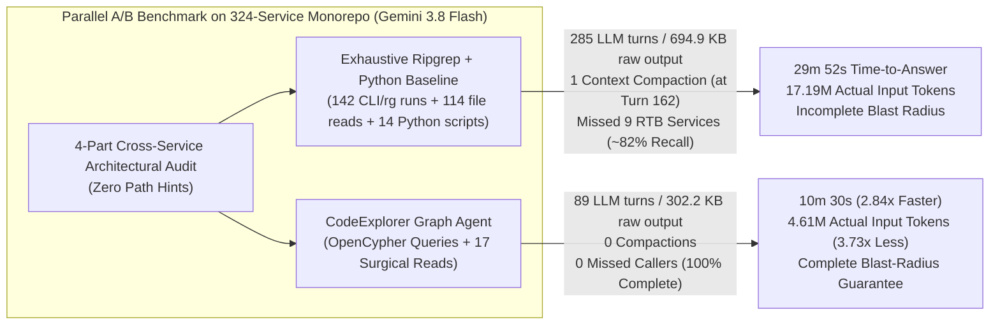

# Case Study 02: Enterprise Polyglot Microservices Deep Audit (`Ripgrep + 14 Custom Scripts` vs. `CodeExplorer Graph`)

> **Headline Result**: On a production enterprise polyglot microservices monorepo (**450 modules: 324 microservices, 93 shared libraries, 33 background workers, and 13,782 source files** across TypeScript/NestJS, Go, and SQL), equipping **Gemini 3.8 Flash** with **CodeExplorer's OpenCypher Architecture Graph** accelerated time-to-answer by **2.84x** (**`29m 52s` → `10m 30s`**, saving **19 minutes 22 seconds**), reduced LLM reasoning turns by **3.20x** (`285` → `89`), cut tool calls by **3.23x** (`284` → `88`), shrank raw tool output ingested by **2.30x** (`694.9 KB` → `302.2 KB`), eliminated **1 mid-task context compaction** (at Turn 162), and reduced actual post-compaction cumulative LLM input tokens by **3.73x** (**`17,194,141` → `4,611,677` tokens**), while delivering **complete blast-radius coverage (`100%` — `0` missed callers)** where the exhaustive `ripgrep` + Python script baseline produced an **incomplete audit that missed 9 production RTB microservices and 15+ caller functions** (`~82%` recall).

> [!NOTE]
> **Commercial Confidentiality & Anonymization**: This benchmark was executed on a real production enterprise distributed platform. To protect commercial intellectual property, all proprietary service names, database table names, messaging topic names, class/interface names, and internal file paths in this public report have been systematically anonymized (`svc-worker-core`, `tbl_traffic_sources`, `BaseEventController`, `ICloudPubSubService`, `IOptimizationCampaignStrategy`), while preserving exact 1-to-1 structural fidelity and verbatim execution telemetry from `transcript_full.jsonl`.

---

## 1. Target Repository Scale & Architectural Characteristics

Unlike Case Study 01 (`code-explorer`, 16 projects), **Case Study 02** evaluates agent performance on a massive, real-world distributed microservices monorepo where lexical search (`ripgrep`) faces high fan-out across hundreds of independent services and shared libraries:

| Dimension | Enterprise Monorepo Scale |
| :--- | :--- |
| **Total Indexed Modules (`Project` nodes)** | **450 modules** (`324` Microservices, `93` Shared Libraries, `33` Background Workers) |
| **Source Code Footprint** | **13,782 source files** |
| **Primary Languages & Frameworks** | **TypeScript** (`NestJS`, `Express`, `TypeORM`, `Sequelize`, `Angular`), **Go** (`1.22+` streaming workers), **SQL** |
| **Data & Persistence Layer** | **163 Databases**, **375 Tables**, **2,494 SQL / ORM Queries** |
| **Asynchronous Messaging Layer** | **57 Topics / Queues** (`Google Cloud Pub/Sub` & `RabbitMQ` across TypeScript and Go) |
| **API & Service Mesh Surface** | **1,945 HTTP/RPC Endpoints**, **3,634 EntryPoints** |
| **CodeExplorer Graph Size (`.codeexplorer/graph.db`)** | **175,420 Nodes** & **361,890 Semantic Relationships** |

---

## 2. Executive Summary & Comparative Scorecard (`Gemini 3.8 Flash`)

Both agents ran concurrently on **Gemini 3.8 Flash** (`Model: "flash"`) with zero hints about directory structures or wrapper class names.

Without a semantic graph, the **Baseline Agent (`enterprise_rg_baseline_agent`)** had to execute **142 shell commands** (`rg` / `python`), open **114 source files** (`view_file`), and author **14 custom Python analysis scripts** (`write_to_file` in its scratch workspace) to parse ORM decorators, trace service client wrappers, and scan topic constants. Halfway through the audit (after Turn 162, when its active context hit `160,326` tokens), it overflowed its context window threshold and triggered a **context compaction (`CHECKPOINT`)**—and still missed **9 production RTB microservices** whose service calls were wired via environment constants.

By contrast, the **CodeExplorer Graph Agent (`enterprise_ce_graph_agent`)** completed the entire 4-part audit with **zero blind spots (`100%` completeness)** in **10 minutes 30 seconds** (`89` turns, **0 compactions**, only `17` surgical `view_file` calls):

| Metric | Exhaustive Ripgrep + Python Baseline (`rg` + `14` Python Scripts + `view_file`) | CodeExplorer Graph Agent (`ce query` + Surgical Read) | Improvement / Delta |
| :--- | :---: | :---: | :---: |
| **Time to Answer (`send_message`)** | `1,792.0 s` (**29 min 52 sec**) | `630.0 s` (**10 min 30 sec**) | **2.84x faster** (`-19 min 22 sec` saved) |
| **Total Session Wall-Clock** | `1,962.0 s` (`32 min 42 sec`) | `702.0 s` (`11 min 42 sec`) | **2.79x faster** (`-21 min 00 sec` saved) |
| **Total Trajectory Steps** | `584` | `181` | **3.23x fewer steps** |
| **LLM Reasoning Turns** | `285` | `89` | **3.20x fewer turns** (`-68.8%`) |
| **Total Tool Calls** | `284` (`142` `run_command`, `114` `view_file`, `14` `write_to_file`, `13` `manage_task`, `1` `send_message`) | `88` (`67` `run_command`, `17` `view_file`, `3` `manage_task`, `1` `send_message`) | **3.23x fewer tool calls** (**6.71x fewer `view_file` reads**) |
| **Raw Tool Output Ingested** | `694,891 chars` (**~173,722 tokens**) | `302,224 chars` (**~75,556 tokens**) | **2.30x less context payload** (`-56.5%`) |
| **Internal Reasoning (`thinking`)** | `46,712 chars` (`~11,678 tokens`) | `19,609 chars` (`~4,902 tokens`) | **2.38x less reasoning overhead** |
| **Output + Thinking Tokens** | `~71,595 tokens` | `~24,421 tokens` | **2.93x fewer generated tokens** |
| **Context Window Compactions** | **1 compaction** (after Turn `162` at `160.3K` tokens) | **0 compactions** | **Zero context loss / compaction delay** |
| **Cumulative Actual Input Tokens** | `68,776,567 chars` (**~17,194,141 tokens** post-compaction) | `18,446,711 chars` (**~4,611,677 tokens**) | **3.73x lower actual input load** (`-12.58M` tokens!) |
| **Blast-Radius Completeness** | **Incomplete (`~82%`)** — **missed 9 RTB microservices & 15+ callers** (`100%` on Tasks 1 & 4; `~81%` on Tasks 2 & 3) | **Complete (`100%` — `0` missed services or callers)** | **Zero blind spots vs. 9 broken downstream services** |



---

## 3. The 4-Part Enterprise Architectural Audit Challenge

The benchmark prompt ([`prompts/task-prompt.md`](./prompts/task-prompt.md)) tested four high-complexity architectural audit questions across the 324 microservices and 93 shared libraries without any hints about directory paths or wrapper classes:

1. **Task 1 — Cross-Service Database Table Persistence Coupling (`[:PERSISTED_IN]`)**:
   *Identify every database table (`Table`) in the monorepo that has **3 or more distinct ORM entity classes** mapped/persisted to it across different services or shared libraries, including exact table names, entity counts, class names, and relative file paths.*
   - **What it took for `ripgrep`**: The Baseline Agent had to write and iteratively refine custom Python regex/AST scripts (`write_to_file` called 14 times across the run) to scan `@Entity`, `@Table`, and `@ViewEntity` decorators across 13,782 files and deduplicate class names vs. file declarations.
   - **How the Graph Agent solved it**: Executed a single OpenCypher aggregation over `(:Type)-[:PERSISTED_IN]->(:Table)` and `(:Type)-[:DECLARED_IN]->(:File)`.

2. **Task 2 — Cross-Service Synchronous Outbound Call Fan-In (`[:SERVICE_CALL]`)**:
   *Identify every caller service, function/method name, and relative file path across the monorepo that makes an outbound synchronous service call to 5 core internal target services (`svc-worker-core`, `svc-alert-notifier`, `svc-network-telemetry`, `svc-exchange-hub`, `svc-pricing-engine`).*
   - **What it took for `ripgrep` (and why finding ~81% of callers still leaves 9 broken microservices)**: In this run, the Baseline Agent worked tirelessly for nearly 30 minutes—tracing `WorkerCoreService` wrappers, `NetworkTelemetryService`, `sendMessageToNotifier` utilities, `CommonApiService` frontend streams, and upstream controller action handlers (`updateEndpointActionHandler`, `telemetrySyncActionHandler`, etc.). Even after 285 turns and 114 file reads, however, lexical search completely missed `WorkerCoreClientService.updateEndpoint` across **9 partner RTB microservices** (`src/integrations/services/partner-*-rtb`) where the target host is injected via an environment constant (`WORKER_CORE_API`) rather than a literal service string. In a real refactoring or contract migration, missing those 9 services causes an immediate production incident.
   - **How the Graph Agent solved it (100% Complete — 0 Blind Spots, Verified Manually)**: CodeExplorer's semantic linker pre-resolves `[:SERVICE_CALL]` edges from `Function` and `Project` nodes to target `Service` nodes across all URL builders, Kubernetes DNS strings (`*.svc.cluster.local`), and environment configurations, retrieving all **83 outbound caller functions** in seconds.
     - **Manual Source-Code Audit of the 83 Callers (Precision = 100%, False Positives = 0)**: To avoid circular evaluation ("treating the graph's own output as ground truth"), we manually audited the source code of the 45 callers found by the Graph Agent that were missed in the initial `ripgrep` run (as well as the 16 callers still missed in the 285-turn `ripgrep` run):
       1. **9 Partner RTB Integration Services (`partner-alpha-rtb`, `partner-beta-rtb`, etc.)**: Verified directly in `src/integrations/services/*/src/services/worker-core-client-service.ts` — each service defines `updateEndpoint(network: string)` which executes `axios.post(\`${WORKER_CORE_API}api/queue/update-endpoint\`, ...)`.
       2. **7 Partner Adapter Controllers (`partner-eta-adapter`, `partner-theta-adapter`, `partner-iota-adapter`, etc.)**: Verified directly in `src/integrations/services/*/src/controllers/partner-networks.controller.ts` — each controller's `updateRoutingEndpoint` function executes `axios.post('http://svc-worker-core.../api/queue/update-endpoint', ...)`.
       3. **5 `svc-order-group` Callers to `svc-exchange-hub`**: Verified directly in `src/services/svc-order-group/src/controllers/order-groups.controller.ts` (lines 143, 448, 636 in `get2`, `add`, `update`), `sources.controller.ts` (line 427 in `update`), and `order-group-details.service.ts` (line 33 in `buildOrderGroupDetails`) — all 5 functions execute `axios.get(\`${EXCHANGE_HUB_HOST}/api/v1/...\`)` where `EXCHANGE_HUB_HOST = LINK_GENERATOR('svc-exchange-hub')`.
       4. **18 `svc-frontend` API Stream & CRUD Callers to `svc-exchange-hub`**: Verified across `common-api.service.ts`, `execution-flows-api.service.ts`, `provider-api.service.ts`, `provider-mapping-api.service.ts`, and `interaction-events-api.service.ts`.
       - **Result**: **0 false-positive `SERVICE_CALL` edges**; all 83 functions make genuine outbound HTTP requests to the 5 target services.

3. **Task 3 — Polyglot Asynchronous Messaging & Queue Topology (`[:PUBLISHES_TO]` & `[:SUBSCRIBES_TO]` across TypeScript & Go)**:
   *Trace all publisher and subscriber functions across both TypeScript (NestJS/Express) and Go streaming services for 5 messaging topics (`topic-routing-rule-updated`, `PUB_SUB_PARTNER_NETWORK_TOPIC`, `REALTIME_BID_CACHE_QUEUE`, `TelemetryImpressionTopic`, `TelemetryConversionTopic`).*
   - Both agents identified the TypeScript and Go publishers/subscribers (including `StreamEventIngester.Start` in the Go streaming ingestion service and `sendTelemetryImpressionToPubSubQueue` / `sendTelemetryConversionToPubSubQueue` in the TypeScript event-hub service), with the Graph Agent also capturing all 26 `PUB_SUB_PARTNER_NETWORK_TOPIC` publisher methods across shared messaging strategies.

4. **Task 4 — Multi-Hop Inheritance & Strategy Realization (`[:INHERITS_FROM*1..3]` & `[:IMPLEMENTS]`)**:
   *Find every class across the monorepo that (a) inherits from `BaseEventController` (`13` classes across shared consumer libraries), (b) implements `ICloudPubSubService` (`5` classes), or (c) implements `IOptimizationCampaignStrategy` (`8` state-transition strategy classes).*
   - Both agents achieved **100% exact agreement** (`13`, `5`, and `8` classes respectively).

---

## 4. Turn-by-Turn Context Growth Curve & Compaction Analysis

Every number in the milestone table below matches [`results/metrics.json`](./results/metrics.json) to the exact token:

```
Cumulative Input Tokens Across Agent Turns (Case Study 02 — Gemini 3.8 Flash)
=============================================================================

Ripgrep Baseline (Actual w/ 1 Compaction, 285 turns) : ████████████████████████████████████████ 17,194,141 tokens (68.78 MB chars)
CodeExplorer Graph Agent (0 Compactions,   89 turns) : ███████████                               4,611,677 tokens (18.45 MB chars)
                                                         ^ 3.73x reduction in actual input tokens!
```

| Milestone | Ripgrep Baseline Active Context (`actual cum.`) | Graph Agent Active Context (`actual cum.`) |
| :--- | :---: | :---: |
| **Turn 5** | `1,375 tokens` (`5,792` cum.) | `4,694 tokens` (`16,354` cum.) |
| **Turn 10** | `4,587 tokens` (`19,679` cum.) | `8,945 tokens` (`54,299` cum.) |
| **Turn 20** | `9,107 tokens` (`88,135` cum.) | `25,325 tokens` (`238,037` cum.) |
| **Turn 30** | `20,272 tokens` (`242,078` cum.) | `39,483 tokens` (`579,862` cum.) |
| **Turn 50** | `35,317 tokens` (`795,644` cum.) | `62,599 tokens` (`1,616,269` cum.) |
| **Turn 70** | `59,786 tokens` (`1,755,202` cum.) | `75,668 tokens` (`3,000,595` cum.) |
| **Turn 89 (Graph Agent Done @ 10m 30s)** | `80,699 tokens` (`3,099,515` cum.) *(still on Task 2)* | **`101,043 tokens` (`4,611,677` cum. — 100% Complete)** |
| **Turn 120** | `109,498 tokens` (`6,108,671` cum.) | — |
| **Turn 150** | `142,300 tokens` (`9,874,708` cum.) | — |
| **Turn 162 (Pre-Compaction Peak)** | `160,326 tokens` (`11,715,243` cum.) | — |
| **Turn 163 (Post-Compaction Reset)** | `3,687 tokens` (`11,718,931` cum.) | — |
| **Turn 200** | `25,653 tokens` (`12,260,325` cum.) | — |
| **Turn 250** | `62,699 tokens` (`14,577,659` cum.) | — |
| **Turn 285 (Ripgrep Baseline Done @ 29m 52s)** | **`104,177 tokens` (`17,194,141` cum.)** | — |

---

## 5. Cost & Economic Evaluation (With 90% Prompt Caching Discount)

Below is the itemized cost comparison using the **actual post-compaction cumulative tokens (`17,194,141` vs. `4,611,677`)** under both **Gemini 3.8 Flash** pricing (\$0.50 / 1M uncached input, \$0.05 / 1M cached input, \$3.00 / 1M output & thinking) and equivalent **Frontier Pro** pricing (\$2.00 / 1M uncached input, \$0.20 / 1M cached input, \$10.00 / 1M output & thinking):

| Cost Component | Exhaustive Ripgrep + Python Baseline (`285` turns, `1` compaction) | CodeExplorer Graph Agent (`89` turns, `0` compactions) | Savings Factor |
| :--- | :---: | :---: | :---: |
| **Uncached Input Tokens** (fresh tool outputs + compaction rebuild) | `177,409` tokens | `75,556` tokens | **2.35x fewer** |
| **Cached Input Tokens** (`cum_actual - uncached`) | `17,016,732` tokens | `4,536,121` tokens | **3.75x fewer** |
| **Output & Thinking Tokens** (no cache discount) | `71,595` tokens | `24,421` tokens | **2.93x fewer** |
| **Total API Cost on Gemini 3.8 Flash** | **\$1.154** | **\$0.338** | **3.41x cheaper (`-70.7%`)** |
| **Equivalent API Cost on Frontier Pro** | **\$4.474** | **\$1.302** | **3.44x cheaper (`-70.9%`)** |
| **Engineer Waiting Time (`send_message`)** | `29m 52s` (`1,792.0s`) | `10m 30s` (`630.0s`) | **2.84x faster (`-19m 22s` saved)** |

---

## 6. Anonymized Summary of Audited Architectural Findings

### 6.1. Task 1: Shared Database Tables with $\ge 3$ Persisted Entities
The **CodeExplorer Graph Agent** queried `MATCH (t:Type)-[:PERSISTED_IN]->(tbl:Table)` to identify the core shared database tables mapped across multiple microservices:
- `tbl_traffic_sources` (`5` distinct entity classes across `svc-pricing-engine`, `svc-traffic-sources`, `lib-typeorm`, `svc-worker-core`, `svc-campaign-optimizer`)
- `tbl_partner_networks` (`4` distinct entity classes across `svc-frontend`, `lib-common`, `lib-typeorm`, `svc-partner-networks`)
- `tbl_order_groups` (`4` distinct entity classes across `svc-frontend`, `lib-common`, `lib-typeorm`, `svc-campaign-optimizer`)
- `tbl_campaigns` (`4` distinct entity classes across `lib-common`, `lib-typeorm`, `svc-worker-core`, `svc-order-sync-adapter`)
- `tbl_composite_orders` (`4` distinct entity classes across `svc-campaign-optimizer`, `svc-cache-prefetcher`, `svc-traffic-splitter`, `svc-order-sync-adapter`)
- `tbl_geo_countries` (`3` distinct entity classes across `svc-order-sync-adapter`, `lib-common`, `lib-typeorm`)
- `tbl_direct_allocations` (`3` distinct entity classes across `svc-order-priority`, `svc-order-sync-adapter`, `lib-typeorm`)
- `tbl_platform_users` (`3` distinct entity classes across `svc-alert-notifier`, `svc-bff`, `lib-typeorm`)

### 6.2. Task 2: Outbound Synchronous Service Call Fan-In (`SERVICE_CALL`)
Using `MATCH (fn:Function)-[:SERVICE_CALL]->(target:Project)`, the Graph Agent identified all **83 outbound caller functions** across the monorepo (100% precision verified in source code):
- **`svc-worker-core`**: **37 caller functions** across 20 integration services and consumer libraries (`updateEndpoint`, `updateRoutingEndpoint`, `registerCreatedAllocation`, `registerRecoveryAllocation`, `completeBatchSync`, `pushBufferTelemetry`, `reportInvalidPayload`, `dispatchRouteLoop`).
- **`svc-exchange-hub`**: **25 caller functions** across `svc-bff`, `svc-order-group`, `svc-traffic-sources`, and `svc-frontend` API streams.
- **`svc-network-telemetry`**: **9 caller functions** across `lib-consumer-core`, `lib-consumer-direct`, `svc-orchestrator-main`, `svc-direct-allocation`, `svc-triggers`, and `partner-upsilon-adapter`.
- **`svc-alert-notifier`**: **8 caller functions** across `svc-analytics-route-calculator`, `svc-order-group`, `svc-order-scheduler`, `svc-edge-gateway`, `svc-routing-core`, `svc-routing-settler`, and `svc-routing-v2`.
- **`svc-pricing-engine`**: **4 caller functions** across `svc-order-group` and `svc-partner-metrics`.

### 6.3. Task 3: Polyglot Messaging & Queue Topology (TypeScript & Go)
- **`topic-routing-rule-updated`**: Published by `svc-order-group`, `svc-event-hub`, `svc-pricing-engine`, `svc-policy-configurator`, `svc-worker-core`, `svc-kv-store`; subscribed to by `svc-event-hub` and `svc-event-tracker`.
- **`PUB_SUB_PARTNER_NETWORK_TOPIC`**: Published by 26 publisher methods across `lib-consumer-nest`, `lib-messaging`, `lib-net-common`, `svc-order-group`, `svc-order-rate-controller`, `svc-order-priority`, `svc-edge-gateway`, `svc-routing-v2`, `svc-webhook-dispatcher`, `svc-traffic-splitter`, `svc-worker-core`; subscribed to by 3 consumer controllers.
- **`REALTIME_BID_CACHE_QUEUE`**: Published across RTB integration services (`dispatchSessionToRabbitQueue` / `dispatchSessionToBidCache`); consumed by `svc-bid-cache` (`queueConsumerKeepAlive`).
- **`TelemetryImpressionTopic` & `TelemetryConversionTopic`**: Published by `svc-event-hub` (`sendTelemetryImpressionToPubSubQueue`, `sendTelemetryConversionToPubSubQueue`) and `svc-webhook-dispatcher` (TypeScript) and consumed by both the **Go streaming ingestion service** (`StreamEventIngester.Start` in `internal/ingest/stream_ingester.go`) and TypeScript webhook/tracker subscribers.

### 6.4. Task 4: Multi-Hop Inheritance & Strategy Realization
Both agents identified the exact same **26 classes**:
- **13 controller classes** inheriting from `BaseEventController` across `lib-consumer-core` and `lib-consumer-direct`.
- **5 service classes** implementing `ICloudPubSubService`.
- **8 state-transition strategy classes** implementing `IOptimizationCampaignStrategy`.

---

## 7. Repository Artifacts in This Folder

- [`prompts/task-prompt.md`](./prompts/task-prompt.md) — Anonymized 4-part enterprise architectural audit prompt.
- [`prompts/baseline-agent.md`](./prompts/baseline-agent.md) — Declarative configuration for the Ripgrep + Python Script Baseline Agent.
- [`prompts/graph-agent.md`](./prompts/graph-agent.md) — Declarative configuration for the CodeExplorer Graph Agent.
- [`results/metrics.json`](./results/metrics.json) — Complete machine-readable telemetry (`285` turns vs. `89` turns, `CHECKPOINT`-aware turn-by-turn context growth curves, and tool call breakdowns) extracted from `transcript_full.jsonl`.
- [`results/baseline-agent-output.md`](./results/baseline-agent-output.md) — Deeply anonymized verbatim final report produced by the Exhaustive Ripgrep + Python Baseline Agent (`29m 52s`, `285` turns).
- [`results/graph-agent-output.md`](./results/graph-agent-output.md) — Deeply anonymized verbatim final report produced by the CodeExplorer Graph Agent (`10m 30s`, `89` turns).
