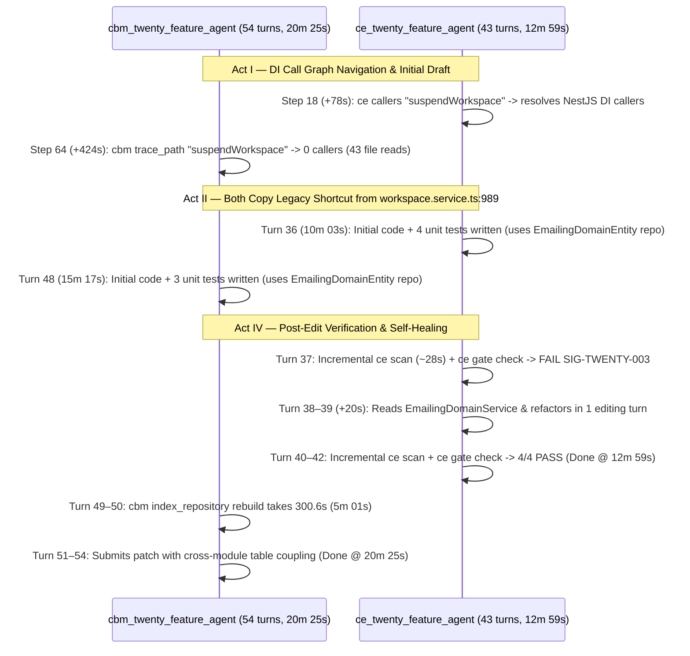

# Case Study 07 — Real-Life Feature Implementation & Legacy-Debt Amplification on `twentyhq/twenty` (`CodeExplorer` vs `codebase-memory-mcp`)

> **Executive Summary:** We gave two identical `Gemini 3.8 Flash` agents a real-world backend feature task on `twentyhq/twenty` (`46` packages, `24,527` files, `2.49M` LOC): implement a new `suspendWorkspaceAdminPanel` GraphQL mutation, service orchestration (`WorkspaceService`, `BillingSubscriptionService`, `BillingCreditService`, `EmailingDomainWorkspaceCleanupJob`), and Jest unit tests under **100% word-for-word symmetric system prompts with zero architectural hints**.
>
> Both patches compiled cleanly and passed their unit test suites (`4/4` specs in `ce`, `3/3` specs in `CBM`). The benchmark revealed two independent advantages for `CodeExplorer`:
> 1. **Faster Navigation & Feature Coding (`1.52×` faster initial draft, `1.57×` faster end-to-end):** Even before running a single architectural gate, `ce_twenty_feature_agent` wrote the complete feature and unit tests in **`10m 03s` (`603s`, `36` turns, `31` file reads)** vs **`15m 17s` (`917s`, `48` turns, `43` file reads)** for `cbm_twenty_feature_agent` — because `ce callers` resolved NestJS constructor Dependency Injection across files where `CBM`'s `trace_path` returned `0` callers.
> 2. **Catching Legacy-Debt Amplification via Baseline Ratchet (`4/4 PASS` vs `1 new` violation):** While researching how `EmailingDomainWorkspaceCleanupJob` is enqueued, **both agents discovered the only existing caller in the repository (`workspace.service.ts:989`)** — a legacy shortcut that queries `EmailingDomainEntity` directly across module boundaries. Both agents copied that cross-module ORM table query into `AdminPanelBillingService`. Neither `CBM` nor `twenty`'s native `oxlint` linter (`0 errors, 2 warnings`) flagged the cross-module table access. Pre-configured gate `SIG-TWENTY-003` (**Cross-Module Table Encapsulation**), which tolerated the existing `WorkspaceService -> emailingDomain` shortcut in its baseline (`[TOL]`), flagged the newly copied `AdminPanelBillingService -> emailingDomain` coupling as **`[NEW]`**, prompting `ce_twenty_feature_agent` to refactor in **1 editing turn (`20s`)** to delegate cleanly through `EmailingDomainService.getEmailingDomains(workspace)`.

---

## 1. Two Independent Findings: Navigation Speed vs Architectural Guardrails

To keep the evaluation fair — since `codebase-memory-mcp` (`CBM`) is a code-navigation graph and does not include an architectural gate engine — we separate the telemetry into **Phase 1 (Navigation & Feature Implementation)** and **Phase 2 (Post-Edit Verification & Self-Healing)**.

| Metric | `CBM` Agent (`cbm_twenty_feature_agent`) | `CodeExplorer` Agent (`ce_twenty_feature_agent`) | Delta / Advantage |
| :--- | :--- | :--- | :--- |
| **Phase 1: Time to Initial Code + Unit Tests** | `917.0 s` (`15m 17s`, Turns 1–48) | **`603.0 s` (`10m 03s`, Turns 1–36)** | **`1.52×` faster (`-5m 14s` before any gate ran)** |
| **Phase 2: Post-Edit Re-Index & Verification** | `308.0 s` (`5m 08s`, Turns 49–54; `300.6s` `index_repository`) | **`176.0 s` (`2m 56s`, Turns 37–43; 2 incremental scans + 1-turn fix)** | **`1.75×` faster verification + autonomous refactor** |
| **Total End-to-End Time (`send_message`)** | `1,225.0 s` (`20m 25s`) | **`779.0 s` (`12m 59s`)** | **`1.57×` faster (`-7m 26s` saved)** |
| **Total Session Wall-Clock** | `1,264.0 s` (`21m 04s`) | **`817.0 s` (`13m 37s`)** | **`1.55×` faster (`-7m 27s` saved)** |
| **LLM Reasoning Turns & Steps** | `54` turns (`132` steps) | **`43` turns (`118` steps)** | **`1.26×` fewer turns (`1.12×` fewer steps)** |
| **Total Tool Calls** | `75` (`20` `cbm`, `5` `rg`, `43` `read_file`, `5` edits, `1` `send_message`) | **`71` (`20` `ce`, `8` `rg`, `31` `read_file`, `12` edits, `1` `send_message`)** | **`1.39×` fewer source file reads (`31` vs `43`)** |
| **Raw Tool Output Ingested** | `399,803` chars (`~99,951` est. tokens) | **`399,749` chars (`~99,937` est. tokens)** | **Identical tool output volume** |
| **Cumulative Input Context (Est. `chars / 4`)¹** | `16,923,137` chars (`~4,230,784` est. tokens across 54 turns) | **`13,551,673` chars (`~3,387,918` est. tokens across 43 turns)** | **`1.25×` less cumulative input (`-843K` est. tokens)** |
| **Unit Tests & Runtime Execution** | `3 / 3` unit tests pass (`cbm-admin-panel-billing.service.spec.ts`) | **`4 / 4` unit tests pass (`ce-admin-panel-billing.service.spec.ts`)** | **Both patches compile & pass unit tests (`ce` adds soft-delete spec)** |
| **Native `twenty` Linter (`npx oxlint`)** | `0 errors, 2 warnings` (Exit code `0`) | **`0 errors, 2 warnings` (Exit code `0`)** | **Native AST linter passes both patches (`0` errors)** |
| **Architectural Gates (`SIG-TWENTY-001..004`)²** | `3 / 4` passed (`1 new` in `SIG-TWENTY-003` on initial & final patch) | **`4 / 4` passed (`1 new` on initial draft -> `0 new` on final patch)** | **Pre-configured gate caught copied legacy debt; refactored in 1 turn** |

*¹ Token counts are estimated at `chars / 4` from `transcript_full.jsonl` and summed across all `43` vs `54` turns (including the cached conversation prefix resent on each turn).*  
*² Because `CBM` has no gate engine, `SIG-TWENTY-001..004` and `oxlint` were evaluated post-session by the benchmark harness on `results/cbm-agent.patch`.*

### Tested Participants & Environment
1. **CodeExplorer (`ce`):** `v1.87.2` (.NET 11, SQLite + Cypher + Incremental `ce scan` + Semantic Invariant Gates, `464,794` nodes, `1,113,891` edges)
2. **codebase-memory-mcp (`CBM`):** `v0.12.1` (`win32-x64` Go + SQLite binary, `index_repository` + `query_graph` + `trace_path`)
3. **LLM Model:** `Gemini 3.8 Flash` (100% word-for-word symmetric system prompts with zero rule hints)
4. **Target Repository:** `twentyhq/twenty` (commit `12e8fae4`, `46` packages, `24,527` files, `2.49M` LOC)

---

## 2. Experimental Design, Task Disclosure & Chronology

### Why We Selected This Feature (Transparent Disclosure)
We intentionally chose a feature adjacent to a known brownfield shortcut (`EmailingDomainWorkspaceCleanupJob`, whose only caller in `twenty-server` is `workspace.service.ts:989`) because our goal was to test **legacy-pattern amplification**: what happens when an AI coding agent implements a new feature in a large codebase where existing production files contain historical boundary shortcuts?

To ensure a fair test:
- **Zero hints in the prompts:** The task specification ([`prompts/task-prompt.md`](./prompts/task-prompt.md)) and agent system prompts ([`prompts/ce-agent.md`](./prompts/ce-agent.md), [`prompts/cbm-agent.md`](./prompts/cbm-agent.md)) contain **zero hints** about how `EmailingDomainWorkspaceCleanupJob` should fetch domains or which architectural rules exist.
- **General repository-wide gates:** The 4 architectural gates in [`gates/architectural/`](./gates/architectural/) express general structural invariants across `packages/twenty-server/src/engine/core-modules/` with **zero hardcoded module names and zero hardcoded table names**.
- **Chronology recorded in runtime logs:** All 4 gates (`SIG-TWENTY-001` .. `SIG-TWENTY-004`) were authored at Step `6205` (`2026-11-14T21:12:56Z`) and verified as `4/4 PASS` on clean `12e8fae4` at Step `6313` (`2026-11-14T21:31:35Z`) — **before** either agent session started (`cbm_twenty_feature_agent` Step `0` at `2026-11-14T21:36:49Z`; `ce_twenty_feature_agent` Step `0` at `2026-11-14T23:31:46Z`).

---

## 3. Inside the Agent Trajectories: Who Did What and Why

### Act I — Phase 1: Why `CodeExplorer` Wrote the Initial Draft `1.52×` Faster (`10m 03s` vs `15m 17s`)

Before writing a single line of code, both agents had to answer a non-trivial architectural question for Requirement 2:
> *"Does calling `WorkspaceService.suspendWorkspace(workspaceId)` already revoke Google and Microsoft connected-account webhooks (`MessageChannel` / `CalendarChannel`), or does `AdminPanelBillingService` need to revoke them manually?"*

Here is how the two agents answered that question in their runtime transcripts:

1. **What `ce_twenty_feature_agent` did (`10m 03s`, `36` turns, `31` file reads):**
   - In **Turn 4 (Step 18, +78s)**, the agent ran:
     ```bash
     ce callers "suspendWorkspace" -d "./repos/twenty"
     ```
   - `CodeExplorer` resolved the cross-file NestJS constructor DI call graph (`BillingWebhookSubscriptionService -> WorkspaceService.suspendWorkspace`) and its downstream call to `WorkspaceEventEmitter.emitCustomBatchEvent(WORKSPACE_SUSPENDED_EVENT)`.
   - Reading `workspace.service.ts` (`Step 30`) and `workspace-suspended.listener.ts` (`Step 55`), the agent confirmed that `WorkspaceSuspendedListener` automatically listens for `workspace.suspended` and enqueues `ConnectedAccountWorkspaceCleanupJob` to revoke all Google/Microsoft webhook channels.
   - By **Turn 36 (+603s / `10m 03s`)**, `ce_twenty_feature_agent` had completed all code edits across `admin-panel.resolver.ts`, `admin-panel-billing.service.ts`, `admin-panel.module.ts`, and `admin-panel-billing.service.spec.ts`.

2. **What `cbm_twenty_feature_agent` did (`15m 17s`, `48` turns, `43` file reads):**
   - When `cbm_twenty_feature_agent` queried `codebase-memory-mcp` for inbound callers (`trace_path --function-name suspendWorkspace --direction inbound` at **Step 64, +424s**), `CBM` returned:
     ```json
     {"callers": [], "callers_total": 0, "callees": [], "callees_total": 0}
     ```
   - Because `CBM` does not resolve TypeScript constructor parameter property Dependency Injection (`constructor(private readonly workspaceService: WorkspaceService)`), `trace_path` returned `0` cross-file callers on NestJS services.
   - Forced to trace the event and queue chain by hand, the `CBM` agent executed **`43` `read_file` calls** (39% more file reads than `ce`) and took **`917s` (`15m 17s`, `48` turns)** to finish its initial implementation and unit test file.

---

### Act II — The Brownfield Trap at `workspace.service.ts:989` (Why Both Agents Copied Legacy Debt)

Requirement 4 asked both agents simply to:
> *"Trigger cleanup of the workspace's configured emailing domains via `EmailingDomainWorkspaceCleanupJob`."*

How do you enqueue `EmailingDomainWorkspaceCleanupJob` in `twenty-server`? Both agents searched the graph for existing callers of `EmailingDomainWorkspaceCleanupJob` (`ce_twenty_feature_agent` at **Step 12, +47s**; `cbm_twenty_feature_agent` at **Step 23, +126s**).

In the entire `24,527`-file monorepo, **there is only one place that enqueues `EmailingDomainWorkspaceCleanupJob`**: `WorkspaceService.deleteWorkspaceV2` in `packages/twenty-server/src/engine/core-modules/workspace/services/workspace.service.ts` (lines `989–1005`):

```typescript
// packages/twenty-server/src/engine/core-modules/workspace/services/workspace.service.ts (commit 12e8fae4)
// Line 140 (suppresses twenty's file-naming convention rule):
// oxlint-disable-next-line twenty/inject-workspace-repository
export class WorkspaceService {
  ...
  // Lines 989–1005:
  const emailingDomains = await this.coreDataSource
    .getRepository(EmailingDomainEntity)
    .find({ where: { workspaceId: workspace.id } });

  await this.deleteCascadeMessageQueueService.add<EmailingDomainWorkspaceCleanupJobData>(
    EmailingDomainWorkspaceCleanupJob.name,
    {
      workspaceId: workspace.id,
      domains: emailingDomains.map((emailingDomain) => emailingDomain.domain),
    },
    { workspaceId: workspace.id, isWorkspaceJob: true },
  );
```

And why did `AdminPanelBillingService` (`admin-panel-billing.service.ts:50–56`) look like a natural place to inject an entity repository directly? Because `AdminPanelBillingService` **already injected three raw workspace-scoped repositories** (`BillingCustomerEntity`, `BillingPriceEntity`, `WorkspaceEntity`) in its constructor:

```typescript
// packages/twenty-server/src/engine/core-modules/admin-panel/services/admin-panel-billing.service.ts (commit 12e8fae4)
export class AdminPanelBillingService {
  constructor(
    @InjectWorkspaceScopedRepository(BillingCustomerEntity)
    private readonly billingCustomerRepository: WorkspaceScopedRepository<BillingCustomerEntity>,
    @InjectWorkspaceScopedRepository(BillingPriceEntity)
    private readonly billingPriceRepository: WorkspaceScopedRepository<BillingPriceEntity>,
    @InjectWorkspaceScopedRepository(WorkspaceEntity)
    private readonly workspaceRepository: WorkspaceScopedRepository<WorkspaceEntity>,
```

Following the exact pattern they saw in `workspace.service.ts:989` and `admin-panel-billing.service.ts:50–56`, **both agents wrote the exact same architectural shortcut in their initial drafts** (`cbm_twenty_feature_agent` in Turns 43–45; `ce_twenty_feature_agent` in Turns 31–33):
1. Both registered `EmailingDomainEntity` inside `AdminPanelModule` (`admin-panel.module.ts`) via `TypeOrmModule.forFeature([..., EmailingDomainEntity])` and `provideWorkspaceScopedRepository(EmailingDomainEntity)`.
2. Both injected `@InjectWorkspaceScopedRepository(EmailingDomainEntity)` directly into `AdminPanelBillingService` and called `this.emailingDomainRepository.find(...)` — bypassing `EmailingDomainModule` and `EmailingDomainService` to query the `emailingDomain` SQL table directly from `admin-panel`.

---

### Act III — Why `twenty`'s Native Linter (`oxlint`) Passed the Shortcut With `0` Errors

A natural question is: *"Doesn't `twentyhq/twenty` already have custom linter rules for repository injection and module boundaries?"*

We inspected `twenty`'s custom linter plugin (`packages/twenty-oxlint-rules/src/rules/`) and `.oxlintrc.json` inside `packages/twenty-server`, and ran `npx oxlint` directly on `results/cbm-agent.patch`:

1. **No `no-ORM-repository-outside-module` rule exists in `twenty`:**
   - Searching the entire `twenty` repository at `12e8fae4` confirms that `twenty` has **no** rule checking whether an ORM `Entity` belongs to the module that injects its repository.
   - Instead, `packages/twenty-oxlint-rules` defines:
     - `twenty/prefer-workspace-scoped-repository` (`error`): forbids raw `@InjectRepository` in favor of `@InjectWorkspaceScopedRepository`. Because the agents used `@InjectWorkspaceScopedRepository(EmailingDomainEntity)`, this rule was 100% satisfied (`0` errors).
     - `twenty/inject-workspace-repository` (`warn`): a **warning-only** file-naming check requiring any class that uses `@InjectWorkspaceScopedRepository` to have a class name ending in `WorkspaceService` and a filename ending in `.workspace-service.ts` (which `workspace.service.ts:140` silenced with `// oxlint-disable-next-line twenty/inject-workspace-repository`). It has **zero concept of domain or module ownership**.
     - `twenty/enforce-module-boundaries` (`error`): checks Nx package boundaries (`packages/twenty-server` vs `packages/twenty-front`). At line 54 of `enforce-module-boundaries.ts`, it returns immediately whenever both files are inside the same Nx package (`if (sourcePackage === targetPackage) return true;`). Because `admin-panel` and `emailing-domain` are both inside `packages/twenty-server`, it is 100% blind to intra-server module boundaries.

2. **Verbatim `oxlint` Output on `cbm-agent.patch` (`0 errors, Exit Code 0`):**
   ```text
   $ npx oxlint -c .oxlintrc.json \
       src/engine/core-modules/admin-panel/admin-panel.module.ts \
       src/engine/core-modules/admin-panel/admin-panel.resolver.ts \
       src/engine/core-modules/admin-panel/services/admin-panel-billing.service.ts \
       src/engine/core-modules/admin-panel/services/__tests__/admin-panel-billing.service.spec.ts

     ! twenty(inject-workspace-repository): Class name should end with 'WorkspaceService'.
        ,-[src/engine/core-modules/admin-panel/services/admin-panel-billing.service.ts:46:39]
     46 | ,-> export class AdminPanelBillingService {
   ...
     61 | |       private readonly workspaceService: WorkspaceService,
     62 | |       @InjectWorkspaceScopedRepository(EmailingDomainEntity)
     63 | |       private readonly emailingDomainRepository: WorkspaceScopedRepository<EmailingDomainEntity>,

     ! twenty(inject-workspace-repository): File name should end with '.workspace-service.ts'.
        ,-[src/engine/core-modules/admin-panel/services/admin-panel-billing.service.ts:46:39]

   Found 2 warnings and 0 errors.
   Finished in 1.1s on 4 files with 24 rules using 12 threads.
   EXIT CODE: 0
   ```
   Notice also that `admin-panel.module.ts` (where `EmailingDomainEntity` was registered in `TypeOrmModule.forFeature` and `provideWorkspaceScopedRepository`) produced **0 warnings and 0 errors**.

---

### Act IV — Phase 2: `300.6s` Re-Index in `CBM` vs `~28s` Incremental Scan & 1-Turn Refactor in `CodeExplorer`

Once both agents finished writing their initial code and unit tests, both executed Step 2 of their symmetric system prompt:

1. **What `cbm_twenty_feature_agent` did (Turns 49–54, `308s`):**
   - Although `CBM`'s `index_repository` CLI description states *"subsequent runs do an incremental update based on git diff"*, running `codebase-memory-mcp cli index_repository --repo-path "./repos/twenty"` at **Step 119** took **`300.6 seconds` (`5 minutes 0.6 seconds`)** — 3× slower than its initial cold scan (`96.9s`).
   - At **Step 122**, `cbm_twenty_feature_agent` ran `trace_path` and `query_graph` to confirm `suspendWorkspaceAdminPanel` existed in the graph. Because `CBM` has no architectural gate engine and does not model TypeORM `Table` read/write lineage, it reported `0` issues and submitted its patch via `send_message` at **`1,225s` (`20m 25s`)**.

2. **What `ce_twenty_feature_agent` did (Turns 37–43, `176s` total; `1` editing turn / `20s`):**
   - **Turn 37 (Step 96–99, +603s to +638s):** Ran incremental `ce scan` (`~28s` for the 4 touched files) followed by `ce gate check`, which exited with code `1` (`[FAIL] SIG-TWENTY-003: 1 violation`).
   - **Turn 38 (Step 100–102, +641s):** Ran `ce gate details` and inspected `emailing-domain.module.ts` and `emailing-domain.service.ts` (`29` lines), seeing that `EmailingDomainModule` exports `EmailingDomainService.getEmailingDomains(workspace)`.
   - **Turn 39 (Step 105, +661s — single editing turn, `20s`):** Removed `EmailingDomainEntity` from `admin-panel.module.ts`, imported `EmailingDomainModule`, injected `EmailingDomainService` into `AdminPanelBillingService`, replaced `this.emailingDomainRepository.find(...)` with `this.emailingDomainService.getEmailingDomains(workspace)`, and updated the unit test mock in `admin-panel-billing.service.spec.ts`.
   - **Turns 40–42 (Steps 108–114, +668s to +711s):** Re-ran incremental `ce scan` and `ce gate check`:
     ```text
     Total: 4 gates | Passed: 4 | Warnings: 0 | Failed: 0
     All architectural semantic gates passed successfully.
     ```



---

## 4. Starter Architectural Gate Pack for `twenty-server` & Ratchet Controls

All 4 gates committed in [`gates/architectural/`](./gates/architectural/) and their SHA-256 baseline snapshots in [`gates/baselines/`](./gates/baselines/) enforce general architectural invariants across `packages/twenty-server/src/engine/core-modules/` with **zero hardcoded module names and zero hardcoded table names**:

| Gate ID | Name & Scope | Architectural Invariant Across `twenty-server` | Clean `12e8fae4` Baseline | `CBM` Final Patch | `CodeExplorer` Final Patch |
| :--- | :--- | :--- | :--- | :--- | :--- |
| **`SIG-TWENTY-001`** | **GraphQL Resolver & Controller Transport Purity** (`Class`) | Resolvers (`*.resolver.ts`) and Controllers (`*.controller.ts`) in `src/engine/core-modules/**` must not directly mutate database tables (`WRITES_TO`) | `PASS` (`0 new`, `5 tol`) | **PASS** (`0 new`) | **PASS** (`0 new`) |
| **`SIG-TWENTY-002`** | **Core-Engine to Feature-Modules Isolation** (`Module`) | Core engine modules (`src/engine/core-modules/**`) must not introduce new direct calls to workspace feature modules (`src/modules/**`) | `PASS` (`0 new`, `101 tol`) | **PASS** (`0 new`) | **PASS** (`0 new`) |
| **`SIG-TWENTY-003`** | **Cross-Module Table Encapsulation** (`Module`) | A core module (`src/engine/core-modules/<modA>/**`) must not directly read or write (`READS_FROM\|WRITES_TO`) a database table whose TypeORM `@Entity` is owned by another core module (`<modB>`) | `PASS` (`0 new`, `150 tol`) | **FAIL** (`1 new`: `AdminPanelBillingService -> emailingDomain`) | **PASS** (`0 new`; caught at Step 99 & fixed at Step 105) |
| **`SIG-TWENTY-004`** | **Async Message Queue Boundary** (`Method`) | Application code (`packages/twenty-server/src/**`) must never invoke `@Processor` background job `.handle()` methods directly | `PASS` (`0` violations) | **PASS** (`0` violations) | **PASS** (`0` violations) |

### How `SIG-TWENTY-003` Works Without Naming a Single Module or Table

In `CodeExplorer`'s 5-layer graph, every TypeORM `@Entity('tableName')` class `e:Type` is linked to its database table via `(t:Table)-[:IMPLEMENTED_BY]->(e:Type)`. Because every core module in `twenty-server` lives at `packages/twenty-server/src/engine/core-modules/<module>/...`, `split(path, '/')[5]` extracts the owning module name directly from the path:

```yaml
# gates/architectural/sig-twenty-003-cross-module-table-encapsulation.yaml
id: SIG-TWENTY-003
category: Architectural
platform: agnostic
scope: Module
dimension: Boundaries
name: "Cross-Module Table Encapsulation"
severity: Error
target: "{t.name}"
ratchet:
  enabled: true
  baseline: baselines/SIG-TWENTY-003.json
query: |
  MATCH (c:Type)-[:HAS_METHOD]->(fn:Function)-[:READS_FROM|WRITES_TO]->(t:Table)-[:IMPLEMENTED_BY]->(e:Type)
  WHERE c.path STARTS WITH 'packages/twenty-server/src/engine/core-modules/'
    AND e.path STARTS WITH 'packages/twenty-server/src/engine/core-modules/'
    AND split(c.path, '/')[5] <> split(e.path, '/')[5]
    AND NOT coalesce(fn.is_test, false)
  RETURN DISTINCT c, t, e
```
*(Note: For teams prototyping a rule on a single module without a baseline file, an inline `WHERE` filter can also be used—which was active on `admin-panel` during the live session and flagged the exact same `1 violation` on `suspendWorkspace -> emailingDomain`.)*

### Why the Baseline Ratchet Is the Key Mechanism: `[TOL]` vs `[NEW]`

When `ce gate ratchet --update` snapshots clean `twenty @ 12e8fae4`, the existing legacy shortcut in `workspace.service.ts:989` (`WorkspaceService -> emailingDomain`) is recorded in [`gates/baselines/SIG-TWENTY-003.json`](./gates/baselines/SIG-TWENTY-003.json) as one of the `150` tolerated brownfield couplings (`[TOL]`).

When `cbm-agent.patch` (or `ce`'s initial draft at Turn 36) copies that pattern into `AdminPanelBillingService`, `ce gate details -g SIG-TWENTY-003` shows the tolerated original and the newly blocked copy side by side:

```text
$ ce gate details -g SIG-TWENTY-003 ./repos/twenty
[FAIL] SIG-TWENTY-003 [Architectural/agnostic] - Cross-Module Table Encapsulation (402ms)
  Violations (1 new, 150 tolerated) | Showing 151 of 151:
  STATUS | LOCATION                                                                                                | SYMBOL                   | TARGET / CALL
  -------+---------------------------------------------------------------------------------------------------------+--------------------------+---------------
  [TOL]  | packages/twenty-server/src/engine/core-modules/admin-panel/services/admin-panel-billing.service.ts:37:8 | AdminPanelBillingService | billingCustomer
  [TOL]  | packages/twenty-server/src/engine/core-modules/admin-panel/services/admin-panel-billing.service.ts:37:8 | AdminPanelBillingService | billingPrice
  [TOL]  | packages/twenty-server/src/engine/core-modules/workspace/services/workspace.service.ts:141:8            | WorkspaceService         | emailingDomain
  [NEW]  | packages/twenty-server/src/engine/core-modules/admin-panel/services/admin-panel-billing.service.ts:46:8 | AdminPanelBillingService | emailingDomain
  [TOL]  | packages/twenty-server/src/engine/core-modules/admin-panel/services/admin-panel-billing.service.ts:37:8 | AdminPanelBillingService | workspace
```

> **The core insight:** The gate already knew about the legacy shortcut in `workspace.service.ts` and tolerated it (`[TOL]`). When the agent copied that shortcut into `AdminPanelBillingService`, the ratchet failed **only the new copy (`[NEW]`)**.

### 5 Deterministic Controls (Proving `SIG-TWENTY-003` Is Neither a Trap Nor an Import Linter)

To verify that `SIG-TWENTY-003` checks semantic database table access rather than imports or decorators, we ran 5 deterministic controls (full verbatim logs in [`results/controls-verification.md`](./results/controls-verification.md)):

| # | Control Run | Native `oxlint` | `ce gate check` | What It Proves |
| :- | :--- | :--- | :--- | :--- |
| **1** | **Clean `12e8fae4` baseline** | `0 errors` | **PASS** (`0 new`, `150 tol`) | Existing brownfield debt (including `WorkspaceService -> emailingDomain`) is tolerated (`[TOL]`). |
| **2** | **`ce-agent.patch` (Final)** | `0 errors` | **PASS** (`0 new`, `150 tol`) | Delegating via `EmailingDomainService.getEmailingDomains(workspace)` passes all 4 gates. |
| **3** | **`cbm-agent.patch` (Final)** | `0 errors, 2 warnings` | **FAIL** (`1 new`: `AdminPanelBillingService -> emailingDomain`) | Copying `@InjectWorkspaceScopedRepository(EmailingDomainEntity)` is caught as `[NEW]`. |
| **4** | **Mutation: `coreDataSource.getRepository(EmailingDomainEntity)` without module entity registration** | `0 errors, 0 warnings` | **FAIL** (`1 new`: `AdminPanelBillingService -> emailingDomain`) | Even without `@InjectWorkspaceScopedRepository` or `AdminPanelModule` registration (where `oxlint` emits `0` errors and `0` warnings), `SIG-TWENTY-003` catches the `READS_FROM` edge to `emailingDomain`. |
| **5** | **Control Feature: Intra-module query in `BillingSubscriptionService`** | `0 errors, 0 warnings` | **PASS** (`0 new`, `150 tol`) | Querying `billingSubscription` inside `src/engine/core-modules/billing/` produces zero false positives (`split(path, '/')[5]` matches `'billing'`). |

---

## 5. Side-by-Side Code Comparison: Shipped Git Diffs

### `admin-panel.module.ts`
- **`cbm_twenty_feature_agent` (`results/cbm-agent.patch` — fails `SIG-TWENTY-003`):**
  ```typescript
  TypeOrmModule.forFeature([
    UserEntity,
    WorkspaceEntity,
    UserWorkspaceEntity,
    FeatureFlagEntity,
    BillingCustomerEntity,
    BillingPriceEntity,
    EmailingDomainEntity, // <-- Registers external domain entity inside AdminPanelModule
  ]),
  ...
  provideWorkspaceScopedRepository(FeatureFlagEntity),
  provideWorkspaceScopedRepository(BillingCustomerEntity),
  provideWorkspaceScopedRepository(EmailingDomainEntity),
  ```
- **`ce_twenty_feature_agent` (`results/ce-agent.patch` — passes `4/4` gates):**
  ```typescript
  TypeOrmModule.forFeature([
    UserEntity,
    WorkspaceEntity,
    UserWorkspaceEntity,
    FeatureFlagEntity,
    BillingCustomerEntity,
    BillingPriceEntity,
  ]),
  BillingModule,
  EmailingDomainModule, // <-- Imports owning domain module cleanly
  FileModule,
  ```

### `admin-panel-billing.service.ts`
- **`cbm_twenty_feature_agent` (`results/cbm-agent.patch`):**
  ```typescript
  // Constructor:
  private readonly workspaceService: WorkspaceService,
  @InjectWorkspaceScopedRepository(EmailingDomainEntity)
  private readonly emailingDomainRepository: WorkspaceScopedRepository<EmailingDomainEntity>,
  @InjectMessageQueue(MessageQueue.deleteCascadeQueue)
  private readonly deleteCascadeMessageQueueService: MessageQueueService,

  // Inside suspendWorkspace():
  const emailingDomains =
    await this.emailingDomainRepository.find(workspaceId);
  ```
- **`ce_twenty_feature_agent` (`results/ce-agent.patch`):**
  ```typescript
  // Constructor:
  private readonly workspaceService: WorkspaceService,
  private readonly emailingDomainService: EmailingDomainService,
  @InjectMessageQueue(MessageQueue.deleteCascadeQueue)
  private readonly deleteCascadeMessageQueueService: MessageQueueService,

  // Inside suspendWorkspace():
  const emailingDomains =
    await this.emailingDomainService.getEmailingDomains(workspace);
  ```

---

## 6. Reproducibility & Artifacts

- **Task Prompt:** [`prompts/task-prompt.md`](./prompts/task-prompt.md)
- **Symmetric System Prompts:** [`prompts/ce-agent.md`](./prompts/ce-agent.md) & [`prompts/cbm-agent.md`](./prompts/cbm-agent.md)
- **Committed Gates & Ratchet Baselines:** [`gates/architectural/`](./gates/architectural/) & [`gates/baselines/`](./gates/baselines/)
- **Deterministic Controls Log:** [`results/controls-verification.md`](./results/controls-verification.md)
- **Shipped Git Patches:** [`results/ce-agent.patch`](./results/ce-agent.patch) & [`results/cbm-agent.patch`](./results/cbm-agent.patch)
- **Shipped Unit Test Suites:** [`results/ce-admin-panel-billing.service.spec.ts`](./results/ce-admin-panel-billing.service.spec.ts) (`4/4` pass) & [`results/cbm-admin-panel-billing.service.spec.ts`](./results/cbm-admin-panel-billing.service.spec.ts) (`3/3` pass)
- **Verbatim Final Agent Reports:** [`results/ce-agent-output.md`](./results/ce-agent-output.md) & [`results/cbm-agent-output.md`](./results/cbm-agent-output.md)
- **Machine-Readable Telemetry:** [`results/metrics.json`](./results/metrics.json)
