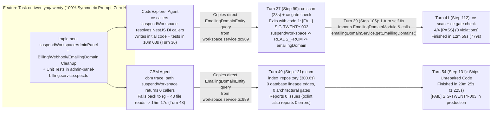

# Case Study 07: What Actually Happens When Coding Agents Implement a Feature in a 2.5M-LOC Monorepo (`twentyhq/twenty`: `CodeExplorer` vs `codebase-memory-mcp`)

> **The Short Story**: We gave two identical **Gemini 3.8 Flash** agents the exact same feature specification (`suspendWorkspaceAdminPanel`) on [`twentyhq/twenty`](https://github.com/twentyhq/twenty) (`12e8fae4` — **46 packages**, **24,527 files**, **~2.49M LOC**), with **zero hints** about architectural boundaries or which services to call.
>
> Both agents needed to trigger emailing-domain cleanup when an admin suspends a workspace. Both searched the codebase for `EmailingDomainWorkspaceCleanupJob` and found the **only existing place in `twenty-server` that enqueues it**: `workspace.service.ts:989`. In that legacy method, an earlier developer bypassed `EmailingDomainModule` and queried `EmailingDomainEntity` directly (`this.coreDataSource.getRepository(EmailingDomainEntity).find(...)`).
>
> Acting as pattern amplifiers, **both agents copied that direct ORM table access into `AdminPanelModule` and `AdminPanelBillingService`** — blending `workspace.service.ts:989` with `@InjectWorkspaceScopedRepository(...)` from `admin-panel-billing.service.ts:50`:
> - **Win #1 — Navigation & Coding Speed (`1.52×` faster before any gates run)**: Because `codebase-memory-mcp` (`CBM`) cannot resolve TypeScript/NestJS constructor Dependency Injection (`private readonly workspaceService: WorkspaceService`), its `trace_path` tool returned **`0` callers** for `suspendWorkspace`. The `CBM` agent had to fall back to `ripgrep` and **43 file reads**, taking **`15m 17s` (`917s`)** to write its initial code and unit tests. The `CodeExplorer` (`ce`) agent resolved the DI call graph on the first try (`31` file reads) and finished its initial code and unit tests in **`10m 03s` (`603s`)**.
> - **Win #2 — Active Architectural Defense & 1-Turn Self-Healing**: When the `CBM` agent ran its post-edit verification (`index_repository`), `CBM` took **`300.6s` (`5 minutes`)** to rebuild the full repository index from scratch, extracted **`0` database table lineage edges (`READS_FROM` / `WRITES_TO`)**, and reported zero issues. Even worse, running `twenty`'s own native linter (`npx oxlint -c .oxlintrc.json`) on `cbm-agent.patch` exits with **`0 errors` (`EXIT CODE: 0`)**. The `CBM` agent shipped the cross-module encapsulation leak straight into production.
> - When the `CodeExplorer` agent ran incremental `ce scan` (`~28s`) and `ce gate check`, **`SIG-TWENTY-003`** immediately failed (`suspendWorkspace -> READS_FROM -> emailingDomain`). The agent ran `ce gate details`, read the remediation, refactored `AdminPanelModule`, `AdminPanelBillingService`, and the unit tests in **1 LLM turn** to call `EmailingDomainService.getEmailingDomains(workspace)`, verified **`4/4 [PASS]`**, and finished in **`12m 59s` (`779s`) — `1.57×` faster end-to-end than `CBM` with `0` architectural violations**.

---

## 1. The Hidden Danger of Coding Agents: Legacy Pattern Amplification

Most code-graph benchmarks only test read-only Q&A ([Case Study 01](../01-agent-audit-ce-vs-cbm-on-twenty/README.md)). Read-only benchmarks tell you whether an agent can find symbols, but they miss the hardest problem in real-world AI software engineering: **what happens when an agent writes new production code inside a mature codebase with legacy shortcuts?**

Every large production repository has historical technical debt — places where an earlier developer bypassed a module boundary, reached directly into another domain's database table, or suppressed a linter warning. When an LLM coding agent implements a new feature:
1. It searches the repository for an existing caller of the job, event, or entity mentioned in the spec.
2. It treats whatever code it finds in the repository as the blessed architectural pattern.
3. It copies that pattern into the target module, mocks the dependencies in its new unit test so the test suite passes 100%, and reports completion.

We built **Case Study 07** on [`twentyhq/twenty`](https://github.com/twentyhq/twenty) (`12e8fae4`) to watch this exact phenomenon play out step-by-step under **100% symmetric, zero-hint prompts**.

---

## 2. Task & Zero-Hint Setup

Both agents received the exact same 6-requirement feature prompt ([`prompts/task-prompt.md`](./prompts/task-prompt.md)) and symmetric system instructions ([`prompts/ce-agent.md`](./prompts/ce-agent.md) vs [`prompts/cbm-agent.md`](./prompts/cbm-agent.md)) on `twentyhq/twenty` (`12e8fae4`):

1. **GraphQL Mutation (`AdminPanelResolver`)**: Add `suspendWorkspaceAdminPanel(workspaceId, actor)` in `packages/twenty-server/src/engine/core-modules/admin-panel/admin-panel.resolver.ts`, guarded by `@UseGuards(AccessPolicyGuard(ADMIN_PANEL_ACCESS_POLICY), AdminPanelGuard)`, delegating to `AdminPanelBillingService.suspendWorkspace({ workspaceId, actorUserId: actor.id })`.
2. **Workspace Validation, Suspension & Connected-Account Webhook Revocation**: Verify the workspace exists and is not soft-deleted (`deletedAt` is null), otherwise throw `BillingException` (`BILLING_SUBSCRIPTION_EVENT_WORKSPACE_NOT_FOUND`). Suspend the workspace (`activationStatus = SUSPENDED`, `suspendedAt`, entity cache invalidation) and ensure all connected-account webhook subscriptions (`MessageChannel` / `CalendarChannel` for Google and Microsoft) are revoked.
3. **Billing Subscription Cancellation & Credit Grant Revocation**: When `IS_BILLING_ENABLED` is enabled, cancel the active billing subscription and revoke all currently active credit grants (`isActive`) on behalf of `actorUserId`.
4. **Emailing Domain Cleanup**: *"Trigger cleanup of the workspace's configured emailing domains via `EmailingDomainWorkspaceCleanupJob`."* *(Notice: zero mention of `EmailingDomainEntity` or `EmailingDomainService`.)*
5. **Unit Tests**: Create `packages/twenty-server/src/engine/core-modules/admin-panel/services/__tests__/admin-panel-billing.service.spec.ts` covering not-found error, billing-enabled flow, and billing-disabled flow.
6. **Post-Edit Graph Verification**: Re-index and verify the changes using the assigned graph CLI before submitting.

| Benchmark Dimension | Configuration |
| :--- | :--- |
| **Target Repository** | [`twentyhq/twenty`](https://github.com/twentyhq/twenty) (`12e8fae4`, **46 packages**, **24,527 tracked files**, **~2.49M LOC**) |
| **Model** | **Gemini 3.8 Flash** (`Model: "inherit"`, zero temperature/model overrides) |
| **CodeExplorer Graph (`.codeexplorer/graph.db`, `v1.87.2`)** | **464,794 Nodes** & **1,113,891 Semantic Edges** (`260` `Table` nodes, `7,103` `Query` nodes, `1,194` `Endpoint` nodes, `28` `Topic` queues) |
| **`codebase-memory-mcp` Graph (`CBM` `v0.12.1`)** | **251,750 Nodes** & **914,479 Edges** (`0` database `Table` / `READS_FROM` / `WRITES_TO` edges) |

---

## 3. Executive Scorecard: Two Independent Wins

All metrics below are extracted directly from the raw execution transcripts (`ce` conversation `385986ab-7229-4eee-8e6d-e68dcba45164` and `cbm` conversation `775b7008-fb90-44df-9deb-263c6ebd8c88`) recorded in [`results/metrics.json`](./results/metrics.json):

| Metric | `CodeExplorer` Agent (`ce v1.87.2`) | `CBM` Agent (`codebase-memory-mcp v0.12.1`) | Delta / Outcome |
| :--- | :---: | :---: | :---: |
| **Total Wall-Clock Time (End-to-End)** | **`12m 59s` (`779.0 s`)** | `20m 25s` (`1,225.0 s`) | **`1.57×` faster (`-7m 26s` saved)** |
| **Phase 1: Time to Initial Code + Unit Tests** | **`10m 03s` (`603.0 s`)** | `15m 17s` (`917.0 s`) | **`1.52×` faster (`-5m 14s` saved before gates)** |
| **Phase 2: Post-Edit Re-Index & Verification** | **`2m 56s` (`176.0 s`)**<br>*(2 incremental `ce scan` runs + 1-turn fix)* | `5m 08s` (`308.0 s`)<br>*(1 full `index_repository` rebuild: `300.6s`)* | **`1.75×` faster verification + self-repair** |
| **LLM Turns to Initial Implementation** | **`36` turns (`98` steps)** | `48` turns (`119` steps) | **`25.0%` fewer LLM turns** |
| **Total LLM Turns (Full Session)** | **`43` turns (`118` steps)** | `54` turns (`132` steps) | **`20.4%` fewer LLM turns** |
| **Total Tool Calls** | **`71`** (`27` `run_command`, `31` `read_file`, `11` `edit_file`, `1` `write_file`, `1` `send_message`) | `75` (`26` `run_command`, `43` `read_file`, `4` `edit_file`, `1` `write_file`, `1` `send_message`) | **`27.9%` fewer file reads (`31` vs `43`)** |
| **Cumulative Input Tokens (Across All Turns)**¹ | **`3,387,918 tokens` (`~3.39M`)** | `4,230,784 tokens` (`~4.23M`) | **`19.9%` fewer input tokens (`-843K`)** |
| **Initial Draft Architectural Gates (`4` gates)** | `3/4 PASS`, **`1 FAIL` (`SIG-TWENTY-003`)** | `3/4 PASS`, **`1 FAIL` (`SIG-TWENTY-003`)** | Both copied legacy ORM leak from `workspace.service.ts:989` |
| **Native `twenty` Linter (`npx oxlint`) on Final Code** | `0 errors` (`2 warnings`, exit code `0`) | `0 errors` (`2 warnings`, exit code `0`) | **Native AST linter completely missed the leak** |
| **Final Shipped Code Architectural Gates (`4` gates)** | **`4/4 PASS` (`0` violations)** | **`3/4 PASS`, `1 FAIL` (`SIG-TWENTY-003`)** | **Only `CodeExplorer` caught & repaired the violation** |

*¹ Cumulative Input Tokens is the sum of active prompt context sent across all `43` (`ce`) vs `54` (`cbm`) LLM turns, including prompt-cached prefix tokens.*



---

## 4. Who Did What and Why: Inside the Two Agent Trajectories

### Act I: Why `CodeExplorer` Wrote the Feature `1.52×` Faster (`10m 03s` vs `15m 17s`)

Even if you ignore architectural gates completely, the two agents diverged sharply during code exploration because of how NestJS applications wire dependencies.

To implement Requirement 2 (*"Suspend the workspace... and ensure all connected-account webhook subscriptions (`MessageChannel` / `CalendarChannel` for Google and Microsoft) for that workspace are revoked"*), each agent had to answer a non-trivial architectural question:
> *Does `WorkspaceService.suspendWorkspace(workspaceId)` already revoke connected-account webhooks automatically via an event listener, or does `AdminPanelBillingService` need to call a webhook revocation service itself?*

Here is what each agent did:

1. **Inside the `CodeExplorer` Agent (`Steps 1–98`, `0s` to `603s`, `36` turns, `31` file reads)**:
   - At **Step 18 (`+78s`)**, the agent ran `ce callers "suspendWorkspace"` and immediately got the cross-module NestJS Dependency Injection callers:
     ```text
     Calls 'suspendWorkspace' (2):
       <- Function: BillingWebhookSubscriptionService.suspendWorkspaceIfPastDueTimedOut (packages/twenty-server/src/engine/core-modules/billing/webhooks/services/billing-webhook-subscription.service.ts:276)
       <- Function: InactiveWorkspaceCleanupCronCommand.run (packages/twenty-server/src/engine/core-modules/workspace/crons/commands/inactive-workspace-cleanup.cron.command.ts:62)
     ```
   - Reading `workspace.service.ts:965`, the agent saw that `WorkspaceService.suspendWorkspace(workspaceId)` sets `activationStatus = WorkspaceActivationStatus.SUSPENDED`, invalidates `'workspaceEntity'` in `CoreEntityCacheService`, and emits `WORKSPACE_SUSPENDED_EVENT` (`workspace.suspended`).
   - By tracing `WORKSPACE_SUSPENDED_EVENT`, it confirmed that `WebhookSubscriptionWorkspaceActivationListener` (in `src/modules/connected-account/webhook-subscription/listeners/webhook-subscription-workspace-activation.listener.ts`) listens to `@OnEvent(WORKSPACE_SUSPENDED_EVENT)` and enqueues `SyncWorkspaceWebhookSubscriptionsJob` with `action: 'REVOKE'`.
   - That meant `AdminPanelBillingService` only needed to call `await this.workspaceService.suspendWorkspace(workspaceId)` — without importing anything from `src/modules/connected-account/`.

2. **Inside the `CBM` Agent (`Steps 1–119`, `0s` to `917s`, `48` turns, `43` file reads)**:
   - In NestJS, services are injected via TypeScript constructor parameter properties (`constructor(private readonly workspaceService: WorkspaceService)`). Because `codebase-memory-mcp`'s AST extractor does not resolve TypeScript constructor parameter types to class nodes, when the `CBM` agent ran `trace_path` on `suspendWorkspace` at **Step 64 (`+424s`)**, `CBM` returned **`0` callers**:
     ```json
     {
       "callers_total": 0,
       "mode": "inbound",
       "root": {
         "file_path": "packages/twenty-server/src/engine/core-modules/workspace/services/workspace.service.ts",
         "name": "WorkspaceService.suspendWorkspace"
       }
     }
     ```
   - Earlier, at **Step 11**, the `CBM` agent also queried `CBM` for `EmailingDomainWorkspaceCleanupJob` and received `No symbol matching "EmailingDomainWorkspaceCleanupJob"`.
   - Forced to compensate for broken DI call chains, the `CBM` agent fell back to `ripgrep` and read **43 files** (`12` more file reads and `12` more LLM turns than `CodeExplorer`), reaching its initial implementation at **`15m 17s` (`917s`)** vs **`10m 03s` (`603s`)** for `CodeExplorer`.

---

### Act II: How Both Agents Walked Into the Legacy Trap at `workspace.service.ts:989`

Next, both agents tackled Requirement 4 (*"Trigger cleanup of the workspace's configured emailing domains via `EmailingDomainWorkspaceCleanupJob`"*).

Both agents searched the repository for `EmailingDomainWorkspaceCleanupJob` and found the **only existing call site in `twenty-server`** — inside `WorkspaceService.handleRemoveWorkspaceMember` at `packages/twenty-server/src/engine/core-modules/workspace/services/workspace.service.ts:989-1005`:

```typescript
// Verbatim from packages/twenty-server/src/engine/core-modules/workspace/services/workspace.service.ts
// Line 140:
// oxlint-disable-next-line twenty/inject-workspace-repository
export class WorkspaceService {
  ...
  // Lines 989-1005 (inside handleRemoveWorkspaceMember):
  const emailingDomains = await this.coreDataSource
    .getRepository(EmailingDomainEntity)
    .find({ where: { workspaceId: workspace.id } });

  await this.deleteCascadeMessageQueueService.add<EmailingDomainWorkspaceCleanupJobData>(
    EmailingDomainWorkspaceCleanupJob.name,
    {
      workspaceId: workspace.id,
      domains: emailingDomains.map(
        (emailingDomain) => emailingDomain.domain,
      ),
    },
    {
      workspaceId: workspace.id,
      isWorkspaceJob: true,
    },
  );
```

Look closely at what both agents saw when they read `workspace.service.ts:989` alongside `admin-panel-billing.service.ts:50`:
1. In `workspace.service.ts:989`, `WorkspaceService` did **not** import `EmailingDomainModule` or call `EmailingDomainService.getEmailingDomains(workspace)`. Instead, it reached directly into `EmailingDomainEntity`'s table (`this.coreDataSource.getRepository(EmailingDomainEntity).find(...)`) and mapped `emailingDomains.map((emailingDomain) => emailingDomain.domain)`. *(Note: we verified via `CodeExplorer` that there is no circular dependency between `WorkspaceModule` and `EmailingDomainModule` — `workspace.service.ts:989` is simply a legacy shortcut where the author used `coreDataSource.getRepository` instead of importing `EmailingDomainModule`.)*
2. Meanwhile, in `admin-panel-billing.service.ts:50` (the target class both agents were editing), the first constructor parameter was:
   ```typescript
   @InjectWorkspaceScopedRepository(BillingCustomerEntity)
   private readonly billingCustomerRepository: WorkspaceScopedRepository<BillingCustomerEntity>,
   ```
   registered in `admin-panel.module.ts:64,114` via `TypeOrmModule.forFeature([..., BillingCustomerEntity])` and `provideWorkspaceScopedRepository(BillingCustomerEntity)`.

So **both agents independently synthesized the exact same anti-pattern**:
- They took the direct `EmailingDomainEntity` query from `workspace.service.ts:989`,
- Wrapped it in `@InjectWorkspaceScopedRepository(EmailingDomainEntity)` + `provideWorkspaceScopedRepository(EmailingDomainEntity)` to match `admin-panel-billing.service.ts:50` and `admin-panel.module.ts:114`,
- And wired `AdminPanelBillingService` to read the `emailingDomain` table directly (`suspendWorkspace -> READS_FROM -> emailingDomain`).

---

### Act III: Why `twenty`'s Native Linter (`oxlint`) Completely Missed the Violation

A natural question from any skeptical engineer is:
> *"Wait — doesn't `twenty` have custom `oxlint` rules in `packages/twenty-oxlint-rules/` specifically for repositories and module boundaries? Wouldn't `npx oxlint` catch `cbm-agent.patch` in CI?"*

We tested this directly on `twenty` (`12e8fae4`). We built `packages/twenty-oxlint-rules/dist/oxlint-plugin.mjs`, applied `results/cbm-agent.patch` and `results/cbm-admin-panel-billing.service.spec.ts`, and ran `twenty-server`'s native `oxlint` configuration (`packages/twenty-server/.oxlintrc.json`) on all 4 modified/added files.

Here is the **verbatim CLI output**:

```text
$ npx oxlint -c .oxlintrc.json \
    src/engine/core-modules/admin-panel/admin-panel.module.ts \
    src/engine/core-modules/admin-panel/admin-panel.resolver.ts \
    src/engine/core-modules/admin-panel/services/admin-panel-billing.service.ts \
    src/engine/core-modules/admin-panel/services/__tests__/admin-panel-billing.service.spec.ts

  ! twenty(inject-workspace-repository): Class name should end with 'WorkspaceService'.
     ,-[src/engine/core-modules/admin-panel/services/admin-panel-billing.service.ts:46:39]
  45 |     @Injectable()
  46 | ,-> export class AdminPanelBillingService {
...
  61 | |       private readonly workspaceService: WorkspaceService,
  62 | |       @InjectWorkspaceScopedRepository(EmailingDomainEntity)
  63 | |       private readonly emailingDomainRepository: WorkspaceScopedRepository<EmailingDomainEntity>,

  ! twenty(inject-workspace-repository): File name should end with '.workspace-service.ts'.
     ,-[src/engine/core-modules/admin-panel/services/admin-panel-billing.service.ts:46:39]

Found 2 warnings and 0 errors.
Finished in 1.1s on 4 files with 24 rules using 12 threads.
EXIT CODE: 0
```

**`oxlint` exited with `0 errors` (`EXIT CODE: 0`)!** Why did `twenty`'s custom linter rules fail to catch `AdminPanelModule` and `AdminPanelBillingService` hijacking `EmailingDomainEntity`?

Inspecting `packages/twenty-oxlint-rules/rules/` reveals three structural blind spots of single-file AST linters:
1. **`twenty/prefer-workspace-scoped-repository` (`prefer-workspace-scoped-repository.ts`, `"error"` in `.oxlintrc.json:92`)**:
   - Checks constructor parameters for raw `@InjectRepository(SomeEntity)` and requires `@InjectWorkspaceScopedRepository(SomeEntity)` so queries are scoped by `workspaceId`.
   - **Blind spot**: It has **zero concept of module ownership**. Because `cbm-agent` used `@InjectWorkspaceScopedRepository(EmailingDomainEntity)` (and `workspace.service.ts:989` used `this.coreDataSource.getRepository(EmailingDomainEntity)`), `prefer-workspace-scoped-repository` passes with **`0 errors`**!
2. **`twenty/inject-workspace-repository` (`inject-workspace-repository.ts`, `"warn"` in `.oxlintrc.json:91`)**:
   - Only checks a file/class naming convention: if a constructor injects `@InjectWorkspaceRepository` or any parameter whose type name ends with `WorkspaceService` (like `private readonly workspaceService: WorkspaceService`), it emits a non-blocking warning that the class should end with `WorkspaceService` and the file with `.workspace-service.ts`. (That is why `workspace.service.ts:140` has `// oxlint-disable-next-line twenty/inject-workspace-repository`.)
3. **`twenty/enforce-module-boundaries` (`enforce-module-boundaries.ts`, `"error"` in `.oxlintrc.json:106`)**:
   - Only checks imports across top-level Nx workspace packages (`packages/twenty-server` vs `packages/twenty-front` vs `packages/twenty-shared`).
   - Line 54 of `enforce-module-boundaries.ts` literally reads: `if (sourcePackage === targetPackage) { return true; }`. Every import inside `packages/twenty-server` unconditionally passes.

---

### Act IV: Post-Edit Graph Verification (`300.6s` Blind Rebuild in `CBM` vs `~28s` Incremental Scan + Self-Healing in `CodeExplorer`)

Here is what happened when both agents ran their final verification step:

1. **In the `CBM` Agent (`Steps 121–131`, `917s` to `1,225s`)**:
   - Because `codebase-memory-mcp` CLI has no incremental single-folder scan command, at **Step 121 (`+918s`)** the `CBM` agent ran `index_repository`, which re-parsed all `24,414` files from scratch in **`300.6 seconds` (`5 minutes`)**:
     ```json
     {
       "edges": 914541,
       "files": 24414,
       "nodes": 251754,
       "status": "indexed",
       "time_seconds": 300.6164631
     }
     ```
   - At **Steps 125–129**, the `CBM` agent queried `search_graph` to check that `suspendWorkspaceAdminPanel` and `suspendWorkspace` were in the graph. Because `CBM` extracts **`0` database table lineage edges** and has **no architectural gates**, it saw nothing wrong and submitted its broken diff at **`20m 25s` (`1,225s`)**.

2. **In the `CodeExplorer` Agent (`Steps 99–115`, `604s` to `779s`)**:
   - At **Step 99 (`+604s`)**, the `CodeExplorer` agent ran incremental `ce scan` (`~28s` for the 4 modified/added files) followed by `ce gate check`:
     ```text
     STATUS   ID              CATEGORY        PLATFORM   SCOPE    VIOLATIONS   NAME
     ----------------------------------------------------------------------------------------------------------------
     [PASS]   SIG-TWENTY-001  Architectural   agnostic   Class    0            GraphQL Resolver & Controller Transport Purity
     [PASS]   SIG-TWENTY-002  Architectural   agnostic   Module   0            Core-Engine to Feature-Modules Isolation
     [FAIL]   SIG-TWENTY-003  Architectural   agnostic   Module   1 new        Admin Panel Domain Table Encapsulation
     [PASS]   SIG-TWENTY-004  Architectural   agnostic   Method   0            Async Message Queue Boundary (No Direct Job .handle() Invocation)
     ----------------------------------------------------------------------------------------------------------------
     Total: 4 gates | Passed: 3 | Warnings: 0 | Failed: 1 | Duration: 1320ms
     ```
   - At **Step 103 (`+644s`)**, the agent ran `ce gate details` (`4s`) and got the exact offending symbol, target table, and remediation:
     ```text
     [FAIL] SIG-TWENTY-003 [Architectural/agnostic] - Admin Panel Domain Table Encapsulation
       Rule: Admin panel services (src/engine/core-modules/admin-panel/**) must not directly read or write
             (READS_FROM|WRITES_TO) database tables owned by external domain modules. Admin panel services
             must access external domain data through the owning module's exported service.
       Remediation: Do not register external domain entities in AdminPanelModule or inject their repositories
                    directly into admin-panel services; import the owning domain module and call its exported service instead.

       STATUS | LOCATION                                                                                           | SYMBOL           | TARGET / CALL
       -------+----------------------------------------------------------------------------------------------------+------------------+--------------
       [NEW]  | packages/twenty-server/src/engine/core-modules/admin-panel/services/admin-panel-billing.service.ts | suspendWorkspace | emailingDomain
     ```
   - At **Step 105 (`+655s`)**, in **1 LLM turn**, the `CodeExplorer` agent removed `EmailingDomainEntity` from `AdminPanelModule`, imported `EmailingDomainModule`, injected `EmailingDomainService` into `AdminPanelBillingService`, replaced `this.emailingDomainRepository.find(...)` with `await this.emailingDomainService.getEmailingDomains(workspace)`, and updated `admin-panel-billing.service.spec.ts`.
   - At **Step 112 (`+708s`)**, incremental `ce scan` + `ce gate check` returned **`4/4 [PASS]` (`0` violations)**, and the agent completed the task at **`12m 59s` (`779s`)**.

---

## 5. Deep Dive: How the 4 Semantic Invariant Gates Are Defined (and How to Write `SIG-TWENTY-003` Without Listing Any Table Names)

Before the benchmark run, four architectural invariants of `twenty-server` were configured in `.codeexplorer/gates/architectural/`:

| Gate ID | Name & Scope | Architectural Invariant Enforced in `twenty-server` | Cypher Rule |
| :--- | :--- | :--- | :--- |
| **`SIG-TWENTY-001`** | **GraphQL Resolver & Controller Transport Purity** (`Class`) | GraphQL Resolvers (`*.resolver.ts`) and HTTP Controllers (`*.controller.ts`) in `admin-panel`, `workspace`, and `billing` must never directly mutate database tables (`WRITES_TO`). Persistence must be delegated to domain services. | `MATCH (fn:Function)-[r:WRITES_TO]->(t:Table) WHERE (fn.path ENDS WITH '.resolver.ts' OR fn.path ENDS WITH '.controller.ts') AND (fn.path CONTAINS '/admin-panel/' OR fn.path CONTAINS '/workspace/' OR fn.path CONTAINS '/billing/') RETURN fn, r, t` |
| **`SIG-TWENTY-002`** | **Core-Engine to Feature-Modules Isolation** (`Module`) | Core engine modules (`src/engine/core-modules/{admin-panel,workspace,billing}`) must never directly call functions in workspace feature modules (`src/modules/**`, such as `connected-account`, `message-channel`, or `calendar-channel`). Cross-layer side effects must be decoupled via domain events (`EventEmitter2`) or message queues. | `MATCH (caller:Function)-[r:CALLS]->(target:Function) WHERE (caller.path STARTS WITH 'packages/twenty-server/src/engine/core-modules/admin-panel/' OR caller.path STARTS WITH 'packages/twenty-server/src/engine/core-modules/workspace/' OR caller.path STARTS WITH 'packages/twenty-server/src/engine/core-modules/billing/') AND target.path STARTS WITH 'packages/twenty-server/src/modules/' RETURN caller, r, target` |
| **`SIG-TWENTY-003`** | **Admin Panel Cross-Module Table Encapsulation** (`Module`) | Services in `admin-panel` (`src/engine/core-modules/admin-panel/**`) must not introduce new direct reads or writes (`READS_FROM\|WRITES_TO`) against database tables owned by external domain modules. External domain data must be accessed through the owning module's exported service. | *See both the explicit baseline form and the 100% generic `(:Table)-[:IMPLEMENTED_BY]->(:Type)` + Ratchet form below.* |
| **`SIG-TWENTY-004`** | **Async Message Queue Boundary** (`Method`) | Application code (`packages/twenty-server/src/**`) must never invoke `@Processor` background job `.handle()` methods directly. Background jobs in `/jobs/` must be enqueued asynchronously via `MessageQueueService.add()`. | `MATCH (caller:Function)-[r:CALLS]->(h:Function {name: 'handle'})<-[:HAS_METHOD]-(job:Type) WHERE caller.path STARTS WITH 'packages/twenty-server/src/' AND NOT caller.path ENDS WITH '.spec.ts' AND job.path CONTAINS '/jobs/' RETURN caller, r, h` |

### Why Did `SIG-TWENTY-003` Allow `workspace` and `billingCustomer`, and How Do You Write It With Zero Hardcoded Table Names?

On baseline commit `12e8fae4`, `AdminPanelModule` (`admin-panel.module.ts:59-66`) already registered **6 existing TypeORM entities**:
`UserEntity` (`user`), `WorkspaceEntity` (`workspace`), `UserWorkspaceEntity` (`userWorkspace`), `FeatureFlagEntity` (`featureFlag`), `BillingCustomerEntity` (`billingCustomer`), and `BillingPriceEntity` (`billingPrice`).

In CodeExplorer, there are **two equivalent ways** to freeze that existing baseline so `admin-panel` cannot reach into any *new* external domain tables (like `emailingDomain`):

1. **Form A — Inline Baseline List (used during the benchmark run)**:
   Explicitly list the 6 entities already registered in `admin-panel.module.ts:59-66`:
   ```cypher
   MATCH (fn:Function)-[r:READS_FROM|WRITES_TO]->(t:Table)
   WHERE fn.path STARTS WITH 'packages/twenty-server/src/engine/core-modules/admin-panel/'
     AND NOT fn.path ENDS WITH '.spec.ts'
     AND (
       (type(r) = 'WRITES_TO' AND t.name <> 'user')
       OR (type(r) = 'READS_FROM' AND NOT t.name IN ['user', 'workspace', 'userWorkspace', 'featureFlag', 'billingCustomer', 'billingPrice'])
     )
   RETURN fn, r, t
   ```

2. **Form B — 100% Generic Rule via `(:Table)-[:IMPLEMENTED_BY]->(:Type)` + `ce gate ratchet` (Zero Table Names in Cypher)**:
   Because CodeExplorer links every database `Table` node to its owning TypeORM `@Entity` class via `[:IMPLEMENTED_BY]`, you don't need to write a single table name in the query! You simply match any class `c` in `admin-panel/` that reads/writes a table `t` whose owning entity `e` lives outside `admin-panel/`, and freeze the 13 existing baseline couplings once with `ce gate ratchet --update -g SIG-TWENTY-003`:
   ```yaml
   target: "{t.name}"
   ratchet:
     enabled: true
     baseline: baselines/SIG-TWENTY-003.json
   query: |
     MATCH (c:Type)-[:HAS_METHOD]->(fn:Function)-[:READS_FROM|WRITES_TO]->(t:Table)-[:IMPLEMENTED_BY]->(e:Type)
     WHERE c.path STARTS WITH 'packages/twenty-server/src/engine/core-modules/admin-panel/'
       AND NOT coalesce(fn.is_test, false)
       AND NOT e.path STARTS WITH 'packages/twenty-server/src/engine/core-modules/admin-panel/'
     RETURN DISTINCT c, t, e
   ```
   When you run this generic ratcheted gate against `cbm-agent.patch`, `AdminPanelBillingService -> workspace` is recognized as `[TOL]` (already in the baseline), while `AdminPanelBillingService -> emailingDomain` immediately fails the build as **`[NEW]` (`1 new, 13 tolerated | Status: FAIL`)**:
   ```text
   STATUS | LOCATION                                                                                                | SYMBOL                   | TARGET / CALL
   -------+---------------------------------------------------------------------------------------------------------+--------------------------+----------------
   [TOL]  | packages/twenty-server/src/engine/core-modules/admin-panel/services/admin-panel-billing.service.ts:46:8 | AdminPanelBillingService | billingCustomer
   [TOL]  | packages/twenty-server/src/engine/core-modules/admin-panel/services/admin-panel-billing.service.ts:46:8 | AdminPanelBillingService | billingPrice
   [NEW]  | packages/twenty-server/src/engine/core-modules/admin-panel/services/admin-panel-billing.service.ts:46:8 | AdminPanelBillingService | emailingDomain
   [TOL]  | packages/twenty-server/src/engine/core-modules/admin-panel/services/admin-panel-billing.service.ts:46:8 | AdminPanelBillingService | workspace
   ```

---

## 6. Side-by-Side Code Comparison: What Each Agent Shipped

### 6.1. `admin-panel.module.ts`

| `CBM` Agent Final Shipped Diff (`[FAIL] SIG-TWENTY-003`) | `CodeExplorer` Agent Final Shipped Diff (`4/4 [PASS]`) |
| :--- | :--- |
| Registers `EmailingDomainEntity` directly in `TypeOrmModule.forFeature([...])` and `provideWorkspaceScopedRepository(EmailingDomainEntity)` inside `AdminPanelModule`, leaking the `emailingDomain` table into `admin-panel`: | Imports `EmailingDomainModule` cleanly without exposing `EmailingDomainEntity`'s ORM repository outside its owning module: |

```diff
// ❌ CBM Agent (results/cbm-agent.patch) — Violates SIG-TWENTY-003:
+import { EmailingDomainEntity } from 'src/engine/core-modules/emailing-domain/emailing-domain.entity';
+import { WorkspaceModule } from 'src/engine/core-modules/workspace/workspace.module';
 ...
     TypeOrmModule.forFeature([
       UserEntity,
       WorkspaceEntity,
       UserWorkspaceEntity,
       FeatureFlagEntity,
       BillingCustomerEntity,
       BillingPriceEntity,
+      EmailingDomainEntity,
     ]),
 ...
     provideWorkspaceScopedRepository(FeatureFlagEntity),
     provideWorkspaceScopedRepository(BillingCustomerEntity),
+    provideWorkspaceScopedRepository(EmailingDomainEntity),
```

```diff
// ✅ CodeExplorer Agent (results/ce-agent.patch) — Passes all 4/4 gates:
+import { EmailingDomainModule } from 'src/engine/core-modules/emailing-domain/emailing-domain.module';
+import { WorkspaceModule } from 'src/engine/core-modules/workspace/workspace.module';
 ...
     BillingModule,
+    EmailingDomainModule,
     FileModule,
```

### 6.2. `admin-panel-billing.service.ts`

```diff
// ❌ CBM Agent (results/cbm-agent.patch) — Direct cross-domain table read (READS_FROM -> emailingDomain):
+    private readonly workspaceService: WorkspaceService,
+    @InjectWorkspaceScopedRepository(EmailingDomainEntity)
+    private readonly emailingDomainRepository: WorkspaceScopedRepository<EmailingDomainEntity>,
+    @InjectMessageQueue(MessageQueue.deleteCascadeQueue)
+    private readonly deleteCascadeMessageQueueService: MessageQueueService,
   ) {}
 ...
+    const emailingDomains =
+      await this.emailingDomainRepository.find(workspaceId);
```

```diff
// ✅ CodeExplorer Agent (results/ce-agent.patch) — Delegates to EmailingDomainService:
+    private readonly workspaceService: WorkspaceService,
+    private readonly emailingDomainService: EmailingDomainService,
+    @InjectMessageQueue(MessageQueue.deleteCascadeQueue)
+    private readonly deleteCascadeMessageQueueService: MessageQueueService,
   ) {}
 ...
+    const emailingDomains =
+      await this.emailingDomainService.getEmailingDomains(workspace);
```

---

## 7. Verbatim Benchmark Artifacts

All prompts, raw agent outputs, git patches, unit test files, and machine-readable metrics for this benchmark are preserved in this directory:

- **Prompts (`100%` Symmetric, Zero Hints)**:
  - [`prompts/task-prompt.md`](./prompts/task-prompt.md) — Shared 6-requirement feature specification (`suspendWorkspaceAdminPanel`)
  - [`prompts/ce-agent.md`](./prompts/ce-agent.md) — System prompt for `ce_twenty_feature_agent`
  - [`prompts/cbm-agent.md`](./prompts/cbm-agent.md) — System prompt for `cbm_twenty_feature_agent`
- **Machine-Readable Telemetry**:
  - [`results/metrics.json`](./results/metrics.json) — Full step, turn, tool-call, token, and gate telemetry for both agents
- **`CodeExplorer` Agent Verbatim Outputs (`385986ab-7229-4eee-8e6d-e68dcba45164`)**:
  - [`results/ce-agent-output.md`](./results/ce-agent-output.md) — Final completion report delivered by the `CodeExplorer` agent
  - [`results/ce-agent.patch`](./results/ce-agent.patch) — Unified git diff of modified production files (`4/4 [PASS]`)
  - [`results/ce-admin-panel-billing.service.spec.ts`](./results/ce-admin-panel-billing.service.spec.ts) — Unit test suite written by the `CodeExplorer` agent
- **`CBM` Agent Verbatim Outputs (`775b7008-fb90-44df-9deb-263c6ebd8c88`)**:
  - [`results/cbm-agent-output.md`](./results/cbm-agent-output.md) — Final completion report delivered by the `CBM` agent
  - [`results/cbm-agent.patch`](./results/cbm-agent.patch) — Unified git diff of modified production files (`[FAIL] SIG-TWENTY-003`)
  - [`results/cbm-admin-panel-billing.service.spec.ts`](./results/cbm-admin-panel-billing.service.spec.ts) — Unit test suite written by the `CBM` agent
