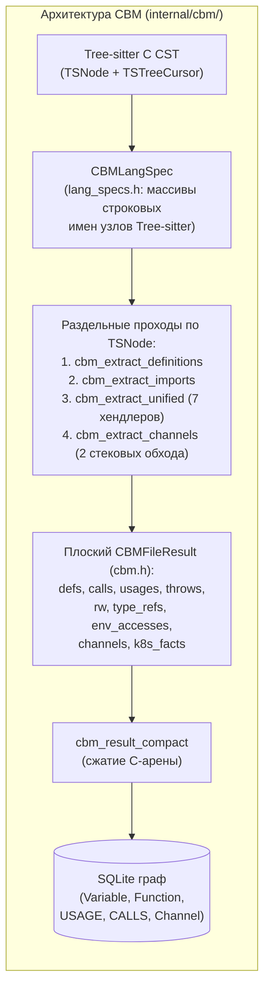

# Universal Abstract Syntax Tree (UAST) — Архитектура, Структура и Аудит

Документ описывает детальную структуру **Universal Abstract Syntax Tree (UAST)** в `CodeExplorer.Core.Parser.Syntax`, механизмы конвертации из нативных CST-деревьев Tree-sitter, надстройки потока данных и управления (Dataflow & Execution Context), а также **полный аудит избыточных («лишних») и незаполненных («забытых») элементов**.

Исходные файлы ядра UAST:
- [`SyntaxNodes.cs`](../../cli/src/Core/CodeExplorer.Core/Parser/Syntax/SyntaxNodes.cs) — иерархия из 36 канонических классов узлов (`SyntaxKind`), перечисления и примитивы памяти (без языково-специфичных строк грамматики Tree-sitter).
- [`TreeSitterSyntaxBuilder.cs`](../../cli/src/Parsers/CodeExplorer.Parser.Shared/TreeSitterSyntaxBuilder.cs) и [`TreeSitterSyntaxPopulator.cs`](../../cli/src/Parsers/CodeExplorer.Parser.Shared/TreeSitterSyntaxPopulator.cs) — конвертер `TreeSitterSyntaxConverterBase` из нативного `TreeSitter.Tree` в `SyntaxDocument` и полное заполнение типизированных свойств UAST.
- [`SyntaxValueEvaluator.cs`](../../cli/src/Core/CodeExplorer.Core/Parser/Syntax/SyntaxValueEvaluator.cs) — предвычисление константных выражений, декодирование и встраивание SQL (`EmbeddedSyntax`).
- [`CallSiteContextExtractor.cs`](../../cli/src/Core/CodeExplorer.Core/Parser/Syntax/CallSiteContextExtractor.cs) — извлечение структурного контекста вызова за $O(\text{depth})$.
- [`FunctionDataflowSummary.cs`](../../cli/src/Core/CodeExplorer.Core/Analysis/Dataflow/FunctionDataflowSummary.cs) — внутрипроцедурный анализатор потоков данных (`FunctionDataflowAnalyzer`).

---

## 1. Архитектурные принципы и модель памяти

1. **Мгновенное освобождение неуправляемой памяти Tree-sitter:**
   - `TreeSitterSyntaxConverterBase.Parse(...)` использует потокобезопасный `[ThreadStatic] TreeSitter.Parser`, обходит нативное дерево через единый `TreeCursor` в рамках `using var tree = parser.Parse(sourceText)` и сразу освобождает нативный C-хэндл `TreeSitter.Tree`.
2. **Zero-Allocation срезы исходного текста (`SourceSlice` и `TextSpan`):**
   - Полный текст файла хранится **один раз** в `SyntaxDocument.SourceText`.
   - Узлы UAST не хранят дубликаты подстрок кода: свойства `Name`, `MethodName`, `MemberName`, `ValueText` используют 8-байтовый `SourceSlice(Start, Length)` и возвращают `ReadOnlySpan<char>` (`NameSpan`, `MethodNameSpan`, `AsSpan()`).
3. **Пул строк (`SyntaxStringPool`):**
   - Использует `.NET 10 ConcurrentDictionary.GetAlternateLookup<ReadOnlySpan<char>>()` для дедупликации `FieldRole`, операторов и коротких идентификаторов ($\le 64$ символов, до $32\,768$ записей) без аллокации промежуточных `string`.
4. **Строго канонический UAST без следов оригинальных AST:**
   - Все узлы в `SyntaxDocument` представлены строго типизированными каноническими классами UAST (`SyntaxKind`), без хранения языково-специфичных имен узлов Tree-sitter (`RawGrammarKind` и `UnmappedSyntax` полностью удалены).
   - Контейнерные и группирующие конструкции представляются типизированным `SyntaxList` (`SyntaxListKind`: `Arguments`, `Parameters`, `TypeArguments`, `TypeParameters`, `Attributes`, `Declarations`, `Imports`, `Exports`, `SwitchArms`, `Initializer`, `Clauses`, `TopLevelStatement`, `Expressions`, `General`).
   - Неименованные токены (`public`, `async`, `const`, `+`, `=`, `*`) не создают узлов в дереве, а напрямую обогащают метаданные родительского узла (`Modifiers`, `Operator`, `IsWildcard`) через `ApplyUnnamedTokenMetadata`.

---

## 2. Полная иерархия классов UAST (36 классов)

```mermaid
classDiagram
    class SyntaxNode {
        <<abstract>>
        +int NodeId
        +TextSpan Span
        +SyntaxKind SyntaxKind
        +string Type
        +string? FieldRole
        +SyntaxDocument? Document
        +SyntaxNode? Parent
        +int ChildIndex
        +IReadOnlyList~SyntaxNode~ Children
    }

    class SyntaxDocument {
        +string FilePath
        +string RelativePath
        +string LanguageName
        +string SourceText
        +string? PackageOrNamespace
        +IReadOnlyList~ImportDeclSyntax~ Imports
        +IReadOnlyList~DeclarationSyntax~ Declarations
        +IReadOnlyList~StatementSyntax~ TopLevelStatements
        +IReadOnlyList~TypeDeclSyntax~ AllTypes
        +IReadOnlyList~FunctionDeclSyntax~ AllFunctions
        +IReadOnlyList~MemberDeclSyntax~ AllMembers
        +IReadOnlyList~VariableDeclSyntax~ AllVariables
        +IReadOnlyList~CallExprSyntax~ AllCalls
        +IReadOnlyList~SqlStmtSyntax~ AllSqlStatements
        +IReadOnlyList~SyntaxDiagnostic~ Diagnostics
    }

    class DeclarationSyntax {
        <<abstract>>
        +SourceSlice NameSlice
        +string Name
        +SyntaxModifiers Modifiers
    }

    class StatementSyntax {
        <<abstract>>
    }

    class ExprSyntax {
        <<abstract>>
        +string? ResolvedValue
        +bool IsDecoded
        +SyntaxNode? EmbeddedSyntax
    }

    SyntaxNode <|-- SyntaxDocument
    SyntaxNode <|-- DeclarationSyntax
    SyntaxNode <|-- BaseTypeClauseSyntax
    SyntaxNode <|-- TypeRefSyntax
    SyntaxNode <|-- StatementSyntax
    SyntaxNode <|-- ExprSyntax
    SyntaxNode <|-- SyntaxList

    DeclarationSyntax <|-- NamespaceDeclSyntax
    DeclarationSyntax <|-- ImportDeclSyntax
    DeclarationSyntax <|-- TypeDeclSyntax
    DeclarationSyntax <|-- ImplDeclSyntax
    DeclarationSyntax <|-- FunctionDeclSyntax
    DeclarationSyntax <|-- ParameterDeclSyntax
    DeclarationSyntax <|-- MemberDeclSyntax
    DeclarationSyntax <|-- VariableDeclSyntax
    DeclarationSyntax <|-- AnnotationSyntax

    StatementSyntax <|-- BlockStmtSyntax
    StatementSyntax <|-- ControlFlowStmtSyntax
    StatementSyntax <|-- CatchClauseSyntax
    StatementSyntax <|-- ReturnStmtSyntax
    StatementSyntax <|-- SqlStmtSyntax

    ExprSyntax <|-- LiteralExprSyntax
    ExprSyntax <|-- InterpolatedStringExprSyntax
    ExprSyntax <|-- IdentifierExprSyntax
    ExprSyntax <|-- MemberAccessExprSyntax
    ExprSyntax <|-- IndexExprSyntax
    ExprSyntax <|-- ArgumentSyntax
    ExprSyntax <|-- CallExprSyntax
    ExprSyntax <|-- BinaryExprSyntax
    ExprSyntax <|-- UnaryExprSyntax
    ExprSyntax <|-- AssignmentExprSyntax
    ExprSyntax <|-- ConditionalExprSyntax
    ExprSyntax <|-- CollectionExprSyntax
    ExprSyntax <|-- LambdaExprSyntax
    ExprSyntax <|-- KeyValueExprSyntax
    ExprSyntax <|-- TypeCastExprSyntax
    ExprSyntax <|-- UiElementSyntax
    ExprSyntax <|-- PatternSyntax
    ExprSyntax <|-- ParenthesizedExprSyntax
```

---

## 3. Детальная спецификация узлов и их свойств

### 3.1. Базовые и корневые узлы

| Класс | Свойства | Описание и статус заполнения |
| :--- | :--- | :--- |
| **`SyntaxNode`** *(abstract)* | `NodeId` (`int`), `Id` (`IntPtr`), `Span` (`TextSpan`), `SyntaxKind` (`SyntaxKind`), `Type` (`string`), `FieldRole` (`string?`), `Document` (`SyntaxDocument?`), `Parent` (`SyntaxNode?`), `ChildIndex` (`int`), `Children` (`IReadOnlyList<SyntaxNode>`), `NextSibling`, `PrevSibling` | Базовый узел дерева. Поддерживает быстрый поиск детей без аллокаций (`FirstChildOfType<T>()`, `LastChildOfType<T>()`, `NthChildOfType<T>()`, `GetChildForField(name)`) и синтетический маппинг полей (`ResolveSyntheticField`). |
| **`SyntaxDocument`** *(sealed)* | `FilePath`, `RelativePath`, `LanguageName`, `SourceText`, `PackageOrNamespace` **Индексы:** `Imports`, `Declarations`, `TopLevelStatements`, `AllTypes`, `AllFunctions`, `AllMembers`, `AllVariables`, `AllCalls`, `AllSqlStatements`, `Diagnostics` | Корневой узел документа (`NodeId = 1`). Все плоские списки (`AllTypes`, `AllFunctions`, `AllCalls` и т.д.) заполняются **за один проход** во время построения дерева (`ConvertNode`), что избавляет анализаторы от повторного полного обхода AST. |
| **`BaseTypeClauseSyntax`** *(sealed)* | `IsImplements` (`bool`) | ✅ **Заполняется:** спецификация базовых типов и реализуемых интерфейсов (`extends`, `implements`, `base_list`, `superclass`). |
| **`TypeRefSyntax`** *(sealed)* | `Kind` (`TypeRefKind`), `NameSlice` (`SourceSlice`), `NameSpan` (`ReadOnlySpan<char>`), `Name` (`string`) | ✅ **Заполняется:** ссылка на тип (`Named`, `Generic`, `Array`, `Slice`, `Tuple`, `Pointer`, `Reference`, `Nullable`, `Union`, `Intersection`, `Function`, `Channel`, `Annotation`, `Predefined`). |
| **`SyntaxList`** *(sealed)* | `Kind` (`SyntaxListKind`) | ✅ **Заполняется:** канонический контейнер списков (`Arguments`, `Parameters`, `TypeArguments`, `TypeParameters`, `Attributes`, `Declarations`, `Imports`, `Exports`, `SwitchArms`, `Initializer`, `Clauses`, `TopLevelStatement`, `Expressions`, `General`). |

---

### 3.2. Узлы объявлений (`DeclarationSyntax` — 9 классов)

Все наследники `DeclarationSyntax` имеют `NameSlice`, `NameSpan`, `Name` и битовую маску `Modifiers` (`SyntaxModifiers`).

| Класс | Специфичные свойства | Статус заполнения в конвертерах |
| :--- | :--- | :--- |
| **`NamespaceDeclSyntax`** | *(только базовые свойства `DeclarationSyntax`)* | ✅ **Заполняется** (`Name` прокидывается в `SyntaxDocument.PackageOrNamespace`). |
| **`ImportDeclSyntax`** | `ModulePath` (`string`) `Alias` (`string?`) `IsWildcard` (`bool`) `IsReExport` (`bool`) `IsStatic` (`bool`) | ✅ **Заполняется полностью** (`ModulePath`, `Alias`, `IsWildcard`, `IsReExport`, `IsStatic`). |
| **`TypeDeclSyntax`** | `Kind` (`TypeSyntaxKind`: `Class`, `Interface`, `Struct`, `Enum`, `Record`, `Trait`, `Protocol`, `ObjectSingleton`, `CompanionObject`, `TypeAlias`, `Union`, `GraphQlType`) | ✅ **Заполняется** (`Class`, `Interface`, `Struct`, `Enum`, `Record`, `Trait`, `TypeAlias`, `Union`). 4 резервных значения enum пока не задействованы. |
| **`ImplDeclSyntax`** | `TargetType` (`TypeRefSyntax?`) `ImplementedTrait` (`TypeRefSyntax?`) | ✅ **Заполняется** (для Rust `impl Trait for Type` и `impl Type`). |
| **`FunctionDeclSyntax`** | `Kind` (`FunctionSyntaxKind`) `Receiver` (`ParameterDeclSyntax?`) `Parameters` (`IReadOnlyList<ParameterDeclSyntax>`) `Body` (`BlockStmtSyntax?`) `ExpressionBody` (`ExprSyntax?`) `DataflowSummary` (`FunctionDataflowSummary?`) `IsAsync` (`bool`) | ✅ **Заполняется полностью** (`Receiver`, `Parameters`, `Body`, `ExpressionBody`, `DataflowSummary`, `IsAsync`). |
| **`ParameterDeclSyntax`** | `ParameterType` (`TypeRefSyntax?`) `DefaultValue` (`ExprSyntax?`) `PassingMode` (`ParameterPassingMode`) | ✅ **Заполняется полностью** (`ParameterType`, `DefaultValue`, `PassingMode`: `Value`, `Receiver`, `MutBorrow`, `VariadicArgs`, `VariadicKwargs`). |
| **`MemberDeclSyntax`** | `Kind` (`MemberSyntaxKind`: `Field`, `Property`, `Event`, `Constant`, `EnumMember`) `MemberType` (`TypeRefSyntax?`) `Initializer` (`ExprSyntax?`) `ResolvedValue` (`string?`) `IsDecoded` (`bool`) | ✅ **Заполняется полностью** (`Kind`, `MemberType`, `Initializer`, `ResolvedValue`, `IsDecoded`). |
| **`VariableDeclSyntax`** | `VariableType` (`TypeRefSyntax?`) `Initializer` (`ExprSyntax?`) `IsConstant` (`bool`) `Scope` (`string = "local"`) `ResolvedValue` (`string?`) `IsDecoded` (`bool`) | ✅ **Заполняется полностью** (`VariableType` наследуется дочерними декларантами, `Initializer`, `IsConstant`, `ResolvedValue`, `IsDecoded`). |
| **`AnnotationSyntax`** | `Arguments` (`IReadOnlyList<ArgumentSyntax>`) | ✅ **Заполняется полностью** (`Name` и нормализованный список `Arguments`). |

---

### 3.3. Узлы инструкций (`StatementSyntax` — 5 классов)

| Класс | Специфичные свойства | Статус заполнения в конвертерах |
| :--- | :--- | :--- |
| **`BlockStmtSyntax`** | `IsUnsafe` (`bool`) | ✅ **Заполняется** (`IsUnsafe = true` для `unsafe_statement` в C# и `unsafe_block` в Rust). |
| **`ControlFlowStmtSyntax`** | `Kind` (`ControlFlowKind`: `Expression`, `If`, `Loop`, `Switch`, `Try`, `Using`, `Lock`, `Defer`, `Goroutine`, `Branch`, `Throw`) `Condition` (`ExprSyntax?`) `Body` (`SyntaxNode?`) `Alternative` (`SyntaxNode?`) | ✅ **Заполняется:** • `If`: `Condition`, `Body` (consequence), `Alternative` (else/elif) • `Loop`: `Condition`, `Body` • `Try`: `Body`, `Alternative` (finally блок) • `Lock` / `Using`: `Body` • `Switch`, `Defer`, `Goroutine`, `Branch`, `Throw`, `Expression`: создаются с нужным `Kind`. |
| **`CatchClauseSyntax`** | `ExceptionType` (`TypeRefSyntax?`) `Body` (`BlockStmtSyntax?`) | ✅ **Заполняется полностью** (`ExceptionType` и `Body`). |
| **`ReturnStmtSyntax`** | `Value` (`ExprSyntax?`) | ✅ **Заполняется** (для `return` и `yield`). |
| **`SqlStmtSyntax`** | `Operation` (`SqlOperationKind`) `OperationVerb` (`string`) `Tables` (`IReadOnlyList<SqlTableRefSyntax>`) `Columns` (`IReadOnlyList<string>`) `Procedures` (`IReadOnlyList<string>`) `RawSql` (`string`) | ✅ **Заполняется** в `SqlParser` (для `.sql` файлов) и в `SyntaxValueEvaluator` (для встроенных SQL-строк в коде через `ExprSyntax.EmbeddedSyntax`). |

---

### 3.4. Узлы выражений (`ExprSyntax` — 18 классов)

Все наследники `ExprSyntax` имеют свойства `ResolvedValue` (`string?`), `IsDecoded` (`bool`) и `EmbeddedSyntax` (`SyntaxNode?`), заполняемые в `SyntaxValueEvaluator`.

| Класс | Специфичные свойства | Статус заполнения в конвертерах |
| :--- | :--- | :--- |
| **`LiteralExprSyntax`** | `LiteralKind` (`LiteralSyntaxKind`: `String`, `RawString`, `Char`, `Integer`, `Float`, `Boolean`, `Null`, `Regex`) `ValueSlice` (`SourceSlice`) `HasEscapeSequences` (`bool`) `ValueSpan`, `ValueText` | ✅ **Заполняется полностью** (включая `Regex` в TS/JS). |
| **`InterpolatedStringExprSyntax`** | *(базовые свойства `ExprSyntax`)* | ✅ **Заполняется** (`template_string` в TS, `interpolated_string_expression` в C#, `format_string` в Python). |
| **`IdentifierExprSyntax`** | `Role` (`IdentifierRole`: `Symbol`, `Type`, `Member`, `SelfOrSuper`) `NameSpan` (`ReadOnlySpan<char>`), `Name` (`string`) | ✅ **Заполняется** (zero-allocation срез по `Span` и семантическая роль идентификатора). |
| **`MemberAccessExprSyntax`** | `Object` (`ExprSyntax?`) `MemberNameSlice` (`SourceSlice`) `MemberNameSpan`, `MemberName` `Operator` (`string = "."`) | ✅ **Заполняется** во всех 6 языковых конвертерах с учетом специфики полей (`object`/`property`, `expression`/`name`, `operand`/`field`, `value`/`field`). |
| **`IndexExprSyntax`** | `Target` (`ExprSyntax?`) `Index` (`ExprSyntax?`) | ✅ **Заполняется полностью** (`Target` и `Index`, включая C# `bracketed_argument_list` и потоки данных `ResolveExprOrigins`). |
| **`ArgumentSyntax`** | `NameSlice` (`SourceSlice`), `NameSpan`, `Name` (`string?`) `Value` (`ExprSyntax?`) `IsSpread` (`bool`) | ✅ **Заполняется** (поддерживает именованные, позиционные и spread-аргументы). |
| **`CallExprSyntax`** | `CallKind` (`CallSyntaxKind`) `Callee` (`ExprSyntax?`) `Receiver` (`ExprSyntax?`) `MethodNameSlice`, `MethodNameSpan`, `MethodName` `Arguments` (`IReadOnlyList<ArgumentSyntax>`) | ✅ **Заполняется полностью** во всех 6 языках: извлекает `Callee`, отделяет `Receiver` от `MethodName` при вызове через точку и нормализует список `Arguments`. |
| **`BinaryExprSyntax`** | `Left` (`ExprSyntax?`) `Operator` (`string`) `Right` (`ExprSyntax?`) | ✅ **Заполняется** (включая извлечение оператора из безымянного токена или среза между `Left` и `Right`). |
| **`UnaryExprSyntax`** | `Operator` (`string`) `Operand` (`ExprSyntax?`) `IsPrefix` (`bool = true`) `IsAwait` (`bool`) `IsTryPropagate` (`bool`) | ✅ **Заполняется** (включая `await` во всех языках и оператор `?` `try_expression` в Rust). |
| **`AssignmentExprSyntax`** | `Left` (`SyntaxNode?`) `Operator` (`string = "="`) `Right` (`ExprSyntax?`) | ✅ **Заполняется** (`=`, `+=`, `:=` и др.). |
| **`ConditionalExprSyntax`** | `Condition` (`ExprSyntax?`) `WhenTrue` (`ExprSyntax?`) `WhenFalse` (`ExprSyntax?`) | ✅ **Заполняется полностью** (включая порядок `WhenTrue if Condition else WhenFalse` в Python и проброс `DataflowOrigin` через обе ветки). |
| **`CollectionExprSyntax`** | `Kind` (`CollectionSyntaxKind`: `Array`, `Object`, `Dictionary`, `Tuple`, `Set`, `Initializer`) `Elements` (`IReadOnlyList<ExprSyntax>`) | ✅ **Заполняется полностью** во всех 6 языках (объекты `{...}`, массивы `[...]`, словари, кортежи, списки инициализации) и пробрасывает `DataflowOrigin`. |
| **`LambdaExprSyntax`** | `Parameters` (`IReadOnlyList<ParameterDeclSyntax>`) `Body` (`SyntaxNode?`) `IsAsync` (`bool`) | ✅ **Заполняется полностью** (`Parameters`, `Body` и флаг `IsAsync`). |
| **`KeyValueExprSyntax`** | `Key` (`SyntaxNode?`) `Value` (`ExprSyntax?`) | ✅ **Заполняется** (пары `key: value`, JSX-атрибуты, элементы словарей и спецификаторы импорта/экспорта). |
| **`TypeCastExprSyntax`** | `Operand` (`ExprSyntax?`) `TargetType` (`TypeRefSyntax?`) `IsGenericInstantiation` (`bool`) | ✅ **Заполняется** (приведения типов `as`, `(T)x`, `type_assertion` и инстанцирование generic-функций). |
| **`UiElementSyntax`** | `TagNameSlice` (`SourceSlice`) `IsSelfClosing`, `IsClosing`, `IsFragment` (`bool`) | ✅ **Заполняется** (JSX/TSX элементы и фрагменты). |
| **`PatternSyntax`** | `Kind` (`PatternKind`: `Binding`, `Object`, `Array`, `Tuple`, `Rest`, `As`, `Pair`) | ✅ **Заполняется** (паттерны деструктуризации и сопоставления с образцом). |
| **`ParenthesizedExprSyntax`** | `Expression` (`ExprSyntax?`) `IsInterpolation` (`bool`) | ✅ **Заполняется** (скобочные выражения и подстановки интерполяции `${...}` / `{...}`). |

---

## 4. Матрица маппинга грамматик Tree-sitter по 6 языкам

| UAST Узел | C# (`c-sharp`) | TypeScript / JS (`typescript`/`tsx`) | Go (`go`) | Java (`java`) | Python (`python`) | Rust (`rust`) |
| :--- | :--- | :--- | :--- | :--- | :--- | :--- |
| **`NamespaceDeclSyntax`** | `namespace_declaration`, `file_scoped_namespace_declaration` | `module`, `internal_module` | `package_clause` | `package_declaration` | `module` | `mod_item` |
| **`ImportDeclSyntax`** | `using_directive` | `import_statement`, `export_statement` | `import_declaration`, `import_spec` | `import_declaration` | `import_statement`, `import_from_statement` | `use_declaration`, `extern_crate_declaration` |
| **`TypeDeclSyntax`** | `class_declaration`, `interface_declaration`, `struct_declaration`, `record_declaration`, `enum_declaration`, `delegate_declaration` | `class_declaration`, `abstract_class_declaration`, `interface_declaration`, `enum_declaration`, `type_alias_declaration` | `type_spec`, `struct_type`, `interface_type` | `class_declaration`, `interface_declaration`, `annotation_type_declaration`, `record_declaration`, `enum_declaration` | `class_definition` | `struct_item`, `enum_item`, `trait_item`, `type_item`, `union_item` |
| **`ImplDeclSyntax`** | — | — | — | — | — | `impl_item` |
| **`FunctionDeclSyntax`** | `method_declaration`, `local_function_statement`, `constructor_declaration`, `destructor_declaration`, `accessor_declaration`, `operator_declaration`, `conversion_operator_declaration` | `function_declaration`, `generator_function_declaration`, `method_definition`, `method_signature` | `function_declaration`, `method_declaration` | `method_declaration`, `constructor_declaration`, `compact_constructor_declaration` | `function_definition` | `function_item`, `function_signature_item`, `macro_definition` |
| **`ParameterDeclSyntax`** | `parameter` | `required_parameter`, `optional_parameter`, `rest_pattern` | `parameter_declaration`, `variadic_parameter_declaration` | `formal_parameter`, `spread_parameter`, `receiver_parameter` | `identifier` (в `parameters`), `default_parameter`, `typed_parameter`, `typed_default_parameter`, `*_splat_pattern` | `parameter`, `self_parameter`, `variadic_parameter` |
| **`MemberDeclSyntax`** | `field_declaration`, `property_declaration`, `indexer_declaration`, `event_declaration`, `event_field_declaration`, `enum_member_declaration` | `public_field_definition`, `property_signature`, `enum_assignment` | `field_declaration`, `const_spec` | `field_declaration`, `annotation_type_element_declaration`, `constant_declaration`, `enum_constant` | — *(поля через `self.x = ...`)* | `field_declaration`, `enum_variant`, `const_item`, `static_item` |
| **`VariableDeclSyntax`** | `variable_declarator`, `variable_declaration`, `local_declaration_statement` | `variable_declarator`, `variable_declaration`, `lexical_declaration` | `var_spec`, `var_declaration`, `short_var_declaration`, `const_declaration` | `variable_declarator`, `local_variable_declaration` | — *(переменные через `assignment`)* | `let_declaration` |
| **`AnnotationSyntax`** | `attribute` | `decorator` | — | `annotation`, `marker_annotation` | `decorator` | `attribute_item`, `inner_attribute_item` |
| **`CallExprSyntax`** | `invocation_expression`, `object_creation_expression`, `implicit_object_creation_expression` | `call_expression`, `new_expression` | `call_expression` | `method_invocation`, `object_creation_expression`, `explicit_constructor_invocation`, `super_constructor_invocation` | `call` | `call_expression`, `macro_invocation` |
| **`LambdaExprSyntax`** | `lambda_expression` | `arrow_function`, `function_expression` | `func_literal` | `lambda_expression` | `lambda` | `closure_expression` |
| **`ControlFlowStmtSyntax`** | `if_statement`, `switch_*`, `for*`, `while_statement`, `do_statement`, `try_statement`, `using_statement`, `throw_*`, `break_statement`, `continue_statement`, `goto_statement`, `lock_statement`, `expression_statement` | `if_statement`, `switch_statement`, `for*`, `while_statement`, `do_statement`, `try_statement`, `with_statement`, `throw_statement`, `break_statement`, `continue_statement`, `expression_statement` | `if_statement`, `*_switch_statement`, `select_statement`, `for_statement`, `defer_statement`, `go_statement`, `break_statement`, `continue_statement`, `goto_statement`, `fallthrough_statement`, `expression_statement` | `if_statement`, `switch_*`, `for*`, `while_statement`, `do_statement`, `try*`, `throw_statement`, `break_statement`, `continue_statement`, `synchronized_statement`, `expression_statement` | `if_statement`, `match_statement`, `for_statement`, `while_statement`, `try_statement`, `with_statement`, `raise_statement`, `break_statement`, `continue_statement`, `expression_statement` | `if_expression`, `match_expression`, `loop_expression`, `while_expression`, `for_expression`, `break_expression`, `continue_expression`, `expression_statement` |

---

## 5. Семантические надстройки над UAST (Dataflow, Context, Value Evaluation)

Во время и сразу после построения `SyntaxDocument` выполняются 3 быстрых прохода обогащения:

1. **Внутрипроцедурный Dataflow (`FunctionDataflowAnalyzer`):**
   - Запускается автоматически в `PopulateSyntaxNode` для каждого `FunctionDeclSyntax` ($\le 64$ КБ).
   - Отслеживает источники значений (`FlowSourceKind`: `Parameter`, `InstanceField`, `CallReturn`, `ExternalSource`, `Constant`).
   - Строит `FunctionDataflowSummary`:
     - `ReturnOrigins`: какие параметры/поля/вызовы формируют `return` функции (`ret:p0.Id`).
     - `FieldWrites`: в какие поля `this._field` / `self._field` функция записывает данные (`writes:_repo<-p0`).
     - `CallArgFlows`: какие источники передаются в каждый аргумент вызываемых функций (`calls:Dispatch:174(0<-p0)`).
2. **Структурный контекст вызова (`CallSiteContextExtractor`):**
   - За $O(\text{depth})$ подъемов по указателю `Parent` от `CallExprSyntax` до `FunctionDeclSyntax` вычисляет `CallSiteExecutionContext`:
     - Флаги `CallExecutionFlags`: `InLoop`, `InNestedLoop`, `IsConditional`, `InTryBlock`, `InCatchBlock`, `InFinallyBlock`, `InLockBlock`, `InUsingResource`, `IsAwaited`, `IsConcurrentSpawn`, `InLambda`.
     - Распознает функциональные циклы (`.forEach`, `.map`, `.Select`, `.ForEachAsync`) и конкурентный запуск (`Task.Run`, `spawn`, `go fn()`).
3. **Предвычисление констант и встроенного SQL (`SyntaxValueEvaluator`):**
   - Вычисляет `ResolvedValue` и флаг декодирования `IsDecoded` (Base64, Hex, `fromCharCode`, конкатенации, шаблонные строки) для `MemberDeclSyntax`, `VariableDeclSyntax` и `ExprSyntax`.
   - Автоматически распознает встроенные SQL-запросы внутри строковых выражений, парсит таблицы и операции (`SELECT`, `INSERT`, `UPDATE`, `DELETE`, `CREATE`, `EXEC`) и прикрепляет `SqlStmtSyntax` в `ExprSyntax.EmbeddedSyntax` и `SyntaxDocument.AllSqlStatements`.

---

## 6. АУДИТ: Что было доработано и что оставлено в резерве

### ✅ А. Доработанные элементы (100% заполнение UAST в `TreeSitterSyntaxPopulator`)

Все ранее незаполненные («hollow») свойства узлов UAST теперь заполняются автоматически в один проход в [`TreeSitterSyntaxPopulator.cs`](../../cli/src/Parsers/CodeExplorer.Parser.Shared/TreeSitterSyntaxPopulator.cs):
1. **`ParameterDeclSyntax` (`ParameterType`, `DefaultValue`, `PassingMode`):**
   - Извлекается тип параметра (`TypeRefSyntax`, в том числе из `type_annotation` в TS/Python и пользовательских типов), значение по умолчанию (`DefaultValue`) и режим передачи (`PassingMode`: `Value`, `Receiver` для `self`/`this`, `MutBorrow` для `&mut self`, `VariadicArgs`, `VariadicKwargs`).
2. **`FunctionDeclSyntax.Receiver`:**
   - Заполняется как для явного поля `receiver` в Go (`func (s *Server) Run()`), так и для первого `self`/`this` параметра в Python/Rust.
3. **`LambdaExprSyntax` (`Parameters`, `Body`, `IsAsync`):**
   - Заполняются параметры стрелочных функций и замыканий (включая одиночный параметр без скобок `x => x + 1`), тело (`BlockStmtSyntax` или выражение) и флаг `IsAsync`.
4. **`IndexExprSyntax` (`Target`, `Index`):**
   - Заполняются целевая коллекция (`Target`) и выражение индекса (`Index`, включая `bracketed_argument_list` в C#), а `FunctionDataflowAnalyzer` пробрасывает поток данных (`DataflowOrigin`) через индексацию `items[i]`.
5. **`ConditionalExprSyntax` (`Condition`, `WhenTrue`, `WhenFalse`):**
   - Добавлены и заполняются ветки `WhenTrue` (`Consequence`) и `WhenFalse` (`Alternative`) с учетом порядка `WhenTrue if Condition else WhenFalse` в Python; `FunctionDataflowAnalyzer` отслеживает источники данных через обе ветки тернарного оператора.
6. **`CollectionExprSyntax` (`Kind`, `Elements`):**
   - Добавлен канонический узел `CollectionExprSyntax` (`Array`, `Object`, `Dictionary`, `Tuple`, `Set`, `Initializer`) для литералов объектов `{...}`, массивов `[...]`, словарей, кортежей и списков инициализации во всех 6 языках. Благодаря этому литералы объектов/массивов, передаваемые в функции (`send({ item }, [first])`), корректно попадают в `CallExprSyntax.Arguments` и участвуют в анализе потоков данных.
7. **`MemberDeclSyntax.MemberType` и `VariableDeclSyntax.VariableType`:**
   - Добавлено свойство `MemberType` в `MemberDeclSyntax`, оба типа заполняются из `TypeRefSyntax` / `type_annotation` и наследуются дочерними декларантами.
8. **`CatchClauseSyntax.ExceptionType`, `ImportDeclSyntax` (`ModulePath`, `Alias`, `IsStatic`), `AnnotationSyntax.Arguments`, `TypeRefSyntax.Kind`:**
   - Все свойства заполняются при построении дерева (включая разворачивание `call_expression` внутри декораторов `@Injectable({...})` в TypeScript/Python).

### 💤 Б. Зарезервированные элементы (пока не задействованы, оставлены на будущее)

- Отдельные значения перечислений, зарезервированные под расширение грамматик:
  - `TypeSyntaxKind`: `Protocol`, `ObjectSingleton`, `CompanionObject`, `GraphQlType`.
  - `CallSyntaxKind`: `Function`, `SuperConstructor`, `ThisConstructor`.
  - `SyntaxModifiers.Data` (под `data class` в Kotlin).
- `VariableDeclSyntax.Scope` и `SqlStmtSyntax.Columns`.
- Легаси-списки `SyntaxTree.RawImports` / `RawVariables` / `RawTypeBindings` (в дальнейшем могут быть полностью заменены прямым чтением `SyntaxDocument.Imports`, `AllVariables` и `AllMembers`).

---

## 7. Критическое сравнение с CBM (`DeusData/codebase-memory-mcp`): является ли UAST нашим ноу-хау?

Для объективной оценки мы детально изучили исходный код **CBM (`https://github.com/DeusData/codebase-memory-mcp`, каталог `internal/cbm/`)** и сравнили его с архитектурой **CodeExplorer (CE)** и **CodePassport** как по коду, так и на результатах сканирования монорепозитория `twenty`.

### 7.1. Как реально устроен парсинг и извлечение в исходниках CBM (`internal/cbm/`)

В **CBM нет UAST** (единого типизированного синтаксического дерева в памяти). Архитектура CBM на C (`cbm.h`, `lang_specs.h`, `extract_unified.c`, `cbm.c`) устроена следующим образом:

1. **`CBMLangSpec` (`internal/cbm/lang_specs.h`) — полный аналог нашего `LanguageSyntaxProfile`, но без построения дерева:**
   - В `lang_specs.h` для каждого языка описана структура `CBMLangSpec` со списками строковых имен узлов Tree-sitter: `function_node_types`, `class_node_types`, `field_node_types`, `call_node_types`, `import_node_types`, `branching_node_types`, `variable_node_types`, `assignment_node_types`, `throw_node_types`, `decorator_node_types`.
   - Однако вместо конвертации `TSNode` в типизированные узлы UAST, CBM обходит сырое дерево `TSNode` напрямую и сразу складывает плоские записи в массивы структуры `CBMFileResult` (`internal/cbm/cbm.h`).
2. **Несколько обходов сырого дерева `TSNode` (`internal/cbm/cbm.c`, `extract_unified.c`, `extract_channels.c`):**
   - Хотя в `extract_unified.c` 7 обработчиков (`handle_calls`, `handle_usages`, `handle_throws`, `handle_read_writes`, `handle_type_assigns`, `handle_env_accesses`, `handle_Infra_k8s`) объединены в один проход `TSTreeCursor` с явным стеком `CBMWalkScope` (`extract_unified.h`), помимо него CBM всё равно выполняет **отдельные обходы дерева**:
     - `cbm_extract_definitions` (отдельный обход для сбора `CBMDefinition` и вложенной сложности),
     - `cbm_extract_imports` (отдельный обход для импортов),
     - `cbm_extract_channels` (в `extract_channels.c` запускает **два собственных полных стековых обхода** `TSNodeStack`: сначала `scan_string_consts_js`, затем `extract_channels_js`, где вдобавок на каждом вызове поднимается вверх через `ts_node_parent` в `enclosing_function_qn`!),
     - `cbm_walk_error_nodes` (при наличии синтаксических ошибок).
3. **Плоские структуры `CBMFileResult` (`internal/cbm/cbm.h`) вместо дерева выражений:**
   - На выходе из файла CBM формирует плоские динамические массивы:
     - `CBMDefArray defs` (`CBMDefinition`: имя, сигнатура, `receiver`, `decorators`, `route_path`, `route_method`, метрики циклов `loop_count`, `loop_depth`, `max_access_depth`, `linear_scan_in_loop`, `alloc_in_loop`, `fingerprint`, `http_client`, `http_base_url`),
     - `CBMCallArray calls` (`CBMCall`: `callee_name`, `enclosing_func_qn`, `first_string_arg`, `second_arg_name`, плоский массив `CBMCallArg args[8]` с парой `keyword`/`expr` в виде сырых строк, `loop_depth`, `branch_depth`),
     - `CBMUsageArray usages`, `CBMRWArray rw` (`CBMReadWrite`), `CBMTypeRefArray type_refs`, `CBMTypeAssignArray type_assigns`, `CBMEnvAccessArray env_accesses`, `CBMChannelArray channels`.
   - Иерархия выражений (вложенные вызовы, цепочки методов, тернарные операторы, лямбды, индексация, литералы объектов/массивов) **теряется** — в `CBMCallArg` остается только срез сырого текста из исходника и дочерний идентификатор.

---

### 7.2. Почему CBM ошибается на реальных проектах: доказательства прямо из C-кода (`internal/cbm/`)

Анализ исходного кода `DeusData/codebase-memory-mcp` на 100% объясняет все аномалии и слепые зоны, которые мы наблюдали на репозитории `twenty`:

| Архитектурный аспект | Как это написано в исходниках CBM (`internal/cbm/`) | Как это решено в CodeExplorer (благодаря UAST) |
| :--- | :--- | :--- |
| **Очереди и Pub/Sub (`extract_channels.c`)** | В `extract_channels.c` (строки 2315–2358) функция `js_classify_receiver` смотрит **только на последнее слово после точки (`tail`)**: `if (strcmp(tail, "socket") == 0 \|\| strcmp(tail, "io") == 0 \|\| strcmp(tail, "ws") == 0 \|\| strcmp(tail, "client") == 0 \|\| strcmp(tail, "server") == 0) return "socketio";` А `js_is_listen_method` ловит `.on()`, `.once()`, `.addListener()`. В результате **любой стандартный `socket.on('data')`, `socket.on('close')`, `socket.on('error')`, `server.on('upgrade')`** на обычном TCP/HTTP сокете Node.js жестко классифицируется как брокер `"socketio"`! А поддержки BullMQ (`@Processor`, `@InjectQueue`) в `extract_channels.c` нет вообще. | В CE анализаторы работают поверх типизированного UAST (`AnnotationSyntax`, `CallExprSyntax`, `MemberDeclSyntax`) и профилей библиотек: распознаются декораторы `@Processor`/`@InjectQueue` (BullMQ), Kafka, RabbitMQ, MassTransit, а сырые сокеты и тестовые моки отфильтровываются. |
| **Сворачивание констант (`extract_url_fold.h` и `extract_channels.c`)** | В `extract_url_fold.h` есть только плоская внутрифайловая таблица `CBMStringConstantMap` (лимит `CBM_MAX_STRING_CONSTANTS = 256`) только для Python и JS/TS, которая заменяет любую неизвестную часть выражения на `"{}"`. А в `extract_channels.c` (строка 2561) авторы прямо пишут в комментарии: *"Template literals and config-driven names stay unresolved (acceptable — those require real data-flow analysis)."* | **`SyntaxValueEvaluator` + `AstValueResolver` + `ConstantRegistry`** выполняют рекурсивное вычисление выражений по UAST (конкатенации, шаблонные строки, ссылки на константы между файлами, декодирование Base64/Hex/CharCode). |
| **Таблицы БД и ORM** | В CBM вообще нет семантического извлечения таблиц из ORM-сущностей (`@Entity`, `DbSet<T>`, `prisma`, `typeorm`, `gorm`) и встроенных SQL-строк внутри кода. | В UAST встроенные запросы сразу становятся узлами **`SqlStmtSyntax`**, а `DataLineageExtractor` и профили фреймворков извлекают сотни таблиц и из SQL, и из ORM-декораторов/классов. |
| **Контекст вызова (`in_loop`, `in_lock`, `in_try`, `is_awaited`)** | В `extract_unified.c` (`CBMWalkScope`) считаются только два счетчика: `loop_depth` и `branch_depth`. Информации о том, находится ли вызов внутри `try`/`catch`, внутри `lock`/`synchronized` или под `await`, в `CBMCall` нет. | **`CallSiteContextExtractor`** за 50 нс по цепочке `Parent` в UAST вычисляет полный контекст: `in_loop`, `loop_depth`, `is_conditional`, `in_try`, `in_catch`, `in_lock`, `is_awaited`. |
| **Межпроцедурный Dataflow и безопасность (`CodePassport`)** | В `extract_semantic.c` считаются только эвристические счетчики внутри функции (`max_access_depth`, `linear_scan_in_loop`, `alloc_in_loop`) и структурный `fingerprint`. Проследить, как параметр `p0` через `ConditionalExpr` или `IndexExpr` попадает во 2-й аргумент опасного синка, невозможно. | **`FunctionDataflowAnalyzer`** строит по UAST граф потоков данных (`ret:p0`, `writes:_field<-p0`, `calls:fn(0<-p0)`), а **CodePassport** выполняет на том же UAST символьное выполнение и обратный слайсинг (`AstBackwardProvenanceSlicer`). |
| **Шум в базе данных (`Variable` + `USAGE`)** | `handle_usages` и `handle_read_writes` сбрасывают каждое обращение к переменной в плоские массивы, что на `twenty` порождает **47 428 узлов `Variable`** и **317 336 ребер `USAGE`** (35% всех ребер графа). | Все локальные переменные и промежуточные обращения разрешаются в памяти через UAST на Слоях 3–4, а в граф пишутся только значимые архитектурные узлы и ребра. |

---

### 7.3. Главный вывод: является ли UAST нашим ноу-хау?

**Однозначно да.** Изучение исходников `DeusData/codebase-memory-mcp` подтверждает, что в CBM **вообще нет промежуточного типизированного AST** — там есть только `CBMLangSpec` (списки имен узлов Tree-sitter) и прямая выжимка плоских структур (`CBMDefinition`, `CBMCall`, `CBMChannel`) с сырыми строками.

Наше ноу-хау состоит из **трех уровней, работающих как единая система**:
1. **Канонический UAST (`SyntaxNode` — 36 типизированных классов, `SyntaxKind`):** полностью изолирует все анализаторы CodeExplorer и CodePassport от специфики Tree-sitter грамматик конкретных языков.
2. **Семантический движок поверх UAST (`SyntaxValueEvaluator`, `CallSiteContextExtractor`, `FunctionDataflowAnalyzer`):** решает именно ту задачу, про которую авторы CBM написали в комментарии `extract_channels.c` *"requires real data-flow analysis"*.
3. **Единое ядро для двух продуктов:** один и тот же UAST одновременно питает архитектурный граф и гейты в **CodeExplorer** и деобфускацию / поиск zero-day уязвимостей и вредоносных пакетов в **CodePassport**.

---

### 7.4. План дальнейшего развития пайплайна UAST (Roadmap)

Детальный план развития производительности и алгоритмической семантики UAST зафиксирован в [**docs/proposals/uast-performance-and-loop-semantics-proposal.md**](../proposals/uast-performance-and-loop-semantics-proposal.md):

1. **Детекция алгоритмических узких мест внутри циклов (has_linear_scan_in_loop, has_alloc_in_loop, max_access_depth):**
   - Вычисление флагов скрытого $O(N^2)$ в памяти (.Contains, .IndexOf, .Any, .includes, .indexOf, .find, slices.Contains внутри цикла), аллокаций в цикле и глубины цепочки обращений (.b.c.d) в FunctionDataflowAnalyzer + гейты SIG-M-P-001 и SIG-M-P-002.
2. **Двухфазный жизненный цикл памяти (SyntaxDocument.Compact()):**
   - Освобождение тяжелых тел FunctionDeclSyntax.Body (BlockStmtSyntax) и вложенных деревьев выражений сразу после завершения Слоя 4 (перед глобальным Слоем 5), что снижает пиковое потребление RAM на ~75–80% на гигантских монорепозиториях.
3. **Предварительное разрешение числовых TSFieldId (GetChildByFieldId):**
   - Кэширование числовых идентификаторов полей грамматики Tree-sitter в LanguageSyntaxProfile при старте вместо строкового поиска GetChildByFieldName.
4. **Детерминированный бюджет обхода в узлах (MaxAstNodeBudget):**
   - Отсечение аномально гигантских сгенерированных бандлов по счетчику посещенных узлов CST (5,000,000 узлов) вместо таймеров реального времени для 100% воспроизводимости между машинами.
5. **Отказ от легаси-буферов RawImports / RawVariables / RawTypeBindings:**
   - Перевод CrossReferenceResolver и TypeHierarchyResolver напрямую на типизированные коллекции SyntaxDocument.Imports, AllVariables и AllMembers.
