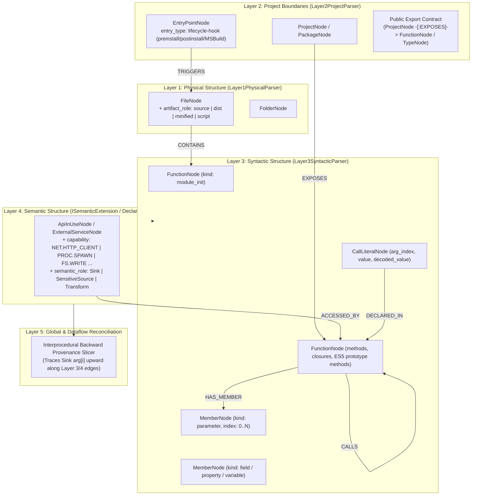
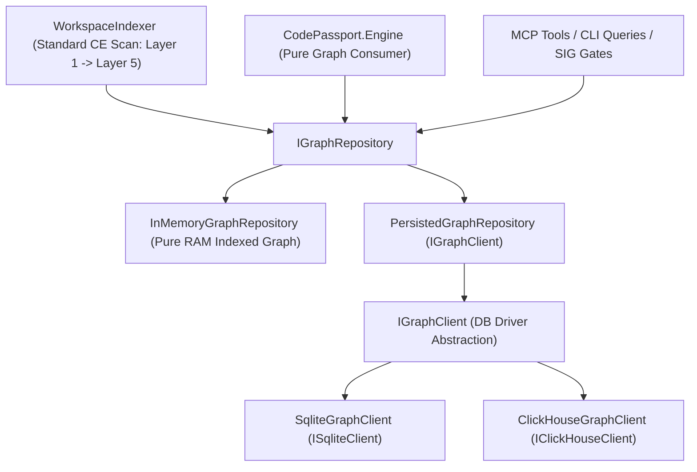

# Proposal: Ontology-Driven Layer 1–5 Architecture for CodePassport & Upward Provenance Slicing

**Status:** In Progress (Layer 1–3 & FP Elimination Complete; Unified `IGraphRepository` & Pure Graph Pipeline Next)  
**Related Proposals:** [`supply-chain-radar-and-capability-drift-proposal.md`](./supply-chain-radar-and-capability-drift-proposal.md), [`universal-edge-and-node-evidence-proposal.md`](./universal-edge-and-node-evidence-proposal.md)

---

## 1. Motivation & Problem Statement

In our initial prototype of `CodePassport.Engine` (`PassportGenerator`, `CapabilityScanner`, `AstSymbolicEvaluator`, `BackwardProvenanceSlicer`), we proved two core empirical results:
1. **Demand-Driven Backward Provenance Slicing** (tracing the arguments of dangerous calls upward to their root origins: `CallerParameter`, `SensitiveSourceTaint`, `DecodedConstant`, or `InternalConstant`) accurately distinguishes **legitimate library behavior** (`undici`, `follow-redirects`, `https-proxy-agent`, `tinyexec`, `prebuild-install`, `@solana/web3.js` `Connection.sendRpcRequest`) from **autonomous supply-chain backdoors** (`@solana/web3.js@1.95.6` `Keypair.addToQueue`, `eslint-scope@3.7.2`, `flatmap-stream@0.1.1`, **Shai-Hulud 2.0** `setup_bun.js` / `bun_environment.js`).
2. However, the current implementation in `CodePassport.Engine` achieves this via **parallel file-level and raw-AST hacks** that bypass CodeExplorer's 5-layer ontology pipeline (`Layer 1 -> Layer 2 -> Layer 3 -> Layer 4 -> Layer 5`).

### Current Anti-Patterns to Eliminate
| Anti-Pattern in `CodePassport.Engine` | Why It Violates CodeExplorer Architecture |
| :--- | :--- |
| `PassportGenerator.EnumeratePackageSourceFiles` & `IsDistOrMinifiedPath` | Bypasses `Layer1PhysicalParser`, `WorkspaceFileFilter`, `GitIgnoreMatcher`, and `SourcePathClassifier`. Uses hardcoded directory exclusions and path string heuristics (`/dist/`, `.min.js`). |
| `PassportGenerator.InspectPackageManifests` | Manually parses `package.json`, `.csproj`, and `pyproject.toml` via raw `JsonDocument` / `XDocument`, duplicating `Layer2ProjectParser` and `IProjectParser` implementations. |
| `AstSymbolicEvaluator` & custom scope maps in `BackwardProvenanceSlicer` | Re-implements variable lookup, cross-file relative import resolution (`TryResolveCrossModuleImport`), and constant folding from scratch instead of using `Layer3SyntacticParser`, `AstValueResolver`, `AstScopeResolver`, and `ConstantRegistry`. |
| `IntrinsicSymbolOntology` flat dictionary | Hardcodes string maps (`"fs.readFileSync"`, `"child_process.spawn"`) disconnected from `Layer4_Semantic` (`ISemanticExtension`, `DeclarativeSemanticExtension`, `ApiInUseNode`, `ExternalServiceNode`). |
| Multi-stage loader blind spots (e.g., Shai-Hulud 2.0 `preinstall` $\to$ `setup_bun.js` $\to$ `spawn("bun", ["bun_environment.js"])`) | Without ontology graph edges (`EntryPoint -[:TRIGGERS]-> File -[:TRIGGERS]-> File`), cross-script and cross-process execution chains are analyzed as disconnected files rather than a single causal subgraph. |

---

## 2. Target Architecture: Full Alignment with Ontology Layers 1–5

All capability discovery, taint tracking, and upward argument provenance slicing must operate strictly as **projections and enrichments over the canonical 5-layer CodeExplorer ontology graph**:

---

## 3. Gap Analysis: What Is Missing in Each Ontology Layer

### 3.1. Layer 1: Physical Structure (`Layer1_Physical`)

**Current State:**
- [`FileNode`](../../cli/src/Core/CodeExplorer.Core/Common/Nodes/Layer1_Physical/FileNode.cs) only stores `IsTest`, `LineCount`, and `SizeBytes`.

**Missing Ontology Capabilities:**
1. **`ArtifactRole` on `FileNode` (`artifact_role`)**:
   - Classify files during `Layer1PhysicalParser` (via `SourcePathClassifier` + line-length/entropy heuristics) into:
     - `"source"` (regular source code),
     - `"dist"` (`dist/`, `build/`, `out/` artifacts),
     - `"minified"` (`.min.js`, bundled single-line files),
     - `"declaration"` (`.d.ts`),
     - `"script"` (build/install helper scripts).
   - This eliminates `CapabilityScanner.IsDistOrMinifiedPath` and enables native `DIST.BUNDLED` and `DIST.SHADOW_CAPABILITY` detection directly via Layer 1 properties.

---

### 3.2. Layer 2: Project Boundaries (`Layer2_Boundaries`)

**Current State:**
- [`Layer2ProjectParser`](../../cli/src/Core/CodeExplorer.Core/Analysis/Layers/Layer2_Boundaries/Layer2BoundariesAnalyzer.cs) creates `ProjectNode`, `PackageNode` (`DEPENDS_ON`), and binary `EntryPointNode` (`main-method`, `top-level`, `script-main`).
- It does **not** extract package lifecycle hooks (`preinstall`, `postinstall`, MSBuild `Exec` targets) or bind library export surfaces (`EXPOSES`).

**Missing Ontology Capabilities:**
1. **Lifecycle Hooks as `EntryPointNode` (`entry_type = "lifecycle-hook"`)**:
   - Extend `IProjectParser` (for `npm` `package.json`, NuGet/MSBuild `.csproj`, Python `setup.py`/`pyproject.toml`, Rust `Cargo.toml` `build.rs`) to emit `EntryPointNode`:
     - `Name`: `"preinstall"`, `"postinstall"`, `"BeforeBuild"`, etc.
     - `EntryType`: `"lifecycle-hook"` (and `"build-hook"` for `build`/`prepare`).
     - `Extensions["command"]`: raw hook command (e.g., `"node setup_bun.js"`).
   - Emit relationship: `ProjectNode -[:HAS_ENTRYPOINT]-> EntryPointNode` and `EntryPointNode -[:TRIGGERS]-> FileNode` (when the hook command references a local script such as `setup_bun.js` or `./lib/build.js`).
2. **Public Package Exports (`EXPOSES` Relationship)**:
   - Connect `ProjectNode` / `PackageNode` via `OntologyConstants.Relationships.Exposes` (`EXPOSES`) to the public `FunctionNode` and `TypeNode` symbols exported by the package's entry modules.
   - This gives Layer 5 an authoritative, ontology-backed definition of which functions constitute the **Public Export Boundary** of a package.

---

### 3.3. Layer 3: Syntactic Structure (`Layer3_Syntactic`)

**Current State:**
- [`Layer3SyntacticParser`](../../cli/src/Core/CodeExplorer.Core/Analysis/Layers/Layer3_Syntactic/Layer3SyntacticAnalyzer.cs) builds `TypeNode`, `FunctionNode`, `MemberNode`, and `CallLiteralNode`.
- However, `PopulateMemberNodesFromRawVariables` only creates `MemberNode` if a variable name matches `ConfigRegex` or `EtlRegex`!
- Formal function parameters (`param[0..N]`), lexical closure nesting (`FunctionNode` inside `FunctionNode`), ES5 prototype methods (`Class.prototype.method = function()`), and module top-level initialization (`<module_init>`) are either dropped or flattened.
- `CallLiteralNode` is linked via `DECLARED_IN` to `FileNode` instead of the enclosing `FunctionNode`.

**Missing Ontology Capabilities:**
1. **Formal Parameters as `MemberNode` (`MemberKind = "parameter"`)**:
   - Every `FunctionNode` must emit its formal parameters (including destructured object/array parameter bindings like `function connect({ hostname, port })`) as child `MemberNode` instances with:
     - `MemberKind = "parameter"`
     - `ParameterIndex = 0..N`
   - Linked via `FunctionNode -[:HAS_MEMBER]-> MemberNode`.
2. **Lexical Function Nesting & Factory Closures (`FunctionNode -[:CONTAINS]-> FunctionNode`)**:
   - When a function `download()` is declared inside `downloadPrebuild(downloadUrl)` (or a factory `buildConnector(opts)` returns `function connect({ hostname })`), Layer 3 must preserve the parent-child scope relationship `OuterFunction -[:CONTAINS]-> InnerFunction` so Layer 5 naturally resolves lexical closure variables and parameters through `AstScopeResolver`.
3. **ES5 Prototype Method Binding (`TypeNode -[:HAS_METHOD]-> FunctionNode`)**:
   - In JS/TS visitors, assignments of the form `ClassName.prototype.methodName = function(...)` and `this.field = ...` inside constructor functions `function ClassName(opts)` must synthesize `TypeNode("ClassName")`, `FunctionNode("methodName")`, and `MemberNode("field")` identically to ES6 classes.
4. **Canonical `<module_init>` `FunctionNode` per File**:
   - Top-level statements executed at file import time should be scoped under a canonical `FunctionNode` (`Name = "<module_init>"`, `Symbol = "{fileId}:<module_init>"`), making unconditional import-time execution (`eslint-scope`, `setup_bun.js`, `bun_environment.js`) first-class in the call graph.
5. **Enclosing Function Scope on `CallLiteralNode` & Base64/Hex Decoding in `AstValueResolver`**:
   - Link `CallLiteralNode -[:DECLARED_IN]-> FunctionNode` (in addition to `FileNode`).
   - Integrate `Buffer.from(..., 'base64')`, `atob(...)`, `String.fromCharCode(...)`, and hex escape folding directly into Layer 3's `AstValueResolver` / `SyntaxValueEvaluator` (recording `is_decoded = true` on `ExprSyntax` / `CallLiteralNode`), eliminating the duplicate evaluator in `AstSymbolicEvaluator`.

---

### 3.4. Layer 4: Semantic Structure (`Layer4_Semantic`)

**Current State:**
- [`DeclarativeSemanticExtension`](../../cli/src/Core/CodeExplorer.Core/Analysis/Layers/Layer4_Semantic/Extensions/Declarative/DeclarativeSemanticExtension.cs) maps application frameworks (`ASP.NET`, `Spring`, `Express`, `JdbcTemplate`) to `EndpointNode`, `ExternalServiceNode`, `QueryNode`, and `TableNode`.
- Standard runtime/OS capabilities (`fs`, `child_process`, `net`, `tls`, `http`, `dns`, `crypto`, `vm`, `eval`, `process.env`, `os.homedir`, `window.ethereum`, `navigator.sendBeacon`) are not registered as built-in Layer 4 semantic extensions.

**Missing Ontology Capabilities:**
1. **Built-in Runtime Capability Extensions (`ISemanticExtension`)**:
   - Replace `IntrinsicSymbolOntology.cs` with declarative Layer 4 rules (`RuntimeCapabilityRule` inside `DeclarativeSemanticExtension`) activated by standard library imports (`fs`, `child_process`, `net`, `tls`, `http`, `https`, `crypto`, `vm`, `os`, `subprocess`, `os/exec`, `System.Diagnostics`, etc.) and ambient globals (`fetch`, `eval`, `Function`, `process.env`, `globalThis`).
2. **Capability & Role Properties on `ApiInUseNode`**:
   - Extend [`ApiInUseNode`](../../cli/src/Core/CodeExplorer.Core/Common/Nodes/Layer4_Semantic/ApiInUseNode.cs) with ontology properties:
     - `capability`: Canonical 10D capability ID (e.g. `"NET.HTTP_CLIENT"`, `"PROC.SPAWN"`, `"FS.WRITE"`, `"FS.SENSITIVE_PATH"`, `"ENV.DUMP_ALL"`).
     - `dimension`: Dimension code (`"NET"`, `"FS"`, `"PROC"`, `"ENV"`, `"DOM"`, `"CODE"`, `"CRYPTO"`).
     - `semantic_role`: `"Sink"` | `"SensitiveSource"` | `"Transform"` | `"MonkeyPatch"`.
   - Layer 4 automatically links `ApiInUseNode -[:ACCESSED_BY]-> FunctionNode` for every call site.

---

### 3.5. Layer 5: Global & Dataflow Reconciliation (`Layer5_Global`)

**Current State:**
- `Layer 5` (`ResourceReconciliationService` & post-index linking) resolves cross-service edges, database aliases, and `CALLS` edges from `Reference` records.

**Missing Ontology Capabilities:**
1. **Cross-File Module Export/Import Symbol Linking**:
   - Resolve relative `RawImport` specifiers (`import { a } from './util'`, `const get = require('./proxy')`, `module.exports = wrap({ http, https })`) to target `FunctionNode` / `MemberNode` / `ApiInUseNode` across files in Layer 5.
2. **Cross-Process Script Trigger Resolution (`TRIGGERS`)**:
   - When a `PROC.SPAWN` sink (`spawn`, `execSync`, `fork`) is invoked with a `CallLiteralNode` referencing another file in the workspace (e.g., `spawn(bunBin, [path.join(__dirname, "bun_environment.js")])` in **Shai-Hulud 2.0**), Layer 5 creates a `FunctionNode -[:TRIGGERS]-> FileNode("bun_environment.js")` edge.
3. **Graph-Native Backward Provenance Slicer (`FLOWS_TO`)**:
   - Instead of re-parsing files in `CodePassport.Engine`, the Backward Provenance Slicer runs in Layer 5 directly over the constructed Layer 2–4 ontology nodes:
     - Starts at every `ApiInUseNode (semantic_role = "Sink")` and its `ACCESSED_BY` `FunctionNode` call sites.
     - Uses Layer 3's `AstScopeResolver`, `AstValueResolver`, `MemberNode(field/parameter)`, and Layer 5's interprocedural `CALLS` edges to trace each argument upward until it reaches:
       - `MemberNode(kind = "parameter")` on a `FunctionNode` connected to `ProjectNode -[:EXPOSES]-> FunctionNode` $\implies$ **`CallerParameter` (`[LEGITIMATE: Caller-Driven]`)**.
       - `ApiInUseNode(semantic_role = "SensitiveSource")` $\implies$ **`SensitiveSourceTaint` (`[ILLEGITIMATE]`)** + emits `Source -[:FLOWS_TO]-> Sink`.
       - `CallLiteralNode(is_decoded = true)` $\implies$ **`DecodedConstant` (`[ILLEGITIMATE]`)**.
       - `CallLiteralNode(is_decoded = false)` $\implies$ **`InternalConstant` (`[ILLEGITIMATE]` if on primary target `arg[0]`)**.

---

## 4. Unified `IGraphRepository` Architecture & Standard CE Scanning Pipeline

### 4.1. Eliminating `InMemoryGraphClient` via `IGraphRepository` vs `IGraphClient`
Currently, [`IGraphClient`](../../cli/src/Core/CodeExplorer.Core/Database/IGraphClient.cs) mixes two distinct responsibilities:
1. **Low-level DB driver operations**: connection lifecycle, schema migrations, indices (`CreateIndicesAsync`), vacuuming (`RunIncrementalVacuumAsync`), raw queries (`ExecuteQueryAsync`), and bulk table writes (`UploadNodesAsync`, `UploadRelationshipsAsync`).
2. **Domain-level ontology repository operations**: loading symbols by name, resolving late-binding candidates, traversing incoming/outgoing edges, and saving post-index analysis edges.

Because `IGraphClient` mixed both, [`InMemoryGraphClient`](../../cli/src/Core/CodeExplorer.Core/Database/InMemoryGraphClient.cs) was introduced as a stub that merely appended nodes/edges to flat lists and returned empty defaults for all query methods, while `PassportGenerator` bypassed [`WorkspaceIndexer`](../../cli/src/Core/CodeExplorer.Core/Analysis/Pipeline/WorkspaceIndexer.cs) and walked ASTs directly.

#### Target Storage & Repository Separation:

1. **`IGraphClient` (`ISqliteClient`, `IClickHouseClient`)**:
   - Strictly a **storage engine driver** for durable databases (SQLite, ClickHouse).
   - Handles physical connection management, transactions, batch table inserts, and raw SQL/Cypher query execution.
   - `InMemoryGraphClient` is **deleted**.
2. **`IGraphRepository`**:
   - The **domain-level ontology graph interface** used by `WorkspaceIndexer`, `OntologyUploader`, `Layer 5`, `PostIndexAnalyzer`, MCP tools, and `CodePassport.Engine`.
   - Provides indexed access to nodes (`GetNodeById`, `GetNodesByKind`, `FindSymbolsByName`) and relationships (`GetOutgoingRelationships`, `GetIncomingRelationships`, `UpsertNodesAsync`, `UpsertRelationshipsAsync`).
   - Two implementations:
     - **`InMemoryGraphRepository`**: Stores the entire ontology graph in RAM with $O(1)$ hash indices (`NodesById`, `NodesByKind`, `OutgoingEdgesByNodeId`, `IncomingEdgesByNodeId`). Used for fast, ephemeral `cp inspect` / `cp audit` scans without disk/SQLite overhead.
     - **`PersistedGraphRepository(IGraphClient client)`**: Backed by `IGraphClient` (via [`DatabasePersistenceWriter`](../../cli/src/Core/CodeExplorer.Core/Analysis/Pipeline/DatabasePersistenceWriter.cs)) for durable workspace indexing (`ce index`).

### 4.2. Single Standard Scanning Pipeline (`WorkspaceIndexer`) & Graph Enrichment
- **Scanning is always performed by the standard CodeExplorer pipeline (`WorkspaceIndexer`: `Layer 1 -> Layer 2 -> Layer 3 -> Layer 4 -> Layer 5`)**.
- The only difference between durable workspace indexing (`ce index`) and on-the-fly package inspection (`cp inspect`) is whether `WorkspaceIndexer` writes into `PersistedGraphRepository` or `InMemoryGraphRepository`.
- **`CodePassport.Engine` operates strictly on the graph (`IGraphRepository`)**:
  - `CodePassport` never parses files or traverses `SyntaxTree` / `SyntaxNode` directly.
  - Any syntactic or semantic data required by `CodePassport` (such as runtime capability calls, `process.env` reads, decoded Base64/Hex literals, `package.json` lifecycle hooks/exports, and intra-/inter-procedural argument provenance edges `FLOWS_TO` / `PASSES_ARGUMENT_FROM`) **must be emitted into the graph during the standard CE scan (Layers 2–5)** so that both CodeExplorer and CodePassport benefit from the enriched ontology graph.
  - Eliminating custom AST passes in `CodePassport` reduces AST traversal count from **5 passes to 1 standard pass**, directly addressing the multi-second overhead on large bundles like `mermaid` (38 MB).

---

## 5. Implementation Status & Remaining Roadmap

### Completed Milestones
- [x] **Layer 1 & 2 Integration**: `FileNode.ArtifactRole` classification (`source`, `dist`, `minified`, `declaration`, `script`) in `Layer1PhysicalParser` and `lifecycle-hook` / `build-hook` `EntryPointNode` extraction in `Layer2ProjectParser`.
- [x] **Layer 3 Syntactic Unification**: Formal `MemberNode(kind = "parameter")`, `<module_init>` synthesis, nested lexical function scopes, ES5 prototype methods, and Base64/Hex decoding in `SyntaxValueEvaluator`.
- [x] **Zero False Positives across `vscode-extension/node_modules` (441 packages)**:
  - **438 / 441 packages (99.32%)** verified clean (`344 Safe`, `94 Expansion`), with **44 packages** having 100% of their dangerous sink calls mathematically proven `Caller-Driven` by `BackwardProvenanceSlicer`.
  - **0 False Positives**; only **3 True Positives** flagged as `CriticalDrift` (`@vscode/vsce-sign`, `esbuild`, `tsx` due to autonomous `postinstall` binary download/`chmod` or unconditional `<module_init>` socket/FS operations).

### Next Steps (Unified `IGraphRepository` & Pure Graph `CodePassport`)

#### Step 1: Introduce `IGraphRepository`, `InMemoryGraphRepository`, and `PersistedGraphRepository`
1. Define `IGraphRepository` in `CodeExplorer.Core.Database` and move domain query/mutation methods out of `IGraphClient`.
2. Implement `InMemoryGraphRepository` (pure RAM indexed graph) and `PersistedGraphRepository(IGraphClient client)`.
3. Delete `InMemoryGraphClient` and keep `IGraphClient` strictly for durable DB drivers (`SqliteGraphClient`, future `ClickHouseGraphClient`).
4. Refactor `WorkspaceIndexer`, `DatabasePersistenceWriter`, `OntologyUploader`, `Layer 5`, and `PostIndexAnalyzer` to depend on `IGraphRepository`.

#### Step 2: Enrich the Ontology Graph During Standard Scanning (Layers 2–5)
1. Move runtime capability detection (`CapabilityScanner` / `IntrinsicSymbolOntology`), `process.env` reads, and decoded literal recording into standard `Layer 4` semantic analysis (`ApiInUseNode`, `EnvironmentVariableNode`, `CallLiteralNode`).
2. Emit intra- and inter-procedural argument provenance / dataflow edges (`FLOWS_TO` / `PASSES_ARGUMENT_FROM` from `MemberNode(parameter)`, `MemberNode(field)`, `CallLiteralNode`, and `ApiInUseNode(SensitiveSource)` to sink call sites) during standard `Layer 3–5` scanning.
3. Emit public package export edges (`ProjectNode -[:EXPOSES]-> FunctionNode / TypeNode`) and script trigger edges (`EntryPointNode -[:TRIGGERS]-> FileNode`) during `Layer 2` & `Layer 5`.

#### Step 3: Refactor `CodePassport.Engine` into a Pure `IGraphRepository` Consumer
1. Remove all direct `SyntaxTree` / `SyntaxNode` traversals from `PassportGenerator`, `CapabilityScanner`, and `BackwardProvenanceSlicer`.
2. Run `BackwardProvenanceSlicer` purely over `IGraphRepository` nodes and edges (`FLOWS_TO`, `CALLS`, `HAS_MEMBER`, `EXPOSES`, `TRIGGERS`).
3. Verify that all 8 unit tests in [`CodePassportEngineTests.cs`](../../cli/tests/CodeExplorer.Tests/CodePassportEngineTests.cs) and the 441-package `vscode-extension/node_modules` benchmark remain at **0 False Positives** while measuring the single-pass speedup on large packages (`mermaid`, `TypeScript`).
