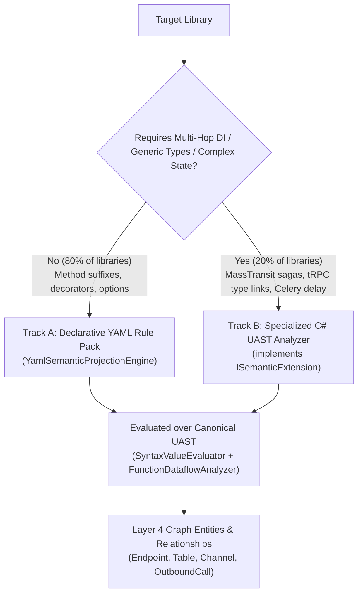

# Proposal: Ecosystem Library Expansion & Polyglot Semantic Archetypes

**Status:** Implemented  
**Created:** 2026-11-07  
**Target Layer:** Layer 4 (Semantic Structure) & Layer 2 (Host Components)  
**Related Proposals:** [`semantic-archetypes-and-yaml-projections-proposal.md`](./semantic-archetypes-and-yaml-projections-proposal.md), [`uast-performance-and-loop-semantics-proposal.md`](./uast-performance-and-loop-semantics-proposal.md)

---

## 1. Executive Summary & Goals

CodeExplorer currently features **136+ specialized library and component parsers** implemented in C#. These provide deep AST comprehension for major web frameworks, database drivers, and messaging systems.

However, analyzing modern real-world enterprise codebases reveals gaps in cloud-native SDKs, modern API paradigms (gRPC / GraphQL / tRPC), modern scheduling engines, resilient HTTP pipelines, and modern microservice frameworks across **C#, Java, Kotlin, TypeScript, Python, and Go**.

This proposal establishes:
1. The **Top 10 High-Value Unsupported Libraries** per target language (60 libraries total), categorized by architecture archetype.
2. A formal **Hybrid Parser Implementation Strategy**:
   - **Track A (Declarative YAML Projections)**: For standard 1-to-1 method/decorator matches (HTTP clients, Redis/Cache, simple queue publishers, DTO validation).
   - **Track B (Specialized C# UAST Analyzers)**: For complex multi-hop semantics (DI registration containers, generic message broker types `TMessage`, ORM fluent entity configurations, and dynamic pipeline middleware).
3. A milestone delivery roadmap to achieve **100% architectural coverage** across modern enterprise stacks.

---

## 2. Inventory of Supported vs Unsupported Libraries

### 2.1. Current Coverage Summary
- **C# (.NET)**: 36 parsers (ASP.NET Core, EF Core, Dapper, MassTransit, MediatR, Confluent Kafka, KafkaFlow, RabbitMQ/EventBus, Orleans, Grpc.Net, HotChocolate, HttpClient, RestSharp, Refit, Flurl, StackExchange.Redis, Npgsql, SqlClient, MongoDb, Neo4j, Couchbase, Nest/Elasticsearch, Stripe, WCF, YARP).
- **TypeScript / JavaScript**: 53 parsers (Express, Fastify, NestJS, Next.js, Koa, RoutingControllers, React, Angular, Vue, Svelte, Vite, Prisma, TypeORM, Drizzle, Sequelize, Knex, Mongoose, MongoDB, Pg, Mysql2, Sqlite3, Redis, InfluxDB, BullMQ, KafkaJS, RabbitMQ, Socket.IO, SignalR, Axios, Fetch, Got, Ky, Undici, Request, Urllib, Grpc, GraphQL, Pothos, AWS/Azure/GCP SDKs, Stripe, Jest, Vitest, Mocha, Cypress, Playwright).
- **Go**: 30 parsers (Gin, Echo, Fiber, Chi, Beego, Fasthttp, GORM, database/sql, pgx, lib/pq, go-sql-driver/mysql, go-sqlite3, Mongo, Redis, ClickHouse, BigQuery, Firestore, Elasticsearch, Sarama Kafka, NATS, RabbitMQ, Resty, net/http, gRPC, grpc-gateway, Pub/Sub).
- **Python**: 24 parsers (FastAPI, Flask, Django, SQLAlchemy, Peewee, SqlModel, Psycopg2, PyMySQL, mysql-connector, sqlite3, PyMongo, Redis, CouchDB, Elasticsearch, Pinecone, ChromaDB, Requests, Httpx, AioHttp, gRPC, unittest/pytest).
- **Java**: 20 parsers (Spring MVC, Spring Data Mongo/Redis/Elasticsearch, Spring Kafka/RabbitMQ/Events/GraphQL, Quarkus Jax-RS/Messaging/Panache, Micronaut, Dubbo, Jpa/Hibernate, JdbcTemplate, gRPC, Java HttpClient).
- **Kotlin**: Regex-based heuristic parser for Ktor and basic SQL; lacks modular Layer 4 `ISemanticExtension` analyzers for idiomatic Kotlin libraries.

---

## 3. Top 10 High-Priority Libraries to Implement (By Language)

### 3.1. C# (.NET)
| Library | Archetype | Architectural Impact & Why It Matters |
| :--- | :--- | :--- |
| **1. Hangfire** | `JobScheduler` | Background recurring jobs, queues (`BackgroundJob.Enqueue`, `RecurringJob.AddOrUpdate`). Crucial for worker service topologies. |
| **2. Polly / Microsoft.Extensions.Resilience** | `ResiliencePipeline` | Retries, circuit breakers, timeout policies wrapping `HttpClient` / DB calls. Identifies resilience boundaries and blast radius. |
| **3. Quartz.NET** | `JobScheduler` | Enterprise job scheduling (`IJob`, `IScheduler.ScheduleJob`, cron triggers). |
| **4. Marten** | `DataAccess` | PostgreSQL Document DB & Event Sourcing engine for .NET. Maps document schemas and event streams. |
| **5. Azure Functions SDK (`Microsoft.Azure.Functions.Worker`)** | `HostComponent` / `EntryPoint` | Serverless trigger bindings: `HttpTrigger`, `ServiceBusTrigger`, `QueueTrigger`, `CosmosDBTrigger`. |
| **6. Wolverine** | `MessageFlow` / `Mediator` | Next-gen .NET command bus & message mediator (Marten/Jasper successor). Maps message routing handlers. |
| **7. AWS SDK for .NET (`AWSSDK.*`)** | `CloudSdk` / `Outbound` | Amazon S3, SQS, SNS, DynamoDB clients for C# enterprise services. |
| **8. Serilog / OpenTelemetry Tracing** | `Observability` | Distributed trace spans and telemetry sinks linking cross-service contextual flow. |
| **9. MassTransit Saga State Machine** | `StateOrchestration` | Orchestration sagas (`MassTransitStateMachine<TState>`). Crucial for complex distributed transactions. |
| **10. Cap (`DotNetCore.CAP`)** | `MessageFlow` | Event bus with Outbox pattern for microservices (Kafka/RabbitMQ/SQL storage). |

---

### 3.2. Java (JVM)
| Library | Archetype | Architectural Impact & Why It Matters |
| :--- | :--- | :--- |
| **1. Apache Camel** | `Integration` / `MessageFlow` | Enterprise Integration Patterns (EIP). Routes (`from("direct:...").to("kafka:...")`). |
| **2. Apache Pulsar Client** | `MessageFlow` | Multi-tenant cloud-native distributed messaging & streaming. |
| **3. MyBatis** | `DataAccess` | Leading SQL mapper in Asian & legacy enterprise markets (XML mapper & `@Select`/`@Insert` annotations). |
| **4. Retrofit / OpenFeign (Standalone)** | `OutboundCall` | Declarative HTTP client interfaces (`@GET`, `@POST`). Completes outbound service-to-service links. |
| **5. Resilience4j** | `ResiliencePipeline` | Fault tolerance: `@CircuitBreaker`, `@Retry`, `@RateLimiter` decorations on outbound calls. |
| **6. JDBI** | `DataAccess` | Popular lightweight alternative to Hibernate/JPA for SQL-centric Java. |
| **7. Axon Framework** | `MessageFlow` / `Cqrs` | CQRS, Event Sourcing, and DDD framework for Java (`@CommandHandler`, `@EventHandler`). |
| **8. R2DBC (Reactive Relational DB)** | `DataAccess` | Non-blocking reactive SQL database driver for Spring WebFlux / Quarkus. |
| **9. Temporal Java SDK** | `StateOrchestration` | Distributed workflow orchestration (`@WorkflowInterface`, `@ActivityInterface`). |
| **10. AWS SDK for Java v2 (`software.amazon.awssdk`)** | `CloudSdk` / `Outbound` | Standard Java AWS clients (S3, SQS, DynamoDbClient). |

---

### 3.3. Kotlin
| Library | Archetype | Architectural Impact & Why It Matters |
| :--- | :--- | :--- |
| **1. Exposed (JetBrains)** | `DataAccess` | Idiomatic Kotlin SQL ORM / DSL (`Table`, `IntIdTable`, `transaction { ... }`). |
| **2. Ktor Server (Modular AST Parser)** | `HostComponent` / `EntryPoint` | Refactor from regex to typed UAST: `routing { get("/...") { ... } }`, subroutes, plugins. |
| **3. Ktor Client** | `OutboundCall` | Kotlin Multiplatform HTTP client: `client.get("...")`, `client.post("...")`. |
| **4. Spring Cloud Stream (Kotlin functional)** | `MessageFlow` | Functional message bindings: `Consumer<T>`, `Function<T, R>`, `Supplier<T>`. |
| **5. Arrow Analysis / Arrow Core** | `ResiliencePipeline` | Typed functional error handling (`Either`, `Raise`) shaping cross-layer control flow. |
| **6. Ktorm** | `DataAccess` | SQL framework for Kotlin with strong ORM features. |
| **7. Koin** | `DependencyBinding` | Pragmatic lightweight dependency injection framework for Kotlin/Android/Backend (`module { single { ... } }`). |
| **8. Micronaut Kotlin** | `HostComponent` / `EntryPoint` | Reactive microservice framework optimized for Kotlin coroutines. |
| **9. KGraphQL / Expedia GraphQL Kotlin** | `EntryPoint` / `Schema` | Schema-first and code-first GraphQL server engines for Kotlin. |
| **10. Kotlinx.Serialization / Moshi-Kotlin** | `DataContract` | Core contract serialization schemas mapping DTO models. |

---

### 3.4. TypeScript / Node.js
| Library | Archetype | Architectural Impact & Why It Matters |
| :--- | :--- | :--- |
| **1. tRPC (`@trpc/server`, `@trpc/client`)** | `EntryPoint` / `OutboundCall` | End-to-end typesafe APIs without schemas. Links client procedures `trpc.user.getById.useQuery()` to server router definitions. |
| **2. Hono (`hono`)** | `HostComponent` / `EntryPoint` | Ultrafast multi-runtime framework (Cloudflare Workers, Bun, Node): `app.get("/...", c => ...)`. |
| **3. Temporal TypeScript SDK (`@temporalio/workflow`, `@temporalio/activity`)** | `StateOrchestration` | Workflow & Activity definitions for reliable microservice coordination. |
| **4. Remix / React Router v7 (`@remix-run/node`)** | `HostComponent` / `EntryPoint` | Fullstack web framework: `loader` (data query), `action` (data mutation). |
| **5. GraphQL Yoga / Apollo Server v4** | `EntryPoint` | Modern standalone GraphQL servers (resolvers, typedefs, context). |
| **6. Kyelys / MikrORM** | `DataAccess` | TypeScript-first ORM with Identity Map, unit of work, and strict relations. |
| **7. Inngest (`inngest`)** | `MessageFlow` / `JobScheduler` | Event-driven background function orchestration for serverless TypeScript. |
| **8. Bull (legacy v3 / v4 `bull`)** | `MessageFlow` | Legacy Redis job queue (`new Queue(...)`, `queue.process(...)`). |
| **9. Vitest Testing Library (`@testing-library/react`)** | `TestCoverage` | DOM user interaction testing mapping UI components to backend endpoints. |
| **10. Pinecone / LangChain.js / Vercel AI SDK (`ai`)** | `AiAgentIntegration` | Outbound AI model completions, vector embeddings, tool calling pipelines. |

---

### 3.5. Python
| Library | Archetype | Architectural Impact & Why It Matters |
| :--- | :--- | :--- |
| **1. Celery** | `MessageFlow` / `JobScheduler` | The dominant Python background worker: `@app.task`, `task.delay()`, `task.apply_async()`. |
| **2. Dramatiq** | `MessageFlow` | Modern, fast alternative to Celery with RabbitMQ/Redis actors (`@dramatiq.actor`). |
| **3. Tortoise ORM** | `DataAccess` | Async asyncio ORM inspired by Django (`class User(Model): ...`). |
| **4. Litestar (formerly Starlite)** | `HostComponent` / `EntryPoint` | High-performance modern ASGI framework alternative to FastAPI. |
| **5. Boto3 (Dedicated Architecture Extractor)** | `CloudSdk` / `Outbound` | Deep extraction for AWS SQS (`sqs.send_message`), SNS, S3, DynamoDB beyond raw SDK string hits. |
| **6. Temporal Python SDK (`temporalio`)** | `StateOrchestration` | Durable execution workflows (`@workflow.defn`, `@activity.defn`). |
| **7. Motor (Async MongoDB)** | `DataAccess` | Official asynchronous MongoDB driver for Tornado/asyncio. |
| **8. Redis-Py Streams / RQ (Redis Queue)** | `MessageFlow` | `rq.Queue`, `redis.xadd()`, `redis.xread()` for lightweight stream processing. |
| **9. LangChain / LlamaIndex / OpenAI SDK** | `AiAgentIntegration` | Outbound LLM API calls, vector store bindings, agent tools. |
| **10. Strawberry GraphQL / Graphene** | `EntryPoint` | Python code-first and schema-first GraphQL servers. |

---

### 3.6. Go (Golang)
| Library | Archetype | Architectural Impact & Why It Matters |
| :--- | :--- | :--- |
| **1. Watermill** | `MessageFlow` | Universal event-driven library for Go (Kafka, RabbitMQ, Google Pub/Sub, SQL). |
| **2. SQLX (`jmoiron/sqlx`)** | `DataAccess` | Standard extensions to `database/sql` (`Get`, `Select`, `NamedExec`). |
| **3. Ent (`entgo.io/ent`)** | `DataAccess` | Facebook's schema-as-code entity framework for Go. |
| **4. Asynq** | `JobScheduler` / `MessageFlow` | Distributed task queue over Redis for Go (`asynq.Client.Enqueue`, `asynq.Server`). |
| **5. Temporal Go SDK (`go.temporal.io/sdk`)** | `StateOrchestration` | Workflow and Activity definitions in Go. |
| **6. GQLGen (`99designs/gqlgen`)** | `EntryPoint` | Leading Go GraphQL server library with code generation. |
| **7. AWS SDK for Go v2 (`aws/aws-sdk-go-v2`)** | `CloudSdk` / `Outbound` | Modern modular Go AWS client (`s3.NewFromConfig`, `sqs.NewFromConfig`). |
| **8. Go-Zero (`zeromicro/go-zero`)** | `HostComponent` / `Microservice` | Full-featured web and RPC framework with builtin service discovery. |
| **9. Bun (`uptrace/bun`)** | `DataAccess` | Fast, lightweight SQL client and ORM for PostgreSQL, MySQL, MSSQL, SQLite. |
| **10. Centrifuge / Gorilla WebSocket** | `WebSocketFlow` | Real-time messaging and WebSocket hubs in Go. |

---

## 4. Implementation Strategy: Declarative YAML vs Specialized C# Analyzers

To implement 60 new libraries efficiently without bloating the codebase with another 60 boilerplate C# classes, parsers will be routed to one of two pipelines:



### 4.1. Track A: Declarative YAML Rule Packs (Fast Velocity)
Libraries with straightforward signatures (e.g. `Hangfire`, `Ktor Client`, `Hono`, `Tortoise ORM`, `SQLX`, `Polly`) are defined in declarative rule files:

```yaml
# Example: datastore-libraries.yaml
extensions:
  - id: python.tortoise_orm
    language: Python
    archetype: DataAccess
    rules:
      - kind: TableDeclaration
        match_base_type: "tortoise.models.Model"
        extract_table_name: "$class_name.to_snake_case()"
      - kind: OperationCall
        match_call: ["filter", "all", "get", "create", "update", "delete"]
        receiver_type: "tortoise.models.Model"
        operation: "$method_name.to_sql_op()"
```

### 4.2. Track B: Specialized C# UAST Analyzers (Deep Semantics)
Libraries that require state-machine compilation, generic type arguments, or multi-hop router linking (e.g., `tRPC`, `Celery`, `Temporal`, `Ent`, `Watermill`) are written as native C# analyzers implementing `ISemanticExtension`:
- Use `CallExprSyntax.TypeArguments` to extract strongly-typed message schemas without string constants.
- Leverage `CallSiteExecutionContext` to attach `in_loop` and `loop_depth` metadata to extracted relationships.
- Use `FunctionDataflowAnalyzer` to trace parameters passed into background job actors.

---

## 5. Phased Implementation Plan (Commit-Per-Phase, Consolidated Release)

All phases are delivered via incremental commits and shipped together in a single consolidated release (`v1.73.0`):

| Phase | Delivery Unit | Target Scope |
| :---: | :--- | :--- |
| **Phase 1: Task Queues & Schedulers** | Commit 1 | **Celery** & **Dramatiq** & **RQ** (Python), **Hangfire** & **Quartz.NET** & **Wolverine** & **CAP** (C#), **Bull** & **Inngest** (TS), **Asynq** & **Watermill** (Go), **Apache Camel** & **Apache Pulsar** & **Axon** (Java). |
| **Phase 2: Modern Web Frameworks & RPC** | Commit 2 | **tRPC**, **Hono**, **Remix**, **GraphQL Yoga** (TS), **Litestar** & **Strawberry GraphQL** (Python), **Go-Zero**, **GQLGen**, **Centrifuge** (Go), **OpenFeign / Retrofit** (Java), **Ktor Server/Client** & **Micronaut** & **GraphQL** (Kotlin), **Azure Functions** (C#). |
| **Phase 3: Modern ORMs & SQL Mappers** | Commit 3 | **Exposed** & **Ktorm** (Kotlin), **Tortoise ORM** & **Motor** (Python), **SQLX**, **Ent**, **Bun** (Go), **MyBatis**, **JDBI**, **R2DBC** (Java), **Marten** (C#), **MikroORM / Kysely** (TS). |
| **Phase 4: Cloud SDKs, Resilience & DI** | Commit 4 | **AWS SDK v2** (Go, Java, .NET), **Boto3** (Python), **Polly** & **OpenTelemetry** (C#), **Resilience4j** (Java), **Koin** & **Arrow** & **Kotlinx.Serialization** (Kotlin), **Testing Library** (TS). |
| **Phase 5: Distributed Workflows & AI Sinks** | Commit 5 | **Temporal SDKs** (Go, TS, Python, Java), **MassTransit Sagas** (C#), **OpenAI / LangChain / Vercel AI SDKs** (TS, Python). |

---

## 6. Verification Criteria & Invariant Gates

1. **Parity Harness**: Each library parser MUST have a dedicated fixture in `cli/tests/SampleProjects/` and unit test verifying node kinds and edge attributes.
2. **Zero Invariant Gate Failures**: `ce scan` and `ce gate check` on test fixtures MUST pass with 0 warnings (`SIG-C-R-001`, `SIG-M-I-001`, `SIG-O-B-003`).
3. **No String Heuristics**: All route and topic names MUST be resolved via `SyntaxValueEvaluator` or UAST symbol references; raw unvalidated regex matching is forbidden.
