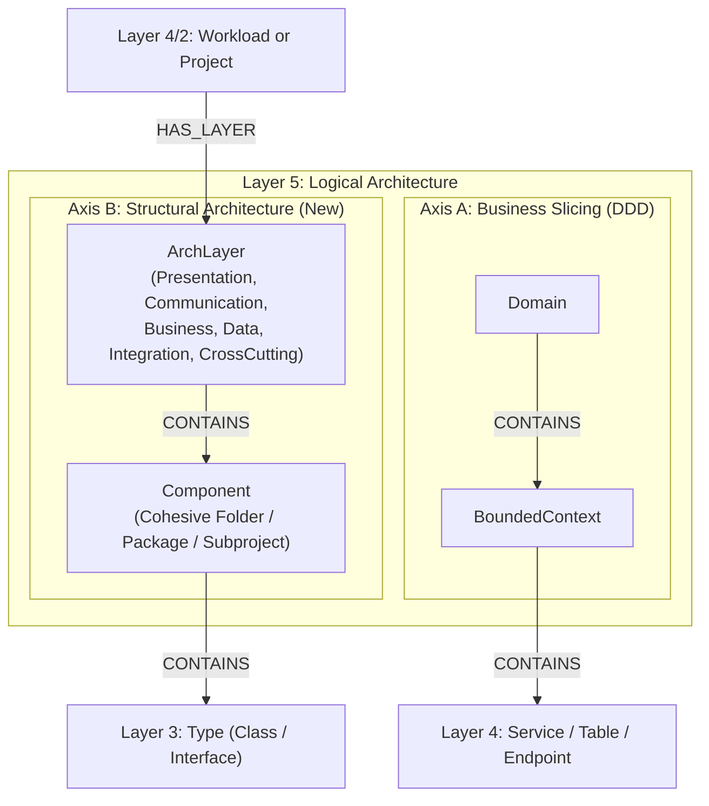
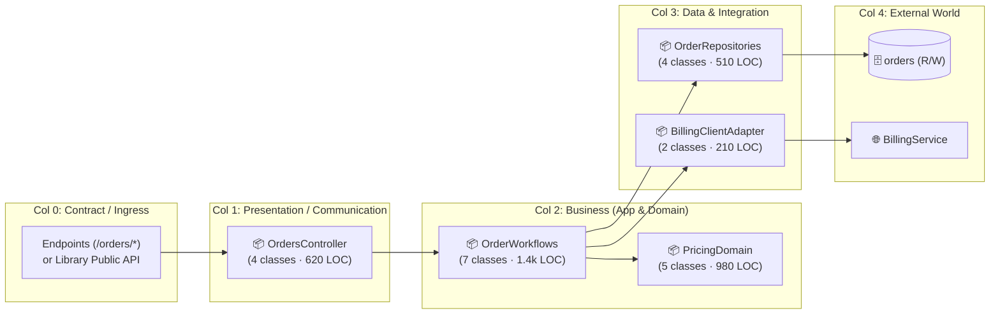

# Proposal: Layer 5 Architectural Structure, Unified Layered Flow & Diagnostic Overlays

**Status:** Proposed  
**Created:** 2026-11-13  
**Target Subsystems:** Layer 5 Ontology (`CodeExplorer.Core`, `CodeExplorer.Analysis`), `ArchitectureViewEngine`, VS Code Webview (`ProjectFlowView`, `ArchitectureMap`, `UniversalGraphMap`), Semantic Invariant Gates (`SIG`)  
**Related Docs:** [`project-map-proposal.md`](./project-map-proposal.md), [`uast-performance-and-loop-semantics-proposal.md`](./uast-performance-and-loop-semantics-proposal.md), [`docs/architecture/ontology-model.md`](../architecture/ontology-model.md)

---

## 1. Motivation & Root-Cause Diagnosis

Recent design reviews and real-world architecture audit scenarios exposed three structural limitations across our visualization suite and Layer 5 ontology:

### 1.1. Why Orbital `Project Map` Fails Cognitively & Geometrically
While [`project-map-proposal.md`](./project-map-proposal.md) solved C3 data extraction (`ProjectMapBuilder`), rendering a project's internal classes and folders on **concentric orbital rings** (`projectMapLayout.ts` + `TryBuildClassMap`) creates four fundamental mismatches with how engineers read code:

1. **Inverted Funnel Geometry:** Real services expose many entry points (`30–80` endpoints/commands) and touch few databases (`1–3` DBs/tables). Concentric orbits place `Orbit 0 (EntryPoints)` on the **smallest inner circle** (cramped) while placing `Orbit 6 (Databases)` on the **huge outer perimeter** (sparse).
2. **No Directional Execution Axis:** Engineers trace execution as a pipeline (**Left $\rightarrow$ Right** or **Top $\rightarrow$ Bottom**: *Request $\rightarrow$ Orchestration $\rightarrow$ Business Logic $\rightarrow$ Persistence*). Scattering 60–80 classes across $360^\circ$ sends dependency chords across the center at arbitrary angles with no visual start or finish.
3. **BFS Hop Depth Masquerading as Architectural Layers:** `ProjectMapBuilder.ClassMap.cs` assigns classes to rings `Application`, `Core`, `Data`, and `Foundation` by raw **BFS step distance (`depth 1..4`)** from entry points. If a controller directly invokes a repository at `depth = 1`, that repository lands on the `Application` ring, while a string helper at `depth = 3` lands on the `Data` ring.
4. **Missing Module Containers ("80-Class Soup") & Library Blindness:**
   - Flattening directories into up to 80 peer class nodes strips away the `5–12` cohesive feature/subsystem groupings (`Orders`, `Pricing`, `Cypher`, `Mcp`) and mixes core business flow with utility/DTO noise.
   - Pure **`Library`** projects have `0` HTTP endpoints and `0` DB tables, leaving the orbital map with neither an ingress anchor nor an egress anchor—even though `ExternalCallersCount` already identifies the library's true **Public API facade**.

### 1.2. Missing Classical Architectural Structure in Layer 5 (`Logical`)
Currently, **Layer 5 (`Logical`)** only persists **vertical business slicing** (`Domain` $\rightarrow$ `BoundedContext`). However:
- The majority of production codebases—monoliths, single-domain microservices, CLI/desktop apps, and enterprise `.sln` solutions—are structured around **classical horizontal architectural layers** (`Presentation`, `Communication`, `Business`, `Data`, `Integration`, `CrossCutting`), not DDD Bounded Contexts.
- Because these architectural layers are not persisted as first-class Layer 5 nodes in SQLite:
  1. `ProjectMapBuilder` has to synthesize and discard a transient in-memory graph on every UI request.
  2. `SIG` architectural gates cannot query architectural layers natively in Cypher and fall back to brittle file-path substring checks.
  3. MCP AI agents cannot inspect a project's internal layer anatomy without scanning directories.

### 1.3. "Confluence Screenshot Syndrome" & Nano-Service Performance Audits
Static "boxes-and-arrows" system maps show *that* `Service A` calls `Service B`, which engineers only look at once. During real-world architecture audits (e.g., diagnosing why a main endpoint across 30 nano-services barely responds), engineers need to see **synchronous fan-out cascades, call-site loop hazards, shared-table write contention, zombie project references, physical network boundary friction, and external runtime timings** directly on the graph.

### 1.4. Explicit Engineering Guardrail: No Static Behavioral / Symbolic Interpreter
> [!IMPORTANT]
> **Strict Non-Goal:** CodeExplorer MUST NOT attempt to statically simulate end-to-end runtime latency (`sum`/`max` millisecond trees across deep call stacks, DI interfaces, `MediatR` pipelines, dynamic URLs, and `if/else` branches). Inter-procedural behavioral simulation in static analysis is fragile and produces false numbers.
>
> **Clean Division of Responsibility:**
> - **Static Graph (100% Deterministic):** Owns structural topology, layer/component boundaries, symbol coupling counts, and **local AST call-site flags** (`in_loop`, `loop_depth`, `is_parallel`, `is_awaited`, `is_conditional`, `in_try`, `in_catch`, `in_lock`, `via_library`).
> - **Declarative Topology & Runtime Telemetry (External Facts):** Physical deployment zones and measured runtime latencies (`p50`/`p95`, call counts from OTel/Jaeger traces or gateway logs) are attached as flat external overlays onto existing graph nodes and edges.

---

## 2. Pillar 1: Layer 5 Ontology Expansion — Classical Architectural Layers

### 2.1. Two Orthogonal Dimensions in Layer 5 (`Logical`)
Layer 5 is expanded to represent both axes of software architecture side by side:



> **Naming Collision Avoidance:** `Layer` is reserved for CodeExplorer's `Layer 1–5` pipeline, and `NodeKind.Module` is already the abstract Layer 4 base node (`Service`, `Library`, `TestSuite`). Layer 5 therefore uses **`ArchLayer`** (role-based horizontal tier) and **`Component`** (cohesive submodule/folder/class group within an `ArchLayer`).

### 2.2. Canonical `ArchLayer` Taxonomy
To support classical N-Tier, Clean/Hexagonal/Onion, MVC, and library architectures uniformly across all 6 languages while preserving left-to-right flow semantics:

| `ArchLayer` Role | Order | Responsibility | Primary Graph Evidence (Layers 3–4) | Folder / Project Tie-Breakers |
| :--- | :---: | :--- | :--- | :--- |
| **`Presentation`** | `0` | UI views, pages, state/view-models, interactive CLI rendering | UI AST components (`.tsx`, `.razor`, `.xaml`), CLI command renderers | `UI`, `Web`, `Views`, `Pages`, `Components`, `Presentation`, `ViewModels` |
| **`Communication`** | `1` | Inbound API boundary, controllers, gRPC services, message consumers, wire DTOs/contracts | Owns `EndpointNode` (`EXPOSED_BY`), `SUBSCRIBES_TO` (`TopicNode`), request/response contracts | `Api`, `Controllers`, `Endpoints`, `Grpc`, `GraphQL`, `Consumers`, `Contracts` |
| **`Business`** | `2` | Use-case orchestration (`Application` sub-role) & core domain rules/entities (`Domain` sub-role) | Behavioral types orchestrating workflows or domain policies without direct DB/UI driver bindings | `Business`, `BLL`, `Application`, `UseCases`, `Services`, `Domain`, `Core`, `Engine`, `Policies` |
| **`Data`** | `3` | Persistence, repositories, ORM contexts, SQL queries, cache stores, migrations | Outbound `READS_FROM`, `WRITES_TO`, `USES_DB` to `TableNode`/`DatabaseNode`, `DbContext`/DAO types | `Data`, `DAL`, `Persistence`, `Repositories`, `Db`, `Storage`, `Migrations` |
| **`Integration`** | `3` | Outbound external service clients, SDK adapters, message producers, cloud storage adapters | Outbound `SERVICE_CALL`, `CALLS_ENDPOINT`, `PUBLISHES_TO`, `ExternalServiceNode` bindings | `Clients`, `Integrations`, `Gateways`, `Adapters`, `Producers`, `Providers` |
| **`CrossCutting`** | `4` | Shared utilities, logging, auth/security primitives, configuration, base abstractions | High internal `FanIn` across multiple layers, near-zero `FanOut`, zero DB/network I/O | `Common`, `Shared`, `Utils`, `Helpers`, `Extensions`, `Logging`, `Config`, `Security`, `Primitives` |

### 2.3. Unifying Single-Project Folders and Multi-Project Solutions
A major advantage of persisting `ArchLayer` and `Component` in Layer 5:
- **Single-Project Service / Monolith:** Folders/packages inside one `Project` (`Controllers/`, `Services/`, `Repositories/`) map to `Component`s under the project's `ArchLayer`s.
- **Multi-Project Enterprise Solution (`Orders.Web`, `Orders.Api`, `Orders.BLL`, `Orders.DAL`):** Whole `.csproj` projects belonging to the same logical application map to `Component`s under those exact same `ArchLayer`s.

### 2.4. Automatic Architectural Pattern Detection & Universal `SIG` Packs
Materializing `ArchLayer` edges (`(ArchLayer)-[:DEPENDS_ON { count, is_violation }]->(ArchLayer)`) unlocks 3-line language-agnostic `SIG` packs and automatic architecture style classification:
- **Classic N-Tier (`classic-layered` pack):** `Presentation → Communication → Business → Data` (`Business` depends on `Data`; skipping `Business` from `Presentation/Communication → Data` or upward calls `Data → Business` fail the gate).
- **Clean / Hexagonal Architecture (`clean-architecture` pack):** `Communication → Business ← Data` (`Data` and `Integration` depend inward on interfaces in `Business`; any outbound `Business → Data | Integration | Communication` edge fails the gate).

---

## 3. Pillar 2: Replacing Orbital `Project Map` with Internal Layered `Project Flow`

### 3.1. One Unified `Flow` Engine ("Matryoshka" Drill-Down)
Instead of maintaining a separate concentric Cytoscape view for `Project Map`, internal project exploration moves onto the **`Project Flow` column-and-card engine** (`ReactFlow` + `Dagre LR` + expandable `CardNode`s with ports):

1. **External Flow (C2 — Inter-Project):** `[Upstream Callers] ──▶ [Selected Project] ──▶ [Downstream Services / DBs / Topics]`.
2. **Drill Inside (`Internal Project Flow` — C3):** Expanding `[Selected Project]` opens left-to-right columns directly from its Layer 5 `ArchLayer`s:



### 3.2. Key UX & Structural Rules for Internal `Project Flow`
1. **Cards = `Component`s; Expandable Ported Rows = `Type`s (Classes):**
   - Collapsed cards prevent vertical walls of 80 classes and summarize `class count`, `LOC`, and port counts.
   - Expanding a card lists its constituent classes (`Type`s) with search/filtering, individual left/right connection ports, and click-to-open-source—reusing `ProjectCardNode`'s existing expandable row mechanics.
   - **Flat-Project Fallback:** If a project dumps 40 files in the root folder without subdirectories, classes within each `ArchLayer` are grouped into `3–7` synthetic `Component` cards by connectivity clustering / shared naming stems (`Order*`, `User*`).
2. **First-Class `Library` Project Support:**
   - When inspecting a `Library`, `Col 0` displays its **Public API Contract**: exported classes/interfaces with `ExternalCallersCount > 0` (badged with *"Used by N projects"*), while `Col 4` shows external packages and referenced lower-level projects.
3. **Instant Visual Detection of Architectural Flaws:**
   - **Layer Violations & Cycles (Right-to-Left Back-Edges):** Because healthy dependencies flow strictly left-to-right (`sourceCol < targetCol`), any upward layer violation or SCC cycle is rendered as a prominent **red right-to-left arc** against the grain.
   - **Cheapest Cycle Cut Badge (`✂️ Cut here`):** Using edge call counts and `Samples` (`file:line`), highlight the minimum-weight feedback edge inside a cycle (e.g., `1 call` vs `34 calls` in the reverse direction).
   - **Layer Bypass (Short-Circuit Arc):** Long arcs jumping directly from `Communication` to `Data` or `Table` across `Business` are highlighted in amber.
   - **Single-Endpoint Vertical Slice Highlighting:** Clicking a route/method in `Col 0` dims unrelated cards (`opacity: 0.15`) and illuminates only the active slice across all columns down to specific `Table`s (`R`/`W`).
   - **`CrossCutting` / Utilities Toggle:** `CrossCutting` helpers (`Logging`, `Extensions`, `Common`) are collapsed into a bottom foundation bar / legend toggle (hidden edges by default, just like the `Library` toggle in `Project Flow`) so utility calls never obscure business flow.

---

## 4. Pillar 3: Practical Diagnostic Lenses on `Architecture Map` & `Service Flow`

Rather than proliferating separate diagram screens, `Architecture Map` and `Service Flow` gain **Diagnostic Lenses (Overlays)** that re-encode edge thickness, color, and card badges using existing Layer 2–5 graph facts:

| Lens | Engineering Question Answered | Visual Encoding & Graph Data Used |
| :--- | :--- | :--- |
| **1. Sync Fan-Out & Cascade Lens** | *"Why is this aggregator/nano-service slow or fragile?"* | Dims async `Topic` edges; runs simple BFS over sync edges (`SERVICE_CALL`, `CALLS_ENDPOINT`, `USES_DB`). Highlights **`in_loop = true`** call-sites (`🔴 ×N loop`), sequential `is_awaited && !is_parallel` chains vs `is_parallel = true` batches (`WhenAll`), and displays `Sync Out-Degree` + `Max Sync Cascade Hops` on service cards. |
| **2. Shared-State & DB Contention Lens** | *"Which services secretly share tables or conflict on writes?"* | Labels DB/table edges with **`R`**, **`W`**, or **`R+W`**. Flags any `Database`/`Table` accessed by $\ge 2$ services (`⚡ Shared State: 3 services, 2 writers`). Clicking a DB expands **only contested tables**, hiding single-owner tables. |
| **3. Hidden Runtime via Libraries (`via_library`)** | *"Which 'innocent' shared library pulls HTTP/DB/Kafka clients into consumers?"* | Highlights `semantic_lifted` / `via_library` edges with a package badge (`Orders ──[📦 via Common.Sdk]──▶ AuthApi`), exposing toxic shared infrastructure libraries. |
| **4. Outage Impact ("Simulate Outage")** | *"What crashes hard vs degrades gracefully if node X goes down?"* | Selecting any DB, broker, external API, or service colors upstream callers using AST call-site flags: **🔴 Hard Crash** (sync call without `in_try`/`is_conditional`), **🟡 Guarded** (`in_try` or `is_conditional`, click to verify catch block), **🔵 Async Buffered** (via `Topic`). |
| **5. Coupling Weight & Zombie References** | *"Which `.csproj`/`package.json` dependencies are dead or trivial to sever?"* | Compares Layer 2 `DEPENDS_ON` edges against Layer 3 AST symbol calls: **👻 Zombie (`0 calls`)** dashed ghost edge safe to remove immediately; **✂️ Hairline (`1–3 symbols`)** easy split seam; **⚓ Heavy (`50+ calls`)**. |
| **6. Refactor Risk & Branch Diff** | *"Where are untested hubs, and how did this PR alter the architecture?"* | Colors high-`FanIn` nodes with `0` inbound `TESTS` edges as high-risk blind spots; diffs current graph against `main` baseline to badge `+NEW` cross-service/layer edges, new shared table writes, or newly introduced cycles/`SIG` failures. |

---

## 5. Pillar 4: Physical Boundary Friction & External Telemetry Overlay (Audit Workflow)

To support performance audits of distributed/nano-service systems **without** building fragile Terraform parsers or symbolic behavioral interpreters, edge weights and timings use a pragmatic **3-level progressive overlay**:

### 5.1. Level 0 — Zero-Config Boundary Friction Categories (Out-of-the-Box)
Without any infrastructure config, Layer 4 already knows the physical nature of every edge:
- `In-Process Library` (`CALLS` / `DEPENDS_ON`) $\rightarrow$ **Zero network friction**
- `Async Broker Handoff` (`PUBLISHES_TO`) $\rightarrow$ **Decoupled** (does not block caller response tail)
- `Intra-Cluster gRPC` vs `Database Query` vs `HTTP/REST` vs `External SaaS` (`ExternalService`) $\rightarrow$ ranked **Static Friction Tiers** + `call_sites` count + `in_loop` marker.

### 5.2. Level 1 — Lightweight Declarative Deployment Zones (`.codeexplorer/topology.yaml`)
In real audits, Terraform/Helm frequently lives in separate DevOps repositories and describes cloud primitives (VPCs, IAM) rather than service-to-zone latency. Instead of blocking on IaC parsers, an optional 15-line `.codeexplorer/topology.yaml` (editable by hand, agent, or UI zone containers, and auto-generatable from Compose/K8s later) maps workloads and DBs into `DeploymentZone`s:

```yaml
zones:
  k8s-primary:
    intra_ms: 4
    nodes: ["*"]
  legacy-dc:
    intra_ms: 2
    nodes: ["LegacyBilling", "CoreOracleDb"]

zone_links:
  - between: [k8s-primary, legacy-dc]
    latency_ms: 35

timings:
  - target: "AuthService"
    p50_ms: 18
    p95_ms: 65
  - edge: "OrdersService -> PricingService"
    calls_per_req: 24
    total_ms: 480
```

Additionally, scanning production config URLs (`appsettings.*.json`, `.env`, `values*.yaml`) can flag **Gateway Hairpinning** when an internal service targets a public ingress domain (`https://api.company.com/...`) instead of cluster-internal DNS.

### 5.3. Level 2 — Runtime Trace / Log Painting (`ce telemetry import`)
Runtime owns execution behavior; CodeExplorer owns static structure. Importing an OpenTelemetry/Jaeger trace JSON or a flat gateway/DB CSV (`source, target, calls, p50_ms, p95_ms`) matches spans to `Service`, `Endpoint` route templates (`/orders/{id}`), and `Table` nodes, painting measured timings onto the graph to reveal four audit insights that neither APM nor static analysis can show alone:
1. **Runtime Fact + Code Cause on One Edge:** `480 ms (24 calls)` paired directly with `CheckoutOrchestrator.cs:84 (await inside foreach)`.
2. **Pass-Through Nano-Service Tax:** Services consuming significant network/serialization wait time while containing `< 100 LOC` of pass-through delegation code and zero owned state.
3. **Boomerangs & Redundant Fan-In:** Multiple downstream nano-services independently calling `GET /users/{id}` within the same parent request trace.
4. **Uninstrumented Telemetry Black Holes:** Outgoing HTTP/DB edges present in the static code graph along an endpoint's call subgraph that have zero corresponding spans in the imported trace (explaining "missing seconds" in Jaeger).

---

## 6. Phased Implementation Roadmap

1. **Phase 1 — Layer 5 `ArchLayer` & `Component` Persistence:**
   - Add `ArchLayerNode` and `ComponentNode` to `Layer5_Logical` (`Presentation`, `Communication`, `Business`, `Data`, `Integration`, `CrossCutting`), populated deterministically in `Layer5GlobalAnalyzer` for both single-project folders and multi-project solutions.
   - Author `classic-layered` and `clean-architecture` `SIG` gate packs over `ArchLayer` relationships.
2. **Phase 2 — Internal Layered `Project Flow` (Retiring Orbital `Project Map`):**
   - Extend `ProjectFlowView` / `ProjectCardNode` with C3 internal drill-down mode (`Col 0..4` from Layer 5 `ArchLayer`s, expandable class rows, Library Public API facade in `Col 0`, red right-to-left violation/cycle arcs, cheapest cycle-cut badge, and single-endpoint slice highlighting).
3. **Phase 3 — High-Signal Lenses on `Architecture Map` & `Service Flow`:**
   - Ship Sync Fan-Out / Loop Lens, Shared-DB `R/W` Contention Lens, `via_library` Hidden Coupling Lens, and Zombie `ProjectReference` (`0 calls`) detection.
4. **Phase 4 — Declarative `topology.yaml` Zones & External Timing Overlay:**
   - Implement `.codeexplorer/topology.yaml` loader + OTel/CSV timing mapper (`ce telemetry import`) to paint physical zone crossings and measured latencies onto `Architecture Map` and `Service Flow`.
