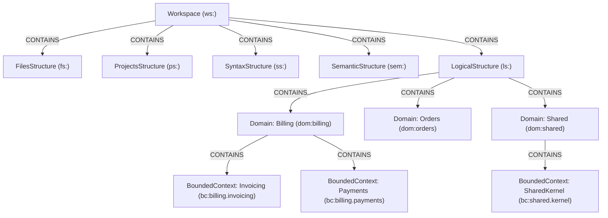
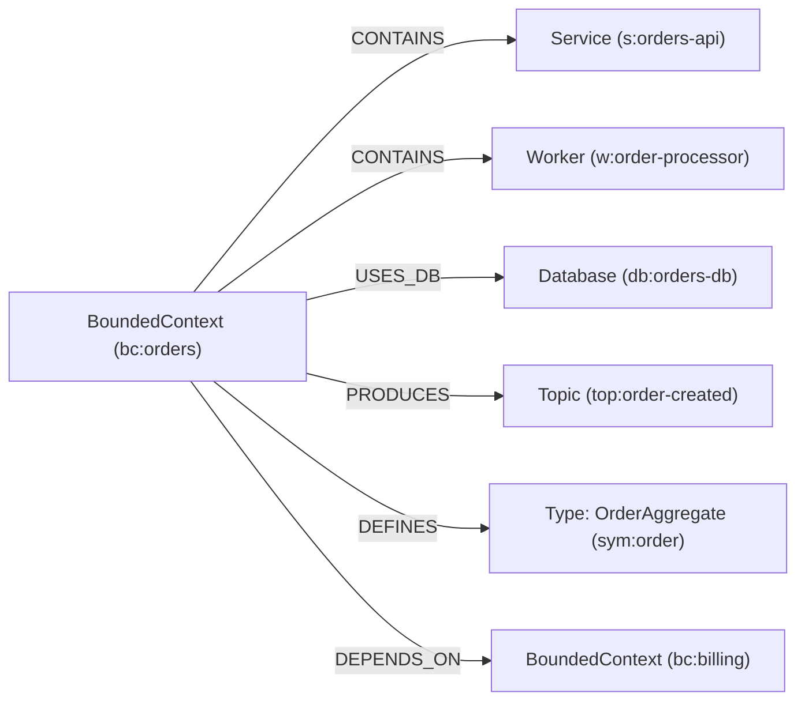

# Level 5 (Logical Structure) & 5-Structure Alignment Design Specification

## 1. Overview & Architectural Vision
CodeExplorer's ontology is structured across five cohesive architectural abstractions, transitioning from physical source code representation up to domain-driven business design. 

This design establishes **Level 5 (Logical Structure)** with **Domain** and **BoundedContext** as first-class, persisted graph citizens in SQLite, while standardizing the naming of all 5 levels across the ontology, pipeline, documentation, and user interfaces:

| Level | Previous Name | New Unified Display Title | Root Structure Node Class (Ontology Label) | Key Node Kinds |
|---|---|---|---|---|
| **Level 1** | Layer 1: Physical Topology | **File Structure** | `FilesStructureNode` (`FilesStructure`, `fs:`) | `File`, `Folder`, `GitSettings`, `Counter` |
| **Level 2** | Layer 2: Project Boundary | **Project Structure** | `ProjectsStructureNode` (`ProjectsStructure`, `ps:`) | `Project`, `Package` |
| **Level 3** | Layer 3: Syntactic Structure | **Syntax Structure** | `SyntaxStructureNode` (`SyntaxStructure`, `ss:`) | `ProjectSyntax`, `Type`, `Function`, `Member`, `CallLiteral`, `CatchClause` |
| **Level 4** | Layer 4: Semantic Structure | **Semantic Structure** | `SemanticStructureNode` (`SemanticStructure`, `sem:`) | `App`, `Service`, `Worker`, `Library`, `CliTool`, `Database`, `Table`, `Topic`, `Endpoint`, `EntryPoint`, `ExternalService`, `Query` |
| **Level 5** | Layer 5: Late Binding / Post-Indexing | **Logical Structure** | `LogicalStructureNode` (`LogicalStructure`, `ls:`) | `Domain`, `BoundedContext` (grouping workloads, data, and domain types) |

> [!NOTE]
> To preserve backward compatibility across existing database indexes and Cypher queries, the C# node class names and ontology labels remain `FilesStructure` and `ProjectsStructure`, while user-facing display titles in UI menus, diagrams, and logs are unified to the singular titles ("File Structure", "Project Structure", etc.).

---

## 2. Graph Ontology & Hierarchy

### 2.1 Workspace Root & Logical Structure Node
`WorkspaceNode` contains `LogicalStructureNode` alongside the other 4 structure nodes:



### 2.2 First-Class Nodes: `DomainNode` & `BoundedContextNode`



1. **`LogicalStructureNode`**:
   - Label: `LogicalStructure`
   - ID Scheme: `{workspaceId}:ls`
   - Purpose: Intermediate grouping node for all high-level business domains, bounded contexts, and logical architectures.
   - Outgoing Edges: `[OntologyEdge<DomainNode>(Relationships.Contains)]`

2. **`DomainNode`**:
   - Label: `Domain`
   - ID Scheme: `{workspaceId}:dom:{domainKey}` (e.g. `dom:billing`)
   - Properties:
     - `Name`: string (e.g. `Billing`)
     - `DisplayName`: string (e.g. `Billing & Invoicing`)
     - `DomainType`: string (`Core` | `Supporting` | `Generic` | `Shared`)
     - `Summary`: string?
     - `Icon`: string? (e.g. `💳`)
   - Outgoing Edges: `[OntologyEdge<BoundedContextNode>(Relationships.Contains)]`

3. **`BoundedContextNode`**:
   - Label: `BoundedContext`
   - ID Scheme: `{workspaceId}:bc:{contextKey}` (e.g. `bc:billing.invoicing`)
   - Legacy ID Alias: Accepts legacy `context:{canonicalKey}` in lookups and routes for complete backward compatibility.
   - Properties:
     - `Name`: string (e.g. `Invoicing`)
     - `DisplayName`: string (e.g. `Invoicing Context`)
     - `DomainId`: string (foreign key to parent domain)
     - `Summary`: string?
     - `BgColor`: string?
     - `BorderColor`: string?
     - `PurityPercentage`: double?
     - `Capabilities`: string[] / JSON?
   - Outgoing Edges:
     - `[OntologyEdge<ServiceNode>(Relationships.Contains)]`
     - `[OntologyEdge<AppNode>(Relationships.Contains)]`
     - `[OntologyEdge<WorkerNode>(Relationships.Contains)]`
     - `[OntologyEdge<LibraryNode>(Relationships.Contains)]`
     - `[OntologyEdge<DatabaseNode>(Relationships.UsesDb)]`
     - `[OntologyEdge<TopicNode>(Relationships.Produces)]` / `[OntologyEdge<TopicNode>(Relationships.Consumes)]`
     - `[OntologyEdge<TypeNode>(Relationships.Defines)]`
     - `[OntologyEdge<BoundedContextNode>(Relationships.DependsOn)]`

### 2.3 Containment Semantics & Query Scoping
Workloads (`Service`, `App`, `Worker`, `Library`) exist at the intersection of two distinct architectural viewpoints:
1. **Semantic Workload Manifestation** (Layer 4): Grouped under `SemanticStructure` (`sem:`).
2. **Logical Domain Ownership** (Layer 5): Grouped under a specific `BoundedContext` (`bc:`).

> [!IMPORTANT]
> Unbounded recursive traversals like `MATCH (ws:Workspace)-[:CONTAINS*]->(s:Service)` would traverse both paths and double-count workloads. To query cleanly, queries should anchor to their specific root structure:
> - Layer 4 physical workloads: `MATCH (:SemanticStructure)-[:CONTAINS]->(s:Service)`
> - Layer 5 logical ownership: `MATCH (:LogicalStructure)-[:CONTAINS*]->(:BoundedContext)-[:CONTAINS]->(s:Service)`

---

## 3. Discovery, Derivation & SQLite Materialization (Layer 5)

### 3.1 Hybrid Materialization Strategy
1. **Source 1: User Configurations**:
   - Inspect `.codeexplorer/domains.json` and `conventions.json` (explicit domain/bounded context mappings by project, service, or directory path).
2. **Source 2: DDD Heuristic Auto-Discovery**:
   - Project name tokens (`Billing.Invoicing.Service` $\to$ Domain: `Billing`, BoundedContext: `Invoicing`).
   - Namespace prefixes and directory boundaries (`src/Services/Billing/Invoicing/`).
   - Domain model indicators (aggregates, entities, repositories, value objects, domain events).
3. **Source 3: Fallback Generic / Shared Handling**:
   - Projects, common libraries, or utilities with no explicit domain affiliation are automatically assigned to `Domain: Shared` (`dom:shared`) and `BoundedContext: SharedKernel` (`bc:shared.kernel`).

### 3.2 Materialization in Indexing Pipeline (`Layer5_Logical`)
During `Layer5AnalysisParser.ParseAsync(l4Result, ctx)`:
1. Synthesize `LogicalStructureNode` and connect `Workspace` -[:CONTAINS]-> `LogicalStructure`.
2. Extract all domains and bounded contexts via `DomainTaxonomyEngine` + `WorkspaceConventions`.
3. Materialize concrete `Domain` and `BoundedContext` graph nodes into SQLite `Node` table with `Kind = NodeKind.Domain` (28) and `NodeKind.BoundedContext` (29).
4. Persist containment edges:
   - `(LogicalStructure)-[:CONTAINS]->(Domain)`
   - `(Domain)-[:CONTAINS]->(BoundedContext)`
   - `(BoundedContext)-[:CONTAINS]->(Service | App | Worker | Library)`
   - `(BoundedContext)-[:USES_DB]->(Database)`
   - `(BoundedContext)-[:DEFINES]->(Type)` (for identified AggregateRoots, Entities, ValueObjects)
5. **Cross-Context Edge Consolidation (Handling `idx_edges_unique`)**:
   SQLite enforces uniqueness via `CREATE UNIQUE INDEX IF NOT EXISTS idx_edges_unique ON edges(from_id, to_id, kind)`.
   Therefore, all interactions between two BoundedContexts (RPC calls, messaging topics, database interactions) must be aggregated into a **single directional `DEPENDS_ON` edge** with a consolidated JSON payload:
   ```json
   {
     "interactions": ["rpc", "messaging"],
     "rpcCallsCount": 4,
     "eventsPublishedCount": 2,
     "channels": ["orders.created", "payments.processed"]
   }
   ```

---

## 4. Renaming & Ontology Alignment Scope

### 4.1 Constants & Node Labels
- `OntologyConstants.Layers`:
  - `Physical` $\to$ `"File Structure"`
  - `ProjectBoundary` $\to$ `"Project Structure"`
  - `Syntactic` $\to$ `"Syntax Structure"`
  - `Semantic` $\to$ `"Semantic Structure"`
  - Add: `Logical = "Logical Structure"`
- Node classes:
  - Add `LogicalStructureNode.cs` in `cli/src/Core/CodeExplorer.Core/Common/Nodes/Layer5_Logical/`.
  - Add `DomainNode.cs` and `BoundedContextNode.cs`.
- Update `OntologyGen` and re-generate `docs/ontology.md` with Mermaid diagram including the Level 5 subgraph.

### 4.2 Layer Pipeline Names & Folders
- Rename `Layer5_Global` namespace / analyzer references to `Layer5_Logical` (with backwards compatibility aliases if needed).
- Update `Layer5Result` in `LayerResults.cs` to hold:
  ```csharp
  public record Layer5Result(
      Layer4Result Prev,
      LogicalStructureNode LogicalStructure,
      List<DomainNode> Domains,
      List<BoundedContextNode> BoundedContexts,
      List<Relationship> LogicalRelationships,
      List<Relationship> LateBoundRelationships
  );
  ```

---

## 5. View Unification (CLI, MCP, Web UI)
1. **Level 5 Architecture View**:
   - `ArchitectureViewType.Logical` queries `Domain` and `BoundedContext` nodes and consolidated `DEPENDS_ON` edges directly from SQLite.
   - Preserves compatibility with `ArchitectureViewType.BoundedContexts` by routing it to the unified Level 5 view engine.
2. **Cypher Queries**:
   - Enables standard OpenCypher queries:
     ```cypher
     MATCH (d:Domain)-[:CONTAINS]->(bc:BoundedContext)
     RETURN d.name, bc.name;

     MATCH (a:BoundedContext)-[r:DEPENDS_ON]->(b:BoundedContext)
     RETURN a.name, b.name, r.interactions, r.rpcCallsCount;
     ```
3. **Web UI & VS Code Extension**:
   - Level dropdown displays:
     - Level 1: File Structure
     - Level 2: Project Structure
     - Level 3: Syntax Structure
     - Level 4: Semantic Structure
     - Level 5: Logical Structure

---

## 6. Architectural Governance via Semantic Invariant Gates (SIG)
Materializing Domain and BoundedContext nodes in SQLite allows teams to enforce DDD architectural boundaries directly via `.codeexplorer/gates/*.cypher`:

### Rule 1: Core Domains Must Not Depend on Supporting or Generic Domains
```cypher
MATCH (core:Domain { domain_type: 'Core' })-[:CONTAINS]->(bc1:BoundedContext)
MATCH (other:Domain)-[:CONTAINS]->(bc2:BoundedContext)
WHERE other.domain_type IN ['Supporting', 'Generic', 'Shared']
  AND (bc1)-[:DEPENDS_ON]->(bc2)
RETURN bc1.name AS OffenderContext, bc2.name AS ForbiddenTargetDependency;
```

### Rule 2: Strict Isolation Between Isolated Bounded Contexts
```cypher
// Context A cannot communicate directly with Context B without going through an asynchronous event bus
MATCH (a:BoundedContext { name: 'Ordering' })-[r:DEPENDS_ON]->(b:BoundedContext { name: 'Inventory' })
WHERE 'rpc' IN r.interactions
RETURN a.name AS Source, b.name AS Target, 'Direct RPC coupling is forbidden between Ordering and Inventory' AS Violation;
```
