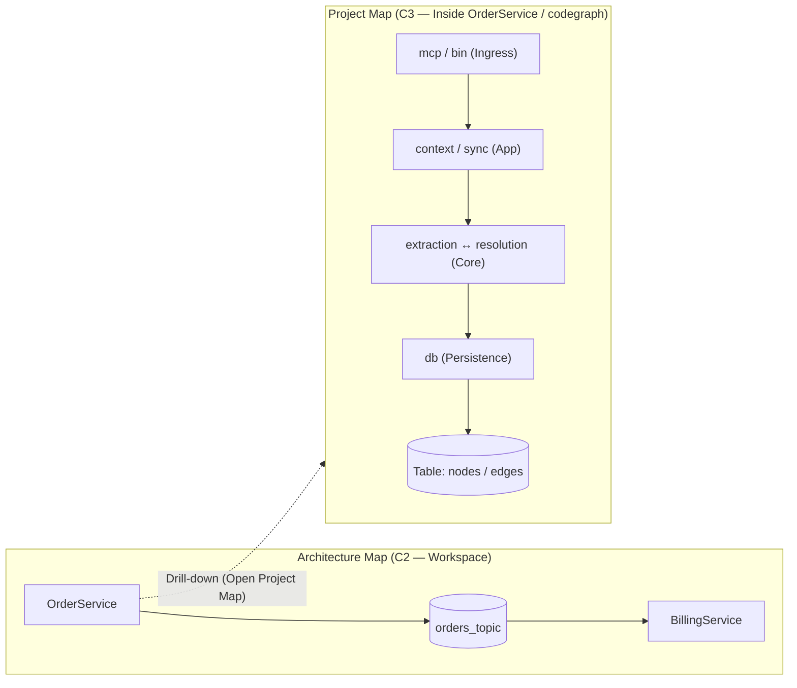

# Proposal: Project Map (C3 Internal Architecture View)

> **Status (2026-10-22):** Slices 1–2 implemented in v1.56.0 (backend `project-map` view + VS Code Project Map panel), following the §8 review notes. Still open: §6 DDL table linking (separate patch) and the optional module-cycle SIG gate (§8.3).

## 1. Problem Statement

Currently, all visual diagrams in CodeExplorer (**Architecture Map**, **Architecture Tiers**, **Project Flow**) operate at the **C2 (Container / Project)** level, where the atomic node is a `:Project` / `:Service` (derived from `.csproj`, `package.json`, `pom.xml`, `go.mod`, `pyproject.toml`, `Cargo.toml`).

This creates two blind spots:
1. **Single-Project Repositories (80% of GitHub & polyglot microservices):**
   In TypeScript, Python, Go, Rust, and single-service repositories (such as `codegraph`, where 203 files and 11,079 AST nodes live under a single `package.json`), **Architecture Map** renders only **1 `:Project` node**, hiding the rich internal architecture (`src/mcp`, `src/extraction`, `src/resolution`, `src/graph`, `src/db`, etc.).
2. **No C2 $\rightarrow$ C3 Drill-Down in Monorepos:**
   In a multi-service repository, once an engineer spots a complex service on the **Architecture Map**, there is no visual way to drill *inside* that specific `:Project` to inspect its internal modules, layer boundaries, circular dependencies, and table-level data access.

---

## 2. Core Concept: `Project Map`

**`Project Map`** is a new **C3 (Internal Module & Component)** view that projects the internal anatomy of a single selected `:Project` onto the same interactive concentric orbit engine (`DomainArchitectureView`) used by **Architecture Map**.

---

## 3. Node Model (What Appears on `Project Map`)

For a selected `:Project` $P$, `Project Map` synthesizes two classes of nodes:

### A. Internal Code Modules (`Kind = Module` / `Component`)
Instead of dumping hundreds of raw `:Type` or `:Function` nodes (which creates an unreadable hairball), `Project Map` groups the project's non-test source files (`is_test != true`) into **architectural modules**:

1. **Primary Partitioning (Source Subfolders / Packages):**
   - Detects the project's source root (`src/`, `lib/`, `internal/`, `pkg/`, `app/`, or the project root for `.csproj` / `pom.xml`).
   - Every first-level directory under the source root becomes a **Module node** (e.g., for `codegraph`: `bin`, `mcp`, `ui`, `installer`, `context`, `sync`, `search`, `upgrade`, `extraction`, `resolution`, `graph`, `db`).
   - If a first-level directory is just a language/namespace wrapper (e.g., `src/main/java/com/acme/billing/<module>`), the partitioner automatically walks down single-child namespace chains to the first branching package directory (`controllers`, `services`, `domain`, `repository`).
2. **Root-Level Files Handling:**
   - Entrypoint files in the root (e.g., `src/index.ts`, `Program.cs`, `main.go`) are grouped into a `root (entry)` module or attached to the entry ring.
   - Pure root utility files (`src/utils.ts`, `src/errors.ts`, `src/types.ts`) are grouped into a `shared / utils` foundation module.
3. **Adaptive Granularity Fallback (Flat Projects):**
   - If a project has **$< 3$ subfolders** (e.g., a flat microservice where all 15 files sit in one folder), `Project Map` automatically switches granularity to top-level **`:Type` / `:File`** nodes so the map is never a single node.

### B. Scoped Resource & Infrastructure Nodes
Any infrastructure or data node touched by files inside project $P$ is projected directly onto the map and linked to the specific **internal module** that accesses it:
- **`:Table`** (physical SQL/SQLite tables read or written by queries/ORM inside a module, e.g., `db` $\rightarrow$ `schema_versions`, `nodes`, `edges`, `files`).
- **`:MessageTopic` / `:Queue`** (topics produced or consumed by a module).
- **`:ExternalService`** (external HTTP/gRPC hosts called by a module, e.g., `github.com`).
- **Referenced Sibling Projects** (optional toggle: other `:Project` nodes in the solution that this project's modules call directly).

---

## 4. Concentric Orbits & Ring Classification (Tiers 0–4)

`Project Map` uses the concentric orbit layout with 5 semantic tiers tailored for internal project architecture:

| Ring / Tier | Role Name | Classification Rules (Name Heuristics + Graph Topology) | Examples in `codegraph` |
| :--- | :--- | :--- | :--- |
| **Tier 0 (Center)** | **Ingress & Entrypoints** | Contains CLI/HTTP/MCP/UI entrypoints (`bin`, `cmd`, `mcp`, `ui`, `controllers`, `api`, `routes`, `views`, `pages`, `index`) or has $0$ incoming internal calls. | `bin`, `mcp`, `ui`, `index` |
| **Tier 1** | **Application & Orchestration** | Orchestrates workflows, commands, background sync, search, or setup (`context`, `sync`, `installer`, `search`, `upgrade`, `handlers`, `application`, `usecases`). | `context`, `sync`, `installer`, `search`, `upgrade` |
| **Tier 2** | **Core Domain & Engine** | Core domain logic, parsers, compilers, graph engines (`extraction`, `resolution`, `graph`, `domain`, `core`, `engine`, `model`). | `extraction`, `resolution`, `graph` |
| **Tier 3** | **Data & Persistence** | Database adapters, repositories, migrations (`db`, `persistence`, `repositories`, `storage`, `dao`). | `db` |
| **Tier 4 (Outer)** | **Resources & Foundation** | Physical `:Table` nodes, `:ExternalService` nodes, `:MessageTopic` nodes, and shared leaf utilities (`utils`, `errors`, `common`). | Tables (`nodes`, `edges`, `schema_versions`), `github.com`, `utils/errors` |

> [!TIP]
> **Noise Reduction Toggle ("Hide Utilities"):** Leaf utility modules (`utils`, `errors`, `types`, `common`, `logging`) are called by almost every module. By default, a HUD toggle **Utilities** can be turned off (or dimmed) so core architectural flows and cycles stand out cleanly.

---

## 5. Edges, Call Lifting & Circular Dependency Detection

### 1. Semantic Call Lifting (`AST -> Module`)
In the backend (`ArchitectureViewEngine.ProjectMap.cs`), all AST relationships inside project $P$:
- `(:Function|Member|Type|EntryPoint)-[:CALLS|USES_TYPE|IMPORTS|INHERITS|IMPLEMENTS]->(:Function|Member|Type)`
are lifted to their parent **Module** nodes (`Module A -> Module B`), recording:
- `call_count`: total cross-module symbol references/calls.
- `distinct_files`: number of files involved.
- `kinds`: breakdown of `CALLS`, `USES_TYPE`, `IMPORTS`.

### 2. Automatic Circular Dependency Detection (`🔄 Cycles`)
Whenever both `Module A -> Module B` and `Module B -> Module A` exist (for example, `extraction <-> db` or `extraction <-> resolution` in `codegraph`):
- Both edges are marked with `is_circular = "true"`.
- The canvas renders circular edges in **highlighted amber/red dashed glow** with bidirectional indicators.
- The top HUD bar displays a live counter pill: **`⚠️ 6 Module Cycles`** — clicking it isolates only the modules involved in circular dependencies!

### 3. Deep Inspector & Click-to-Code Evidence
- **Clicking a Module node (e.g., `extraction`)** opens the right-hand Inspector showing:
  - Module metrics (Files count, Types/Functions count, Incoming/Outgoing calls, Cyclic dependencies).
  - Top files and exported symbols inside `extraction` with 1-click jump to VS Code editor.
  - Inbound & Outbound module dependencies.
- **Clicking an Edge (e.g., `extraction -> db (24 calls)`)** opens the Edge Evidence panel listing the exact caller $\rightarrow$ callee functions and file lines (`tree-sitter.ts:142 -> queries.ts:88`).

---

## 6. Bonus Fix Uncovered During `codegraph` Analysis: DDL SQL Table Linking

While inspecting `C:\Work\Github\codegraph\.codeexplorer\graph.db`, we noticed that `src/db/schema.sql` created `:Table` nodes (`nodes`, `edges`, `files`, `unresolved_refs`, `project_metadata`), but:
1. Tables created via `.sql` DDL files without explicit SQL `SELECT/INSERT` AST nodes were not linked to `Database.dbo` via `(:Database)-[:CONTAINS]->(:Table)` or to the owning `:Project`.
2. In `Project Map` (and `PostIndexAnalyzer`), any `:Table` defined in a `.sql` file or migration inside module $M$ of project $P$ will automatically be linked via `(:Module)-[:DEFINES_SCHEMA / WRITES_TO]->(:Table)` and `(:Database)-[:CONTAINS]->(:Table)`.

---

## 7. UX & Integration Plan

1. **Backend (`CodeExplorer.Core` & Server Routes):**
   - Upgrade `ArchitectureViewType.Component` (or add `ProjectMap`) in `ArchitectureViewEngine` to build the Module + Resource graph with call lifting, cycle detection, and evidence endpoints (`/api/architecture/project-map?project=<id>`).
   - Expose in CLI & MCP (`get_project_map` or `get_architecture_map(project: ...)`).
2. **VS Code Extension Sidebar & Canvas:**
   - Add **`Project Map`** right below **`Architecture Map`** in the `Views` sidebar tree.
   - Reuse `DomainArchitectureView` (concentric orbits, HUD filters, inspector) with a **Project Selector dropdown** in the top HUD bar (and a **`⚠️ Cycles Only`** quick filter).
   - Add an **`Open in Project Map`** action button inside the `Architecture Map` node inspector when any `:Project` / `:Service` is selected.
   - **Auto-Switch on Single-Project Repos:** When opening `Architecture Map` on a workspace that has only **1 code `:Project`** (like `codegraph`), automatically offer (or auto-switch to) **`Project Map`** so the user immediately sees the 12 internal modules instead of 1 dot!

---

## 8. Review Notes (2026-10-22)

**Verdict:** Approve with changes. The problem is real (single-project repos render as one dot), and most of the pieces already exist. Reshape it as an *extension of the existing C3 view*, not a new subsystem.

### 8.1 What already exists (reuse, don't rebuild)
| Need | Existing asset |
| :--- | :--- |
| C3 drill-down entry point | `ArchitectureViewType.Component` → `GetComponentViewAsync` in `ArchitectureViewEngine.Subgraphs.cs` (it currently returns raw `Endpoint`/`Type`/`Table`/`Query` nodes, which is the hairball this proposal fixes) |
| Module partitioning source | Layer 1 `Folder` nodes (`Folder -[:CONTAINS]-> Folder | File`) |
| Symbol edges to lift | `Function -[:CALLS]-> Function`, `Function|Type -[:USES_TYPE]-> Type` |
| Edge click-to-code | `GET /api/architecture/edge-evidence` + `EdgeEvidenceSection` (v1.53.0) |
| Canvas, orbits, HUD, inspector | `DomainArchitectureView` |

### 8.2 Required changes
1. **Compute modules at view time; don't persist them.** **Principle (agreed 2026-10-22): ontology changes and new visuals ship separately.** Project Map is a pure view-layer projection over existing nodes and edges (`Folder`, `File`, `Function`, `Type`, `Table`, `CALLS`, `USES_TYPE`, …). It adds no node labels, no relationship types, no persisted properties, and no gate changes. If a persisted `Module` concept is ever needed (for gates or MCP), it gets its own ontology proposal and release first, and the view adopts it afterwards.
2. **Classify tiers by topology first, names second.** Pure folder-name heuristics (`db`, `core`, `utils`) go against the Epic 0 rule of "evidence-based classification, not string heuristics". Use:
   - Tier 0: contains `Endpoint` / `EntryPoint` nodes, or has internal fan-in = 0.
   - Tier 3: touches `Table` / `Query` via `READS_FROM` / `WRITES_TO` / `PERSISTED_IN`.
   - Tier 4 utilities: fan-in ≥ ~60% of modules and fan-out ≈ 0.
   - Tiers 1/2: instability `I = Ce / (Ca + Ce)`. Folder names only break ties.
3. **Detect cycles with SCCs, not just A↔B pairs.** Use Tarjan/Kosaraju so cycles like `A → B → C → A` are caught. Count and highlight per SCC.
4. **Scope projects properly.** Exclude files that belong to nested child projects. This is the same `EvidenceScope` prefix-collision issue listed in `universal-edge-and-node-evidence-proposal.md` §1.
5. **Add an upper bound on granularity.** The proposal covers the `< 3` subfolder case. Also collapse when there are more than ~30 modules (merge low-degree siblings, or go one level shallower).
6. **Edge payload.** Lifted edges should carry `call_count`, `distinct_files`, `kinds`, and a bounded sample of `(caller, callee, file:line)`. The evidence endpoint can then answer without re-scanning. This lines up with the creation-time provenance direction of the evidence proposal.
7. **Split §6 (DDL table linking) into its own bug fix.** It's an indexer/`PostIndexAnalyzer` defect that is independent of this view. Ship it as a patch.
8. **Drop `IMPORTS` from v1 lifting.** It isn't a persisted relationship today. Lift `CALLS`, `USES_TYPE`, `INHERITS` / `IMPLEMENTS` only.

### 8.3 Follow-on opportunity
- Add a built-in gate, **`SIG-C-B-00x` Module Cycle Prohibition**, that reuses the SCC query so the ratchet can enforce "no new module cycles".

### 8.4 Suggested delivery slices
1. **Backend (MINOR):** a `ProjectMap` mode on the Component view: folder partitioning, lifting, topology tiers, SCC cycles. Exposed through `/api/architecture/project-map` and MCP `get_architecture_view(view: component, project: …)`.
2. **Extension (MINOR):** a `Project Map` sidebar entry, a project selector, an "Open in Project Map" action from the Architecture Map inspector, and auto-suggest on single-project workspaces.
3. **Patch:** DDL table → `Database` / `Project` linking (§6).
4. **Optional:** the module-cycle SIG gate.
