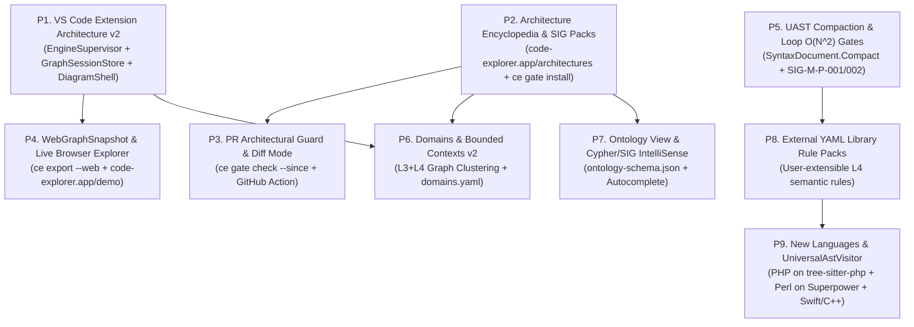

# CodeExplorer — Master Product & Engineering Roadmap 🗺️

This document tracks the verified implementation status of all architectural proposals in [`docs/proposals/`](./) and defines the **priority-ordered roadmap (in descending order of importance)** for CodeExplorer across IDE experience, Architecture Encyclopedia & SIG Packs, CI/PR Guard, Web Explorer, and Core Engine.

**Last Updated:** 2026-11-12 (All in-flight proposal debts closed)

---

## 1. Completed Foundations (100% Implemented & Verified)

| Initiative / Proposal | Status | Shipped Scope |
| :--- | :---: | :--- |
| **Strongly-Typed Ontology Enums & SQLite Schema v6** (`v1.70.0`, `v1.75.0`) | 🟢 **Complete** | `NodeKind`, `RelationshipKind`, and all 1-byte taxonomy enums (`TypeKind`, `EndpointType`, `DatabaseType`, etc.) with `GraphKindCodec`, `IGraphRepository` (`PersistedGraphRepository` + `InMemoryGraphRepository`), and zero-tolerance `SIG-C-C-001`. |
| [`uast-completion-and-lightweight-flow-analysis-proposal.md`](./uast-completion-and-lightweight-flow-analysis-proposal.md) | 🟢 **Complete** | Full UAST property population across all languages, `CallSiteExecutionContext` (`in_loop`, `loop_depth`, `is_conditional`, `in_try`, `in_lock`, `is_awaited`), and intra-procedural `FunctionDataflowSummary` (`arg_flow`, `df_return`, `df_writes`). |
| [`partial-layer-and-in-memory-scanning-proposal.md`](./partial-layer-and-in-memory-scanning-proposal.md) | 🟢 **Complete** | First-class `MaxLayer = Layer1..Layer5` and pure in-memory `WorkspaceIndexer.ScanInMemoryAsync`. |
| [`universal-graph-map-and-inspector-unification-proposal.md`](./universal-graph-map-and-inspector-unification-proposal.md) | 🟢 **Complete** | 4-stage `GraphProjectionEngine`, `<UniversalGraphMap />`, 4-tab `InspectorSidebarView` two-way sync, node/category grouping (`v1.78.1`), and `SIG-P-B-010`. |
| [`project-map-proposal.md`](./project-map-proposal.md) | 🟢 **Complete** | C3 `Project Map`, resilient fallback file discovery (`v1.80.0`), direct `src/` root file rendering (`v1.80.4`), DDL `.sql` table linking (`PostIndexAnalyzer.CanonicalizeDatabasesAsync`), and `SIG-C-B-004` (*Module Dependency Cycle Prohibition*). |
| **Unified `DeclarativeSemanticExtension` & Ecosystem Waves 1 + 2 (250+ Parsers)** ([`ecosystem-library-expansion-wave2-proposal.md`](./ecosystem-library-expansion-wave2-proposal.md)) | 🟢 **Complete** | Wave 1 (59 libraries, `v1.73.0`) + Wave 2 (all 60 libraries across C#, Java, Kotlin, TS, Python, Go) unified onto $O(1)$ `CompiledDeclarativeRuleIndex` (`v1.74.0`). |
| **Semantic Argument Provenance & Multi-Dialect `Superpower` SQL Parser** (`v1.79.0`) | 🟢 **Complete** | `:Parameter`, `:CallArgument`, `FLOWS_TO`, `TARGETED_BY`, interprocedural parameter coloring, and combinator SQL parser across 8 dialects (ANSI, Postgres, MySQL, T-SQL, PL/SQL, BigQuery, ClickHouse, SOQL). |
| **`.NET 11` Runtime, Trimmed Native Binary & 120-Repo Validation Matrix** (`v1.80.0`–`v1.80.1`) | 🟢 **Complete** | Full migration to `net11.0` / C# 14, `PublishTrimmed=true` (`53.6 MB` binary, `-41.6%`), 120-repo polyglot validation harness, and Case Study 06 (`argoproj/argo-cd` 398 ms pre-commit guard). |
| [`semantic-gates-v2-node-extraction-and-thresholds-proposal.md`](./semantic-gates-v2-node-extraction-and-thresholds-proposal.md) | 🟢 **Complete** | Node-first `RETURN src, r, tgt`, `call_sites` multi-site unrolling, parameterized `message`/`target` templates, `GateEditorView` thresholds, 0-row node-query validation in `TestGateQueryAsync`, `--format sarif` (SARIF v2.1.0), and `--format github` workflow annotations. |
| [`universal-edge-and-node-evidence-proposal.md`](./universal-edge-and-node-evidence-proposal.md) | 🟢 **Complete** | `EvidenceProvenanceHelper` (`evidence_ids`, `evidence_count`, `evidence_truncated`, `PropagateEdgeProvenance`), consolidated DB & library-lifted edge provenance merging, structural `EvidenceScope.ContainedNodeIds`, `recorded`/`inferred` confidence, and structured `warnings` across all evidence & usage resolvers. |

---

## 2. Active Roadmap (Ordered Strictly by Decreasing Priority)

### Tier 1 — Flagship UX, Product Differentiation & Team Adoption

| Priority | Initiative / Proposal | Current Status | Scope & Why Now |
| :---: | :--- | :---: | :--- |
| **P1** | **VS Code Extension Architecture v2** ([`vscode-extension-architecture-v2-proposal.md`](./vscode-extension-architecture-v2-proposal.md)) | ⚪ **Ready to Start** | **Phase 1**: Resilient `EngineSupervisor` FSM (no `spawnSync`, no log spam) + single Extension Host RPC broker; **Phase 2**: Headless `GraphSessionStore` + two-tier persistence; **Phase 3**: Hexagonal `<DiagramShell>`, `ViewportGate`, renderer adapters & unified `Inspector`; **Phase 4**: Clean `System · Modules · Code · Data · Gates` tree. *Unblocks every future IDE workflow.* |
| **P2** | **Architecture Encyclopedia (`code-explorer.app/architectures`) & Downloadable SIG Packs + `ce gate install`** (Prototype: [`site/architectures.html`](../../site/architectures.html)) | 🟡 **UI Prototype Ready** | Curate canonical OpenCypher gate packs (`clean-architecture`, `hexagonal`, `modular-monolith`, `vertical-slice`, `feature-sliced-design`, `microservices-isolation`) with stack presets, add `ce gate install <pack> [--stack <s>]` in CLI, and launch the interactive Encyclopedia on `code-explorer.app`. *Solves cold-start adoption in 30s and drives organic SEO.* |
| **P3** | **PR Architectural Guard & Incremental Diff Mode (`ce gate check --since <git-ref>`)** | ⚪ **Proposed** (SARIF & GitHub formats ready) | Sub-second incremental scan + gate check scoped to changed files/blast radius since `<git-ref>`, plus a turnkey GitHub Action posting PR architectural diff & violation summary comments (building directly on `--format sarif` and `--format github`). *Turns `ce` into a team-wide CI gatekeeper.* |

---

### Tier 2 — Viral Web Distribution & Monorepo Scale

| Priority | Initiative / Proposal | Current Status | Scope & Why Now |
| :---: | :--- | :---: | :--- |
| **P4** | **`WebGraphSnapshot` (`ce export --web`) & Live Browser Explorer** ([`web-graph-snapshot-and-live-explorer-proposal.md`](./web-graph-snapshot-and-live-explorer-proposal.md)) | ⚪ **Proposed** | **Phase 1**: `ce export --web` compact JSON (`30–120 KB` gzip) + lightweight read-only browser viewer (`<= 140 KB`) hosting flagship repos (`twenty`, `argo-cd`, `OrchardCore`) on `code-explorer.app/demo` and inside Encyclopedia pages. **Phase 2**: On-demand `code-explorer.app/<owner>/<repo>` public scanner (`$0` LLM cost). |
| **P5** | **UAST Memory Compaction & Loop Complexity Gates ($O(N^2)$)** ([`uast-performance-and-loop-semantics-proposal.md`](./uast-performance-and-loop-semantics-proposal.md)) | ⚪ **Proposed** | Post-Layer-4 `SyntaxDocument.Compact()` (`-75..80%` peak RAM on `15k+`-file monorepos), numeric `TSFieldId` lookup tables, deterministic `MaxAstNodeBudget`, retirement of legacy `RawImports`/`RawVariables`/`RawTypeBindings`, and `has_linear_scan_in_loop` / `has_alloc_in_loop` with built-in gates `SIG-M-P-001/002`. |

---

### Tier 3 — Domain Clustering v2, Authoring DX & Ecosystem Breadth

| Priority | Initiative / Proposal | Current Status | Scope & Why Now |
| :---: | :--- | :---: | :--- |
| **P6** | **Domains & Bounded Contexts v2 (Graph Clustering & Declarative Manifest)** | ⚪ **Scoped (Legacy UI Hidden in `v1.80.3–1.80.5`)** | Reintroduce domain modeling cleanly on top of VS Code v2 (`P1`): deterministic community/cluster detection over `L3` call cohesion + shared `L4` database tables/topics, paired with explicit `.codeexplorer/domains.yaml` boundaries and cross-domain SIG rules. |
| **P7** | **Stratified Ontology Explorer & OpenCypher / SIG IntelliSense** ([`ontology-visualization-and-cypher-intellisense-proposal.md`](./ontology-visualization-and-cypher-intellisense-proposal.md)) | ⚪ **Draft** | Emit `ontology-schema.json` in `CodeExplorer.OntologyGen`, expose `/api/ontology` with Schema Drift detection, build the 5-layer swimlane Ontology View, and add context-aware autocomplete in `CypherEditor.tsx` and `GateEditorView.tsx`. |
| **P8** | **External YAML Semantic Projection Packs** ([`semantic-archetypes-and-yaml-projections-proposal.md`](./semantic-archetypes-and-yaml-projections-proposal.md)) | 🟡 **~50% Complete** (C# `DeclarativeSemanticExtension` done) | All 250 library parsers already use compiled declarative C# rules (`v1.74.0`). Remaining scope: externalize Bucket A (`host-archetypes.yaml`) and Bucket B (`datastore.yaml`, `messaging.yaml`, `http-clients.yaml`, `web-routers.yaml`) into user-extensible YAML files without recompiling C#. |
| **P9** | **Profile-Driven `UniversalAstVisitor` & New Languages (`PHP`, `Perl`, `Swift`, `C++`)** ([`universal-parser-proposal.md`](./universal-parser-proposal.md)) | ⚪ **Scoped PoC** | 1. **`CodeExplorer.Parser.Php`** (`tree-sitter-php` already bundled in `TreeSitter.DotNet 1.3.0`): `ComposerProjectParser` (`composer.json` + PSR-4 autoload), `PhpSyntaxConverter` / `UniversalAstVisitor` (`class`/`interface`/`trait`/`enum`, constructor DI, `?->` calls), and L4 PDO/Doctrine/Laravel/Symfony rules (3–5 days). 2. **`CodeExplorer.Parser.Perl`** (pure C# on `Superpower 3.0.0`, zero native DLLs): context-aware `PerlTokenizer` (`/regex/` vs `/`, `q/qq/qw/s///`, POD skipping, `<<'SQL'` heredocs) + `TokenListParser` island-grammar UAST (`package`, `use`/`parent`/`@ISA`/`Moose`, `sub` + `my (...) = @_` `:Parameter` unpacking, `eval`/`Try::Tiny` `:CatchClause`, `DBI`/`DBIx::Class` heredoc SQL lineage, `Mojolicious`/`Dancer2` routes) (3–4 days). 3. **`UniversalAstVisitor` PoC**: validate 100% parity on Java and onboard `Swift` / `C++`. |

---

## 3. Execution Dependency Flow

