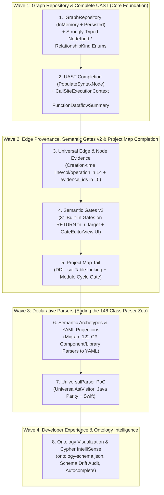

# CodeExplorer — Master Implementation Roadmap 🗺️

This document consolidates all **8 architectural proposals** in [`docs/proposals/`](./) and defines their dependency-ordered implementation sequence from core graph & UAST foundations up to declarative parsers and developer tooling.

**Last Updated:** 2026-10-29

---

## 1. Summary of All Proposals & Current Status

| Order | Proposal | Current Status | Remaining Scope |
| :---: | :--- | :--- | :--- |
| **1** | [`strongly-typed-kinds-and-types-enum-migration-proposal.md`](./strongly-typed-kinds-and-types-enum-migration-proposal.md) | 🟢 **Complete** | Canonical `NodeKind`, `RelationshipKind`, `SemanticExtensionType`, and `ProjectEntityKind` migrated to domain enums across Core, AST, and 136 library parsers. `SIG-C-C-001` untolerated passing with 0 violations. |
| **2** | [`uast-completion-and-lightweight-flow-analysis-proposal.md`](./uast-completion-and-lightweight-flow-analysis-proposal.md) | 🟢 **Complete** | **Pillar 1**: Complete UAST property population (`PopulateSyntaxNode`) across declarations, statements, expressions in all 6 languages; **Pillar 2**: `CallExecutionFlags` & `CallSiteExecutionContext` (`in_loop`, `loop_depth`, `is_conditional`, `in_try`, `in_catch`, `in_lock`, `is_awaited`); **Pillar 3**: `FunctionDataflowSummary` intra-procedural def-use analysis (`df_summary`, `df_return`, `df_writes` on `FunctionNode`, and `arg_flow` on `CALLS` edges). |
| **3** | [`universal-edge-and-node-evidence-proposal.md`](./universal-edge-and-node-evidence-proposal.md) | 🟡 **~50% Complete** (API & UI shipped in v1.52–1.53) | Record creation-time provenance (`file_path`, `line`, `line_end`, `operation`, `evidence_kind`) on Layer 4 edges, aggregate `evidence_ids` on Layer 5 rolled-up edges, and retire query-time heuristics. |
| **4** | [`project-map-proposal.md`](./project-map-proposal.md) | 🟢 **~90% Complete** (Slices 1–2 shipped in v1.56.0) | Finish §6 (DDL `.sql` table linking to `Database` / `Project`) and §8.3 (optional `SIG-C-B-00x` Module Cycle Prohibition gate). |
| **5** | [`semantic-gates-v2-node-extraction-and-thresholds-proposal.md`](./semantic-gates-v2-node-extraction-and-thresholds-proposal.md) | 🟡 **~50% Complete** (Core CLI engine ready) | Populate exact call-site coordinates (`r.line`, `r.call_sites`) on `CALLS` edges, migrate all 31 built-in gates to `RETURN fn, r, target` + `message` templates, update `GateEditorView.tsx`, and add GitHub/SARIF warning annotations. |
| **6** | [`semantic-archetypes-and-yaml-projections-proposal.md`](./semantic-archetypes-and-yaml-projections-proposal.md) | 🟡 **~15% Complete** (Initial `DeclarativeSemanticExtension` exists) | Build `YamlSemanticProjectionEngine` ($O(1)$ `FrozenDictionary` dispatch), migrate 16 Host Component parsers (Bucket A) and 106 Library parsers (Bucket B) to YAML packs, and extract shared `RoutePrefixResolver` (Bucket C). |
| **7** | [`universal-parser-proposal.md`](./universal-parser-proposal.md) | ⚪ Scoped PoC | Implement `UniversalAstVisitor` + `LanguageSyntaxProfile` + `ILanguageHooks`. Track A: 100% parity harness on Java; Track B: new `CodeExplorer.Parser.Swift` assembly. |
| **8** | [`ontology-visualization-and-cypher-intellisense-proposal.md`](./ontology-visualization-and-cypher-intellisense-proposal.md) | ⚪ Draft | Emit `ontology-schema.json` in `CodeExplorer.OntologyGen`, expose `/api/ontology` with Schema Drift detection, build 5-layer swimlane Ontology View, and add context-aware OpenCypher + SIG IntelliSense. |
| **9** | [`partial-layer-and-in-memory-scanning-proposal.md`](./partial-layer-and-in-memory-scanning-proposal.md) | ⚪ Proposed | First-class partial-layer (`MaxLayer = Layer1..Layer5`) and zero-overhead pure in-memory scanning API (`WorkspaceIndexer.ScanInMemoryAsync`) in `CodeExplorer.Core`, removing Passport-specific hooks from `ParsingContext`. |

---

## 2. Dependency Graph & Execution Waves

---

## 3. Detailed Wave-by-Wave Implementation Plan

### Wave 1: Core Graph Abstraction & Complete UAST

1. **Step 1.1 — Unified `IGraphRepository` & Strongly-Typed Enums**
   - **Proposal:** [`strongly-typed-kinds-and-types-enum-migration-proposal.md`](./strongly-typed-kinds-and-types-enum-migration-proposal.md)
   - **Why First:**
     - Decouples domain graph access (`IGraphRepository`) from physical DB storage drivers (`IGraphClient` $\to$ `ISqliteClient`, `IClickHouseClient`).
     - Replaces the stub `InMemoryGraphClient` with a true indexed **`InMemoryGraphRepository`** alongside **`PersistedGraphRepository(IGraphClient)`**.
     - Migrating `Node.Kind` and `Relationship.Kind` to 1-byte enums (`NodeKind`, `RelationshipKind`) at the same time allows `InMemoryGraphRepository` to index nodes and edges by compact integer keys without rewriting repository signatures twice.

2. **Step 1.2 — Complete UAST Population, Execution Context & Function Dataflow Summaries**
   - **Proposal:** [`uast-completion-and-lightweight-flow-analysis-proposal.md`](./uast-completion-and-lightweight-flow-analysis-proposal.md)
   - **Why Second:**
     - Eliminates "hollow shell" UAST nodes by populating all strongly-typed properties (`Parameters`, `Body`, `Arguments`, `Initializer`, `Left/Right`, `Condition`, `ThenBranch/ElseBranch`) in `TreeSitterSyntaxConverterBase` and language converters.
     - Computes `CallSiteExecutionContext` (`in_loop`, `loop_depth`, `is_conditional`, `in_try`, `in_catch`, `in_lock`, `is_awaited`) in $O(\text{depth})$ parent hops.
     - Computes intra-procedural `FunctionDataflowSummary` (`arg_flow` on `CALLS` edges, `df_return` and `df_writes` on `FunctionNode`) during standard Layer 3 scanning.

---

### Wave 2: Creation-Time Edge Provenance, Semantic Gates v2 & Project Map Completion

With the graph repository and Layer 3–5 dataflow/context enrichment in place, Wave 2 upgrades evidence precision and gate ergonomics across the platform.

3. **Step 2.1 — Creation-Time Edge & Node Provenance**
   - **Proposal:** [`universal-edge-and-node-evidence-proposal.md`](./universal-edge-and-node-evidence-proposal.md)
   - **Scope:**
     - Record `file_path`, `line`, `line_end`, `operation`, and `evidence_kind` directly on symbol-level Layer 4 edges at creation time.
     - Aggregate `evidence_ids`, `evidence_count`, and `evidence_truncated` on rolled-up Layer 5 edges (`SERVICE_CALL`, `USES_DB`, `PUBLISHES_TO`).
     - Replace directory-prefix guessing in `EvidenceScope` with structural `CONTAINS` queries and retire query-time heuristics.

4. **Step 2.2 — Semantic Invariant Gates v2 (End-to-End)**
   - **Proposal:** [`semantic-gates-v2-node-extraction-and-thresholds-proposal.md`](./semantic-gates-v2-node-extraction-and-thresholds-proposal.md)
   - **Scope:**
     - Leverages exact call-site coordinates (`r.line`, `r.call_sites`) and `CallExecutionFlags` (`r.in_loop`, `r.in_lock`) on `CALLS` edges.
     - Migrates all 31 built-in gates in `BuiltInGateCatalog` to node-returning queries (`RETURN fn, r, target`) with parameterized `message` and `target` templates.
     - Updates WebSocket/MCP contracts, `GateEditorView.tsx` threshold/template UI, and CI GitHub Actions / SARIF warning annotations.

5. **Step 2.3 — Project Map Remaining Items (§6 & §8.3)**
   - **Proposal:** [`project-map-proposal.md`](./project-map-proposal.md)
   - **Scope:**
     - Link DDL `.sql` schema tables to `(:Database)-[:CONTAINS]->(:Table)` and their owning `:Project` / `:Module`.
     - Add built-in gate `SIG-C-B-00x` (*Module Cycle Prohibition*) reusing the SCC detector.

---

### Wave 3: Declarative YAML Projections & Universal AST Visitor

Once Layer 3 and Layer 4 contracts (including creation-time provenance) are stable, Wave 3 eliminates ~25,000+ lines of repetitive C# parser code.

6. **Step 3.1 — Semantic Archetypes & Declarative YAML Projection Engine**
   - **Proposal:** [`semantic-archetypes-and-yaml-projections-proposal.md`](./semantic-archetypes-and-yaml-projections-proposal.md)
   - **Scope:**
     - Build `YamlSemanticProjectionEngine` using startup-compiled `FrozenDictionary` lookup tables ($O(1)$ dispatch by annotation, base type, method call, and config key).
     - Migrate **Bucket A** (all 16 `IComponentLibraryParser` classes) into `host-archetypes.yaml`.
     - Migrate **Bucket B** (106 standard `ISemanticExtension` library parsers) into declarative YAML rule packs (`datastore.yaml`, `messaging.yaml`, `http-clients.yaml`, `web-routers.yaml`).
     - Consolidate **Bucket C** (11 complex multi-hop route/DI parsers) onto a shared `RoutePrefixResolver` + YAML signatures.

7. **Step 3.2 — Profile-Driven `UniversalAstVisitor` PoC (Java Parity & Swift)**
   - **Proposal:** [`universal-parser-proposal.md`](./universal-parser-proposal.md)
   - **Scope:**
     - With Layer 4 library logic extracted into YAML, language visitors reduce to pure Layer 3 structural extraction.
     - Implement `UniversalAstVisitor`, extended `LanguageSyntaxProfile`, and `ILanguageHooks`.
     - Validate 100% output parity on Java (`UniversalParserParityTests`) and onboard `CodeExplorer.Parser.Swift` as a net-new language.

---

### Wave 4: Ontology Visualization, Schema Audit & OpenCypher IntelliSense

With `NodeKind` / `RelationshipKind` enums and all Layer 1–5 properties finalized, Wave 4 exposes the complete ontology schema interactively in VS Code.

8. **Step 4.1 — Stratified Ontology Explorer & Context-Aware Cypher IntelliSense**
   - **Proposal:** [`ontology-visualization-and-cypher-intellisense-proposal.md`](./ontology-visualization-and-cypher-intellisense-proposal.md)
   - **Scope:**
     - Extend `CodeExplorer.OntologyGen` to emit `proto/ontology-schema.json` at build time.
     - Add `/api/ontology` endpoint combining static schema metadata with live workspace counts and **Schema Drift** detection.
     - Build the 5-layer swimlane **Ontology View** and `cypherCompletionEngine.ts` autocomplete inside `CypherEditor.tsx` and `GateEditorView.tsx`.
