# Semantic Archetypes & Declarative YAML Projections Proposal 🏛️
## Decoupling Layer 3 (Syntactic AST) from Layer 4 (Semantic Architecture) to End the "Infinite Parser Zoo"

- **Document Version:** 1.0.0
- **Status:** Architecture Proposal
- **Target Audience:** Core Maintainers, Systems Architects, Compiler Engineers
- **Target Subsystems:** `CodeExplorer.Core.Common.OntologyConstants`, `CodeExplorer.Core.Parser`, `CodeExplorer.Core.Analysis`

---

## 1. Problem Statement: The "Infinite Parser Zoo" & First-Run Fragility

When scanning a newly onboarded enterprise repository for the first time, CodeExplorer frequently produces an incomplete or distorted high-level architecture map until custom parser logic is written for that repository's specific technology stack.

### 1.1 Why This Happens Today
1. **Layer 4 is Hardcoded Inside Layer 3 Visitors:**
   Currently, framework recognition is implemented via ~85 C# classes (`*LibraryParser.cs` implementing `ISemanticExtension`) invoked *during* the syntactic AST walk (`CSharpSyntaxWalker`, `JavaFileVisitor`, `TypeScriptParser`, etc.).
2. **Combinatorial Explosion of Legacy & Enterprise Frameworks:**
   While the number of programming languages is small and finite (8–10 languages cover 98% of enterprise systems), the number of libraries, RPC mechanisms, and configuration conventions across 25 years of software is vast:
   - Legacy .NET: WCF (`[ServiceContract]`, `ClientBase<T>`), IIS (`web.config`, `<system.serviceModel>`), ASMX SOAP, ADO.NET `SqlCommand` stored procedures, TopShelf, Quartz.NET, MassTransit, NServiceBus.
   - Enterprise Java/Kotlin: Spring Boot, Finshape DBOS, Feign, JAX-RS, Camel, MyBatis XML, JPA `@Procedure`, legacy EJB/JMS, Oracle/ASBT stored procedure adapters.
3. **All-or-Nothing Top-Level Rendering:**
   When a repository uses a framework not yet covered by a C# `ISemanticExtension` (e.g., WCF instead of ASP.NET Core Controllers), Layer 4 (`SemanticStructure`) receives almost no endpoints or service links, or worse, only picks up incidental usages from test/utility projects—resulting in a noisy or nonsensical initial diagram.

---

## 2. Core Architectural Insight: Finite Languages + 5 Universal Semantic Archetypes

Regardless of whether a system was built in 2006 on .NET WCF & IIS or in 2026 on Kotlin/Spring & Kafka, **every software architecture in existence decomposes into exactly 5 semantic archetypes in `Layer 4: Semantic Structure`**:

```mermaid
flowchart LR
    subgraph L1_L3["Layers 1–3: Finite & Framework-Agnostic (AST + Configs)"]
        F["Layer 1: File & ConfigEntry\n(web.config, application.yml, .env)"]
        P["Layer 2: Project & Package\n(.csproj, pom.xml, build.gradle)"]
        S["Layer 3: Type, Function, Member,\nAnnotation, CALLS, CallLiteral"]
    end

    subgraph Engine["Declarative Projection Engine"]
        YAML["YAML Archetype Rules\n(wcf.yaml, spring.yaml, masstransit.yaml)"]
    end

    subgraph L4["Layer 4: The 5 Universal Semantic Archetypes"]
        A1["1. Deployable Host\n(App, Service, Worker, CliTool, Library)"]
        A2["2. Inbound EntryPoint\n(HTTP, gRPC, WCF, GraphQL, Job)"]
        A3["3. Outbound Integration\n(ExternalService, CloudService)"]
        A4["4. Message Channel\n(Topic: Publisher & Subscriber)"]
        A5["5. Data Store\n(Database, Table, Procedure, Query)"]
    end

    L1_L3 --> Engine
    YAML --> Engine
    Engine -- "Emits Node/Edge + :EVIDENCED_BY" --> L4
```



### 2.1 Mapping the 5 Archetypes to `OntologyConstants` (`Layer 4: Semantic Structure`)

We do **not** need to invent a 5th layer. Instead, we formalize **`Layer 4: Semantic Structure`** around these 5 canonical archetypes and enforce a strict boundary between **Layers 1–3 (Extraction)** and **Layer 4 (Projection)**:

| # | Universal Archetype | Layer 4 Node Labels (`OntologyConstants.NodeLabels`) | Canonical Layer 4 Edges (`OntologyConstants.Relationships`) | Required Properties |
| :- | :--- | :--- | :--- | :--- |
| **1** | **Deployable Host** | `Service`, `App`, `Worker`, `CliTool`, `Library` | `CONTAINS`, `DEPLOYS`, `DEPENDS_ON` | `host_kind`, `runtime`, `framework` |
| **2** | **Inbound EntryPoint** | `EntryPoint`, `Endpoint` | `EXPOSES_ENDPOINT` (Host $\rightarrow$ Endpoint), `CALLS` (Endpoint $\rightarrow$ Handler Function) | `protocol` (`http`, `grpc`, `wcf`, `graphql`, `cli`, `channel`), `route`, `verb` |
| **3** | **Outbound Integration** | `ExternalService`, `CloudService` | `CALLS_ENDPOINT`, `SERVICE_CALL`, `USES_CLOUD` | `protocol`, `target_url`, `contract_type` |
| **4** | **Async Message Channel** | `Topic` | `PUBLISHES_TO` (Host/Symbol $\rightarrow$ Topic), `SUBSCRIBES_TO` (Host/Symbol $\rightarrow$ Topic) | `broker` (`kafka`, `rabbitmq`, `masstransit`, `eventbus`), `message_type`, `topic_name` |
| **5** | **Data Store & Persistence** | `Database`, `Table`, `Procedure`, `Query` | `USES_DB`, `READS_FROM`, `WRITES_TO`, `PERSISTED_IN`, `QUERIES_DB` | `engine` (`postgres`, `oracle`, `sqlserver`, `redis`), `schema`, `operation` |

---

## 3. Strict Layer Separation: Making Language Parsers 100% Framework-Agnostic

To stop writing C# code for every library, **Layers 1–3 must capture all raw structural facts without knowing what any library means**:

### 3.1 What Layer 1 (`Physical`) Must Always Extract
* `File` and `Folder` topology.
* **`ConfigEntry` nodes (Unified Config AST):** Every key-value path or XML element/attribute from `appsettings*.json`, `web.config`, `app.config`, `application*.yml`, `application*.properties`, `.env`, and `docker-compose.yml`, along with its exact `file_path` and `line`.

### 3.2 What Layer 2 (`Project Boundary`) Must Always Extract
* `Project` boundaries (`.csproj`, `pom.xml`, `build.gradle`, `package.json`, `Cargo.toml`, `go.mod`, or IIS virtual directory).
* `Package` dependencies with version and import prefix.
* Project-to-Project static references (`(p1:Project)-[:DEPENDS_ON]->(p2:Project)`).

### 3.3 What Layer 3 (`Syntactic Structure`) Must Always Extract (For All 8–10 Languages)
Every language parser (C#, Java, Kotlin, TypeScript, Python, Go, Rust, SQL, Swift) has a single, finite contract:
1. **`Type` (`Class`, `Interface`, `Struct`, `Enum`, `Record`):**
   * Base types & interfaces (`INHERITS_FROM`, `IMPLEMENTS`) including generic type arguments (e.g., `ClientBase<IPaymentService>`, `IConsumer<OrderCreatedEvent>`).
   * Attached **`Annotation` / `Attribute` / `Decorator`** metadata with named and positional arguments (e.g., `[ServiceContract(Namespace = "...")]`, `@Table(name = "orders")`).
2. **`Function` (`Method`, `Constructor`):**
   * Parameter types (`USES_TYPE`), return type (`RETURNS_TYPE`), and method-level annotations (`[OperationContract]`, `@GetMapping("/v1/pay")`, `@Procedure("ASBT_PKG.PAY")`).
3. **`Member` (`Field`, `Property`):**
   * Field/property type bindings (including Kotlin primary constructor `val`/`var` properties and Lombok-annotated fields) and member annotations (`@Value("${kafka.topic}")`, `[Inject]`).
4. **Call Graph & Literals (`CALLS` + `CallLiteral`):**
   * Method invocations (`(fn1:Function)-[:CALLS]->(fn2:Function)`) and constant/string arguments passed at call sites (`PASSES_LITERAL`).

> [!IMPORTANT]
> Once a language parser fulfills this Layer 3 contract, **its C# code is feature-complete**. Supporting a new framework in that language never requires modifying the C# AST visitor again.

---

## 4. Declarative YAML Projection Engine (Layer 1–3 $\rightarrow$ Layer 4)

Instead of 85+ compiled C# `*LibraryParser.cs` classes, Layer 4 is populated by a **Declarative YAML Projection Engine** that evaluates lightweight YAML rule files against Layers 1–3.

### 4.1 Example 1: Legacy .NET WCF + IIS (`rules/dotnet/wcf.yaml`)

```yaml
rule_pack: dotnet-wcf
description: "Detects WCF ServiceContracts, ClientBase proxies, and IIS web.config bindings"
when:
  any_package: ["System.ServiceModel*", "CoreWCF*"]
  or_file_exists: ["**/web.config", "**/app.config"]

projections:
  # 1. WCF Server Endpoint ([ServiceContract] / [OperationContract])
  - id: wcf-operation-contract
    match_layer3:
      kind: Function
      has_attribute: "OperationContract"
      parent_type_has_attribute: "ServiceContract"
    emit_layer4:
      archetype: EntryPoint
      label: Endpoint
      name: "${parent.name}.${symbol.name}"
      properties:
        protocol: "wcf"
        contract: "${parent.name}"
      edges:
        - from: "$enclosing_service"
          type: EXPOSES_ENDPOINT
          to: "$emitted"
        - from: "$emitted"
          type: CALLS
          to: "$matched_symbol"

  # 2. WCF Code-First Client Proxy (class PaymentClient : ClientBase<IPaymentService>)
  - id: wcf-client-base
    match_layer3:
      kind: Type
      inherits_from_pattern: "ClientBase<(?<contract>[^>]+)>"
    emit_layer4:
      archetype: OutboundIntegration
      label: ExternalService
      name: "${contract}"
      properties:
        protocol: "wcf"
        contract_type: "${contract}"
      edges:
        - from: "$enclosing_service"
          type: CALLS_ENDPOINT
          to: "$emitted"

  # 3. IIS / WCF web.config <system.serviceModel><client><endpoint>
  - id: wcf-config-client-endpoint
    match_layer1_config:
      file_pattern: "**/{web,app}.config"
      key_pattern: "configuration.system.serviceModel.client.endpoint"
    emit_layer4:
      archetype: OutboundIntegration
      label: ExternalService
      name: "${attr.contract}"
      properties:
        protocol: "wcf"
        target_url: "${attr.address}"
        binding: "${attr.binding}"
```

### 4.2 Example 2: Enterprise Banking Java/Kotlin — ASBT Stored Procedures & MapStruct (`rules/jvm/spring-jpa-banking.yaml`)

```yaml
rule_pack: jvm-spring-jpa-banking
when:
  any_package: ["org.springframework.data*", "jakarta.persistence*", "javax.persistence*"]

projections:
  # 1. JPA @Procedure or @NamedStoredProcedureQuery -> Layer 4 Procedure node
  - id: jpa-stored-procedure
    match_layer3:
      kind: Function
      has_attribute: ["Procedure", "NamedStoredProcedureQuery"]
    emit_layer4:
      archetype: DataStore
      label: Procedure
      name: "${attr.value | attr.procedureName | attr.name | symbol.name}"
      edges:
        - from: "$matched_symbol"
          type: CALLS
          to: "$emitted"
        - from: "$enclosing_service"
          type: USES_DB
          to: "$emitted"

  # 2. SpringJdbc SimpleJdbcCall.withProcedureName("ASBT_PKG.DO_PAYMENT")
  - id: jdbc-simple-call-procedure
    match_layer3:
      kind: Call
      method_name: "withProcedureName"
    emit_layer4:
      archetype: DataStore
      label: Procedure
      name: "${arg[0]}"
      edges:
        - from: "$caller_symbol"
          type: CALLS
          to: "$emitted"
```

### 4.3 Example 3: Async Message Bus via Generic Interface (`rules/dotnet/masstransit.yaml`)

```yaml
rule_pack: dotnet-masstransit
when:
  any_package: ["MassTransit*"]

projections:
  - id: masstransit-consumer
    match_layer3:
      kind: Type
      implements_pattern: "IConsumer<(?<message_type>[^>]+)>"
    emit_layer4:
      archetype: MessageChannel
      label: Topic
      name: "${message_type}"
      properties:
        broker: "masstransit"
      edges:
        - from: "$enclosing_service"
          type: SUBSCRIBES_TO
          to: "$emitted"

  - id: masstransit-publish
    match_layer3:
      kind: Call
      method_name: ["Publish", "Send"]
      receiver_type_pattern: "*(PublishEndpoint|Bus|SendEndpoint)*"
    emit_layer4:
      archetype: MessageChannel
      label: Topic
      name: "${generic_arg[0] | arg_type[0]}"
      properties:
        broker: "masstransit"
      edges:
        - from: "$enclosing_service"
          type: PUBLISHES_TO
          to: "$emitted"
```

---

## 5. Cross-Service Link Resolution & Graceful Fallback (Zero "Garbage First Run")

Even with a rich YAML catalog, a user may open a repository with a proprietary internal RPC framework or zero external libraries. To ensure the first scan **always** produces a clean, high-signal map:

### 5.1 Three-Tier Fallback Hierarchy in `ArchitectureViewEngine`
1. **Tier A — Full Layer 4 Semantic Topology:**
   When YAML projections emit `EntryPoint`, `ExternalService`, `Topic`, and `Database` nodes, render the full semantic orbital map ( matching `ExternalService(contract/url)` to the corresponding `Service` that `EXPOSES_ENDPOINT(contract/route)`).
2. **Tier B — Hybrid Project + Cross-Project Call Topology (Fallback when Layer 4 is sparse):**
   If a `Project` has zero detected Layer 4 endpoints (e.g., an unrecognized legacy host or class library):
   * Promote non-test, non-utility `Project` nodes to host nodes based on entry-point heuristics (`Program.cs`, `Main()`, `web.config`, `Dockerfile`, `IIS` settings).
   * Synthesize inter-project edges directly from **Layer 2 `DEPENDS_ON`** and **Layer 3 cross-project `CALLS`**, backed by exact method call evidence.
3. **Tier C — "Unrecognized Package" Discovery Hint:**
   During `ce parse`, any external NuGet/Maven/npm package imported across $>5$ files that matches **zero** YAML rule packs is logged in a diagnostic summary (`Unmapped Frameworks Detected: System.ServiceModel, Quartz`). An AI agent (or developer) can generate a YAML rule pack for it in seconds without recompiling `ce`.

---

## 6. Migration Roadmap

1. **Phase 1 — Normalize Layer 3 Metadata:**
   Ensure all language visitors (especially `KotlinFileParser`, `JavaFileVisitor`, and `CSharpSyntaxWalker`) consistently persist class/method/field annotations, generic base types, and `ConfigEntry` nodes in Layers 1–3.
2. **Phase 2 — Introduce `YamlSemanticProjectionEngine`:**
   Build a single post-AST pass in `SyntaxEnricher` that loads embedded + workspace `.codeexplorer/rules/*.yaml` projection definitions and emits Layer 4 nodes + `:EVIDENCED_BY` links.
3. **Phase 3 — Gradual Porting of the `*LibraryParser.cs` Classes:**
   Keep complex SQL/AST analyzers in C# while migrating standard annotation/inheritance/method-call library parsers into declarative YAML packs.

---

## 7. Complete Audit of Existing Component & Library Parsers (Migration Matrix)

We audited all **146 existing semantic extension and component parser files (~20,400 LOC)** across `CodeExplorer.Core` and `CodeExplorer.Parser.*`. They fall into three clear migration buckets:

* **Bucket A (16 Component Parsers, 1,161 LOC):** **100% Immediate YAML Migration** (Archetype #1: `Deployable Host`).
* **Bucket B (106 Standard Library Parsers, ~11,200 LOC):** **100% Declarative YAML Migration** (Archetypes #2–#5: simple/medium annotation, inheritance, and method-call matchers).
* **Bucket C (17 Complex Multi-Hop / Route-Tree Library Parsers, ~8,050 LOC):** **Hybrid Migration** (Declarative YAML triggers + shared C# route-tree / SQL helper routines).

---

### 7.1 Bucket A — Archetype #1 (`Deployable Host`): All 16 `IComponentLibraryParser` Classes
**Status: ✅ 100% Migrate to a Single `host-archetypes.yaml` File (Eliminates 16 C# files / 1,161 LOC)**

Every file in `cli/src/Core/CodeExplorer.Core/Parser/Components/Parsers/` simply checks `context.Dependencies` and `context.ManifestProperties` to assign a `LibraryRole` (`WebService`, `Worker`, `FrontendApp`, `SharedLibrary`, `Test`) and `ComponentCapabilities`.

| Existing C# File | LOC | Target Archetype #1 Role | Migration Action |
| :--- | :---: | :--- | :--- |
| `AspNetCoreComponentParser.cs` | 37 | `Service` (`WebService`) | ✅ Replace with 8 lines in `host-archetypes.yaml` |
| `DotNetWorkerComponentParser.cs` | 33 | `Worker` (`BackgroundWorker`) | ✅ Replace with 6 lines in `host-archetypes.yaml` |
| `DotNetSchedulerComponentParser.cs` | 32 | `Worker` (`Scheduler`) | ✅ Replace with 6 lines in `host-archetypes.yaml` |
| `DotNetLibraryComponentParser.cs` | 44 | `Library` (`SharedLibrary`) | ✅ Replace with 6 lines in `host-archetypes.yaml` |
| `YarpGatewayComponentParser.cs` | 33 | `Service` (`ApiGateway`) | ✅ Replace with 6 lines in `host-archetypes.yaml` |
| `ExpressFastifyComponentParser.cs` | 37 | `Service` (`WebService`) | ✅ Replace with 6 lines in `host-archetypes.yaml` |
| `NestJsComponentParser.cs` | 76 | `Service` (`WebService`) | ✅ Replace with 8 lines in `host-archetypes.yaml` |
| `NodeWorkerSchedulerComponentParser.cs` | 58 | `Worker` (`BackgroundWorker`) | ✅ Replace with 8 lines in `host-archetypes.yaml` |
| `AngularComponentParser.cs` | 71 | `App` (`FrontendApp`) | ✅ Replace with 8 lines in `host-archetypes.yaml` |
| `ReactNextComponentParser.cs` | 76 | `App` (`FrontendApp`) | ✅ Replace with 8 lines in `host-archetypes.yaml` |
| `FastApiComponentParser.cs` | 31 | `Service` (`WebService`) | ✅ Replace with 6 lines in `host-archetypes.yaml` |
| `DotNetTestComponentParser.cs` | 141 | `TestSuite` (`Test`) | ✅ Replace with manifest + test attribute rule in YAML |
| `JavaTestComponentParser.cs` | 114 | `TestSuite` (`Test`) | ✅ Replace with manifest + `@Test` rule in YAML |
| `JavaScriptTestRunnerComponentParser.cs` | 159 | `TestSuite` (`Test`) | ✅ Replace with `package.json` + `describe/it/test` rule in YAML |
| `PythonTestComponentParser.cs` | 104 | `TestSuite` (`Test`) | ✅ Replace with `pytest`/`unittest` rule in YAML |
| `GoTestComponentParser.cs` | 113 | `TestSuite` (`Test`) | ✅ Replace with `*_test.go` / `testing.T` rule in YAML |

---

### 7.2 Bucket B — Archetypes #2–#5: 106 `ISemanticExtension` Library Parsers
**Status: ✅ 100% Migrate to Declarative YAML Packs (Eliminates 106 C# files / ~11,200 LOC)**

#### B.1 Database Drivers & ORMs $\rightarrow$ Archetype #5 (`Data Store`: `Database`, `Table`, `Procedure`, `Query`)
38 driver/ORM classes are near-identical 50–180 line wrappers that match a package import, detect a command/query method call or entity annotation, and pass the SQL literal to `NestedSqlParser`:

| Language | Existing Library Parser Files (LOC) | Total Files / LOC | Migration Target |
| :--- | :--- | :---: | :--- |
| **C# (.NET)** | `MicrosoftDataSqlClientLibraryParser` (54), `SystemDataSqlClientLibraryParser` (54), `NpgsqlLibraryParser` (54), `MySqlDataLibraryParser` (54), `OracleDataAccessLibraryParser` (54), `DapperLibraryParser` (115), `StackExchangeRedisLibraryParser` (79), `ElasticsearchNetLibraryParser` (65), `NestLibraryParser` (66), `Neo4jDriverLibraryParser` (71), `CouchbaseLibraryParser` (83), `MongoDbCsLibraryParser` (193) | **12 files / 942 LOC** | ✅ `rules/dotnet/datastore.yaml` (delegating SQL strings to built-in `NestedSqlParser`) |
| **Java** | `JdbcTemplateLibraryParser` (97), `JpaLibraryParser` (237), `SpringFrameworkConfigurationDescriptor` (58) | **3 files / 392 LOC** | ✅ `rules/jvm/spring-data.yaml` (plus `@Procedure` / `SimpleJdbcCall` for ASBT) |
| **Go** | `GoSqlLibraryParser` (55), `GoSqlite3LibraryParser` (55), `GoSqlDriverMysqlLibraryParser` (55), `LibPqLibraryParser` (55), `PgxLibraryParser` (55), `GoRedisLegacyLibraryParser` (55), `GoRedisLibraryParser` (94), `ElasticsearchGoLibraryParser` (68), `MongoGoLibraryParser` (83), `GormLibraryParser` (133), `ClickHouseGoLibraryParser` (145), `BigQueryGoLibraryParser` (167) | **12 files / 1,020 LOC** | ✅ `rules/go/datastore.yaml` |
| **Python** | `Psycopg2LibraryParser` (55), `PyMysqlLibraryParser` (55), `MysqlConnectorPythonLibraryParser` (55), `PythonSqlite3LibraryParser` (55), `ElasticsearchPythonLibraryParser` (68), `CouchDbPythonLibraryParser` (79), `PythonRedisLibraryParser` (84), `ChromaDbLibraryParser` (90), `PineconeLibraryParser` (90), `PyMongoLibraryParser` (98), `SqlAlchemyLibraryParser` (128), `PeeweeLibraryParser` (143) | **12 files / 1,000 LOC** | ✅ `rules/python/datastore.yaml` |
| **Rust** | `DieselLibraryParser` (106), `SeaOrmLibraryParser` (110), `SqlxLibraryParser` (163) | **3 files / 379 LOC** | ✅ `rules/rust/datastore.yaml` |
| **TypeScript** | `InfluxDbLibraryParser` (63), `Neo4jLibraryParser` (69), `Mysql2LibraryParser` (72), `PgLibraryParser` (72), `Sqlite3LibraryParser` (72), `RedisLibraryParser` (74), `ElasticsearchTsLibraryParser` (79), `MongodbLibraryParser` (89), `MongooseLibraryParser` (115), `KnexLibraryParser` (151), `DrizzleLibraryParser` (154), `PrismaLibraryParser` (185), `TypeOrmLibraryParser` (255), `SequelizeLibraryParser` (259), `ClickHouseLibraryParser` (272), `BigQueryLibraryParser` (323) | **16 files / 2,304 LOC** | ✅ `rules/ts/datastore.yaml` |

#### B.2 Message Brokers & Event Buses $\rightarrow$ Archetype #4 (`Message Channel`: `Topic`)
16 classes match consumer annotations/interfaces (`@KafkaListener`, `@RabbitListener`, `@EventListener`, `IConsumer<T>`, `IRequestHandler<T>`) and producer calls (`Publish`, `send`, `basic_publish`):

| Language | Existing Library Parser Files (LOC) | Total Files / LOC | Migration Target |
| :--- | :--- | :---: | :--- |
| **C# (.NET)** | `MassTransitLibraryParser` (222), `MediatRLibraryParser` (229), `KafkaFlowLibraryParser` (282), `OrleansLibraryParser` (147) | **4 files / 880 LOC** | ✅ `rules/dotnet/messaging.yaml` |
| **Java** | `SpringEventsLibraryParser` (102), `SpringKafkaLibraryParser` (248), `SpringRabbitMqLibraryParser` (256) | **3 files / 606 LOC** | ✅ `rules/jvm/spring-messaging.yaml` |
| **Go** | `RabbitMqGoLibraryParser` (116), `PubSubGoLibraryParser` (351) | **2 files / 467 LOC** | ✅ `rules/go/messaging.yaml` |
| **Rust** | `AsyncNatsLibraryParser` (110), `RdKafkaRustLibraryParser` (112), `LapinLibraryParser` (117) | **3 files / 339 LOC** | ✅ `rules/rust/messaging.yaml` |
| **TypeScript** | `BullMqLibraryParser` (55), `SignalRLibraryParser` (70), `KafkaJsLibraryParser` (84), `SocketIoLibraryParser` (114), `NestJsCqrsLibraryParser` (124), `RabbitMqLibraryParser` (267) | **6 files / 714 LOC** | ✅ `rules/ts/messaging.yaml` |

#### B.3 Outbound HTTP / Cloud / RPC Clients $\rightarrow$ Archetype #3 (`Outbound Integration`: `ExternalService`, `CloudService`)
21 classes match HTTP client method invocations (`get`, `post`, `exchange`, `ExecuteAsync`) or declarative client interfaces (`@FeignClient`, `[Get("/users")]` in Refit) and Cloud SDK clients:

| Language | Existing Library Parser Files (LOC) | Total Files / LOC | Migration Target |
| :--- | :--- | :---: | :--- |
| **C# (.NET)** | `StripeLibraryParser` (19), `FlurlLibraryParser` (114), `RefitLibraryParser` (179), `RestSharpLibraryParser` (261) | **4 files / 573 LOC** | ✅ `rules/dotnet/http-clients.yaml` |
| **Java** | `GrpcJavaLibraryParser` (146), `HttpClientJavaLibraryParser` (254) | **2 files / 400 LOC** | ✅ `rules/jvm/http-grpc-clients.yaml` |
| **Go** | `RestyLibraryParser` (105), `GoHttpClientLibraryParser` (111) | **2 files / 216 LOC** | ✅ `rules/go/http-clients.yaml` |
| **Python** | `AioHttpPythonLibraryParser` (133), `RequestsPythonLibraryParser` (133), `HttpxPythonLibraryParser` (135) | **3 files / 401 LOC** | ✅ `rules/python/http-clients.yaml` |
| **Rust** | `HyperLibraryParser` (80), `ReqwestLibraryParser` (104), `TonicLibraryParser` (255), `AwsSdkRustLibraryParser` (278) | **4 files / 717 LOC** | ✅ `rules/rust/http-cloud-clients.yaml` |
| **TypeScript** | `FetchLibraryParser` (66), `StripeLibraryParser` (88), `GotKyLibraryParser` (95), `AzureSdkLibraryParser` (103), `RequestLibraryParser` (150), `AngularHttpLibraryParser` (152), `AngularOidcLibraryParser` (171), `UrllibLibraryParser` (154), `GcpLibraryParser` (187), `AwsSdkLibraryParser` (237), `UndiciLibraryParser` (247), `AxiosLibraryParser` (356) | **12 files / 2,006 LOC** | ✅ `rules/ts/http-cloud-clients.yaml` |

#### B.4 Standard Web Frameworks & UI EntryPoints $\rightarrow$ Archetype #2 (`Inbound EntryPoint`: `Endpoint`)
23 classes match route annotations/decorators (`@GetMapping`, `#[get("/")]`, `@app.route`) or simple router registrations (`r.GET`, `app.get`):

| Language | Existing Library Parser Files (LOC) | Total Files / LOC | Migration Target |
| :--- | :--- | :---: | :--- |
| **C# (.NET)** | `HotChocolateLibraryParser` (235) | **1 file / 235 LOC** | ✅ `rules/dotnet/graphql.yaml` |
| **Java** | `SpringGraphQlLibraryParser` (162), `SpringMvcLibraryParser` (287) | **2 files / 449 LOC** | ✅ `rules/jvm/spring-web.yaml` (class prefix `@RequestMapping` + method `@GetMapping`) |
| **Go** | `GinLibraryParser` (104), `FiberLibraryParser` (118), `EchoLibraryParser` (120) | **3 files / 342 LOC** | ✅ `rules/go/web-routers.yaml` |
| **Python** | `DjangoLibraryParser` (120), `FlaskLibraryParser` (158) | **2 files / 278 LOC** | ✅ `rules/python/web-frameworks.yaml` |
| **Rust** | `RocketLibraryParser` (90), `ActixWebLibraryParser` (114), `AxumLibraryParser` (175) | **3 files / 379 LOC** | ✅ `rules/rust/web-frameworks.yaml` |
| **TypeScript** | `KoaLibraryParser` (68), `NextJsLibraryParser` (74), `FastifyLibraryParser` (99), `ViteLibraryParser` (104), `SvelteLibraryParser` (109), `MochaLibraryParser` (175), `VueLibraryParser` (184), `ReactLibraryParser` (199), `CypressLibraryParser` (271), `JestVitestLibraryParser` (277), `AngularCoreLibraryParser` (286), `PlaywrightLibraryParser` (297), `PothosLibraryParser` (308), `RoutingControllersLibraryParser` (415) | **14 files / 2,866 LOC** | ✅ `rules/ts/web-and-ui.yaml` |

---

### 7.3 Bucket C — 11 Complex Multi-Hop Parsers (Hybrid Migration: YAML + Shared Core Engine)
**Status: ⚙️ Keep Core Multi-Hop Resolution in C# Engine, Move Signatures to YAML (~6,500 LOC $\rightarrow$ ~1,200 LOC Core Helpers)**

These 11 parsers are large (400–1,000 LOC) **not** because their library signatures are special, but because each one re-implements **hierarchical route prefix concatenation** (e.g., `app.MapGroup("/api").MapGet("/orders")`, `app.use("/v1", router)`), **DI HttpClient base-address resolution** (`AddHttpClient<T>()`), or **DbContext `OnModelCreating` entity-to-table resolution**:

| Existing Complex Parser | LOC | Why It Is Large Today | Target Hybrid Architecture |
| :--- | :---: | :--- | :--- |
| `HttpClientLibraryParser.cs` (C#) | 1,006 | Resolves named/typed `AddHttpClient` registrations in `Program.cs` to `GetAsync` call sites across classes. | Move DI registration $\leftrightarrow$ client usage linking into `PostIndexAnalyzer.CallGraph`, leaving a 20-line YAML signature for `HttpClient`. |
| `AspNetCoreLibraryParser.cs` (545) + `AspNetCoreLibraryParser.MinimalApis.cs` (491) | 1,036 | Resolves `[Route("api/[controller]")]` token replacement and Minimal API `MapGroup` prefix chaining. | Build **1 universal `RoutePrefixResolver`** in `CodeExplorer.Core` (shared across ASP.NET, Spring, Express, FastAPI, NestJS) + YAML rules. |
| `NestJsLibraryParser.cs` (TS) | 797 | Resolves `@Controller('prefix')` + `@Get('subpath')` + NestJS module imports. | Covered by the universal `RoutePrefixResolver` + 25-line YAML rule. |
| `FastApiLibraryParser.cs` (Python) | 725 | Resolves `APIRouter(prefix="/v1")` + `app.include_router()` + `@router.get()`. | Covered by the universal `RoutePrefixResolver` + 20-line YAML rule. |
| `ExpressLibraryParser.cs` (TS) | 515 | Resolves `app.use('/api', userRouter)` sub-router mounting across files. | Covered by the universal `RoutePrefixResolver` + 15-line YAML rule. |
| `EfCoreLibraryParser.cs` (C#) | 505 | Resolves `DbContext`, `DbSet<T>`, `[Table("...")]`, and Fluent API `.ToTable("...")` calls. | Covered by `UniversalParser` generic property extraction (`DbSet<T>`) + 25-line YAML rule. |
| `EventBusLibraryParser.cs` (C#) | 471 | Resolves custom wrapper interfaces (`IEventBus`, `IIntegrationEventHandler<T>`) in eShop-style architectures. | 100% replaceable by generic interface + method-call YAML projection rule. |
| `GrpcCSharpLibraryParser.cs` (C#) | 443 | Links generated `*Grpc.*Base` server classes and `*Client` stubs to `.proto` services. | 30-line YAML rule matching base class `*Base` / `*Client` suffix patterns. |
| `GraphQLClientLibraryParser.cs` (TS) | 401 | Extracts inline `gql` template literal queries/mutations and links to GraphQL operations. | Delegate `gql` template strings to `GraphQLFileParser` + 15-line YAML rule. |

---

### 7.4 Summary of Codebase Reduction

| Subsystem | Current C# Files | Current C# LOC | After Migration (`UniversalParser` + YAML) | Net C# Code Reduction |
| :--- | :---: | :---: | :--- | :---: |
| **Language AST Visitors (`Tier 1`)** | 28 files | ~8,800 LOC | 1 `UniversalAstVisitor` (~600 LOC) + 7 Profiles (~350 LOC) | **-89% C# LOC** |
| **Host Component Parsers (`Bucket A`)** | 16 files | 1,161 LOC | 1 `host-archetypes.yaml` (~120 lines YAML) | **-100% C# LOC** |
| **Standard Library Parsers (`Bucket B`)** | 106 files | ~11,200 LOC | ~20 declarative `.yaml` rule packs | **-100% C# LOC** |
| **Complex Multi-Hop Parsers (`Bucket C`)** | 11 files | ~6,500 LOC | 1 shared `RoutePrefixResolver` & DI linker (~800 LOC) + YAML | **-87% C# LOC** |
| **Total** | **161 files** | **~27,660 LOC** | **~1,750 LOC Core C# Engine + Declarative YAML Catalog** | **~25,900 lines of C# eliminated (-93%)** |

---

## 8. Performance Architecture & The CodeExplorer Pack Marketplace (`ce pack`)

### 8.1 Why Compiled YAML Dispatch Is Faster Than 146 C# Classes (`O(1)` vs `O(N * M)`)

A natural concern with declarative YAML rules is runtime performance. However, inspecting [`BaseParserVisitor.cs`](../../cli/src/Core/CodeExplorer.Core/Parser/BaseParserVisitor.cs#L131-L145) shows why the current C# approach actually has a hidden `O(Nodes × ActiveLibraries)` bottleneck:

* **Current C# Bottleneck (`O(N × M)` Virtual Dispatch):**
  For **every single AST node** in a file, `BaseParserVisitor` loops over `foreach (var libParser in LibraryParsers)` and invokes `MapNodeType(node)` and `CollectReferences(node)`, executing dozens of linear string checks and subtree walks per node.
* **Compiled YAML Dispatch Table (`O(1)` Hash Lookup):**
  YAML files are **never** interpreted during AST traversal. At startup (in `< 5ms`), all active YAML rule packs are compiled into immutable **`FrozenDictionary` lookup tables** indexed by exact token keys:
  1. **`ByAnnotationName`**: `FrozenDictionary<string, ProjectionRule[]>` (e.g., `"OperationContract"`, `"GetMapping"`, `"KafkaListener"`, `"Entity"`).
  2. **`ByBaseTypeName`**: `FrozenDictionary<string, ProjectionRule[]>` (e.g., `"ClientBase"`, `"IConsumer"`, `"DbContext"`, `"ControllerBase"`).
  3. **`ByMethodCallName`**: `FrozenDictionary<string, ProjectionRule[]>` (e.g., `"Publish"`, `"ExecuteReader"`, `"withProcedureName"`, `"send"`).
  4. **`ByConfigKeyPrefix`**: `FrozenDictionary<string, ProjectionRule[]>` (e.g., `"configuration.system.serviceModel"`).

> **Result:** Even if a user loads **500 YAML library packs** simultaneously, looking up whether a method call or annotation triggers a rule is a **single `O(1)` hash lookup** in a `FrozenDictionary`—making it **faster and lower-allocation** than iterating through 15 C# `ISemanticExtension` objects on every AST node!

---

### 8.2 The CodeExplorer Pack Marketplace (Unified Parser + Gate Bundles)

Because YAML projection rules and OpenCypher Semantic Invariant Gates are **100% declarative data (zero executable binary code)**, they unlock a **Community & Enterprise Marketplace (`CodeExplorer Hub`)** that works safely even in strict banking environments.

#### 1. What Is a "CodeExplorer Pack" (`.cepack` / YAML Bundle)?
A single shareable bundle combines **Layer 4 Semantic Parsers + Preset Architectural Gates** for a specific technology or domain:

```text
packs/
  dotnet-wcf-iis/
    pack.yaml          # Metadata: id, version, author, target_packages: ["System.ServiceModel*"]
    projections.yaml   # Layer 3 -> Layer 4 rules ([ServiceContract], ClientBase<T>, web.config)
    gates.yaml         # 6 built-in WCF architectural gates (e.g. no WCF calls from UI thread, timeout enforcement)
  jvm-finshape-asbt/
    pack.yaml          # Enterprise Banking Pack for Finshape DBOS & ASBT Core Banking
    projections.yaml   # DBOS adapters, @Procedure, SimpleJdbcCall, MapStruct
    gates.yaml         # ASBT isolation gate, JPA @Entity -> MapStruct -> DTO gate
```

#### 2. Why Enterprise InfoSec Approves YAML Packs Immediately
* **Zero Arbitrary Code Execution:** Enterprise banks will never allow developers to download third-party `.dll` or `.jar` plugins from a marketplace. A YAML pack contains **only declarative AST matchers and Cypher queries**—it cannot open network connections, execute shell commands, or exfiltrate files.
* **Air-Gapped & Offline Ready:** In an air-gapped environment (like OTP Bank), an architect can export/import a `.cepack` file offline or point `ce pack` to an **internal GitLab repository** inside the bank's perimeter.

#### 3. Developer & Architect Experience (`ce pack` CLI + VS Code Marketplace Tab)
1. **Auto-Recommendation on Scan (`ce parse`):**
   When `ce parse` scans a repository and sees `System.ServiceModel` in `.csproj` or `org.apache.camel` in `pom.xml`, it checks the catalog index and prints:
   ```text
   💡 Unmapped packages detected with available Marketplace Packs:
      • System.ServiceModel -> Pack 'dotnet/wcf-iis' (v1.2.0: 4 projections, 6 gates)
      Run 'ce pack install dotnet/wcf-iis' or click 'Install Recommended Packs' in VS Code.
   ```
2. **Community Flywheel (Crowdsourced Long-Tail Parsers):**
   Instead of the core team writing parsers for every legacy technology on Earth, any architect who encounters an niche framework can ask their AI agent to generate a 30-line `projections.yaml` + `gates.yaml` and publish it to the Community Registry with a single PR.
3. **Commercial Tier Differentiation:**
   * **Community Hub (Free / MIT):** Standard open-source frameworks (Spring, ASP.NET, WCF, Express, Django, MassTransit, Clean Architecture Gates).
   * **Enterprise Industry Packs & Private Hub (Paid):** Certified Banking/Fintech packs (Finshape DBOS, ASBT, PCI-DSS / PII Data Lineage Gates) + ability to host a **Private Corporate Pack Registry** in on-prem GitLab so all 50+ developers and CI runners automatically pull the bank's approved parsers and gates.


