# Semantic Archetypes & Declarative YAML Projections Proposal 🏛️
## Decoupling Layer 3 (Syntactic AST) from Layer 4 (Semantic Architecture) to End the "Infinite Parser Zoo"

- **Document Version:** 1.0.0
- **Status:** Architecture Proposal
- **Target Audience:** Core Maintainers, Systems Architects, Compiler Engineers
- **Target Subsystems:** `CodeExplorer.Core.Common.OntologyConstants`, `CodeExplorer.Core.Parser`, `CodeExplorer.Core.Analysis`

---

## 1. Problem Statement: The "Infinite Parser Zoo" & First-Run Fragility

When scanning a newly onboarded enterprise repository for the first time, CodeExplorer frequently produces an incomplete or distorted high-level architecture map until custom parser logic is written for that repository's specific technology stack.

### 1.1 Why This Happens Today
1. **Layer 4 is Hardcoded Inside Layer 3 Visitors:**
   Currently, framework recognition is implemented via ~85 C# classes (`*LibraryParser.cs` implementing `ISemanticExtension`) invoked *during* the syntactic AST walk (`CSharpSyntaxWalker`, `JavaFileVisitor`, `TypeScriptParser`, etc.).
2. **Combinatorial Explosion of Legacy & Enterprise Frameworks:**
   While the number of programming languages is small and finite (8–10 languages cover 98% of enterprise systems), the number of libraries, RPC mechanisms, and configuration conventions across 25 years of software is vast:
   - Legacy .NET: WCF (`[ServiceContract]`, `ClientBase<T>`), IIS (`web.config`, `<system.serviceModel>`), ASMX SOAP, ADO.NET `SqlCommand` stored procedures, TopShelf, Quartz.NET, MassTransit, NServiceBus.
   - Enterprise Java/Kotlin: Spring Boot, Finshape DBOS, Feign, JAX-RS, Camel, MyBatis XML, JPA `@Procedure`, legacy EJB/JMS, Oracle/ASBT stored procedure adapters.
3. **All-or-Nothing Top-Level Rendering:**
   When a repository uses a framework not yet covered by a C# `ISemanticExtension` (e.g., WCF instead of ASP.NET Core Controllers), Layer 4 (`SemanticStructure`) receives almost no endpoints or service links, or worse, only picks up incidental usages from test/utility projects—resulting in a noisy or nonsensical initial diagram.

---

## 2. Core Architectural Insight: Finite Languages + 5 Universal Semantic Archetypes

Regardless of whether a system was built in 2006 on .NET WCF & IIS or in 2026 on Kotlin/Spring & Kafka, **every software architecture in existence decomposes into exactly 5 semantic archetypes in `Layer 4: Semantic Structure`**:

```mermaid
flowchart LR
    subgraph L1_L3["Layers 1–3: Finite & Framework-Agnostic (AST + Configs)"]
        F["Layer 1: File & ConfigEntry\n(web.config, application.yml, .env)"]
        P["Layer 2: Project & Package\n(.csproj, pom.xml, build.gradle)"]
        S["Layer 3: Type, Function, Member,\nAnnotation, CALLS, CallLiteral"]
    end

    subgraph Engine["Declarative Projection Engine"]
        YAML["YAML Archetype Rules\n(wcf.yaml, spring.yaml, masstransit.yaml)"]
    end

    subgraph L4["Layer 4: The 5 Universal Semantic Archetypes"]
        A1["1. Deployable Host\n(App, Service, Worker, CliTool, Library)"]
        A2["2. Inbound EntryPoint\n(HTTP, gRPC, WCF, GraphQL, Job)"]
        A3["3. Outbound Integration\n(ExternalService, CloudService)"]
        A4["4. Message Channel\n(Topic: Publisher & Subscriber)"]
        A5["5. Data Store\n(Database, Table, Procedure, Query)"]
    end

    L1_L3 --> Engine
    YAML --> Engine
    Engine -- "Emits Node/Edge + :EVIDENCED_BY" --> L4
```



### 2.1 Mapping the 5 Archetypes to `OntologyConstants` (`Layer 4: Semantic Structure`)

We do **not** need to invent a 5th layer. Instead, we formalize **`Layer 4: Semantic Structure`** around these 5 canonical archetypes and enforce a strict boundary between **Layers 1–3 (Extraction)** and **Layer 4 (Projection)**:

| # | Universal Archetype | Layer 4 Node Labels (`OntologyConstants.NodeLabels`) | Canonical Layer 4 Edges (`OntologyConstants.Relationships`) | Required Properties |
| :- | :--- | :--- | :--- | :--- |
| **1** | **Deployable Host** | `Service`, `App`, `Worker`, `CliTool`, `Library` | `CONTAINS`, `DEPLOYS`, `DEPENDS_ON` | `host_kind`, `runtime`, `framework` |
| **2** | **Inbound EntryPoint** | `EntryPoint`, `Endpoint` | `EXPOSES_ENDPOINT` (Host $\rightarrow$ Endpoint), `CALLS` (Endpoint $\rightarrow$ Handler Function) | `protocol` (`http`, `grpc`, `wcf`, `graphql`, `cli`, `channel`), `route`, `verb` |
| **3** | **Outbound Integration** | `ExternalService`, `CloudService` | `CALLS_ENDPOINT`, `SERVICE_CALL`, `USES_CLOUD` | `protocol`, `target_url`, `contract_type` |
| **4** | **Async Message Channel** | `Topic` | `PUBLISHES_TO` (Host/Symbol $\rightarrow$ Topic), `SUBSCRIBES_TO` (Host/Symbol $\rightarrow$ Topic) | `broker` (`kafka`, `rabbitmq`, `masstransit`, `eventbus`), `message_type`, `topic_name` |
| **5** | **Data Store & Persistence** | `Database`, `Table`, `Procedure`, `Query` | `USES_DB`, `READS_FROM`, `WRITES_TO`, `PERSISTED_IN`, `QUERIES_DB` | `engine` (`postgres`, `oracle`, `sqlserver`, `redis`), `schema`, `operation` |

---

## 3. Strict Layer Separation: Making Language Parsers 100% Framework-Agnostic

To stop writing C# code for every library, **Layers 1–3 must capture all raw structural facts without knowing what any library means**:

### 3.1 What Layer 1 (`Physical`) Must Always Extract
* `File` and `Folder` topology.
* **`ConfigEntry` nodes (Unified Config AST):** Every key-value path or XML element/attribute from `appsettings*.json`, `web.config`, `app.config`, `application*.yml`, `application*.properties`, `.env`, and `docker-compose.yml`, along with its exact `file_path` and `line`.

### 3.2 What Layer 2 (`Project Boundary`) Must Always Extract
* `Project` boundaries (`.csproj`, `pom.xml`, `build.gradle`, `package.json`, `Cargo.toml`, `go.mod`, or IIS virtual directory).
* `Package` dependencies with version and import prefix.
* Project-to-Project static references (`(p1:Project)-[:DEPENDS_ON]->(p2:Project)`).

### 3.3 What Layer 3 (`Syntactic Structure`) Must Always Extract (For All 8–10 Languages)
Every language parser (C#, Java, Kotlin, TypeScript, Python, Go, Rust, SQL, Swift) has a single, finite contract:
1. **`Type` (`Class`, `Interface`, `Struct`, `Enum`, `Record`):**
   * Base types & interfaces (`INHERITS_FROM`, `IMPLEMENTS`) including generic type arguments (e.g., `ClientBase<IPaymentService>`, `IConsumer<OrderCreatedEvent>`).
   * Attached **`Annotation` / `Attribute` / `Decorator`** metadata with named and positional arguments (e.g., `[ServiceContract(Namespace = "...")]`, `@Table(name = "orders")`).
2. **`Function` (`Method`, `Constructor`):**
   * Parameter types (`USES_TYPE`), return type (`RETURNS_TYPE`), and method-level annotations (`[OperationContract]`, `@GetMapping("/v1/pay")`, `@Procedure("ASBT_PKG.PAY")`).
3. **`Member` (`Field`, `Property`):**
   * Field/property type bindings (including Kotlin primary constructor `val`/`var` properties and Lombok-annotated fields) and member annotations (`@Value("${kafka.topic}")`, `[Inject]`).
4. **Call Graph & Literals (`CALLS` + `CallLiteral`):**
   * Method invocations (`(fn1:Function)-[:CALLS]->(fn2:Function)`) and constant/string arguments passed at call sites (`PASSES_LITERAL`).

> [!IMPORTANT]
> Once a language parser fulfills this Layer 3 contract, **its C# code is feature-complete**. Supporting a new framework in that language never requires modifying the C# AST visitor again.

---

## 4. Declarative YAML Projection Engine (Layer 1–3 $\rightarrow$ Layer 4)

Instead of 85+ compiled C# `*LibraryParser.cs` classes, Layer 4 is populated by a **Declarative YAML Projection Engine** that evaluates lightweight YAML rule files against Layers 1–3.

### 4.1 Example 1: Legacy .NET WCF + IIS (`rules/dotnet/wcf.yaml`)

```yaml
rule_pack: dotnet-wcf
description: "Detects WCF ServiceContracts, ClientBase proxies, and IIS web.config bindings"
when:
  any_package: ["System.ServiceModel*", "CoreWCF*"]
  or_file_exists: ["**/web.config", "**/app.config"]

projections:
  # 1. WCF Server Endpoint ([ServiceContract] / [OperationContract])
  - id: wcf-operation-contract
    match_layer3:
      kind: Function
      has_attribute: "OperationContract"
      parent_type_has_attribute: "ServiceContract"
    emit_layer4:
      archetype: EntryPoint
      label: Endpoint
      name: "${parent.name}.${symbol.name}"
      properties:
        protocol: "wcf"
        contract: "${parent.name}"
      edges:
        - from: "$enclosing_service"
          type: EXPOSES_ENDPOINT
          to: "$emitted"
        - from: "$emitted"
          type: CALLS
          to: "$matched_symbol"

  # 2. WCF Code-First Client Proxy (class PaymentClient : ClientBase<IPaymentService>)
  - id: wcf-client-base
    match_layer3:
      kind: Type
      inherits_from_pattern: "ClientBase<(?<contract>[^>]+)>"
    emit_layer4:
      archetype: OutboundIntegration
      label: ExternalService
      name: "${contract}"
      properties:
        protocol: "wcf"
        contract_type: "${contract}"
      edges:
        - from: "$enclosing_service"
          type: CALLS_ENDPOINT
          to: "$emitted"

  # 3. IIS / WCF web.config <system.serviceModel><client><endpoint>
  - id: wcf-config-client-endpoint
    match_layer1_config:
      file_pattern: "**/{web,app}.config"
      key_pattern: "configuration.system.serviceModel.client.endpoint"
    emit_layer4:
      archetype: OutboundIntegration
      label: ExternalService
      name: "${attr.contract}"
      properties:
        protocol: "wcf"
        target_url: "${attr.address}"
        binding: "${attr.binding}"
```

### 4.2 Example 2: Enterprise Banking Java/Kotlin — ASBT Stored Procedures & MapStruct (`rules/jvm/spring-jpa-banking.yaml`)

```yaml
rule_pack: jvm-spring-jpa-banking
when:
  any_package: ["org.springframework.data*", "jakarta.persistence*", "javax.persistence*"]

projections:
  # 1. JPA @Procedure or @NamedStoredProcedureQuery -> Layer 4 Procedure node
  - id: jpa-stored-procedure
    match_layer3:
      kind: Function
      has_attribute: ["Procedure", "NamedStoredProcedureQuery"]
    emit_layer4:
      archetype: DataStore
      label: Procedure
      name: "${attr.value | attr.procedureName | attr.name | symbol.name}"
      edges:
        - from: "$matched_symbol"
          type: CALLS
          to: "$emitted"
        - from: "$enclosing_service"
          type: USES_DB
          to: "$emitted"

  # 2. SpringJdbc SimpleJdbcCall.withProcedureName("ASBT_PKG.DO_PAYMENT")
  - id: jdbc-simple-call-procedure
    match_layer3:
      kind: Call
      method_name: "withProcedureName"
    emit_layer4:
      archetype: DataStore
      label: Procedure
      name: "${arg[0]}"
      edges:
        - from: "$caller_symbol"
          type: CALLS
          to: "$emitted"
```

### 4.3 Example 3: Async Message Bus via Generic Interface (`rules/dotnet/masstransit.yaml`)

```yaml
rule_pack: dotnet-masstransit
when:
  any_package: ["MassTransit*"]

projections:
  - id: masstransit-consumer
    match_layer3:
      kind: Type
      implements_pattern: "IConsumer<(?<message_type>[^>]+)>"
    emit_layer4:
      archetype: MessageChannel
      label: Topic
      name: "${message_type}"
      properties:
        broker: "masstransit"
      edges:
        - from: "$enclosing_service"
          type: SUBSCRIBES_TO
          to: "$emitted"

  - id: masstransit-publish
    match_layer3:
      kind: Call
      method_name: ["Publish", "Send"]
      receiver_type_pattern: "*(PublishEndpoint|Bus|SendEndpoint)*"
    emit_layer4:
      archetype: MessageChannel
      label: Topic
      name: "${generic_arg[0] | arg_type[0]}"
      properties:
        broker: "masstransit"
      edges:
        - from: "$enclosing_service"
          type: PUBLISHES_TO
          to: "$emitted"
```

---

## 5. Cross-Service Link Resolution & Graceful Fallback (Zero "Garbage First Run")

Even with a rich YAML catalog, a user may open a repository with a proprietary internal RPC framework or zero external libraries. To ensure the first scan **always** produces a clean, high-signal map:

### 5.1 Three-Tier Fallback Hierarchy in `ArchitectureViewEngine`
1. **Tier A — Full Layer 4 Semantic Topology:**
   When YAML projections emit `EntryPoint`, `ExternalService`, `Topic`, and `Database` nodes, render the full semantic orbital map ( matching `ExternalService(contract/url)` to the corresponding `Service` that `EXPOSES_ENDPOINT(contract/route)`).
2. **Tier B — Hybrid Project + Cross-Project Call Topology (Fallback when Layer 4 is sparse):**
   If a `Project` has zero detected Layer 4 endpoints (e.g., an unrecognized legacy host or class library):
   * Promote non-test, non-utility `Project` nodes to host nodes based on entry-point heuristics (`Program.cs`, `Main()`, `web.config`, `Dockerfile`, `IIS` settings).
   * Synthesize inter-project edges directly from **Layer 2 `DEPENDS_ON`** and **Layer 3 cross-project `CALLS`**, backed by exact method call evidence.
3. **Tier C — "Unrecognized Package" Discovery Hint:**
   During `ce parse`, any external NuGet/Maven/npm package imported across $>5$ files that matches **zero** YAML rule packs is logged in a diagnostic summary (`Unmapped Frameworks Detected: System.ServiceModel, Quartz`). An AI agent (or developer) can generate a YAML rule pack for it in seconds without recompiling `ce`.

---

## 6. Migration Roadmap

1. **Phase 1 — Normalize Layer 3 Metadata:**
   Ensure all language visitors (especially `KotlinFileParser`, `JavaFileVisitor`, and `CSharpSyntaxWalker`) consistently persist class/method/field annotations, generic base types, and `ConfigEntry` nodes in Layers 1–3.
2. **Phase 2 — Introduce `YamlSemanticProjectionEngine`:**
   Build a single post-AST pass in `SyntaxEnricher` that loads embedded + workspace `.codeexplorer/rules/*.yaml` projection definitions and emits Layer 4 nodes + `:EVIDENCED_BY` links.
3. **Phase 3 — Gradual Porting of the 85 `*LibraryParser.cs` Classes:**
   Keep complex SQL/AST analyzers in C# while migrating standard annotation/inheritance/method-call library parsers into declarative YAML packs.
