# Proposal: Semantic Invariant Gates v2 — Node-Aware Extraction, Parameterized Templates, Call-Site Coordinates & Threshold Governance

## 1. Problem Statement & Motivation

Semantic Invariant Gates (SIG) enforce architectural, security, ontology, and evolution invariants using OpenCypher queries following the **Zero-Match Contract** ($R(Q) = \emptyset \implies \text{PASS}$).

While the core CLI engine (`GateExecutionEngine`, `RatchetService`, `SemanticGate`) recently introduced initial support for node-return parsing, parameterized `message` templates, and `warning`/`error` thresholds, several critical architectural gaps remain across the end-to-end pipeline:

1. **Query Boilerplate in the 31 Built-In Gates (`BuiltInGateCatalog`)**:
   All 31 built-in gates still use legacy scalar projections (`RETURN coalesce(fn.symbol, fn.file_path) AS file, coalesce(fn.start_line, 0) AS line, ... 'Hardcoded string' AS message`). This couples graph pattern matching with presentation formatting, omits column numbers (`start_col`), and discards graph node IDs (`NodeId`, `TargetNodeId`) needed for IDE/graph drill-down.
2. **Function Declaration Line vs. Exact Call-Site Line (`CALLS` Edge Coordinates)**:
   When a gate matches `(fn:Function)-[r:CALLS]->(target)`, returning `fn` resolves `line` and `column` to the **enclosing function declaration** (`fn.start_line:fn.start_col`) rather than the exact line where the prohibited call occurs inside the function body. Currently, `Reference` in [`BaseParserVisitor.cs`](../../cli/src/Core/CodeExplorer.Core/Parser/TreeSitter/BaseParserVisitor.cs) does not record `Line` and `Column` from the Tree-sitter call expression node onto the `CALLS` edge properties.
3. **Server Protocol, MCP & VS Code `GateEditorView` Disconnection**:
   - [`WebSocketServerHandler.Endpoints.cs`](../../cli/src/UI/CodeExplorer/Server/WebSocketServerHandler.Endpoints.cs) (`TestGateQueryAsync`, `SaveGateAsync`, `MapGateSuiteToDto`) still enforces the legacy 5-column contract (`requiredContract = ["file", "line", "symbol", "target", "message"]`), flagging valid node-returning queries (`RETURN fn, target`) as having missing columns.
   - [`proto/types.ts`](../../proto/types.ts) and [`GateEditorView.tsx`](../../vscode-extension/src/webview/components/GateEditorView.tsx) lack fields and UI controls for `message` templates, `thresholds: { warning, error }`, `Warning` gate status badges, and `nodeId` / `targetNodeId` graph inspection links.
4. **CI/CD Annotations & SARIF Export**:
   Threshold-classified `Warning` vs `Failed` violations are not yet emitted as GitHub Actions workflow annotations (`::warning file=...,line=...,col=...::...` / `::error ...`) or SARIF v2.1.0 diagnostic levels (`warning` vs `error`).

---

## 2. Architecture Overview

```mermaid
flowchart LR
  subgraph YAML["1. Gate Definition (.yaml / Catalog)"]
    Q["Cypher Query\nRETURN fn, r, target"]
    M["Message Template\n'{fn.name} calls {target.name}'"]
    T["Thresholds\nwarning: 1, error: 30"]
  end

  subgraph Engine["2. GateExecutionEngine"]
    NE["Node & Edge Extractor\n(srcNode, callEdge, tgtNode)"]
    LOC["Exact Location Resolver\ncoalesce(r.line, src.start_line)"]
    INT["Template Interpolator\n{file}, {symbol}, {fn.name}"]
    FP["Line-Shift Immune Fingerprint\nSHA256(gateId + path + sym + tgt + #occ)"]
  end

  subgraph Ratchet["3. RatchetService & Thresholds"]
    BL["Baseline Filter\nActive = Total - Tolerated"]
    TH["Threshold State Machine\nPassed | Tolerated | Warning | Failed"]
  end

  subgraph Consumers["4. Consumers (CLI, MCP, VS Code, CI)"]
    CLI["CLI: --fail-on-warning\n--max-warnings <N>\nGitHub Annotations"]
    VSC["VS Code GateEditorView\nNode Drill-Down & Threshold UI"]
  end

  YAML --> Engine --> Ratchet --> Consumers
```



---

## 3. Core Design Pillars

### Pillar 1: Node-First & Edge-Aware Query Contract

Instead of projecting flattened strings, gate queries return matched graph entities directly:

```yaml
id: "SIG-R-C-001"
name: "Rust Async Tokio Anti-Blocking Invariant Gate"
category: "Rules"
platform: "rust"
scope: "Method"
dimension: "Rules"
severity: "Error"
description: "Async functions running on Tokio runtime must not invoke synchronous blocking calls."
remediation: "Use tokio::time::sleep or spawn_blocking instead of synchronous blocking calls."
message: "Async function '{fn.name}' invokes potential blocking call: '{target.name}'"
thresholds:
  warning: 1
  error: 30
query: |
  MATCH (fn:Function)-[r:CALLS]->(target)
  WHERE (fn.is_async = 'true' OR fn.is_async = true)
    AND target.name IN ['sleep', 'read', 'write', 'read_to_string']
    AND NOT coalesce(fn.is_test, false)
  RETURN fn, r, target
ratchet:
  enabled: true
  baseline: "baselines/SIG-R-C-001.json"
```

#### Automatic Entity & Location Extraction Precedence (`GateExecutionEngine`)
When `ParseViolations` inspects each JSON result row:
1. **Source Node (`srcNode`)**: Resolved from aliases `fn`, `func`, `function`, `src`, `source`, `caller`, `cls`, `class`, `type`, `node`, `from`, `p`, `project`, or the first returned graph node with `file_path` / `start_line`.
   - Extracts `File`, `Symbol`, `NodeId`, and fallback `start_line` / `start_col`.
2. **Relationship / Call-Site Edge (`relEdge`)**: If the row contains a relationship object (e.g., `r`, `rel`, `edge`, `call` with `line` / `column` properties) or a `CallLiteral` node (`lit`):
   - Overrides `Line` and `Column` with the **exact call-site coordinates** (`coalesce(r.line, lit.line, srcNode.start_line)` and `coalesce(r.column, lit.column, srcNode.start_col)`).
   - Preserves `Symbol = srcNode.name` so the **Line-Shift Immune Fingerprint** (`SHA256(GateId + File + Symbol + Target + Occurrence)`) remains 100% stable across line edits!
3. **Target Node (`tgtNode`)**: Resolved from aliases `target`, `tgt`, `callee`, `destination`, `to`, `pkg`, `package`, `dep`, `dependency`, `contract`, `tbl`, `table`, or the second distinct graph node.
   - Extracts `Target` (`name ?? full_name ?? id`) and `TargetNodeId`.
4. **100% Backward Compatibility**: Queries projecting explicit scalar columns (`file`, `line`, `column`, `symbol`, `target`, `message`) continue to work unchanged; explicit scalar columns take precedence over inferred node properties.

---

### Pillar 2: Exact Call-Site Coordinates on `CALLS` and `USES_TYPE` Edges

To enable exact call-site drill-down when returning `MATCH (fn:Function)-[r:CALLS]->(target)`:

1. **AST Reference Coordinates (`Reference` record in `CodeExplorer.Core`)**:
   Extend `Reference` in [`ParseResult.cs`](../../cli/src/Core/CodeExplorer.Core/Models/ParseResult.cs) with optional `int Line = 0` and `int Column = 0`:
   ```csharp
   public record Reference(
       string SourceSymbol,
       string TargetSymbol,
       string Kind,
       int Line = 0,
       int Column = 0,
       string? ReceiverType = null);
   ```
2. **Tree-Sitter Call Extraction (`BaseParserVisitor.cs` & Language Visitors)**:
   When recording `new Reference(..., "CALLS")` or `"USES_TYPE"`, populate `Line = (int)node.StartPosition.Row + 1` and `Column = (int)node.StartPosition.Column + 1`.
3. **Edge Property Persistence (`PostIndexAnalyzer.CallGraph.cs`)**:
   Carry `line` and `column` onto the resolved `CALLS` / `USES_TYPE` `GraphEdge.Properties` dictionary during Layer 3/5 edge materialization.

---

### Pillar 3: Parameterized Message Templates

Decoupling the violation message from the Cypher query keeps queries focused purely on graph predicates:

- **Property**: `message` (alias `message_template`) on `SemanticGate`.
- **Supported Interpolation Tokens**:
  - **Standard Resolved Tokens**: `{file}`, `{line}`, `{column}` (or `{col}`), `{symbol}`, `{target}`, `{location}` (formatted as `file:line:col`).
  - **Dot-Notation Node/Edge Properties**: `{fn.name}`, `{target.name}`, `{r.line}`, `{pkg.version}`, `{cls.cyclomatic_complexity}`, etc., looked up against returned graph nodes/edges in the row.
  - **Scalar Row Columns**: Any custom scalar projection alias in `RETURN` (e.g., `{cycle_length}`, `{fan_out}`).

---

### Pillar 4: Threshold-Based Classification (`Warning` vs `Error`) & Ratchet Integration

Not every architectural smell should immediately block CI on the first occurrence, while exceeding a ceiling must fail the build.

#### 1. YAML Configuration
```yaml
severity: "Warning" # Default base severity if thresholds are omitted
thresholds:
  warning: 1        # >= 1 active (un-baselined) violation -> GateCheckStatus.Warning
  error: 10         # >= 10 active (un-baselined) violations -> GateCheckStatus.Failed
```

#### 2. Interaction with Monotonic Ratchet Baselines
Tolerated baseline violations represent acknowledged legacy debt and **do not count** toward active warning/error thresholds:
$$\text{ActiveNewViolations} = |\text{Violations} \setminus \text{Baseline}|$$
- If $\text{ActiveNewViolations} == 0$:
  - Status is `PassedTolerated` (if $|\text{Tolerated}| > 0$) or `Passed`.
  - If $|\text{Violations}| < \text{Baseline.AllowedViolations}$, `CanRatchetDown = true` (ratchet opportunity to tighten the baseline).
- If $\text{ActiveNewViolations} > 0$:
  - Evaluated against `thresholds.error` and `thresholds.warning` (falling back to `gate.Severity` when `thresholds` is null).

#### 3. Status Taxonomy (`GateCheckStatus`)
| Status | CLI Badge | Default Exit Code | Meaning |
| :--- | :--- | :---: | :--- |
| `Passed` | `[PASS]` | `0` | 0 violations. |
| `PassedTolerated` | `[TOLERATED]` | `0` | 0 new violations; all existing matches are in the ratchet baseline. |
| `Warning` | `[WARN]` | `0` (`1` with `--strict`) | Active new violations $\ge \text{warning}$ and $< \text{error}$. |
| `Failed` | `[FAIL]` | `1` | Active new violations $\ge \text{error}$ (or `Severity == Error` without thresholds). |
| `Error` | `[ERR]` | `1` | Query syntax or execution failure. |

#### 4. CLI Flags & CI Pipeline Controls
- `ce gate check --fail-on-warning` (alias `--strict`): Elevates any `Warning` gate to exit code `1`.
- `ce gate check --max-warnings <N>`: Fails the suite with exit code `1` if total new warnings across the suite exceed $N$.
- `ce gate check --format github` (or auto-detected when `GITHUB_ACTIONS=true`): Emits `::warning file={file},line={line},col={col},title={gateId}::{message}` and `::error ...` annotations.

---

### Pillar 5: Server Protocol, MCP & VS Code `GateEditorView` Alignment

1. **Protocol DTOs ([`proto/types.ts`](../../proto/types.ts) & [`WebSocketDtos.cs`](../../cli/src/UI/CodeExplorer/Server/WebSocketDtos.cs))**:
   - `GateViolationDto`: Add `nodeId?: string` and `targetNodeId?: string`.
   - `GateItemDto`: Add `message?: string`, `thresholds?: { warning?: number; error?: number }`, and include `'Warning'` in `status`.
   - `GateSuiteSummaryDto`: Add `warningCount: number`.
   - `TestGateRequestDto`: Add `message?: string` so live query testing in `GateEditorView` previews interpolated messages.
2. **Contract Validation in `TestGateQueryAsync` ([`WebSocketServerHandler.Endpoints.cs`](../../cli/src/UI/CodeExplorer/Server/WebSocketServerHandler.Endpoints.cs))**:
   - Update `missingColumns` validation: if `ParseViolations` successfully extracts `File` and `Symbol` from a returned graph node (e.g. `RETURN fn, target`), mark `"file"`, `"line"`, `"symbol"`, `"target"` as satisfied by node extraction, and mark `"message"` as satisfied if `message` template is provided on the gate.
3. **VS Code `GateEditorView` ([`GateEditorView.tsx`](../../vscode-extension/src/webview/components/GateEditorView.tsx))**:
   - Add **Message Template** input field with token autocomplete hints (`{file}`, `{symbol}`, `{target}`, `{fn.name}`).
   - Add **Thresholds (`Warning` / `Error`)** numeric inputs in the gate metadata form.
   - Update `STARTER_TEMPLATE` to use the clean node-return pattern (`RETURN caller, callee` + `message` template).
   - Render `[WARN]` badges in amber and enable one-click navigation using `file:line:column` and `nodeId`.

---

## 4. Phased Implementation Plan

### Phase 1: Core Engine & CLI Thresholds *(Completed in CLI/Core)*
- [x] `GateThresholdSettings` (`Warning`, `Error`) and `Message` template on [`SemanticGate`](../../cli/src/Core/CodeExplorer.Core/Gates/Models/SemanticGate.cs).
- [x] `NodeId` and `TargetNodeId` on [`GateViolation`](../../cli/src/Core/CodeExplorer.Core/Gates/Models/GateViolation.cs).
- [x] Graph node auto-extraction and `{token}` / `{node.prop}` interpolation in [`GateExecutionEngine`](../../cli/src/Core/CodeExplorer.Core/Gates/Engine/GateExecutionEngine.cs).
- [x] `GateCheckStatus.Warning` and threshold evaluation in [`RatchetService`](../../cli/src/Core/CodeExplorer.Core/Gates/Engine/RatchetService.cs).
- [x] `--fail-on-warning` (`--strict`) and `--max-warnings` in [`GateOptions`](../../cli/src/UI/CodeExplorer/Options/GateOptions.cs) and [`GateCommandHandler`](../../cli/src/UI/CodeExplorer/Commands/GateCommandHandler.cs).
- [x] Unit test coverage in [`SemanticInvariantGateTests.cs`](../../cli/tests/CodeExplorer.Tests/SemanticInvariantGateTests.cs).

### Phase 2: Call-Site Coordinates on `CALLS` / `USES_TYPE` Edges
- [ ] Add `Line` and `Column` to `Reference` in [`ParseResult.cs`](../../cli/src/Core/CodeExplorer.Core/Models/ParseResult.cs).
- [ ] Populate `Line` and `Column` in [`BaseParserVisitor.cs`](../../cli/src/Core/CodeExplorer.Core/Parser/TreeSitter/BaseParserVisitor.cs) and language-specific visitors when creating `CALLS` and `USES_TYPE` references.
- [ ] Persist `line` and `column` into `GraphEdge.Properties` during call graph resolution in [`PostIndexAnalyzer.CallGraph.cs`](../../cli/src/Core/CodeExplorer.Core/Analysis/Layers/Layer5_Global/PostIndexAnalyzer.CallGraph.cs).
- [ ] Enhance [`GateExecutionEngine.ParseViolations`](../../cli/src/Core/CodeExplorer.Core/Gates/Engine/GateExecutionEngine.cs) to extract `line` and `column` from returned relationship objects (`RETURN fn, r, target`) when present.

### Phase 3: Migrate 31 Built-In Gates Catalog to Node-First + Message Templates
- [ ] Refactor [`BuiltInGateCatalog.cs`](../../cli/src/Core/CodeExplorer.Core/Gates/Storage/BuiltInGateCatalog.cs), [`BuiltInGateCatalog.EvolutionGates.cs`](../../cli/src/Core/CodeExplorer.Core/Gates/Storage/BuiltInGateCatalog.EvolutionGates.cs), and [`BuiltInGateCatalog.PlatformAndResourceGates.cs`](../../cli/src/Core/CodeExplorer.Core/Gates/Storage/BuiltInGateCatalog.PlatformAndResourceGates.cs) to set `Message = "..."` and return graph nodes (`RETURN src, target`), verifying fingerprint stability against `.codeexplorer/gates/baselines/*.json`.
- [ ] Update `.codeexplorer/gates/*.yaml` in the CodeExplorer repository and [`.agents/skills/semantic-invariant-gates/SKILL.md`](../../.agents/skills/semantic-invariant-gates/SKILL.md).

### Phase 4: Server DTOs, WebSocket Endpoints & VS Code `GateEditorView`
- [ ] Update [`WebSocketDtos.cs`](../../cli/src/UI/CodeExplorer/Server/WebSocketDtos.cs), [`WebSocketServerHandler.Endpoints.cs`](../../cli/src/UI/CodeExplorer/Server/WebSocketServerHandler.Endpoints.cs), and [`proto/types.ts`](../../proto/types.ts) with `message`, `thresholds`, `warningCount`, `nodeId`, and `targetNodeId`.
- [ ] Fix `TestGateQueryAsync` column contract check to recognize node-returning queries and `message` templates without false-positive `missingColumns` warnings.
- [ ] Update [`GateEditorView.tsx`](../../vscode-extension/src/webview/components/GateEditorView.tsx) and `GatesTreeProvider` to edit `message` and `thresholds`, display `Warning` statuses, and jump to exact `file:line:column` locations.

