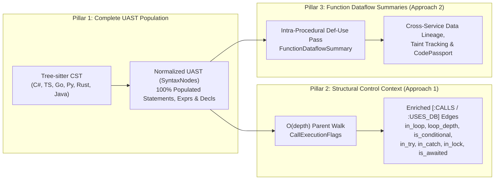
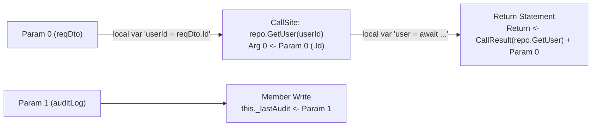

# Proposal: Complete UAST Semantic Mapping, Structural Call Context & Interprocedural Dataflow Summaries
## The Pragmatic Alternative to Full Program Dependence Graphs (PDG) in CodeExplorer

- **Document Version:** 1.0.0
- **Status:** Proposal
- **Target Subsystems:** `CodeExplorer.Core/Parser/Syntax`, `CodeExplorer.Parser.*` (C#, TS/JS, Go, Python, Rust, Java), `Layer3_Syntactic`, `Layer4_Semantic`, `Layer5_Global`, `CodePassport.Engine`, `CodeExplorer.Gates`

---

## 1. Executive Summary & Architectural Rationale

### Why a Textbook Compiler PDG (CFG + CDG + Statement-Level DDG) is Overkill for CodeExplorer
A classic **Program Dependence Graph (PDG)** requires constructing an intra-procedural Control Flow Graph (CFG) of basic blocks, computing Post-Dominator Trees and Dominance Frontiers (Control Dependence Graph — CDG), and running an iterative fixpoint solver over variable definitions (Data Dependence Graph — DDG) at the individual statement/instruction level.

While foundational for optimizing compilers (LLVM, GCC), building a full statement-level PDG across 7 languages in CodeExplorer has a **poor engineering ROI**:
1. **Database & Memory Explosion:** A 100k LOC repository contains ~500,000 to 1,000,000 statements and expressions. Persisting statement nodes and `[:CONTROLS]` / `[:DATA_DEPENDS_ON]` edges into SQLite would inflate the graph database 30–50x and degrade query performance.
2. **Impedance Mismatch with OpenCypher & SIG Gates:** If PDG is built *on-demand* in memory to avoid DB bloat, repository-wide Semantic Invariant Gates (`MATCH (f:Function)...`) in `CodeExplorer.Cypher` cannot query it without materializing PDGs for every function anyway.
3. **Tree-sitter vs. Full Type Checkers:** Without a compiler-grade points-to and alias analyzer for all 7 languages, formal post-dominance breaks down on OOP state mutations, DI interfaces, async state machines, and LINQ/functional pipelines.
4. **LLM Context Reality:** Feeding an AI agent a "sliced" non-contiguous set of 15 lines out of a 100-line method prevents the agent from understanding surrounding invariants and makes surgical `edit_file` replacements impossible without re-reading the full method anyway.

### What Actually Delivers 95% of the Value at 10% of the Cost
By combining **three targeted, high-leverage improvements** on top of our existing architecture, we get all the practical benefits of control and data dependence without CFG/post-dominator complexity or database bloat:



1. **Pillar 1 — Complete UAST Semantic Property Mapping (`PopulateSyntaxNode`)**: Populate all strongly-typed properties on `StatementSyntax`, `ExprSyntax`, and `DeclarationSyntax` that currently sit as `null` shells across converters.
2. **Pillar 2 (Approach 1) — Structural Execution Context on `CALLS` Edges**: Capture control-flow context (`in_loop`, `loop_depth`, `is_conditional`, `in_lock`, `in_try`, `in_catch`, `is_awaited`) in $O(\text{AST depth})$ via parent traversal and store it directly on `Reference` and `CALLS` / `USES_DB` / `SERVICE_CALL` edges.
3. **Pillar 3 (Approach 2) — Interprocedural Function Dataflow Summaries**: Compute compact parameter-to-argument, parameter-to-return, and parameter-to-sink transfer summaries per `FunctionDeclSyntax`, enabling fast cross-method and cross-service dataflow tracing.

---

## 2. Pillar 1: Complete UAST Property Mapping (`PopulateSyntaxNode`)

### 2.1. Current State Diagnosis ("The Hollow Shell Problem")
In [`SyntaxNodes.cs`](../../cli/src/Core/CodeExplorer.Core/Parser/Syntax/SyntaxNodes.cs), we already define a rich hierarchy of strongly-typed UAST nodes:
- **Declarations:** `FunctionDeclSyntax`, `TypeDeclSyntax`, `ParameterDeclSyntax`, `MemberDeclSyntax`, `VariableDeclSyntax`, `ImportDeclSyntax`, `AnnotationSyntax`
- **Statements:** `BlockStmtSyntax`, `IfStmtSyntax`, `LoopStmtSyntax`, `SwitchOrMatchStmtSyntax`, `TryStmtSyntax`, `CatchClauseSyntax`, `UsingOrWithStmtSyntax`, `DeferOrGoStmtSyntax`, `ReturnOrYieldStmtSyntax`, `ThrowStmtSyntax`, `LockStmtSyntax`, `ExprStmtSyntax`, `DeclStmtSyntax`
- **Expressions:** `CallExprSyntax`, `ArgumentSyntax`, `AssignmentExprSyntax`, `BinaryExprSyntax`, `UnaryExprSyntax`, `ConditionalExprSyntax`, `MemberAccessExprSyntax`, `IndexOrSliceExprSyntax`, `LambdaExprSyntax`, `AwaitOrTryExprSyntax`, `CollectionExprSyntax`

**However**, in [`TreeSitterSyntaxBuilder.cs`](../../cli/src/Parsers/CodeExplorer.Parser.Shared/TreeSitterSyntaxBuilder.cs) and the 6 language converters (`CSharp`, `TypeScript`, `Go`, `Python`, `Rust`, `Java`), `PopulateSyntaxNode` currently populates **only 6 node types**:
1. `IdentifierExprSyntax.Name`
2. `LiteralExprSyntax.ValueText` & `ResolvedValue`
3. `DeclarationSyntax.Name`
4. `BinaryExprSyntax.Left`, `Right`, `Operator`
5. `CallExprSyntax.Callee`, `Receiver`, `MethodName` (missing `Arguments`!)
6. `MemberAccessExprSyntax.Object`, `MemberName`

All other properties — including `FunctionDeclSyntax.Parameters/Body`, `VariableDeclSyntax.Initializer`, `AssignmentExprSyntax.Left/Right`, `IfStmtSyntax.Condition/ThenBranch/ElseBranch`, `LoopStmtSyntax.Condition/Body`, `ReturnOrYieldStmtSyntax.Value`, and `CallExprSyntax.Arguments` — **remain `null` or empty `[]`**. Downstream consumers (`SyntaxValueEvaluator`, `BackwardProvenanceSlicer`, `Layer3SyntacticParser`) are forced to fall back to brittle raw `Children` scans and language-specific `RawGrammarKind` checks.

---

### 2.2. Cross-Language Tree-sitter Field Normalization Matrix

Most Tree-sitter grammars share standard field names (`condition`, `body`, `left`, `right`, `value`, `parameters`, `arguments`), with small per-language variations. By centralizing shared field resolution in `TreeSitterSyntaxConverterBase.PopulateSyntaxNode` and handling grammar quirks in language overrides, we achieve 100% UAST population cleanly:

| UAST Node & Property | C# (`c_sharp`) | TypeScript / JS | Go (`go`) | Python (`python`) | Rust (`rust`) | Java (`java`) |
| :--- | :--- | :--- | :--- | :--- | :--- | :--- |
| **`FunctionDeclSyntax`** | | | | | | |
| `.Parameters` | `parameters` (`ParameterDeclSyntax` children) | `parameters` | `parameters` | `parameters` | `parameters` | `parameters` |
| `.Body` | `body` (`BlockStmtSyntax`) | `body` | `body` | `body` | `body` | `body` |
| `.ExpressionBody` | `arrow_expression_clause` child | `body` (when `ExprSyntax`) | N/A | N/A | N/A | N/A |
| `.Receiver` | `this` modifier on 1st param | N/A | `receiver` | `self` (1st param) | `self_parameter` | `receiver_parameter` |
| **`VariableDeclSyntax` / `MemberDeclSyntax`** | | | | | | |
| `.Initializer` | `initializer` / `value` / 1st `ExprSyntax` after `=` | `value` | `value` / rhs `expression_list` | `right` / `value` | `value` | `value` (on `variable_declarator`) |
| `.VariableType` / `.MemberType` | `type` | `type` (`type_annotation`) | `type` | `type` | `type` | `type` |
| **`ParameterDeclSyntax`** | | | | | | |
| `.ParameterType` | `type` | `type` | `type` | `type` | `type` | `type` |
| `.DefaultValue` | `value` / `equals_value_clause` | `value` | N/A | `value` | N/A | N/A |
| **`CallExprSyntax`** | | | | | | |
| `.Arguments` | `arguments` $\to$ `ArgumentSyntax` / `ExprSyntax` | `arguments` | `arguments` | `arguments` | `arguments` | `arguments` |
| **`ArgumentSyntax`** | | | | | | |
| `.Name` | `name` / `name_colon` | N/A | N/A | `name` | N/A | N/A |
| `.Value` | 1st `ExprSyntax` child | 1st `ExprSyntax` | 1st `ExprSyntax` | `value` | 1st `ExprSyntax` | 1st `ExprSyntax` |
| **`AssignmentExprSyntax`** | | | | | | |
| `.Left` | `left` | `left` | `left` | `left` | `left` | `left` |
| `.Right` | `right` | `right` | `right` | `right` | `right` | `right` |
| `.Operator` | `operator` / token between L & R | `operator` | `operator` (`=`, `:=`) | `operator` | `operator` | `operator` |
| **`ConditionalExprSyntax`** | | | | | | |
| `.Condition` | `condition` | `condition` | N/A | 2nd child (`if` cond) | N/A | `condition` |
| `.WhenTrue` | `consequence` | `consequence` | N/A | 1st child | N/A | `consequence` |
| `.WhenFalse` | `alternative` | `alternative` | N/A | 3rd child | N/A | `alternative` |
| **`UnaryExprSyntax`** | | | | | | |
| `.Operand` | `operand` / `argument` | `argument` | `operand` | `argument` | `value` / 1st expr | `operand` |
| `.Operator` | `operator` | `operator` | `operator` | `operator` | `operator` | `operator` |
| **`LambdaExprSyntax`** | | | | | | |
| `.Parameters` | `parameters` | `parameters` / `parameter` | `parameters` | `parameters` | `parameters` | `parameters` |
| `.Body` | `body` | `body` | `body` | `body` | `body` | `body` |
| **`AwaitOrTryExprSyntax`** | | | | | | |
| `.Operand` | 1st `ExprSyntax` child | 1st `ExprSyntax` | N/A | 1st `ExprSyntax` | 1st `ExprSyntax` | N/A |
| **`BlockStmtSyntax`** | | | | | | |
| `.Statements` | All `StatementSyntax` children | All `StatementSyntax` | All `StatementSyntax` | All `StatementSyntax` | All `StatementSyntax` | All `StatementSyntax` |
| **`ExprStmtSyntax`** | | | | | | |
| `.Expression` | 1st `ExprSyntax` child | 1st `ExprSyntax` | 1st `ExprSyntax` | 1st `ExprSyntax` | 1st `ExprSyntax` | 1st `ExprSyntax` |
| **`IfStmtSyntax`** | | | | | | |
| `.Condition` | `condition` | `condition` | `condition` | `condition` | `condition` | `condition` |
| `.ThenBranch` | `consequence` | `consequence` | `consequence` | `consequence` | `consequence` | `consequence` |
| `.ElseBranch` | `alternative` | `alternative` | `alternative` | `alternative` (`elif`/`else`) | `alternative` | `alternative` |
| **`LoopStmtSyntax`** | | | | | | |
| `.Init` | `initializer` | `initializer` | `initializer` | N/A | N/A | `init` |
| `.Condition` | `condition` | `condition` | `condition` | `condition` (`while`) | `condition` | `condition` |
| `.Increment` | `update` | `increment` | `update` | N/A | N/A | `update` |
| `.Collection` | `right` (`foreach`) | `right` (`for..of/in`) | `right` (`range_clause`) | `right` (`for..in`) | `value` (`for..in`) | `value` (`enhanced_for`) |
| `.Body` | `body` | `body` | `body` | `body` | `body` | `body` |
| **`TryStmtSyntax` & `CatchClauseSyntax`** | | | | | | |
| `Try.Body` | `body` | `body` | N/A | `body` | N/A | `body` |
| `Try.Catches` | `CatchClauseSyntax` children | `handler` (`CatchClauseSyntax`) | N/A | `CatchClauseSyntax` children | N/A | `CatchClauseSyntax` children |
| `Try.FinallyBody` | `finalizer` / `finally_clause` | `finalizer` | N/A | `finalizer` (`finally_clause`) | N/A | `finally_clause` |
| `Catch.Body` | `body` | `body` | N/A | `body` | N/A | `body` |
| **`ReturnOrYieldStmtSyntax` & `ThrowStmtSyntax`** | | | | | | |
| `Return.Value` | 1st `ExprSyntax` child | 1st `ExprSyntax` | 1st `ExprSyntax` | 1st `ExprSyntax` | 1st `ExprSyntax` | 1st `ExprSyntax` |
| `Throw.Exception` | 1st `ExprSyntax` child | 1st `ExprSyntax` | N/A | 1st `ExprSyntax` | N/A | 1st `ExprSyntax` |
| **`LockStmtSyntax` & `UsingOrWithStmtSyntax`** | | | | | | |
| `.Body` | `body` | `body` | N/A | `body` | N/A | `body` |

### 2.3. Automatic Statement Normalization (`EnsureStatement`)
In several grammars (C#, TypeScript, Java), the `consequence` of an `if_statement` or the `body` of a `for_statement` without braces (`if (x) DoWork();`) may be parsed directly as an `expression_statement` or expression, whereas with braces it is a `BlockStmtSyntax`. Similarly, in Rust, `if_expression` and `match_expression` can appear in expression positions.
- We will add a helper in `TreeSitterSyntaxConverterBase`:
  ```csharp
  protected static StatementSyntax? AsStatementOrWrap(SyntaxNode? node) =>
      node switch
      {
          null => null,
          StatementSyntax stmt => stmt,
          DeclarationSyntax decl => new DeclStmtSyntax { Span = decl.Span, RawGrammarKind = decl.RawGrammarKind, Parent = decl.Parent, Document = decl.Document, Declarations = [decl] },
          ExprSyntax expr => new ExprStmtSyntax { Span = expr.Span, RawGrammarKind = expr.RawGrammarKind, Parent = expr.Parent, Document = expr.Document, Expression = expr },
          _ => null
      };
  ```
- Furthermore, in `CallExprSyntax`, arguments inside an `argument_list` / `arguments` container node will be automatically unwrapped into `IReadOnlyList<ArgumentSyntax>` (wrapping bare `ExprSyntax` nodes into `ArgumentSyntax { Value = expr }` for languages like TypeScript/Go/Rust where arguments are not always wrapped in an `argument` grammar rule).

---

## 3. Pillar 2 (Approach 1): Structural Execution Context on `CALLS` & `Reference`

### 3.1. Concept: Zero-CFG Control Context via $O(\text{depth})$ Ancestor Walk
Instead of building a Control Flow Graph and computing Post-Dominator Frontiers to know what controls a call site, **95% of architectural and reliability invariants depend on the lexical/structural control enclosures of the call site**:
- Is this HTTP/DB call inside a loop (`for`, `while`, `.forEach`, `.Select`)? How deeply nested is the loop?
- Is this call guarded by a conditional branch (`if`, `switch`, ternary, `&&`)?
- Is this call inside a `lock` / `synchronized` block?
- Is this call inside a `try`, `catch`, or `finally` block?
- Is this async call awaited (`await`), or is it a fire-and-forget call?

Because every `SyntaxNode` already has a `.Parent` pointer populated during `SyntaxDocument.Create`, walking from a `CallExprSyntax` or `SqlStmtSyntax` up to the enclosing `FunctionDeclSyntax` takes **at most 5–15 pointer hops (~50 nanoseconds)** and zero heap allocations!

### 3.2. `CallExecutionFlags` Data Model

```csharp
namespace CodeExplorer.Core.Common;

[Flags]
public enum CallExecutionFlags : ushort
{
    None            = 0,
    InLoop          = 1 << 0, // Inside LoopStmtSyntax or functional loop (.forEach / Parallel.ForEach)
    InNestedLoop    = 1 << 1, // LoopDepth >= 2 (O(N^2) risk)
    IsConditional   = 1 << 2, // Guarded by IfStmt, SwitchOrMatchStmt, ConditionalExpr, or short-circuit && / ??
    InTryBlock      = 1 << 3, // Inside TryStmtSyntax.Body
    InCatchBlock    = 1 << 4, // Inside CatchClauseSyntax (error recovery / retry / logging path)
    InFinallyBlock  = 1 << 5, // Inside TryStmtSyntax.FinallyBody or DeferOrGoStmtSyntax (defer)
    InLockBlock     = 1 << 6, // Inside LockStmtSyntax (C# lock, Java synchronized)
    InUsingResource = 1 << 7, // Inside UsingOrWithStmtSyntax (scoped disposable resource)
    IsAwaited       = 1 << 8, // Wrapped in AwaitOrTryExprSyntax
    IsConcurrentSpawn = 1 << 9, // Inside Go goroutine (`go fn()`), `Task.Run(...)`, or `tokio::spawn(...)`
    InLambda        = 1 << 10 // Inside LambdaExprSyntax closure
}
```

### 3.3. `CallSiteContextExtractor` Implementation
A single language-agnostic service in `CodeExplorer.Core.Parser.Syntax`:

```csharp
public readonly record struct CallSiteExecutionContext(
    CallExecutionFlags Flags,
    byte LoopDepth,
    byte ConditionalDepth
);

public static class CallSiteContextExtractor
{
    private static readonly HashSet<string> FunctionalIterationMethods = new(StringComparer.Ordinal)
    {
        "forEach", "map", "flatMap", "filter", "reduce", "some", "every",
        "ForEach", "ForEachAsync", "Select", "Where", "All", "Any"
    };

    public static CallSiteExecutionContext Extract(SyntaxNode callNode)
    {
        var flags = CallExecutionFlags.None;
        byte loopDepth = 0;
        byte condDepth = 0;

        SyntaxNode? prev = callNode;
        SyntaxNode? curr = callNode.Parent;

        while (curr != null && curr is not FunctionDeclSyntax and not TypeDeclSyntax and not SyntaxDocument)
        {
            switch (curr)
            {
                case AwaitOrTryExprSyntax { IsTryPropagate: false }:
                    flags |= CallExecutionFlags.IsAwaited;
                    break;

                case LoopStmtSyntax loop:
                    // If callNode is inside the loop body (or increment), it executes repeatedly
                    if (prev != loop.Init && prev != loop.Collection)
                    {
                        loopDepth++;
                        flags |= CallExecutionFlags.InLoop;
                        if (loopDepth >= 2) flags |= CallExecutionFlags.InNestedLoop;
                    }
                    break;

                case IfStmtSyntax ifStmt:
                    if (prev != ifStmt.Init && prev != ifStmt.Condition)
                    {
                        condDepth++;
                        flags |= CallExecutionFlags.IsConditional;
                    }
                    break;

                case SwitchOrMatchStmtSyntax or MatchExprSyntax or ConditionalExprSyntax:
                    condDepth++;
                    flags |= CallExecutionFlags.IsConditional;
                    break;

                case BinaryExprSyntax { Operator: "&&" or "||" or "??" or "and" or "or" } bin
                    when ReferenceEquals(prev, bin.Right):
                    condDepth++;
                    flags |= CallExecutionFlags.IsConditional;
                    break;

                case TryStmtSyntax tryStmt:
                    if (ReferenceEquals(prev, tryStmt.FinallyBody) || prev?.FieldRole is "finalizer" or "finally_clause")
                        flags |= CallExecutionFlags.InFinallyBlock;
                    else if (prev is not CatchClauseSyntax)
                        flags |= CallExecutionFlags.InTryBlock;
                    break;

                case CatchClauseSyntax:
                    flags |= CallExecutionFlags.InCatchBlock | CallExecutionFlags.IsConditional;
                    break;

                case LockStmtSyntax:
                    flags |= CallExecutionFlags.InLockBlock;
                    break;

                case UsingOrWithStmtSyntax:
                    flags |= CallExecutionFlags.InUsingResource;
                    break;

                case DeferOrGoStmtSyntax deferGo:
                    flags |= deferGo.IsGoroutine
                        ? CallExecutionFlags.IsConcurrentSpawn
                        : CallExecutionFlags.InFinallyBlock;
                    break;

                case LambdaExprSyntax:
                    flags |= CallExecutionFlags.InLambda;
                    // Check if the lambda is passed to a collection iteration method (.forEach, .map, Task.Run)
                    if (curr.Parent is ArgumentSyntax { Parent: CallExprSyntax outerCall } ||
                        curr.Parent is CallExprSyntax outerCall2 && (outerCall = outerCall2) != null)
                    {
                        if (FunctionalIterationMethods.Contains(outerCall.MethodName))
                        {
                            loopDepth++;
                            flags |= CallExecutionFlags.InLoop;
                            if (loopDepth >= 2) flags |= CallExecutionFlags.InNestedLoop;
                        }
                        else if (outerCall.MethodName is "Run" or "StartNew" or "spawn" or "create_task")
                        {
                            flags |= CallExecutionFlags.IsConcurrentSpawn;
                        }
                    }
                    break;
            }

            prev = curr;
            curr = curr.Parent;
        }

        return new CallSiteExecutionContext(flags, loopDepth, condDepth);
    }
}
```

### 3.4. Ontology Integration & Edge Properties
We extend [`Reference`](../../cli/src/Core/CodeExplorer.Core/Common/Reference.cs) with optional `CallSiteExecutionContext Context = default`:
```csharp
public record Reference(
    string ScopeSymbolId,
    string TargetName,
    string Kind,
    int Line = 0,
    int Column = 0,
    CallSiteExecutionContext Context = default
);
```
When Layer 3 / Layer 4 materializes `CALLS`, `SERVICE_CALL`, `CALLS_ENDPOINT`, `USES_DB`, `READS_FROM`, `WRITES_TO`, and `PUBLISHES_TO` relationships, non-zero execution context flags are serialized as lightweight edge properties (only written when `true` / `> 0` to keep JSON payload minimal!):
- `in_loop`: `true`
- `loop_depth`: `1`, `2`, ...
- `is_conditional`: `true`
- `in_try`: `true`
- `in_catch`: `true`
- `in_lock`: `true`
- `is_awaited`: `true`

#### New High-Value Semantic Invariant Gates (SIG) Enabled Immediately:
```cypher
// 1. N+1 Database Query or Remote HTTP Call Inside a Loop
MATCH (caller:Function)-[r:USES_DB|SERVICE_CALL|CALLS_ENDPOINT]->(target)
WHERE r.in_loop = true
RETURN caller.name AS method, caller.file_path AS file, r.line AS line, target.name AS resource

// 2. Blocking External I/O Inside a Lock Statement (Deadlock / Thread-Pool Starvation Risk)
MATCH (caller:Function)-[r:USES_DB|SERVICE_CALL|CALLS]->(target)
WHERE r.in_lock = true
RETURN caller.name AS method, caller.file_path AS file, r.line AS line

// 3. Unprotected External Network/DB Call (Neither inside try/catch nor guarded by caller)
MATCH (ep:Endpoint)<-[:IMPLEMENTS]-(fn:Function)-[r:SERVICE_CALL]->(ext:Service)
WHERE r.in_try IS NULL
RETURN fn.name, ext.name
```

---

## 4. Pillar 3 (Approach 2): Interprocedural Function Dataflow Summaries

### 4.1. Concept: Compositional Function Summaries Instead of Statement Graphs
In interprocedural analysis (tracing data from an HTTP `Endpoint` $\to$ `Controller` $\to$ `Service` $\to$ `Repository` $\to$ `Database Table`, or tracing taint in `CodePassport`), **90% of methods act as data conduits**:
- They take parameters `(p0, p1, ...)`, transform or validate them, pass them as arguments to helper/service calls, write them to fields/databases, or return a derived value.

Instead of storing every local variable and statement in the global graph, we compute a compact **`FunctionDataflowSummary`** for each `FunctionDeclSyntax` during Layer 3 AST visiting (using the fully populated UAST from Pillar 1) and discard the intra-procedural scratch state once the function is summarized.

### 4.2. What the Intra-Procedural Summary Captures

For a function $F(p_0, p_1, \dots, p_{k-1})$, a single linear scan over its `FunctionDeclSyntax.Body` (maintaining a local map `varName -> Origins` where an `Origin` is `Param(i)`, `Field(this.x)`, `CallResult(callee, line)`, or `Source(ENV/Config)`):



1. **Argument Forwarding (`CallArgFlow`)**:
   - At each outgoing `CallExprSyntax`, which caller parameters (or member fields) flow into which argument index of the callee:
   - Example: `p0 -> arg0`, `p0.Id -> arg0`, `this._tenantId -> arg1`.
2. **Return Provenance (`ReturnFlow`)**:
   - Which parameters, fields, or inner call results flow into `ReturnOrYieldStmtSyntax.Value`:
   - Example: `return <- [p0, call:CalculateTax]`.
3. **State / Sink Mutation (`MutationFlow`)**:
   - Which parameters write to `this.<Field>` or flow into an embedded `SqlStmtSyntax` parameter:
   - Example: `p0 -> field:_cache`, `p1 -> sql:INSERT:users`.

### 4.3. Data Structures & Compact Serialization

```csharp
namespace CodeExplorer.Core.Analysis.Dataflow;

public enum FlowSourceKind : byte
{
    Parameter,      // Function parameter p0..pN
    InstanceField,  // this.fieldName / self.fieldName
    CallReturn,     // Return value of an invoked method
    ExternalSource, // ENV, Config, HTTP Request, DB Read
    Constant        // Literal or resolved constant
}

public readonly record struct DataflowOrigin(
    FlowSourceKind Kind,
    string Identifier,       // e.g. "p0" or "this._repo" or "call:GetUser"
    string? PropertyPath = null // e.g. ".UserId" when accessed via p0.UserId
);

public sealed class FunctionDataflowSummary
{
    /// <summary>Origins that contribute to the function's return value.</summary>
    public List<DataflowOrigin> ReturnOrigins { get; } = [];

    /// <summary>Per-call-site mapping: (CalleeMethodName, Line) -> (ArgIndex -> Origins).</summary>
    public Dictionary<(string Callee, int Line), Dictionary<int, List<DataflowOrigin>>> CallArgFlows { get; } = new();

    /// <summary>Instance fields mutated by this function and their value origins.</summary>
    public Dictionary<string, List<DataflowOrigin>> FieldWrites { get; } = new(StringComparer.Ordinal);

    /// <summary>Compact string encoding stored on FunctionNode.Extensions["df_summary"].</summary>
    public string ToCompactString();
}
```

### 4.4. How Layer 3, Layer 5 & `CodePassport` Consume Summaries

1. **On `FunctionNode` (`df_return` & `df_writes`)**:
   - `df_return`: `"p0.Amount,p1,call:GetRate"` — immediately tells any caller (or Cypher query) whether the function's return value depends on parameter 0, parameter 1, or an inner call.
   - `df_writes`: `"this._state<-p0"` — links constructor/setter injection and stateful mutations across methods of the same class.
2. **On `CALLS` / `SERVICE_CALL` / `USES_DB` Edges (`arg_flow`)**:
   - `arg_flow`: `"0<-p0.UserId;1<-const"` — records on the `CALLS` edge itself how caller parameters map into callee parameters!
3. **End-to-End Cross-Service Data Lineage (`inspect_data_lineage` & MCP)**:
   - By chaining `arg_flow` across `(Endpoint)<-[:IMPLEMENTS]-(Controller)-[:CALLS { arg_flow }]->(Service)-[:CALLS { arg_flow }]->(Repo)-[:WRITES_TO]->(Table)`, CodeExplorer can trace how a specific HTTP request parameter reaches a specific database table across arbitrary call depth in milliseconds!
4. **Unifying with `CodePassport.Engine` (`BackwardProvenanceSlicer`)**:
   - Currently, [`BackwardProvenanceSlicer.cs`](../../cli/src/Core/CodePassport.Engine/Analysis/BackwardProvenanceSlicer.cs) re-parses and walks parent expressions on the fly. Once Pillar 1 (populated UAST) and Pillar 3 (`FunctionDataflowSummary`) are in `CodeExplorer.Core`, `BackwardProvenanceSlicer` can reuse the normalized UAST properties (`AssignmentExprSyntax.Left/Right`, `VariableDeclSyntax.Initializer`, `FunctionDeclSyntax.Parameters`, `ReturnOrYieldStmtSyntax.Value`) directly, cutting its code complexity in half and making it 100% polyglot across all 6 languages.

---

## 5. Phased Implementation Plan

### Phase 1: Complete UAST Mapping in `TreeSitterSyntaxConverterBase` & Language Converters
* **Scope:**
  - Add standard field name constants to `SyntaxFields` (`Condition`, `Consequence`, `Alternative`, `Body`, `Parameters`, `Arguments`, `Initializer`, `Value`, `Type`, `Left`, `Right`, `Operator`, `Update`, `Handler`, `Finalizer`).
  - Expand `TreeSitterSyntaxConverterBase.PopulateSyntaxNode` to populate:
    - `FunctionDeclSyntax` (`Parameters`, `Body`, `ExpressionBody`, `ReturnTypes`)
    - `ParameterDeclSyntax` (`ParameterType`, `DefaultValue`)
    - `VariableDeclSyntax` & `MemberDeclSyntax` (`Initializer`, `VariableType` / `MemberType`)
    - `CallExprSyntax` (`Arguments`) & `ArgumentSyntax` (`Name`, `Value`)
    - `AssignmentExprSyntax` (`Left`, `Right`, `Operator`)
    - `UnaryExprSyntax` (`Operand`, `Operator`) & `ConditionalExprSyntax` (`Condition`, `WhenTrue`, `WhenFalse`)
    - `LambdaExprSyntax` (`Parameters`, `Body`) & `AwaitOrTryExprSyntax` (`Operand`)
    - `BlockStmtSyntax` (`Statements`), `ExprStmtSyntax` (`Expression`), `IfStmtSyntax` (`Condition`, `ThenBranch`, `ElseBranch`), `LoopStmtSyntax` (`Init`, `Condition`, `Increment`, `Collection`, `Body`), `TryStmtSyntax` (`Body`, `Catches`, `FinallyBody`), `CatchClauseSyntax` (`ExceptionType`, `ExceptionVariable`, `Body`), `ReturnOrYieldStmtSyntax` (`Value`), `ThrowStmtSyntax` (`Exception`), `LockStmtSyntax` (`LockTarget`, `Body`), `UsingOrWithStmtSyntax` (`Resources`, `Body`).
  - Add language-specific field overrides in `CSharpSyntaxConverter`, `TypeScriptSyntaxConverter`, `GoSyntaxConverter`, `PythonSyntaxConverter`, `RustSyntaxConverter`, and `JavaSyntaxConverter`.
* **Verification:**
  - Unit test suite (`UastPopulationTests.cs`) parsing representative snippets in all 6 languages and asserting non-null strongly-typed properties across declarations, statements, and expressions.

### Phase 2: Structural Control Context (`CallSiteContextExtractor` & Edge Enrichment)
* **Scope:**
  - Implement `CallExecutionFlags` and `CallSiteContextExtractor` in `CodeExplorer.Core.Parser.Syntax`.
  - Attach `CallSiteExecutionContext` to `Reference` in language visitors / UAST walkers.
  - Project `in_loop`, `loop_depth`, `is_conditional`, `in_try`, `in_catch`, `in_lock`, `is_awaited` onto `CallsRelationship`, `ServiceCallRelationship`, `UsesDbRelationship`, and `PublishesToRelationship`.
  - Add built-in SIG rules (`n-plus-one-db-in-loop`, `io-inside-lock`) to `BuiltInGateCatalog`.
* **Verification:**
  - Unit tests verifying loop depth, conditional guards, `try/catch/lock` flags, and Cypher query matching on `r.in_loop = true`.

### Phase 3: Intra-Procedural `FunctionDataflowSummary` & Interprocedural Lineage
* **Scope:**
  - Implement `FunctionDataflowSummarizer` over populated `FunctionDeclSyntax` UAST nodes.
  - Emit `arg_flow` onto `CALLS` edges and `df_return` / `df_writes` onto `FunctionNode`.
  - Upgrade `BackwardProvenanceSlicer` and `PostIndexAnalyzer.DataLineage` to consume the normalized UAST and function summaries.
* **Verification:**
  - Multi-hop interprocedural lineage tests (Controller $\to$ Service $\to$ Repository $\to$ DB Table) across C#, TypeScript, Go, and Python.

---

## 6. Performance & Storage Impact Summary

| Metric | Full Textbook PDG | Proposed UAST + Context + Summaries |
| :--- | :--- | :--- |
| **New Graph Nodes in SQLite** | +500,000 to +1,000,000 (`Statement` nodes) | **0 new nodes** (zero DB bloat) |
| **Indexing Time Overhead** | +40% to +120% (CFG + Dominator Trees + Fixpoint) | **< 2–3%** (single pass during existing AST walk) |
| **Cypher / SIG Compatibility** | Requires virtual tables or full materialization | **100% Native** (`WHERE r.in_loop = true`, `r.arg_flow`) |
| **Multi-Language Maintenance** | High (custom CFG quirks per language) | **Low** (unified over populated `SyntaxNodes`) |
| **Cross-Service Data Lineage** | Difficult (drowns in local instruction noise) | **Direct $O(1)$ per function hop** via summaries |
