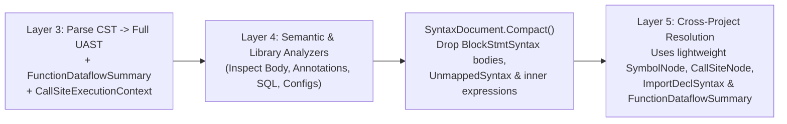

# Proposal: UAST Performance Engineering, Memory Compaction & Algorithmic Loop Semantics

**Status:** Proposed  
**Created:** 2026-11-06  
**Target Layer:** Layer 3 (Syntax / UAST) & Layer 4–5 Pipeline  
**Related Docs:** [`docs/architecture/uast-structure.md`](../architecture/uast-structure.md), [`uast-completion-and-lightweight-flow-analysis-proposal.md`](./uast-completion-and-lightweight-flow-analysis-proposal.md)

---

## 1. Motivation & Problem Statement

Following the completion of full UAST property population (`ParameterDeclSyntax`, `CollectionExprSyntax`, `ConditionalExprSyntax`, `IndexExprSyntax`, `LambdaExprSyntax`, `MemberDeclSyntax.MemberType`) and intra-procedural `FunctionDataflowSummary`, the UAST now serves as a rich, strongly-typed semantic foundation across all 6 supported languages.

To scale this richer UAST to massive monorepos (15,000+ files) while maximizing its analytical return on investment, five architectural optimizations are proposed:

1. **Algorithmic Complexity & Loop Bottleneck Detection:** We already track `in_loop` and `loop_depth` via `CallSiteContextExtractor`, but we only flag external I/O inside loops (DB/HTTP N+1). Hidden in-memory $O(N^2)$ linear scans (`.includes()`, `.IndexOf()`, `.Any()`, `slices.Contains()`) and heavy heap allocations inside loops remain undetected.
2. **Post-Layer-4 UAST Memory Compaction:** Retaining full `BlockStmtSyntax` statement trees, expression hierarchies, and `UnmappedSyntax` trivia in RAM for all files through the end of Layer 5 consumes 75–80% of peak heap memory after Layer 4 has already finished inspecting function bodies.
3. **Tree-sitter Native Field Resolution Overhead:** Calling `node.GetChildByFieldName("name")` across millions of AST nodes passes strings across P/Invoke and triggers linear `strncmp` scans over grammar field tables inside native Tree-sitter.
4. **Non-Deterministic Wall-Clock AST Timeouts:** Truncating pathological/generated files by wall-clock milliseconds produces different graph outputs depending on machine load and CI runner speed.
5. **Duplicate Legacy `Raw*` Buffers on `SyntaxTree`:** `SyntaxTree` still populates parallel flat lists (`RawImports`, `RawVariables`, `RawTypeBindings`) that duplicate data now natively carried by `ImportDeclSyntax`, `VariableDeclSyntax`, and `MemberDeclSyntax`.

---

## 2. Pillar 1: Algorithmic Loop Bottleneck Semantics & In-Memory $O(N^2)$ Gates

### 2.1. New `FunctionNode` & `FunctionDeclSyntax` Metrics
During the single-pass `FunctionDataflowAnalyzer` walk over `FunctionDeclSyntax.Body`, compute three structural complexity indicators without any extra tree traversal:

| Property on `FunctionNode` | Type | Description |
| :--- | :--- | :--- |
| `has_linear_scan_in_loop` | `bool` | `true` if any `CallExprSyntax` with `in_loop == true` invokes an $O(N)$ linear collection scan method (e.g., C# `.Contains()` on `List<T>`/array, `.IndexOf()`, `.Any()`, `.FirstOrDefault()`; TS/JS `.includes()`, `.indexOf()`, `.find()`, `.findIndex()`, `.some()`; Go `slices.Contains()`, `slices.Index()`, `strings.Contains()`; Python `in` / `.index()`; Java `.contains()`, `.indexOf()`; Rust `.iter().any()`, `.contains()`). |
| `has_alloc_in_loop` | `bool` | `true` if any `ObjectCreationExprSyntax` (`new T()`, `make()`, `Box::new`, `Vec::new`) or collection-cloning call (`.ToArray()`, `.ToList()`, `.slice()`, `.concat()`) occurs at `loop_depth >= 1`. |
| `max_access_depth` | `int` | Maximum chained property/member dereference depth (`a.b.c.d` $\to 3$) observed inside the function via `MemberAccessExprSyntax` nesting (Law of Demeter indicator). |

### 2.2. New Semantic Invariant Gates (SIG)
- **`SIG-M-P-001` (*Linear Collection Scan Inside Loop — Hidden $O(N^2)$*)**:
  ```cypher
  MATCH (f:Function)
  WHERE f.has_linear_scan_in_loop = true AND COALESCE(f.is_test, false) = false
  RETURN f
  ```
- **`SIG-M-P-002` (*Excessive Member Chain Depth / Law of Demeter Violation*)**:
  ```cypher
  MATCH (f:Function)
  WHERE f.max_access_depth > 5 AND COALESCE(f.is_test, false) = false
  RETURN f
  ```

---

## 3. Pillar 2: Post-Layer-4 UAST Lifecycle & Memory Compaction (`SyntaxDocument.Compact()`)

### 3.1. Two-Stage UAST Retention Lifecycle


### 3.2. Implementation Details
1. Add `SyntaxDocument.Compact()` and `SyntaxTree.Compact()`:
   - On every `FunctionDeclSyntax` and `LambdaExprSyntax`, replace `Body` with `null` (preserving `Parameters`, `ReturnType`, `Receiver`, `Annotations`, `Modifiers`, and `Location`).
   - Clear `UnmappedSyntax` children and non-constant initializer expression trees once `AstValueResolver` and Layer 4 analyzers have completed for the project.
   - Reset lazy descendant caches (`_allFunctions`, `_allCalls`, `_allControlFlows`, `_allVariables`) so the GC can immediately reclaim statement and expression allocations.
2. **Expected Impact:** ~75–80% reduction in retained UAST heap memory prior to Layer 5 global cross-reference resolution.

---

## 4. Pillar 3: Pre-Resolved Numeric `TSFieldId` Caching in Tree-sitter Binding

### 4.1. Problem
`TSNode.GetChildByFieldName(string name)` calls `ts_node_child_by_field_name(node, name, length)`, which inside native Tree-sitter iterates through the language grammar's field table comparing strings via `strncmp`. Because `TreeSitterSyntaxPopulator` queries fields (`name`, `body`, `parameters`, `type`, `value`, `left`, `right`, `condition`, `consequence`, `alternative`, `function`, `arguments`, `object`, `property`) on nearly every CST node, string comparison overhead accumulates across millions of nodes.

### 4.2. Design
1. Expose `ts_language_field_id_for_name` and `ts_node_child_by_field_id` in the low-level Tree-sitter P/Invoke binding.
2. At `LanguageSyntaxProfile` initialization time, resolve all canonical field names (`"name"`, `"body"`, `"parameters"`, `"return_type"`, `"type"`, `"value"`, `"left"`, `"right"`, `"operator"`, `"condition"`, `"consequence"`, `"alternative"`, `"function"`, `"arguments"`, `"object"`, `"property"`, `"index"`, `"receiver"`, `"alias"`) once per `TSLanguage` into `ushort` (`TSFieldId`) constants stored in a struct `CachedFieldIds`.
3. Replace string-based field lookups in `TreeSitterSyntaxPopulator` and `TreeSitterSyntaxBuilder` with $O(1)$ integer `GetChildByFieldId(ushort fieldId)`.

---

## 5. Pillar 4: Deterministic AST Node-Count Budget (`MaxAstNodeBudget`)

### 5.1. Problem
Wall-clock timeouts during AST walking behave differently on a busy laptop versus a dedicated CI server, potentially causing non-deterministic partial extraction on huge bundled/generated files.

### 5.2. Design
1. Introduce a deterministic node-visit budget `MaxAstNodeBudget` (default: `5_000_000` visited CST nodes per file) inside `TreeSitterSyntaxConverterBase`.
2. Increment a lightweight local counter `visitedNodes++` inside the main CST traversal loop.
3. If `visitedNodes > MaxAstNodeBudget`:
   - Gracefully stop descending further into child subtrees.
   - Mark `SyntaxDocument.IsTruncated = true` and record `visited_nodes` on `SourceFileNode` properties so oversized generated artifacts are surfaced deterministically in scan diagnostics.

---

## 6. Pillar 5: Direct UAST Type & Import Resolution (Retiring `Raw*` Buffers)

### 6.1. Design
Now that UAST nodes carry complete type and import metadata:
- **`ImportDeclSyntax`** (`ModulePath`, `ImportedSymbols`, `Alias`, `IsWildcard`, `IsStatic`) replaces `SyntaxTree.RawImports`.
- **`VariableDeclSyntax`** (`Name`, `VariableType`, `Initializer`, `EnclosingFunctionName`) and **`ParameterDeclSyntax`** (`Name`, `ParameterType`) replace `SyntaxTree.RawVariables` and `SyntaxTree.RawTypeBindings`.
- **`MemberDeclSyntax`** (`Name`, `MemberType`, `Kind`) provides class field/property types directly from `TypeDeclSyntax.Members`.

### 6.2. Migration Steps
1. Update `TypeHierarchyResolver`, `CrossReferenceResolver`, and language-specific `ITypeResolver` implementations to read directly from `SyntaxDocument.Imports`, `SyntaxDocument.AllVariables`, and `SyntaxDocument.AllMembers`.
2. Remove `RawImports`, `RawVariables`, and `RawTypeBindings` from `SyntaxTree`, eliminating redundant list allocations and string copies per file.

---

## 7. Implementation Sequence & Verification Checklist

| Phase | Deliverable | Verification Criteria |
| :---: | :--- | :--- |
| **Phase 1** | **Loop Bottleneck Semantics (`has_linear_scan_in_loop`, `has_alloc_in_loop`, `max_access_depth`) + Gates `SIG-M-P-001/002`** | Unit tests across all 6 languages verifying loop scan/allocation flags; `ce gate check` passes with 0 failures. |
| **Phase 2** | **Post-Layer-4 UAST Compaction (`SyntaxDocument.Compact()`)** | Benchmark on `twenty` verifying identical Layer 5 node/edge counts with $\ge 70\%$ reduction in post-Layer-4 retained UAST memory. |
| **Phase 3** | **Cached Numeric `TSFieldId` (`GetChildByFieldId`) & Deterministic `MaxAstNodeBudget`** | Zero regressions across `CodeExplorer.Tests`; measurable speedup in Layer 3 CST-to-UAST conversion time. |
| **Phase 4** | **Retire Legacy `RawImports` / `RawVariables` / `RawTypeBindings`** | Full test suite green with all type and import resolution driven exclusively by `SyntaxDocument`. |
