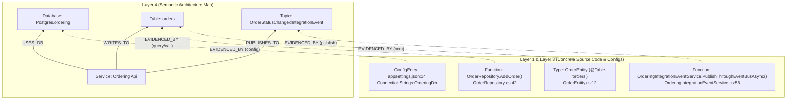

# Universal Edge & Node Evidence Architecture Proposal 🔍
## First-Class Provenance (`EVIDENCED_BY`) Across All Semantic Nodes, Edges & Orbital Groups

- **Document Version:** 1.0.0
- **Status:** Architecture Proposal & Bug Root-Cause Analysis
- **Target Audience:** Core Maintainers, Systems Architects, Frontend/Extension Engineers
- **Target Subsystems:** `CodeExplorer.Core.Analysis`, `CodeExplorer.Core.Protocol`, `CodeExplorer.Core.Parser.SyntaxEnricher`, `vscode-extension`

---

## 1. Executive Summary & The Trust Problem

When an architect, tech lead, or security auditor inspects the CodeExplorer orbital graph and sees an arrow between two components—such as:
* `Ordering Api --[MSGS]--> OrderStatusChangedEvent`
* `WebApp --[HTTP]--> Catalog Api`
* `Payment Service --[USES_DB]--> Oracle (ASBT)`

their immediate first question is: **"Why did CodeExplorer draw this line? Show me the exact file and line of code that proves this dependency exists."**

Without clickable, 100% deterministic code evidence on every arrow and node:
1. Skeptical leads cannot distinguish true dependencies from parser hallucinations.
2. Architects cannot jump from a high-level architectural smell directly to the offending line of code.
3. Our previous attempt at Database Evidence (`GetDatabaseEvidenceAsync`) currently renders empty in the UI due to three specific pipeline bugs detailed below.

---

## 2. Post-Mortem: Why Current Database Evidence Always Shows Empty

An audit of the current Database Evidence pipeline revealed **three concrete bugs** that cause the UI to display `"No query or model evidence recorded"` even when queries and entities exist in `graph.db`:

### Bug 1: Fatal JSON Property Name Mismatch (`"items"` vs `"evidence"`)
* **Backend (C#):** In [`WebSocketProtocol.cs`](file:///c:/Work/Personal/code-explorer/cli/src/Core/CodeExplorer.Core/Protocol/WebSocketProtocol.cs#L1453-L1454), `DatabaseEvidenceResponseDto` serializes the evidence list under the JSON key `"items"`:
  ```csharp
  [JsonPropertyName("items")]
  public List<DatabaseEvidenceItemDto> Items { get; set; } = [];
  ```
* **Frontend (TypeScript):** Both [`DomainInspector.tsx`](file:///c:/Work/Personal/code-explorer/vscode-extension/src/webview/domain/components/DomainInspector.tsx#L48) and [`codeExplorerTreeHelpers.ts`](file:///c:/Work/Personal/code-explorer/vscode-extension/src/codeExplorerTreeHelpers.ts#L677) read `data.evidence`:
  ```ts
  setEvidence(data?.evidence || []); // Always undefined -> []
  ```
* **Impact:** 100% of responses returned by `/api/database/evidence` are discarded by the frontend and rendered as an empty array.

### Bug 2: Project File Path vs. Directory Path in `MatchesService()`
* In [`ArchitectureViewEngine.DatabaseEvidence.cs`](file:///c:/Work/Personal/code-explorer/cli/src/Core/CodeExplorer.Core/Analysis/ArchitectureViewEngine.DatabaseEvidence.cs#L209-L244), `servicePath` is fetched from `coalesce(s.file_path, s.path)` on the `Project`/`Service` node, which points to the project manifest file (e.g., `src/Ordering.API/Ordering.API.csproj` or `pom.xml`).
* `MatchesService()` then checks:
  ```csharp
  filePath.StartsWith(servicePath, StringComparison.OrdinalIgnoreCase)
  ```
* Because no `.cs` or `.java` source file path starts with `.../Ordering.API.csproj`, **every source file is filtered out** whenever `serviceId` is passed (which happens every time a user clicks a `Service -> Database` edge). `Path.GetDirectoryName(servicePath)` must be used instead.

### Bug 3: Missing Traversal Through `:Table` and `:Procedure` Nodes
* In [`ArchitectureViewEngine.DatabaseEvidence.cs`](file:///C:/Work/Personal/code-explorer/cli/src/Core/CodeExplorer.Core/Analysis/ArchitectureViewEngine.DatabaseEvidence.cs#L370-L372), the relationship query only checks direct edges targeting the `:Database` node (`(src)-[r]->(tgt:Database)`).
* However, ORM entities (`@Entity`, `DbSet<T>`) and SQL queries typically link to `:Table` or `:Procedure` nodes via `PERSISTED_IN`, `READS_FROM`, or `WRITES_TO`, while only the `:Project` or config file links directly to `:Database` via `USES_DB`.

---

## 3. Target Architecture: The Law of Universal Provenance (`EVIDENCED_BY`)

Instead of writing ad-hoc heuristic queries in `ArchitectureViewEngine` to "guess" why a Layer 4 node or edge exists after the fact, **provenance must be recorded at creation time**.

### 3.1 The Fundamental Law of Layer 4
> **Law of Semantic Provenance:**
> Every node and every relationship in `Layer 4: Semantic Structure` (`Service`, `App`, `Worker`, `EntryPoint`, `Endpoint`, `ExternalService`, `Topic`, `Database`, `Table`, `Procedure`, `Query`) is a semantic projection of one or more concrete constructs in `Layer 1` (`File`, `ConfigEntry`) or `Layer 3` (`Type`, `Function`, `Member`, `CallLiteral`).
> Therefore, every Layer 4 creation operation **must** attach provenance linking back to the originating Layer 1/3 node(s).



---

## 4. Universal Evidence Data Model

### 4.1 Graph Storage Representation
To keep `graph.db` fast and compact while supporting instant evidence lookup on any node or macro-edge:

1. **Direct Symbol Provenance on Layer 4 Nodes:**
   Every Layer 4 node (`Endpoint`, `Topic`, `Query`, `Table`, `Database`, `ExternalService`) stores:
   * `file_path`, `line`, `line_end` (primary declaration/discovery location).
   * Incoming semantic edges directly from the Layer 3 symbols that interact with it:
     * `(fn:Function)-[:PUBLISHES_TO]->(t:Topic)`
     * `(fn:Function)-[:SUBSCRIBES_TO]->(t:Topic)`
     * `(fn:Function)-[:CALLS_ENDPOINT]->(es:ExternalService)`
     * `(cls:Type)-[:PERSISTED_IN]->(tbl:Table)`
     * `(fn:Function)-[:DECLARES]->(q:Query)-[:READS_FROM|WRITES_TO]->(tbl:Table)`
     * `(cfg:File)-[:CONFIGURES]->(db:Database)`

2. **Edge Evidence Aggregation (`EvidenceJson` on Macro-Edges):**
   When `SyntaxEnricher` or `ArchitectureViewEngine` rolls up symbol-level edges into a service-level macro-edge (e.g., `(s:Service)-[:PUBLISHES_TO]->(t:Topic)` or `(s1:Service)-[:SERVICE_CALL]->(s2:Service)`), it attaches a lightweight `evidence_count` and resolves the exact underlying symbol-level edges on demand.

### 4.2 Unified DTO Contract (`ArchitectureEvidenceDto`)

We unify node, edge, and database evidence under a single consistent contract (fixing the `"items"` vs `"evidence"` mismatch by supporting both or standardizing on `"items"` with a backward-compatible alias):

```csharp
public class ArchitectureEvidenceItemDto
{
    [JsonPropertyName("id")]
    public string Id { get; set; } = string.Empty;

    /// <summary>
    /// Category: "endpoint", "http_call", "grpc_call", "wcf_call", "publish", "subscribe",
    /// "query", "orm", "procedure", "config", "migration", "type_reference"
    /// </summary>
    [JsonPropertyName("kind")]
    public string Kind { get; set; } = string.Empty;

    /// <summary>
    /// Short badge label: "POST", "GET", "PUBLISH", "SUBSCRIBE", "SELECT", "INSERT", "ORM", "CONFIG"
    /// </summary>
    [JsonPropertyName("operation")]
    public string Operation { get; set; } = string.Empty;

    [JsonPropertyName("title")]
    public string Title { get; set; } = string.Empty;

    [JsonPropertyName("filePath")]
    public string FilePath { get; set; } = string.Empty;

    [JsonPropertyName("lineStart")]
    public int LineStart { get; set; }

    [JsonPropertyName("lineEnd")]
    public int LineEnd { get; set; }

    [JsonPropertyName("codeSnippet")]
    public string? CodeSnippet { get; set; }

    [JsonPropertyName("callerSymbol")]
    public string? CallerSymbol { get; set; }

    [JsonPropertyName("targetSymbol")]
    public string? TargetSymbol { get; set; }

    [JsonPropertyName("serviceName")]
    public string? ServiceName { get; set; }

    [JsonPropertyName("reason")]
    public string Reason { get; set; } = string.Empty;
}
```

---

## 5. Evidence Resolution Matrix by Edge Type

When a user clicks **any** edge `(Source) --[EdgeKind]--> (Target)` in the orbital diagram (including edges between **Grouped Nodes** like `Services (6) -> Topics (14)`), the Universal Evidence Resolver executes the corresponding deterministic graph traversal:

| Edge Selected in UI | Underlying Graph Traversal for Evidence | What User Sees in Sidebar |
| :--- | :--- | :--- |
| **`Service` $\rightarrow$ `Topic` (`PUBLISHES_TO` / `MSGS`)** | `MATCH (s)-[:CONTAINS*1..3]->(sym)-[r:PUBLISHES_TO\|CALLS]->(t:Topic)` | Exact method calling `.Publish()` / `KafkaTemplate.send()`, file, line, and event type. |
| **`Topic` $\rightarrow$ `Service` (`SUBSCRIBES_TO` / `MSGS`)** | `MATCH (s)-[:CONTAINS*1..3]->(sym)-[r:SUBSCRIBES_TO\|HANDLES]->(t:Topic)` | Exact `@KafkaListener` / `IConsumer<T>` / `IntegrationEventHandler` class & method. |
| **`App/Service` $\rightarrow$ `Service` (`HTTP` / `gRPC` / `WCF`)** | `MATCH (s1)-[:CONTAINS*1..3]->(caller)-[:CALLS_ENDPOINT\|CALLS]->(ep)<-[:EXPOSES_ENDPOINT]-(s2)` | Outbound client call site (`HttpClient`, `FeignClient`, `gRPC` stub) + matched target Controller endpoint. |
| **`Service` $\rightarrow$ `Database` (`USES_DB`)** | 1. Queries (`:Query`) in `Service` matching DB schema/tables<br>2. ORM Entities (`:Type`) `PERSISTED_IN` `:Table`<br>3. Stored `:Procedure` calls<br>4. Config files (`appsettings.json`, `application.yml`) & Migrations | Grouped tabs/badges: `SQL Queries`, `ORM Entities`, `Stored Procs`, `Config`, `Migrations`. |
| **`Group A` $\rightarrow$ `Group B` (Clustered Edge)** | Expands `sourceIds[]` in Group A and `targetIds[]` in Group B, aggregating all evidence items grouped by `ServiceName`. | Complete breakdown of every inter-group connection with 1-click jump to source code. |

---

## 6. Implementation Plan

### Step 1: Immediate Bugfix for Database Evidence (1 Hour)
1. **Fix JSON Serialization Contract:**
   In [`DatabaseEvidenceResponseDto`](file:///c:/Work/Personal/code-explorer/cli/src/Core/CodeExplorer.Core/Protocol/WebSocketProtocol.cs#L1453-L1454) and [`DomainInspector.tsx`](file:///c:/Work/Personal/code-explorer/vscode-extension/src/webview/domain/components/DomainInspector.tsx#L48) / [`codeExplorerTreeHelpers.ts`](file:///c:/Work/Personal/code-explorer/vscode-extension/src/codeExplorerTreeHelpers.ts#L677), align on `data?.items || data?.evidence || []`.
2. **Fix `MatchesService` Path Resolution:**
   In [`ArchitectureViewEngine.DatabaseEvidence.cs`](file:///c:/Work/Personal/code-explorer/cli/src/Core/CodeExplorer.Core/Analysis/ArchitectureViewEngine.DatabaseEvidence.cs#L222), normalize `servicePath` to its project directory (`Path.GetDirectoryName(servicePath)` when `servicePath` points to a file) before comparing against source file paths.
3. **Include `:Table` and `:Procedure` Lineage in `GetDatabaseEvidenceAsync`:**
   Expand Step 4 in `ArchitectureViewEngine.DatabaseEvidence.cs` to traverse `(src)-[:PERSISTED_IN|READS_FROM|WRITES_TO|CALLS]->(t:Table|Procedure)` in addition to direct `:Database` edges.

### Step 2: Generalize `/api/architecture/edge-evidence` for All Edges (1–2 Days)
1. Add `GetEdgeEvidenceAsync(string sourceId, string targetId, string? edgeKind, CancellationToken ct)` to `IArchitectureQueryService`.
2. Wire `EdgeEvidenceSection` into `DomainInspector.tsx` whenever **any** edge (`MSGS`, `HTTP`, `gRPC`, `SERVICE_CALL`, `USES_DB`, or grouped cluster edge) is selected in the VS Code Webview.
3. Support 1-click navigation (`vscode.workspace.openTextDocument` at `lineStart`) from every evidence card.
