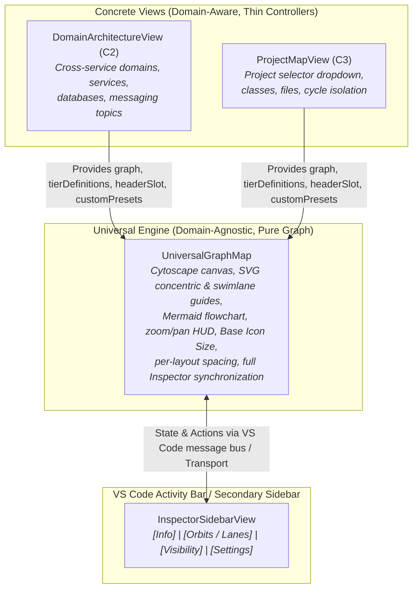

# Proposal: Universal Graph Map Engine & Declarative Inspector Architecture
## Eliminating Leaky Map Flags (`isProjectMap`) via Domain-Agnostic Component Composition

- **Document Version:** 1.0.0
- **Status:** Proposal
- **Target Subsystems:** `vscode-extension/src/webview/components/`, `vscode-extension/src/webview/layout/`, `vscode-extension/src/webview/domain/`, `.codeexplorer/gates/architectural/`

---

## 1. Executive Summary & Root Cause Analysis

### 1.1. What Happened in Version 1.66.1 (`f505348b`)
In version `1.65.11`, `ProjectMapView.tsx` (194 lines) was unified with `DomainArchitectureView.tsx` via a shared component `<BaseGraphMap />`, which allowed both views to share:
- The 4-tab unified VS Code Sidebar Inspector (`InspectorSidebarView`: `Info`, `Orbits` / `Lanes`, `Visibility`, `Settings`).
- Interactive layout algorithms (`Default / Concentric`, `Swimlanes` with dynamic `Lanes` tab, real interactive `Mermaid`, and `Force`).
- Base Icon Size slider, per-layout spacing memory, and SVG overlay headers.

However, in commit `f505348b` (`feat(architecture): stabilize project map and architecture view lifecycle with SIG gates`):
1. `<BaseGraphMap.tsx>` was deleted.
2. A new architectural gate was added: `.codeexplorer/gates/architectural/sig-p-b-010-view-abstraction-independence.yaml` (*"C2 / C3 Architecture View Independence: ProjectMapView must not delegate to, embed, or wrap DomainArchitectureView or BaseGraphMap"*).
3. `ProjectMapView.tsx` was rewritten into an isolated 1,200-line legacy component with its own Cytoscape instance, its own old HUD, and a right-docked inline element inspector (`.pm-inspector`), completely disconnecting it from `InspectorSidebarView` and forfeiting the new UI features.

### 1.2. The Root Cause: Leaky Boolean Flag Coupling (`isProjectMap`)
The regression was provoked by an architectural code smell in `DomainArchitectureView.tsx`:
- `DomainArchitectureView` contained hardcoded `isProjectMap` branches:
  ```typescript
  // Anti-pattern in DomainArchitectureView.tsx and swimlanesLayout.ts:
  isProjectMap ? PROJECT_MAP_LANE_DEFINITIONS : LANE_DEFINITIONS
  isProjectMap ? DEFAULT_PROJECT_MAP_ORBIT_CONFIG : DEFAULT_ORBIT_CONFIG
  ```
- Because `DomainArchitectureView` was conceptually the **C2 Cross-Service Domain View**, having `ProjectMapView` (the **C3 Project Map**) call `DomainArchitectureView` with `isProjectMap={true}` created an inverted dependency where C3 depended on C2, and C2 had specialized C3 branches hardcoded inside it.

---

## 2. Target Architecture: Domain-Agnostic Composition (Option 2)

Rather than class/form inheritance (which does not work with modern React hooks) or having C3 wrap C2 with boolean flags, we introduce a **domain-agnostic graph map component (`<UniversalGraphMap />`)**.

Both `DomainArchitectureView` (C2) and `ProjectMapView` (C3) are equal, sibling consumers of `<UniversalGraphMap />`:



### Key Principles of `<UniversalGraphMap />`:
1. **Zero Domain Knowledge:** Does not know what a "microservice", "Kafka topic", "project", or "dependency cycle" is.
2. **Zero `isProjectMap` Flags:** All tier names, icons, colors, presets, and header controls are passed declaratively via metadata and props.
3. **Architectural Independence (SIG-P-B-010 Compliant):** Neither C2 depends on C3, nor C3 depends on C2. Both depend strictly on the neutral `<UniversalGraphMap />`.

---

## 3. Component Specification & Props Contract

### 3.1. `<UniversalGraphMapProps>`

```typescript
export interface TierDefinition {
  tier: number;
  title: string;
  icon?: string;
  color?: string;
  accentBg?: string;
}

export interface InspectorPresetDefinition {
  id: string;
  label: string;
  description: string;
  icon: string;
  isActive: boolean;
  onToggle: () => void;
  badge?: string | number;
}

export interface InspectorOverviewMetric {
  label: string;
  value: string | number;
  highlight?: boolean;
}

export interface InspectorOverviewModel {
  title: string;
  subtitle?: string;
  metrics: InspectorOverviewMetric[];
  actionBanner?: {
    text: string;
    actionLabel: string;
    isActive: boolean;
    onAction: () => void;
  };
}

export interface UniversalGraphMapProps {
  // Graph Data & Server Transport
  graph: GraphData | null;
  serverHttpUrl?: string;

  // Header & Title
  hudLabel: string;       // e.g. "C2 System Architecture" or "C3 Internal Structure"
  hudTitle: string;       // e.g. "Domain Architecture" or "Project Map: CodeExplorer.Core"
  headerControlsSlot?: React.ReactNode; // e.g. Project selector <select> or Domain dropdown

  // Tiers & Layout Configuration
  tierDefinitions?: TierDefinition[]; // Driven by graph.metadata.tiers or view defaults
  defaultOrbitConfig: OrbitConfig;
  allowedLayouts?: Array<{ id: DomainLayoutName; label: string }>;
  defaultLayoutName?: DomainLayoutName;
  defaultNodeSizingMode?: NodeSizingMode;
  defaultNodeContentMode?: NodeContentMode;

  // Local Storage Isolation
  storagePrefix: string;  // e.g. "ce_arch_v3_" vs "ce_pm_v3_" (isolated per-layout spacing & icon size)

  // Declarative Inspector Extension Slots
  inspectorOverviewSlot?: InspectorOverviewModel;     // Rendered in Info tab when no node is selected
  visibilityPresetsSlot?: InspectorPresetDefinition[]; // Additional toggle buttons rendered in Visibility tab

  // Event Callbacks
  onOpenFile?: (filePath: string, lineStart?: number) => void;
  onSelectNode?: (node: GraphNode | null) => void;
  onRefresh?: () => void;
}
```

---

## 4. Eliminating Leaky Map Flags

### 4.1. Metadata-Driven Tier Definitions
The backend ([`ProjectMapGraphMapper.cs`](../../cli/src/Core/CodeExplorer.Analysis/Analysis/ProjectMap/ProjectMapGraphMapper.cs#L84)) already generates a structured JSON array in `graph.metadata.tiers`:
```json
[
  { "tier": 0, "label": "EntryPoints & Endpoints", "description": "CLI commands, HTTP endpoints" },
  { "tier": 1, "label": "Classes — Orbit 1", "description": "Entry handlers and direct orchestrators" },
  { "tier": 2, "label": "Classes — Orbit 2", "description": "Application and domain services" },
  { "tier": 3, "label": "Classes — Orbit 3", "description": "Engine, repositories, and lower-level services" },
  { "tier": 4, "label": "Classes — Orbit 4+", "description": "Foundation classes, helpers, and utilities" },
  { "tier": 5, "label": "Transports, Buses & Libraries", "description": "Message buses and external services" },
  { "tier": 6, "label": "Databases & Storage", "description": "Databases, tables, procedures" }
]
```

### 4.2. Clean `swimlanesLayout.ts` Refactoring
Remove `isProjectMap?: boolean`, `PROJECT_MAP_LANE_DEFINITIONS`, and `PROJECT_MAP_SWIMLANE_TITLES` from `swimlanesLayout.ts`.
Replace with an optional `tierDefinitions?: TierDefinition[]` parameter:

```typescript
export function computeSwimlanesLayout(
  nodes: SwimlaneNodeInput[],
  edges: SwimlaneEdgeInput[],
  air: number = 1.2,
  tierDefinitions?: TierDefinition[],
  laneOrder?: number[],
  baseIconSize?: number
): SwimlanesLayoutResult
```
If `tierDefinitions` is provided, the layout assigns nodes to lanes matching `def.tier` and uses `def.title` directly. If omitted, it falls back to the standard 6 tiers.

---

## 5. View Implementation Profiles

### 5.1. `ProjectMapView.tsx` (Thin Controller ~160 lines)
```tsx
export const ProjectMapView: React.FC<ProjectMapViewProps> = ({
  serverHttpUrl,
  project,
  onProjectChange,
  onOpenFile,
}) => {
  // 1. Fetch project-map graph via webviewTransport
  // 2. Parse cycles, entrypoints, modules, resources
  // 3. Render <UniversalGraphMap /> passing:
  return (
    <UniversalGraphMap
      graph={filteredGraph}
      serverHttpUrl={serverHttpUrl}
      hudLabel="C3 Internal Structure"
      hudTitle={`Project Map${model.projectName ? `: ${model.projectName}` : ''}`}
      headerControlsSlot={<ProjectSelectDropdown ... />}
      tierDefinitions={parsedTiersFromMetadata}
      defaultOrbitConfig={DEFAULT_PROJECT_MAP_ORBIT_CONFIG}
      allowedLayouts={PROJECT_MAP_LAYOUTS}
      defaultLayoutName="concentric"
      storagePrefix="ce_pm_v3_"
      inspectorOverviewSlot={{
        title: model.projectName || 'Project Overview',
        subtitle: `${model.filesCount} source files`,
        metrics: [
          { label: 'EntryPoints', value: model.entryPointCount },
          { label: 'Classes', value: model.moduleCount },
          { label: 'Dependencies', value: model.depCount },
          { label: 'Resources', value: model.resourceCount },
        ],
        actionBanner: model.cycles.length > 0 ? {
          text: `⚠️ ${model.cycles.length} dependency cycle(s) detected`,
          actionLabel: cyclesOnly ? 'ISOLATING' : 'ISOLATE',
          isActive: cyclesOnly,
          onAction: () => setCyclesOnly(v => !v)
        } : undefined
      }}
      visibilityPresetsSlot={[
        { id: 'hideUtilities', label: 'Hide Utilities', icon: '🧰', isActive: hideUtilities, onToggle: ... },
        { id: 'hideResources', label: 'Hide Resources', icon: '🗄️', isActive: hideResources, onToggle: ... }
      ]}
      onOpenFile={onOpenFile}
      onRefresh={handleReload}
    />
  );
};
```

### 5.2. `DomainArchitectureView.tsx` (Thin Controller / C2 Adapter)
Renders `<UniversalGraphMap />` passing C2-specific presets (`Hide Workers`, `Hide Messaging`, `Domain Filters`) and default C2 orbit configuration.

---

## 6. Implementation & Verification Plan

| Phase | Description | Files Affected |
| :--- | :--- | :--- |
| **Phase 1** | Extract shared Cytoscape/Mermaid canvas and state management into `<UniversalGraphMap />`. Remove all `isProjectMap` branches from the canvas core. | `vscode-extension/src/webview/components/UniversalGraphMap.tsx` |
| **Phase 2** | Refactor `swimlanesLayout.ts` to accept generic `tierDefinitions?: TierDefinition[]`, deleting hardcoded `PROJECT_MAP_*` constants. | `vscode-extension/src/webview/layout/swimlanesLayout.ts` |
| **Phase 3** | Refactor `DomainArchitectureView.tsx` and `ProjectMapView.tsx` to mount `<UniversalGraphMap />` with their respective slots and configs. | `ProjectMapView.tsx`, `DomainArchitectureView.tsx` |
| **Phase 4** | Update or replace architectural gate `SIG-P-B-010` to require that both `ProjectMapView` and `DomainArchitectureView` use `<UniversalGraphMap />` without duplicating canvas code. | `.codeexplorer/gates/architectural/sig-p-b-010-view-abstraction-independence.yaml` |
| **Phase 5** | Run extension typecheck and unit tests (`npm run typecheck`, `npm run test`). Verify that `ProjectMapView` has the full 4-tab `InspectorSidebarView` (`Info`, `Orbits/Lanes`, `Visibility`, `Settings`), `Base Icon Size`, `Mermaid`, and `Swimlanes`. | `vscode-extension/` |

---

## 7. Expected Outcomes & Invariants

1. **Zero Code Duplication:** No duplicated Cytoscape initialization, wheel-zoom handlers, Mermaid renderers, or HUD positioning logic between C2 and C3.
2. **Unified User Experience:** Project Map immediately gains all past and future Inspector enhancements (`Base Icon Size`, dynamic `Lanes` tab, per-layout spacing persistence, Mermaid view).
3. **Clean Boundaries:** Clean unidirectional imports where both concrete views depend on the neutral `<UniversalGraphMap />`.
