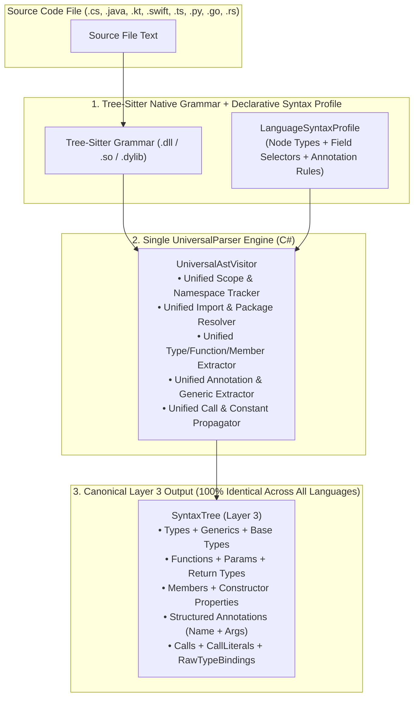

# UniversalParser Architecture Proposal 🌐
## Unifying Polyglot AST Extraction Under a Single Profile-Driven Tree-Sitter Engine

- **Document Version:** 1.0.0
- **Status:** Architecture Proposal
- **Target Audience:** Core Maintainers, Compiler Engineers, Systems Architects
- **Target Subsystems:** `CodeExplorer.Core.Parser`, `LanguageSyntaxProfile`, `BaseParserVisitor`, `CodeExplorer.Parser.*`

---

## 1. Problem Statement: Why Do We Still Have 10 Separate Parser Assemblies?

Today, CodeExplorer maintains 10 separate `CodeExplorer.Parser.<Language>` projects (`CSharp`, `Java`, `Kotlin`, `TypeScript`, `Python`, `Go`, `Rust`, `SQL`, `ColdFusion`, `Android`), each containing its own `IFileParser`, `BaseParserVisitor` subclass (`JavaFileVisitor`, `CSharpVisitor`, `RustVisitor`, etc.), and custom declaration/variable extractors.

### 1.1 The Hidden Duplication Across Language Visitors
An inspection of [`BaseParserVisitor.cs`](file:///c:/Work/Personal/code-explorer/cli/src/Core/CodeExplorer.Core/Parser/BaseParserVisitor.cs) and its language-specific subclasses (such as [`JavaFileVisitor.cs`](file:///c:/Work/Personal/code-explorer/cli/src/Parsers/CodeExplorer.Parser.Java/JavaFileVisitor.cs)) reveals that **90% of every language visitor does the exact same 6 structural operations on a Tree-sitter CST/AST**:

1. **Package / Namespace Detection:** Find the file-level `package_declaration` or `namespace_declaration` and record the scope prefix.
2. **Import Extraction:** Find `import_declaration` / `using_directive` / `use_declaration`, extract the imported path, and classify it as `Internal` vs. `External`.
3. **Symbol Declaration (`Type` & `Function`):** Match node types in [`LanguageSyntaxProfile`](file:///c:/Work/Personal/code-explorer/cli/src/Core/CodeExplorer.Core/Parser/LanguageSyntaxProfile.cs) (`ClassDeclarations`, `InterfaceDeclarations`, `MethodDeclarations`, `FunctionDeclarations`) and extract the symbol name from the `name` field or identifier child.
4. **Inheritance & Interfaces (`INHERITS_FROM` / `IMPLEMENTS`):** Walk `superclass` / `super_interfaces` / `base_list` / `type_inheritance_clause` and emit type references.
5. **Annotations / Attributes / Decorators (`ANNOTATED_WITH`):** Walk `modifiers` / `attribute_list` / `decorator` nodes and attach annotation names and key-value arguments to the symbol.
6. **Variables, Type Bindings & Call Graph (`CALLS` + `RawTypeBindings`):** Extract field/variable `(name, type, initializer)` bindings and extract `receiver.method` names from `call_expression` / `method_invocation` / `object_creation_expression`.

### 1.2 Consequences of Fragmented Language Visitors
* **Feature Drift Between Languages:** Improvements made to `CSharpParser` or `JavaParser` (such as annotation extraction, constant propagation, or constructor field binding) are missing in `KotlinFileParser` (which still uses regexes) or `PythonParser`.
* **Slow Onboarding of New Languages (e.g., Swift for iOS, Scala, C++, PHP, Dart):** Adding Swift support today requires creating a new C# project, writing a custom `SwiftFileVisitor`, and wiring custom AST traversal logic, even though Swift's Tree-sitter grammar has the exact same conceptual nodes (`class_declaration`, `protocol_declaration`, `function_declaration`, `call_expression`, `import_declaration`).

---

## 2. Target Architecture: The Single `UniversalParser` Engine

Combined with the [Semantic Archetypes & YAML Projections Proposal](file:///c:/Work/Personal/code-explorer/docs/proposals/semantic-archetypes-and-yaml-projections-proposal.md), we can collapse **all Layer 3 syntactic extraction** across all programming languages into a **single `UniversalFileParser` and `UniversalAstVisitor`** driven entirely by an enriched **`LanguageSyntaxProfile`**.



---

## 3. Enriching `LanguageSyntaxProfile` to Eliminate Subclasses

Currently, [`LanguageSyntaxProfile.cs`](file:///c:/Work/Personal/code-explorer/cli/src/Core/CodeExplorer.Core/Parser/LanguageSyntaxProfile.cs) only lists node type sets (`ClassDeclarations`, `Calls`, etc.), forcing subclasses to override `ExtractIdentifier`, `FindCallName`, `VisitImportStatement`, and `VisitVariableDeclaration`.

By adding **Field & Structural Descriptors** to `LanguageSyntaxProfile`, `UniversalAstVisitor` can execute all 6 extraction phases without a single language-specific C# subclass:

### 3.1 Proposed `LanguageSyntaxProfile` v2 Specification

```csharp
public class LanguageSyntaxProfile
{
    public required string LanguageId { get; init; } // "java", "kotlin", "swift", "csharp", ...
    public required FrozenSet<string> FileExtensions { get; init; } // [".kt", ".kts"]

    // 1. Top-Level Scope & Imports
    public FrozenSet<string> NamespaceDeclarations { get; init; } = FrozenSet<string>.Empty;
    public FrozenSet<string> Imports { get; init; } = FrozenSet<string>.Empty;
    public FrozenSet<string> StdLibImportPrefixes { get; init; } = FrozenSet<string>.Empty;
    public FrozenSet<string> SourceRootConventions { get; init; } = FrozenSet<string>.Empty; // e.g. ["src/main/kotlin", "src/main/java"]

    // 2. Symbol Declarations (Layer 3 Types & Functions)
    public FrozenSet<string> ClassDeclarations { get; init; } = FrozenSet<string>.Empty;
    public FrozenSet<string> InterfaceDeclarations { get; init; } = FrozenSet<string>.Empty;
    public FrozenSet<string> StructDeclarations { get; init; } = FrozenSet<string>.Empty;
    public FrozenSet<string> EnumDeclarations { get; init; } = FrozenSet<string>.Empty;
    public FrozenSet<string> MethodDeclarations { get; init; } = FrozenSet<string>.Empty;
    public FrozenSet<string> FunctionDeclarations { get; init; } = FrozenSet<string>.Empty;
    public FrozenSet<string> ConstructorDeclarations { get; init; } = FrozenSet<string>.Empty;

    // 3. Variables, Fields & Primary Constructor Properties (e.g. Kotlin/TypeScript/Scala)
    public FrozenSet<string> VariableDeclarations { get; init; } = FrozenSet<string>.Empty;
    public FrozenSet<string> VariableDeclarators { get; init; } = FrozenSet<string>.Empty;
    public FrozenSet<string> Parameters { get; init; } = FrozenSet<string>.Empty;
    public FrozenSet<string> PropertyParameters { get; init; } = FrozenSet<string>.Empty; // Kotlin class Foo(val bar: Bar)

    // 4. Annotations / Attributes / Decorators
    public FrozenSet<string> AnnotationNodes { get; init; } = FrozenSet<string>.Empty; // "annotation", "marker_annotation", "attribute", "decorator"
    public FrozenSet<string> ModifierContainers { get; init; } = FrozenSet<string>.Empty; // "modifiers", "attribute_list"

    // 5. Inheritance & Implementation
    public FrozenSet<string> SuperclassNodes { get; init; } = FrozenSet<string>.Empty;
    public FrozenSet<string> SuperInterfaceNodes { get; init; } = FrozenSet<string>.Empty;
    public FrozenSet<string> InheritanceClauses { get; init; } = FrozenSet<string>.Empty;

    // 6. Call Graph & Expressions
    public FrozenSet<string> Calls { get; init; } = FrozenSet<string>.Empty;
    public FrozenSet<string> ObjectCreations { get; init; } = FrozenSet<string>.Empty;
    public FrozenSet<string> StringLiterals { get; init; } = FrozenSet<string>.Empty;

    // 7. Universal Field Name Selectors (with automatic fallback chain)
    public FieldSelectorConfig Fields { get; init; } = FieldSelectorConfig.Default;
}

public class FieldSelectorConfig
{
    public static readonly FieldSelectorConfig Default = new();

    public string[] NameFields { get; init; } = ["name", "declarator", "identifier"];
    public string[] TypeFields { get; init; } = ["type", "return_type"];
    public string[] ValueFields { get; init; } = ["value", "initializer", "right"];
    public string[] CallObjectFields { get; init; } = ["object", "function", "receiver", "expression"];
    public string[] CallNameFields { get; init; } = ["name", "member", "field"];
    public string[] CallArgumentsFields { get; init; } = ["arguments", "argument_list", "value_arguments"];
}
```

---

## 4. How `UniversalAstVisitor` Handles All Languages Uniformly

With `LanguageSyntaxProfile` v2, the 5 previously abstract/overridden methods in `BaseParserVisitor` become concrete, deterministic algorithms in `UniversalAstVisitor`:

### 4.1 Universal Identifier Extraction
```csharp
protected override string? ExtractIdentifier(Node node)
{
    // 1. Try named grammar fields ("name", "identifier")
    foreach (var field in Profile.Fields.NameFields)
    {
        var fNode = node.GetField(field);
        if (fNode.IsValid())
        {
            var id = UnwrapIdentifier(fNode);
            if (!string.IsNullOrEmpty(id)) return id;
        }
    }

    // 2. Fallback: first direct Identifier or TypeIdentifier child
    foreach (var child in node.Children)
    {
        if (child.IsAny(TreeSitterSyntax.Common.Identifier,
                        TreeSitterSyntax.Common.TypeIdentifier,
                        "simple_identifier"))
        {
            return child.Text;
        }
    }
    return null;
}
```

### 4.2 Universal Call Name Extraction (`FindCallName`)
Across Java (`method_invocation`), C# (`invocation_expression`), Kotlin (`call_expression`), Swift (`call_expression`), Python (`call`), Go (`call_expression`), and TypeScript (`call_expression`), every call is either:
* **Direct Call:** `foo(a, b)`
* **Member Call:** `receiver.foo(a, b)` (`member_expression` / `navigation_expression` / `field_access`)
* **Constructor Call:** `new Foo(a, b)` or `Foo(a, b)`

`UniversalAstVisitor.FindCallName` handles all three patterns uniformly by inspecting `Profile.ObjectCreations`, `Profile.Fields.CallObjectFields`, and `Profile.MemberAccessExpressions`.

### 4.3 Universal Annotation & Attribute Extraction
Whether it is Java/Kotlin `@Entity(name = "users")`, C# `[ServiceContract(Namespace = "...")]`, Python `@app.route("/pay")`, TypeScript `@Controller("/api")`, or Swift `@MainActor`, `UniversalAstVisitor` extracts a structured `SyntacticAnnotation`:
* **`Name`**: `"Entity"`, `"ServiceContract"`, `"Controller"`
* **`PositionalArgs`**: `["/api"]`
* **`NamedArgs`**: `{ "name": "users" }`
* Emits `(symbol)-[:ANNOTATED_WITH]->(annotation)` and stores structured arguments on the symbol for downstream YAML Layer 4 projection rules!

### 4.4 Universal Constructor Property & Field Binding (Solving Kotlin, TypeScript & Lombok)
* **Kotlin / TypeScript Primary Constructors:** In Kotlin (`class OrderService(private val repo: OrderRepository)`) and TypeScript (`constructor(private readonly repo: OrderRepository)`), constructor parameters with `val`/`var`/`private`/`public`/`readonly` modifiers are simultaneously **class fields** and **constructor dependencies**.
* `UniversalAstVisitor` automatically registers any parameter in `ConstructorDeclarations` or `PrimaryConstructor` as a `RawTypeBinding` on the enclosing `Class`, enabling 100% accurate DI call graph resolution (`repo.save()` $\rightarrow$ `OrderRepository.save()`) across Kotlin, Java, C#, and TypeScript!
* **Lombok Support in Java (`@RequiredArgsConstructor`, `@Data`, `@Getter`):** When a Java class has fields of type `OrderRepository`, `RawTypeBindings` already maps `repo -> OrderRepository` at class scope, and `UniversalAstVisitor` synthesizes virtual getter/setter resolution for `@Data`/`@Getter` classes.

---

## 5. Concrete Proof: Adding Kotlin & iOS Swift in ~35 Lines Each

With `UniversalParser`, upgrading Kotlin from regexes to full AST analysis and adding brand-new iOS Swift support requires **zero new Visitor logic**—only profile definitions:

### 5.1 Kotlin Profile (`KotlinSyntaxProfile.cs` or `kotlin.grammar.yaml`)
```yaml
language_id: kotlin
extensions: [".kt", ".kts"]
namespace_declarations: ["package_header"]
imports: ["import_header"]
class_declarations: ["class_declaration", "object_declaration"]
interface_declarations: [] # Differentiated via 'interface' keyword token in class_declaration
method_declarations: ["function_declaration"]
constructor_declarations: ["primary_constructor", "secondary_constructor"]
variable_declarations: ["property_declaration"]
parameters: ["parameter", "class_parameter"]
annotation_nodes: ["annotation", "single_annotation", "unescaped_annotation"]
modifier_containers: ["modifiers"]
inheritance_clauses: ["delegation_specifiers", "delegation_specifier"]
calls: ["call_expression"]
member_access_expressions: ["navigation_expression"]
string_literals: ["string_literal", "line_string_literal", "multi_line_string_literal"]
```

### 5.2 iOS Swift Profile (`SwiftSyntaxProfile.cs` or `swift.grammar.yaml`)
```yaml
language_id: swift
extensions: [".swift"]
imports: ["import_declaration"]
class_declarations: ["class_declaration"] # Covers class, struct, enum, actor, extension in tree-sitter-swift
interface_declarations: ["protocol_declaration"]
method_declarations: ["function_declaration", "init_declaration"]
variable_declarations: ["property_declaration"]
parameters: ["parameter"]
annotation_nodes: ["attribute"]
modifier_containers: ["modifiers"]
inheritance_clauses: ["inheritance_specifier", "type_inheritance_clause"]
calls: ["call_expression"]
member_access_expressions: ["navigation_expression"]
string_literals: ["line_string_literal", "multi_line_string_literal"]
```

---

## 6. Architectural Synergy: How All 3 Proposals Fit Together

Together, the three proposals in `docs/proposals/` form a complete, closed-loop architecture for CodeExplorer:

| Layer / Stage | Engine | Responsibility | Extensibility Cost |
| :--- | :--- | :--- | :--- |
| **1. Layer 1–3 Extraction** | **`UniversalParser`** ([universal-parser-proposal.md](file:///c:/Work/Personal/code-explorer/docs/proposals/universal-parser-proposal.md)) | Parses any language into a uniform AST graph (`Type`, `Function`, `Member`, `Annotation`, `CALLS`, `ConfigEntry`). | **~35 lines** of `LanguageSyntaxProfile` per new language. |
| **2. Layer 4 Projection** | **`YAML Projection Engine`** ([semantic-archetypes-and-yaml-projections-proposal.md](file:///c:/Work/Personal/code-explorer/docs/proposals/semantic-archetypes-and-yaml-projections-proposal.md)) | Projects Layer 1–3 nodes into the **5 Universal Semantic Archetypes** (`Host`, `EntryPoint`, `ExternalService`, `Topic`, `DataStore`). | **~20 lines** of YAML per new library/framework (WCF, Spring, DBOS, MassTransit). |
| **3. Provenance & Trust** | **`Universal Evidence Engine`** ([universal-edge-and-node-evidence-proposal.md](file:///c:/Work/Personal/code-explorer/docs/proposals/universal-edge-and-node-evidence-proposal.md)) | Automatically links every Layer 4 node & arrow back to its originating Layer 1/3 symbol, file, and line (`EVIDENCED_BY`). | **0 lines** (automatic byproduct of Layer 3 $\rightarrow$ Layer 4 projection). |
| **4. Governance & CI** | **`Semantic Invariant Gates`** ([semantic-invariant-gates-proposal.md](file:///c:/Work/Personal/code-explorer/docs/proposals/semantic-invariant-gates-proposal.md)) | Enforces architectural boundaries in CI/CD (`< 2s`) with Ratchet Baselines. | Preset packs or AI-generated Cypher queries. |
