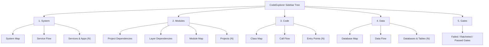
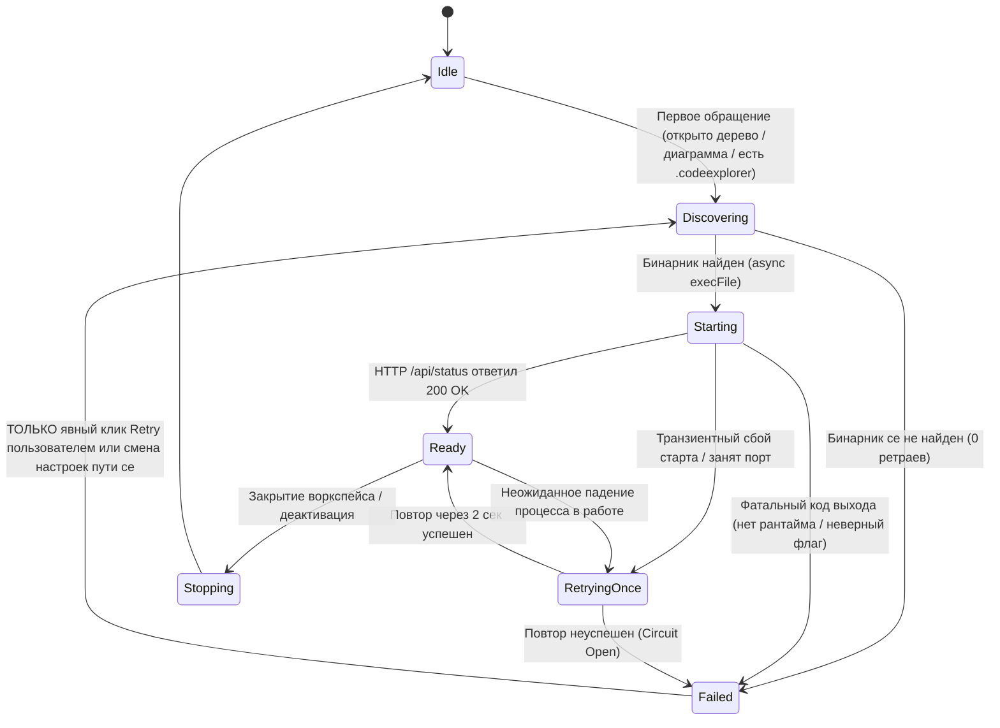
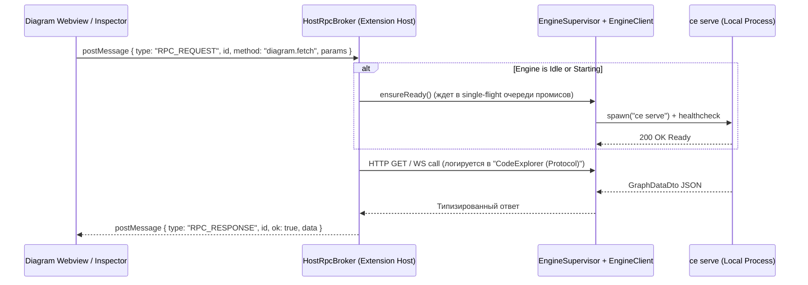
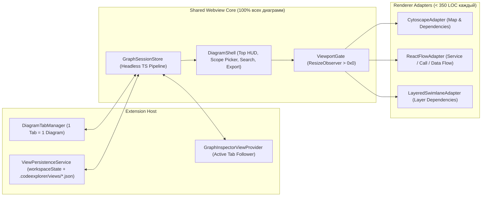

# Proposal: Архитектура v2 VS Code расширения CodeExplorer
## Единое ядро диаграмм (`GraphSessionStore`), адаптеры рендеринга, дерево `System · Modules · Code · Data · Gates` и отказоустойчивый `EngineSupervisor`

- **Document Version:** 1.0.0
- **Date:** 2026-11-11
- **Status:** Proposed
- **Supersedes:** [`universal-graph-map-and-inspector-unification-proposal.md`](./universal-graph-map-and-inspector-unification-proposal.md)
- **Target Subsystems:** `vscode-extension/src/`, `cli/src/Core/CodeExplorer.Analysis/`, `cli/src/Server/CodeExplorer.Server/`, `.codeexplorer/gates/`

---

> [!IMPORTANT]
> **Ключевой принцип реализации:** работа разбита на **4 атомарные, полностью собираемые фазы**. После каждой фазы обязательны зеленые сборки C# и TypeScript, прохождение unit-тестов и строгий контроль инвариантов `ce scan && ce gate check` (`Failed: 0`). Новые модули проектируются компактными (`< 350` строк на файл), чтобы исключить появление новых монолитов уровня `DomainArchitectureView.tsx` (`6,242` строки).

---

## 1. Диагноз текущих проблем (Root Causes)

| Область | Симптом у пользователя | Точная причина в текущем коде |
| :--- | :--- | :--- |
| **1. Дерево и диаграммы** | Непонятные названия (`Landscape`, `DSM`, сырые `Ontology Layers 1–5`), пустые/шумные домены, мусорный раздел `Management` в дереве | [`codeExplorerTreeProvider.ts`](../../vscode-extension/src/codeExplorerTreeProvider.ts) смешивает пользовательские задачи с внутренностями движка; [`App.tsx`](../../vscode-extension/src/webview/App.tsx) содержит `12` разрозненных `viewMode`, а названия в UI расходятся с уровнями C1/C2/C3 в [`ArchitectureViewEngine.cs`](../../cli/src/Core/CodeExplorer.Analysis/Analysis/Services/ArchitectureViewEngine.cs). |
| **2. Архитектура View и Inspector** | В `Project Map` ломаются группировки и навсегда пропадают скрытые типы в Inspector; в `Flow` и `Tiers` Inspector вообще не работает | В коде сосуществуют **3 поколения View**: старый `<Toolbar>` + встроенный `<aside className="drawer">`, отдельный [`BoundedContextMapView.tsx`](../../vscode-extension/src/webview/components/BoundedContextMapView.tsx) и два разошедшихся гиганта — [`DomainArchitectureView.tsx`](../../vscode-extension/src/webview/components/DomainArchitectureView.tsx) и его copy-paste форк [`UniversalGraphMap.tsx`](../../vscode-extension/src/webview/components/UniversalGraphMap.tsx), который вырезает скрытые узлы **до** [`computeGroupedGraph`](../../vscode-extension/src/webview/domain/nodeGrouping.ts) и отправляет урезанный словарь в [`InspectorSidebarView.tsx`](../../vscode-extension/src/webview/components/InspectorSidebarView.tsx). |
| **3. Запуск `ce` и спам логами** | Фризы VS Code при старте и бесконечная бомбардировка логами каждые ~1.5 сек, если `ce` не смог запуститься | 1) Синхронные вызовы `cp.spawnSync` в [`discovery.ts`](../../vscode-extension/src/engine/discovery.ts) и [`processManager.ts`](../../vscode-extension/src/processManager.ts) блокируют главный поток Extension Host.<br>2) Каждая вкладка открывает свой прямой `WebSocket` в [`webviewTransport.ts`](../../vscode-extension/src/webview/services/webviewTransport.ts), шлет по 4 сигнала реконнекта каждые `1.5 с`, а [`serverTransport.ts`](../../vscode-extension/src/serverTransport.ts) при каждом вызове `verifyHealthyConnection` **сбрасывает `_restartTimestamps = []`**, полностью отключая Circuit Breaker. |
| **4. Потеря графа при переключении** | Переход между диаграммами или вкладками приводит к пустому холсту или сбросу режима | 1) [`UniversalGraphMap.tsx`](../../vscode-extension/src/webview/components/UniversalGraphMap.tsx) вызывает `cy.layout({ fit: true }).run()` на скрытом контейнере `0×0 px`, уводя zoom/pan в `NaN` / бесконечность.<br>2) [`webviewTransport.ts`](../../vscode-extension/src/webview/services/webviewTransport.ts) молча отбрасывает запросы (`return false`), пока сокет в статусе `CONNECTING`.<br>3) [`GraphPanel`](../../vscode-extension/src/graphPanel.ts) привязан к `initialViewMode`, и любой приход `SERVER_CONFIG` принудительно сбрасывает переключенный `viewMode` внутри вкладки. |

---

## 2. Новая структура дерева и каталог диаграмм

### 2.1. Верхний уровень дерева: `System · Modules · Code · Data · Gates`

Дерево строится по понятной шкале масштаба + отдельная ось данных + контроль архитектурных инвариантов. Внутри каждого из первых четырех разделов используется **гибридная структура**: сначала идут **2–3 детерминированные диаграммы**, а под ними — компактная свернутая папка **найденных сущностей этого уровня** для мгновенного открытия диаграммы в нужном фокусе (`Scope`).



> [!NOTE]
> **Единый словарь терминов:** из названий полностью убираются разнородные термины (`Landscape`, `Topology`, `DSM`, `Domain Contexts`, `Ontology Layers`). Остаются ровно **3 прозрачных архетипа**:
> - **`Map`** — структурная карта сущностей уровня и связей между ними;
> - **`Dependencies`** — направленные сборочные или слоевые зависимости (циклы, пробои правил, blast radius);
> - **`Flow`** — направленный поток выполнения запросов или чтения/записи данных в рантайме.

### 2.2. Полная спецификация 9 детерминированных диаграмм

Все 9 диаграмм на 100% опираются на статический анализ AST / проектов / SQL без зависимости от локальных LLM. Код матрицы и `Bounded Contexts / Domains` **не удаляется**, а паркуется в `src/webview/experimental/` (скрыт из дерева и UI до отдельной переработки).

| Раздел | ID диаграммы | Название в UI | Основная роль | Назначение и ценность для пользователя | Базовый Scope | Рендерер (`Adapter`) | Серверная проекция |
| :--- | :--- | :--- | :--- | :--- | :--- | :--- | :--- |
| **System** | `system-map` | **System Map** | System / Solution Architect | Контур всей системы за 30 сек: исполняемые сервисы, воркеры, внешние API, брокеры и БД. | Весь воркспейс *(опц. фокус на Service)* | `CytoscapeAdapter` | `ArchitectureViewType.SystemContext` |
| **System** | `service-flow` | **Service Flow** | System Architect / Backend Lead | Как сервисы общаются в рантайме (`HTTP`, `gRPC`, очереди/события) и какие контракты связывают контур. | Весь воркспейс или выбранный `Service` | `ReactFlowAdapter` | `ArchitectureViewType.ServiceFlow` |
| **Modules** | `project-dependencies` | **Project Dependencies** | Tech Lead / Архитектор | Граф зависимостей всех проектов и пакетов (`.csproj`, `package.json`, `go.mod`, Python), поиск циклов сборки и оценка blast radius. | Весь воркспейс *(опц. фокус на Project)* | `CytoscapeAdapter` | **Новая** `ArchitectureViewType.ProjectDependencies` |
| **Modules** | `layer-dependencies` | **Layer Dependencies** | Tech Lead / Reviewer | Распределение проектов по слоям (`UI/Ingress → Application → Domain → Infrastructure → Tests`) и подсветка нарушений направленности слоев. | Весь воркспейс или `Service` | `LayeredSwimlaneAdapter` | `ArchitectureViewType.Tiers` |
| **Modules** | `module-map` | **Module Map** | Tech Lead / Senior Dev | Внутренняя структура папок и подмодулей внутри выбранного проекта/монолита с поднятыми вызовами и внутренними циклами. | Выбранный `Project` *(автовыбор если 1 проект)* | `CytoscapeAdapter` | `ArchitectureViewType.ProjectMap` |
| **Code** | `class-map` | **Class Map** | Разработчик | Карта классов, интерфейсов, наследования и DI-зависимостей внутри выбранного проекта или `namespace`. | Выбранный `Project` / `Namespace` | `CytoscapeAdapter` | `ArchitectureViewType.Component` |
| **Code** | `call-flow` | **Call Flow** | Разработчик | Пошаговая трасса вызовов методов от точки входа (`HTTP/gRPC Endpoint`, `Consumer`, `CLI`, метод) до БД или внешнего клиента. | Выбранный `Entry Point` или символ | `ReactFlowAdapter` | **Новая** `ArchitectureViewType.CallFlow` *(поверх `CallChainAnalyzer`)* |
| **Data** | `database-map` | **Database Map** | Архитектор / DBA / Backend | Карта «Сервисы и Проекты ↔ Базы данных, схемы и топики» с мгновенной подсветкой общих БД (`Shared DB`). | Весь воркспейс *(пресет `Shared DBs Only`)* | `CytoscapeAdapter` | **Новая** `ArchitectureViewType.DatabaseMap` |
| **Data** | `data-flow` | **Data Flow** | Разработчик / DBA / Архитектор | Поток чтения и записи конкретных таблиц (`Writers → Table / View / Topic → Readers`) до ORM-сущностей, репозиториев и SQL-запросов. | Выбранная `Table` / `Database` *(или все таблицы БД)* | `ReactFlowAdapter` | **Новая** `ArchitectureViewType.DataFlow` *(поверх `DataLineageAnalyzer`)* |

### 2.3. Вынос технического `Management` из дерева
- Раздел `Management` и сырые `Graph Layers (Ontology 1 - 5)` полностью убираются из дерева.
- Статус движка (`Idle`, `Starting`, `Ready · 42 projects`, `Scanning 65%`, `Failed`) переезжает в постоянный элемент **VS Code Status Bar** (`CodeExplorerStatusBar`).
- Быстрые действия (`Rescan Workspace`, `Open Launch / Protocol Logs`, `Workspace Settings`) выносятся в иконки заголовка дерева (`view/title`) и меню Status Bar.

---

## 3. Архитектура запуска `ce` и единого RPC-брокера (Пункт №3)

### 3.1. Конечный автомат `EngineSupervisor` и отказ от `spawnSync`

Весь жизненный цикл бинарника `ce` инкапсулируется в `EngineSupervisor` на базе детерминированного конечного автомата:



**Жесткие гарантии:**
1. **Ноль `spawnSync` во всем коде расширения:** [`discovery.ts`](../../vscode-extension/src/engine/discovery.ts) и остановка процесса в [`processManager.ts`](../../vscode-extension/src/processManager.ts) переписываются на неблокирующий `execFile` / `spawn` с кэшированием результата обнаружения бинарника на время сессии (и актуализацией диагностики рантайма под `.NET 11`).
2. **Ленивый запуск по требованию:** `ce serve` стартует только когда пользователь открыл панель/диаграмму CodeExplorer или в воркспейсе уже присутствует индекс `.codeexplorer/graph.db`.
3. **Абсолютная тишина в состоянии `Failed`:** никаких фоновых таймеров, пингов или автоперезапусков каждые `1.5 с`. В канал `CodeExplorer` пишется ровно **один** структурированный диагностический блок, а UI в Status Bar / дереве / пустом состоянии вкладки показывает понятную причину и кнопки **`Retry Start`** и **`Open Launch Logs`**.

### 3.2. Топология единого RPC-брокера (`Single-Broker Host Transport`)

Webview больше **никогда** не открывает прямые `WebSocket` или `fetch('http://127.0.0.1:...')` к серверу `ce`:



**Что это решает сразу:**
- **Никаких потерянных запросов при старте или переключении вкладок:** если при старте VS Code восстанавливаются 3 вкладки диаграмм, их `RPC_REQUEST` спокойно дожидаются резолва промиса `ensureReady()` и гарантированно получают данные.
- **Идеальное разделение логов:**
  - `OutputChannel("CodeExplorer")` — исключительно поиск бинарника, аргументы запуска `ce serve`, `stdout`/`stderr` процесса и коды выхода.
  - `OutputChannel("CodeExplorer (Protocol)")` — исключительно RPC/HTTP/WS команды, параметры, время ответа (`ms`) и размер ответа.
- **Полная совместимость с WSL / Remote-SSH / Dev Containers** без проброса портов в браузерный контекст Webview.

---

## 4. Единое ядро View, Адаптеры и Inspector (Пункты №2 и №4)

### 4.1. Гексагональная архитектура View (`Ports & Adapters`)

Вместо монолитных компонентов, совмещающих загрузку, фильтрацию, группировку, рендеринг и инспектор, вводится строгое разделение на **общее ядро сессии** и **тонкие визуальные адаптеры**:



### 4.2. Неизменяемый 5-шаговый конвейер `GraphSessionStore`

Каждая из 9 диаграмм работает поверх одного и того же класса `GraphSessionStore` (чистый TypeScript без привязки к DOM/Cytoscape/ReactFlow, на 100% покрытый быстрыми unit-тестами):

1. **`Stage 1: FullCatalogIndex`** — строит полный неизменяемый индекс `allNodesById`, `allEdgesById`, `entityTypeCounts` по сырому `GraphDataDto` от сервера. **Никогда не урезается фильтрами**, поэтому `Inspector` всегда знает полный список существующих типов сущностей и точное число скрытых узлов (баг из `Project Map` становится структурно невозможен).
2. **`Stage 2: PresetFilter`** — применяет декларативные переключатели конкретной диаграммы (`Cycles Only`, `Shared DBs Only`, `Include External Libraries`, `Include Tests`), помечая причину фильтрации каждого узла.
3. **`Stage 3: VisibilityFilter`** — применяет `hiddenEntityTypes`, `hiddenNodeIds` и `focusedNeighborhood` (подсветка/изоляция blast radius на `N` шагов).
4. **`Stage 4: GroupingAndBundling`** — единый модуль группировки (автогруппировка по `Service` / `Project` / `Layer` / `Namespace` / `Database` + пользовательские группы из Inspector) с обязательным агрегированием метрик (`inboundCount`, `outboundCount`, `cycleCount`, `dbCount`) и склейкой параллельных ребер (`bundledEdges`).
5. **`Stage 5: RenderProjection & InspectorSnapshot`** — формирует два синхронных слепка:
   - `RenderProjection` — чистый список видимых узлов, compound-групп и агрегированных ребер для выбранного `DiagramCanvasAdapter`;
   - `InspectorSnapshot` — унифицированный контракт для `GraphInspectorViewProvider` (выделенный узел/ребро/группа, входящие/исходящие связи с переходом к коду, управление группами, видимость типов и счетчик скрытых элементов с кнопкой быстрого сброса).

### 4.3. Контракт `DiagramCanvasAdapter` и защита от `0×0` (`ViewportGate`)

Все визуальные движки реализуют единый интерфейс:

```ts
export interface DiagramCanvasProps {
  definition: DiagramDefinition;
  projection: RenderProjection;
  selection: SelectionState;
  savedViewport?: ViewportTransform;
  containerSize: { width: number; height: number }; // Гарантированно > 0 от ViewportGate
  onSelect: (selection: SelectionState) => void;
  onDrillDown: (target: DrillDownTarget) => void;
  onToggleGroupCollapse: (groupId: string) => void;
  onViewportChange: (viewport: ViewportTransform) => void;
}
```

**Как устраняется потеря графа при переключении вкладок (Пункт №4):**
1. **`1 вкладка = 1 диаграмма` (`DiagramTabManager`):** каждая открытая диаграмма (`diagramId + scopeKey`, например `project-dependencies:workspace` или `call-flow:OrdersController.Create`) живет в собственной нативной вкладке VS Code. Внутри вкладки `diagramId` **не подменяется** на другую диаграмму (переход на другую диаграмму по drill-down открывает или фокусирует соответствующую целевую вкладку).
2. **`ViewportGate` на `ResizeObserver`:** компонент-обертка измеряет реальный размер контейнера. Пока вкладка скрыта в фоне (`width === 0 || height === 0`), рендереры **не монтируют первичный `fit()` и не пересчитывают layout**, а откладывают операцию во флаг `pendingLayoutFit` до момента, когда вкладка станет видимой (`width > 0 && height > 0`).
3. **Автоматическое переключение `Inspector`:** `DiagramTabManager` слушает `panel.onDidChangeViewState` всех открытых вкладок и мгновенно переключает правую панель `Inspector` на `InspectorSnapshot` активной вкладки (поддерживая в том числе режим Split Editor с двумя графами рядом).
4. **Двухуровневое сохранение состояния (`ViewPersistenceService`):**
   - **Локальное автосохранение (0 шума в Git):** зум, позиция камеры, скрытые типы/узлы, активные пресеты и черновые группы с debounce `250 мс` сохраняются в `context.workspaceState` по ключу `viewState:<diagramId>:<scopeKey>` (переживает закрытие вкладки и перезапуск VS Code).
   - **Командное сохранение (`Save Shared View`):** по явному клику в шапке диаграммы или Inspector конфигурация групп, фильтров и закрепленных узлов сохраняется в `.codeexplorer/views/<diagramId>.json`, чтобы вся команда могла открыть тот же вид через Git.

---

## 5. Пофазовый план реализации

### Фаза 1: Надёжный запуск `ce`, `EngineSupervisor` и единый RPC-брокер
**Цель:** полностью ликвидировать фризы UI (`spawnSync`), бесконечный спам логами при сбое запуска `ce` и прямые сокеты из Webview.

- **`[NEW]`** `vscode-extension/src/engine/engineLifecycleFsm.ts` — чистый конечный автомат состояний (`Idle`, `Discovering`, `Starting`, `RetryingOnce`, `Ready`, `Failed`, `Stopping`) с жестким лимитом `<= 1` транзиентного повтора.
- **`[NEW]`** `vscode-extension/src/engine/engineSupervisor.ts` — асинхронный запуск/остановка `ce serve`, кэшированный поиск бинарника, разделение логов на `CodeExplorer` (процесс) и `CodeExplorer (Protocol)` (команды).
- **`[NEW]`** `vscode-extension/src/rpc/hostRpcBroker.ts` и `vscode-extension/src/webview/rpc/webviewRpcClient.ts` — типизированный `request/response` + подписки на события сканирования через `postMessage` с очередью ожидания во время `Starting`.
- **`[NEW]`** `vscode-extension/src/ui/statusBarController.ts` — индикация состояния движка в Status Bar с быстрыми действиями `Retry Start`, `Rescan`, `Open Logs`.
- **`[MODIFY]`** [`discovery.ts`](../../vscode-extension/src/engine/discovery.ts), [`processManager.ts`](../../vscode-extension/src/processManager.ts), [`serverTransport.ts`](../../vscode-extension/src/serverTransport.ts) — удаление всех вызовов `cp.spawnSync` и сброса `_restartTimestamps` из фоновых проверок, актуализация диагностики под `.NET 11`.
- **Проверка Фазы 1:** unit-тесты на FSM (фатальный выход = `0` ретраев; занятый порт = `1` ретрай → `Failed` и `0` таймеров; очередь из 5 параллельных RPC во время старта резолвится без потерь), `npm run typecheck`, `npm run test`, `ce gate check`.

---

### Фаза 2: Серверные проекции и безголовое ядро `GraphSessionStore`
**Цель:** подготовить все 9 детерминированных серверных источников данных и единое тестируемое ядро фильтрации, видимости, группировки и хранения состояния.

- **`[MODIFY]`** [`ArchitectureViewEngine.cs`](../../cli/src/Core/CodeExplorer.Analysis/Analysis/Services/ArchitectureViewEngine.cs) и новые partial-файлы `ArchitectureViewEngine.ProjectDependencies.cs`, `ArchitectureViewEngine.FlowsAndData.cs`:
  - добавление `ArchitectureViewType.ProjectDependencies` (полный граф проектов/пакетов воркспейса + детекция циклов SCC + опция внешних пакетов);
  - добавление `ArchitectureViewType.CallFlow` (адаптация `CallChainAnalyzer` в `GraphDataDto`);
  - добавление `ArchitectureViewType.DatabaseMap` и `ArchitectureViewType.DataFlow` (адаптация `DataLineageAnalyzer` в `GraphDataDto` + фильтр `SharedDatabasesOnly`).
- **`[MODIFY]`** [`ServerRouteBuilderExtensions.cs`](../../cli/src/Server/CodeExplorer.Server/ServerRouteBuilderExtensions.cs) — маршруты для новых `viewType` в `/api/view` + легковесные реестры сущностей для дерева (`/api/catalog/entrypoints`, `/api/catalog/databases`).
- **`[NEW]`** `vscode-extension/src/webview/core/graphSessionStore.ts` — 5-шаговый конвейер (`FullCatalogIndex → PresetFilter → VisibilityFilter → GroupingAndBundling → RenderProjection + InspectorSnapshot`).
- **`[NEW]`** `vscode-extension/src/webview/core/diagramRegistry.ts` — декларативные описания `DiagramDefinition` для всех 9 диаграмм.
- **`[NEW]`** `vscode-extension/src/persistence/viewPersistenceService.ts` — автосохранение в `workspaceState` + чтение/запись `.codeexplorer/views/<diagramId>.json`.
- **Проверка Фазы 2:** C# тесты в `CodeExplorer.Tests` на новые проекции + TypeScript тесты на `GraphSessionStore` (проверка инварианта: скрытие типа сущности никогда не удаляет карточку типа из `InspectorSnapshot`, а агрегация ребер группы всегда считает корректные `inbound/outbound` счетчики), `dotnet build -c Release`, `dotnet test`, `ce scan && ce gate check`.

---

### Фаза 3: `<DiagramShell>`, `ViewportGate`, адаптеры рендереров и единый `Inspector`
**Цель:** перевести отображение всех 9 диаграмм и `Inspector` на единую гексагональную оболочку с моделью `1 вкладка = 1 диаграмма`.

- **`[NEW]`** `vscode-extension/src/panels/diagramTabManager.ts` — реестр нативных вкладок по ключу `diagramId + scopeKey`, сериализация вкладок при перезапуске VS Code, автоматическая привязка активной вкладки к `GraphInspectorViewProvider`.
- **`[NEW]`** `vscode-extension/src/webview/shell/DiagramShell.tsx` и `ViewportGate.tsx` — единая верхняя панель (`ScopeSelector`, поиск по узлам, переключатели пресетов диаграммы, layout, экспорт `SVG/PNG/Mermaid`, `Save Shared View`) и строгий барьер `ResizeObserver` (`width > 0 && height > 0`).
- **`[NEW]`** Тонкие адаптеры рендеринга (`< 350` строк на модуль):
  - `vscode-extension/src/webview/adapters/cytoscape/` (`CytoscapeCanvasAdapter.tsx`, `canvasNodePainter.ts`, `cytoscapeLayouts.ts`) — для `System Map`, `Project Dependencies`, `Module Map`, `Class Map`, `Database Map`;
  - `vscode-extension/src/webview/adapters/flow/` (`ReactFlowCanvasAdapter.tsx`, `FlowNodeCard.tsx`, `flowLayout.ts`) — для `Service Flow`, `Call Flow`, `Data Flow`;
  - `vscode-extension/src/webview/adapters/swimlane/` (`LayeredSwimlaneAdapter.tsx`) — для `Layer Dependencies`.
- **`[MODIFY]`** [`InspectorSidebarView.tsx`](../../vscode-extension/src/webview/components/InspectorSidebarView.tsx) и [`DeclarativeInspector.tsx`](../../vscode-extension/src/webview/components/DeclarativeInspector.tsx) — перевод на единый `InspectorSnapshot` от любой из 9 диаграмм (карточка узла/ребра, навигация к исходному коду, создание/редактирование групп, управление видимостью типов и скрытых элементов).
- **Проверка Фазы 3:** проверка переключения между 5+ открытыми вкладками разного типа (Cytoscape ↔ ReactFlow ↔ Swimlane), проверка Split View двух диаграмм и автоматического переключения Inspector без потери данных и без `0×0` сброса зума; `npm run typecheck`, `npm run test`, `ce gate check` (включая проверку/обновление архитектурного гейта `SIG-P-B-010` под новую гексагональную схему адаптеров).

---

### Фаза 4: Новое гибридное дерево `System · Modules · Code · Data · Gates` и уборка техдолга
**Цель:** включить новую навигацию для пользователя, убрать дублирующийся legacy-код и припарковать экспериментальные модули.

- **`[MODIFY]`** [`codeExplorerTreeProvider.ts`](../../vscode-extension/src/codeExplorerTreeProvider.ts), [`codeExplorerTreeHelpers.ts`](../../vscode-extension/src/codeExplorerTreeHelpers.ts), [`package.json`](../../vscode-extension/package.json):
  - построение 5 корневых разделов `System · Modules · Code · Data · Gates`;
  - ленивая подгрузка папок сущностей (`Services`, `Projects`, `Entry Points`, `Databases & Tables`) с кликом для открытия профильной диаграммы в выбранном `scope`;
  - перенос действий `Rescan`, `Settings`, `Logs` в заголовок панели (`view/title`) и контекстные меню редактора/проводника (`Open Module Map`, `Open Class Map`, `Trace Call Flow`).
- **`[MOVE]`** Парковка кода `BoundedContextMapView.tsx` и матричного представления в `vscode-extension/src/webview/experimental/` (без экспорта в пользовательское дерево и меню, с сохранением компилируемости для будущей переделки).
- **`[DELETE]`** Удаление сломанного copy-paste дубликата [`UniversalGraphMap.tsx`](../../vscode-extension/src/webview/components/UniversalGraphMap.tsx), старого `webviewTransport.ts` с прямыми браузерными сокетами, устаревшего `<Toolbar>` и встроенного `<aside className="drawer">` из [`App.tsx`](../../vscode-extension/src/webview/App.tsx).
- **Проверка Фазы 4 (Финальный релизный гейт):**
  - `dotnet build cli/CodeExplorer.slnx -c Release` (`0 warnings, 0 errors`);
  - `dotnet test cli/tests/CodeExplorer.Tests/CodeExplorer.Tests.csproj` и `CodeExplorer.Cypher.Tests`;
  - `cd vscode-extension && npm run typecheck && npm run test`;
  - `ce scan && ce gate check` (**обязательно `Failed: 0`**).
