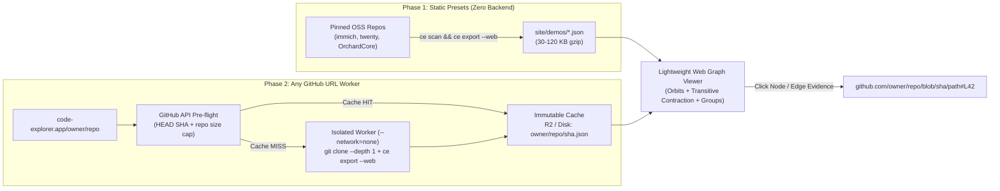

# Proposal: `WebGraphSnapshot` JSON Contract, Lightweight Web Graph Viewer & Public GitHub URL Explorer

**Status:** Proposed  
**Repository:** `code-explorer` (`CodeExplorer.Cli`, `vscode-extension/src/webview`, `site/`)  
**Related Proposals:** [`partial-layer-and-in-memory-scanning-proposal.md`](./partial-layer-and-in-memory-scanning-proposal.md), [`universal-graph-map-and-inspector-unification-proposal.md`](./universal-graph-map-and-inspector-unification-proposal.md), [`universal-edge-and-node-evidence-proposal.md`](./universal-edge-and-node-evidence-proposal.md)

---

## 1. Motivation & Problem Statement

Today, visitors on [`code-explorer.app`](https://code-explorer.app) can only inspect static PNG screenshots of the Architecture Cockpit until they install the VS Code extension or CLI locally. Meanwhile, embedding the full VS Code extension webview (`dist/webview.js`) directly into the website is unsuitable:

1. **Bundle & State Overhead:** The full VS Code webview bundle weighs `~6.1 MB` raw because it packages `mermaid`, `cytoscape`, `GateEditorView`, `SettingsView`, `NodeGridView`, and interactive IDE state machines that are irrelevant in a browser preview.
2. **Chatty Live-Server Coupling:** The IDE webview expects an active local `ce serve` daemon over WebSocket/REST (`ws://127.0.0.1:<port>/ws`) backed by a full SQLite `.codeexplorer/graph.db` containing up to `450,000+` Layer 1–3 AST nodes (e.g., `784 MB` on `twentyhq/twenty`).
3. **Viral Opportunity (`code-explorer.app/<owner>/<repo>`):** Developers love zero-install URL tools where replacing `github.com/owner/repo` with `code-explorer.app/owner/repo` renders a live architectural map. Unlike LLM-based diagram generators that cost `$0.10–$0.50` per repository, take 60+ seconds, and hallucinate edges, `ce` is a **deterministic native binary (`$0.00` token cost, `5–20 s` scan)** that links every edge to exact `file:line` evidence.

### Architectural Goal

Introduce a clean, strict boundary between **graph extraction** and **browser visualization**:

1. **Producer (`ce export --web`):** A CLI command that distills `.codeexplorer/graph.db` (or an in-memory scan) into a single, self-contained, compact JSON file (**`WebGraphSnapshot v1`**, target size `30–120 KB` gzipped even for 25k-file monorepos).
2. **Consumer (Lightweight Web Graph Viewer):** A stripped-down, read-only browser viewer (`<= 140 KB` gzipped) that consumes *only* `WebGraphSnapshot` JSON—supporting concentric orbits, **lightweight client-side orbit hiding with transitive contraction**, **domain/module group collapsing**, search, blast-radius focus, and click-to-GitHub-line navigation.
3. **Two-Phase Delivery:**
   - **Phase 1 (Zero-Backend Static Demo):** Serve pre-built `.json` snapshots (`immich`, `twenty`, `OrchardCore`) statically on `code-explorer.app/demo` with zero server load.
   - **Phase 2 (On-Demand GitHub URL Service):** Add a sandboxed background worker that clones any public `github.com/<owner>/<repo>`, runs `ce`, caches `<owner>/<repo>/<sha>.json` immutably on object storage/CDN, and feeds the exact same web viewer with zero frontend changes.

---

## 2. End-to-End Architecture



---

## 3. Producer Specification: `ce export --web`

### 3.1. CLI Interface

```bash
ce export --web \
  -d ./repos/immich \
  -o ./site/demos/immich.json \
  --repo-url https://github.com/immich-app/immich \
  --commit 2153d22f \
  --max-nodes 350
```

| Flag | Default | Description |
| :--- | :--- | :--- |
| `--web` | — | Selects the `WebGraphSnapshot v1` architectural projection format. |
| `-d, --directory` | `.` | Target workspace directory (uses `.codeexplorer/graph.db` if present, or runs in-memory scan). |
| `-o, --output` | `stdout` | Output `.json` file path. |
| `--repo-url` | Auto-detected from `.git/config` | Canonical GitHub/GitLab repository URL used to build click-to-source links. |
| `--commit` | Auto-detected `HEAD` short SHA | Commit SHA or branch ref used in source links and cache keys. |
| `--max-nodes` | `350` | Upper bound on exported architectural nodes; merges low-degree leaf tables/endpoints into parent summaries if exceeded. |

### 3.2. Architectural Projection & Pruning Rules

Raw `graph.db` stores Layer 1–5 entities (`File`, `Type`, `Function`, `Member`, `Literal`, etc.). `ce export --web` projects **only architectural-level nodes (Layers 2, 4, and 5)** and aggregates underlying Layer 3 call/query paths into edge weights + evidence samples:

1. **Included Node Kinds (Mapped to Concentric Orbits):**
   - `ingress` (Orbit 1 — Outer): HTTP/REST Controllers or route groups, GraphQL Resolvers, gRPC Services, CLI Entrypoints, Cron/Background Triggers.
   - `public_service` (Orbit 2): API-facing applications, gateways, BFFs, web/server modules.
   - `broker` (Orbit 3): Message queues, Kafka/PubSub/RabbitMQ/BullMQ topics (`Topic`).
   - `domain_service` (Orbit 4): Internal microservices, worker modules, bounded-context packages (`Project` / `Service`).
   - `database` (Orbit 5 — Inner): Databases and persisted ORM/SQL tables (`Database`, `Table`).
   - `external` (Peripheral): Outbound third-party HTTP/SDK integrations (`ExternalService`).
2. **Excluded Low-Level Nodes:** Individual `File`, `Function`, `Parameter`, `Literal`, and private `Type` nodes are **never** emitted as graph nodes. Instead, up to `5` representative `Caller -> Callee` or `Function -> Table` source locations are attached to `edge.samples[]`.
3. **Group Assignment (`groups[]`):**
   - Every node receives an optional `groupId` derived from `.codeexplorer/domains.json` (if present), top-level monorepo workspace/package boundaries (`packages/*`, `services/*`, `src/Modules/*`), or topological service clusters.

---

## 4. Canonical JSON Contract (`WebGraphSnapshot v1`)

The viewer accepts a single static JSON document matching this TypeScript interface:

```ts
export interface WebGraphSnapshotV1 {
  schemaVersion: 1;
  meta: {
    name: string;                  // e.g. "immich-app/immich"
    repoUrl?: string;              // e.g. "https://github.com/immich-app/immich"
    commit?: string;               // e.g. "2153d22f"
    generatedAt: string;           // ISO-8601 UTC
    languages: string[];           // e.g. ["TypeScript", "Python", "SQL"]
    stats: {
      files: number;
      projects: number;
      endpoints: number;
      topics: number;
      tables: number;
      totalGraphNodes: number;     // Raw nodes in full graph.db (for context badge)
      totalGraphEdges: number;     // Raw edges in full graph.db
    };
  };

  /** Ordered concentric rings from outer (0) to inner (N-1). */
  orbits: Array<{
    id: 'ingress' | 'public_service' | 'broker' | 'domain_service' | 'database' | 'external';
    label: string;                 // e.g. "Message Queues", "SQL Tables"
    ringIndex: number;             // 0 = outermost, 4 = center
    defaultVisible: boolean;
  }>;

  /** Domain or monorepo package clusters for 1-click grouping/collapsing. */
  groups: Array<{
    id: string;                    // e.g. "grp:server", "grp:microservices"
    label: string;                 // e.g. "immich-server", "Billing"
    kind: 'domain' | 'package' | 'service';
    colorIndex: number;            // Deterministic palette slot (0..7)
  }>;

  nodes: Array<{
    id: string;                    // Compact stable ID, e.g. "n14"
    name: string;                  // Display label, e.g. "AssetController", "webhook-queue", "asset"
    kind:
      | 'endpoint_group'
      | 'service'
      | 'worker'
      | 'library'
      | 'topic'
      | 'table'
      | 'database'
      | 'external_service';
    orbit: string;                 // References orbits[].id
    groupId?: string;              // References groups[].id
    path?: string;                 // Repo-relative forward-slash path ("server/src/controllers/asset.controller.ts")
    line?: number;                 // 1-based declaration line for GitHub #L anchor
    metrics?: {
      endpoints?: number;          // e.g. 14 routes inside an endpoint_group
      columns?: number;            // e.g. 22 columns on a table
      inDegree?: number;
      outDegree?: number;
    };
  }>;

  edges: Array<{
    id: string;
    source: string;                // References nodes[].id
    target: string;                // References nodes[].id
    kind:
      | 'exposes'
      | 'calls'
      | 'calls_http'
      | 'publishes'
      | 'subscribes'
      | 'reads'
      | 'writes'
      | 'depends_on';
    weight: number;                // Number of underlying call sites / queries aggregated into this edge
    samples?: Array<{
      label: string;               // e.g. "AssetService.uploadFile -> jobRepository.queue"
      path: string;                // Repo-relative file path
      line: number;                // 1-based line number
    }>;
  }>;
}
```

### Payload Size Estimate
- `250` nodes × `~140 B` = `35 KB` raw
- `450` edges (with 2–3 evidence samples each) × `~220 B` = `99 KB` raw
- **Total raw JSON:** `~135 KB` → **`~32–45 KB` over HTTP gzip/brotli** (loads in `< 30 ms`).

---

## 5. Consumer Specification: Lightweight Web Graph Viewer

### 5.1. Strict Scope & Bundle Budget

To keep the web viewer fast, maintainable, and visually aligned with `code-explorer.app` (`Console` dark graphite theme), it is built as a **dedicated entry point** (`vscode-extension/src/web-demo/index.tsx` compiled via `esbuild` to `site/assets/web-graph.js` + `web-graph.css`):

- **Shared from `vscode-extension/src/webview/`:**
  - Pure layout math: [`concentricLayout.ts`](../../vscode-extension/src/webview/layout/concentricLayout.ts) & [`concentricSectorsLayout.ts`](../../vscode-extension/src/webview/layout/concentricSectorsLayout.ts)
  - Entity icons & Console color tokens
  - `@xyflow/react` canvas (or lightweight SVG/Canvas viewport)
- **Strictly Excluded from Web Bundle:**
  - `mermaid` (`~3.5 MB`), `cytoscape`, `cytoscape-dagre`, `GateEditorView`, `SettingsView`, `NodeGridView`, `DeclarativeInspector`, `WebviewServerTransport` WebSocket client.
- **Target Bundle Size:** **`<= 140 KB` gzipped** total JS + CSS.

### 5.2. Lightweight Interactive Controls

The toolbar exposes only four high-signal controls:

1. **Orbit Filter Pills + Client-Side Transitive Contraction:**
   - Top bar renders toggle chips from `snapshot.orbits`:
     `[✓ Ingress API]  [✓ Services]  [✓ Queues]  [✓ Databases]  [✓ External]`
   - **Transitive Contraction Algorithm (Client-Side, `< 3 ms`):**
     When the user hides an orbit $H$ (for example, unchecking `Queues` or `Ingress API`), any path $u \to h_1 \to \dots \to h_k \to v$ where $u, v \notin H$ and all $h_i \in H$ (bounded to hop depth $\le 3$) is collapsed into a synthetic dashed edge $u \dashrightarrow v$ (`kind: 'contracted'`, tooltip: `"via webhook-queue"`), and concentric ring radii re-pack smoothly without empty gaps.

2. **Lightweight Group / Domain Collapsing:**
   - Toggle button: **`Group by Domain / Package`** (`Expanded` | `Clustered` | `Collapsed`):
     - *Expanded*: Individual nodes arranged in concentric orbits, subtly tinted/sectored by `groupId` (`concentricSectorsLayout`).
     - *Collapsed* (global or per-group click): All nodes belonging to `groupId` collapse into a single super-node (`[Billing · 6 services, 4 tables]`), aggregating inter-group edges and summing `weight` counts. Clicking a collapsed group expands just that group in-place.

3. **Search & 1-Click Blast-Radius Focus:**
   - Instant substring filter (`/` shortcut) over `node.name`.
   - Clicking any node dims unrelated nodes to `18%` opacity, highlights its `1-hop` (and optional `2-hop`) upstream callers and downstream queues/tables, and opens a compact **Evidence Card** on the right.

4. **Compact Evidence Card with Direct GitHub Links:**
   - Displays node `name`, `kind`, `group`, inbound edges (`Called by / Subscribed by / Read by`), outbound edges (`Calls / Publishes to / Writes to`), and `edge.samples[]`.
   - When `meta.repoUrl` and `meta.commit` are present, every node and edge sample renders a direct clickable link:
     `https://github.com/<owner>/<repo>/blob/<commit>/<path>#L<line>`.

### 5.3. Landing Page UX Guardrail (No Scroll Hijacking)

- If embedded inline on a scrollable page, wheel-zoom **must** require `Ctrl/Cmd + Wheel` (or clicking `"Interact with Graph"` first) so normal vertical page scrolling is never trapped inside the canvas.
- Primary recommended placement: a **`Live Interactive Demo`** button in the Hero / Cockpit bar on `site/index.html` opening full-viewport `/demo.html` (`100vw × 100dvh`), where pan/zoom, orbit toggles, and the GitHub evidence drawer have full screen real estate.

---

## 6. Phase 2 Architecture: Any Public GitHub URL (`code-explorer.app/<owner>/<repo>`)

Once `ce export --web` and the viewer ship in Phase 1, supporting arbitrary public GitHub repositories requires **zero changes to the frontend viewer**—only a small stateless backend service:

### 6.1. Request Flow

1. User visits `https://code-explorer.app/twentyhq/twenty` (or pastes `https://github.com/twentyhq/twenty` into `/demo`).
2. **Pre-Flight Check (`GET https://api.github.com/repos/<owner>/<repo>`):**
   - Verify repository exists, is public, and check `size` (e.g., reject repos `> 500 MB` git pack size such as `torvalds/linux` or `chromium` with a friendly message suggesting local `ce` CLI).
   - Resolve `default_branch` HEAD `commit_sha` (`8`-char prefix).
3. **Immutable Cache Lookup (`R2 / S3 / Local NVMe`):**
   - Key: `snapshots/v1/<owner>/<repo>/<commit_sha>.json.gz`.
   - **Cache HIT (`99%` of traffic on popular repos):** Return `200 OK` directly from CDN/nginx in `< 10 ms` with `Cache-Control: public, max-age=31536000, immutable`.
4. **Cache MISS (Bounded Worker Queue):**
   - Enqueue job `(owner, repo, commit_sha)` into a bounded single-host queue (concurrency `= 2`, max queue depth `= 25`, per-IP rate limit `= 5 scans / 10 min`, deduplicating concurrent requests for the same `owner/repo@sha`!).
   - Stream status to browser (`Cloning -> Scanning AST & Frameworks -> Building Snapshot`, or `"Position #2 in queue (~18s)"`).

### 6.2. Sandbox & Safety Constraints

Because `ce` performs static parsing only and **never executes repository code, build scripts, or package managers**, sandboxing is straightforward:

1. **Filtered Shallow Clone (Network Enabled, No Hooks):**
   ```bash
   git -c core.hooksPath=/dev/null clone \
     --depth 1 --single-branch \
     --filter=blob:limit=1m \
     https://github.com/<owner>/<repo>.git /tmp/job-<id>
   ```
   *(Skips binary/generated blobs `> 1 MB`, submodules, and git hooks; hard timeout `25 s`, max checkout size `300 MB` / `30,000` files.)*
2. **Offline Deterministic Scan (`--network=none`):**
   ```bash
   docker run --rm \
     --network=none \
     --cpus="2.0" --memory="3g" --pids-limit=128 \
     --read-only --tmpfs /tmp:rw,noexec,nosuid,size=1g \
     -v /tmp/job-<id>:/repo:ro \
     codeexplorer-worker:latest \
     ce export --web -d /repo --repo-url https://github.com/<owner>/<repo> --commit <sha> -o /tmp/out.json
   ```
   *(Leveraging [`WorkspaceIndexer.ScanInMemoryAsync`](./partial-layer-and-in-memory-scanning-proposal.md) avoids writing intermediate multi-hundred-MB SQLite databases to disk.)*
3. **Upload & Immediate Cleanup:**
   - Gzip `/tmp/out.json`, store under `snapshots/v1/<owner>/<repo>/<commit_sha>.json.gz`, and delete `/tmp/job-<id>` immediately in a `finally` block.

---

## 7. Implementation Milestones

| Milestone | Scope | Effort Estimate |
| :--- | :--- | :--- |
| **M1: `WebGraphSnapshot v1` & `ce export --web`** | Add `--web` exporter in `CodeExplorer.Cli` projecting L2/L4/L5 nodes, orbits, groups, and `edge.samples` from `graph.db`. Verify output size and visual quality on `immich`, `twenty`, and `code-explorer`. | `~0.5–1 day` |
| **M2: Lightweight Web Viewer + `/demo.html` (Phase 1)** | Build standalone `web-graph.js` (`<= 140 KB` gzip) reusing `concentricLayout`, orbit toggles + client-side transitive contraction, group collapsing, and GitHub `#L` links. Ship on `code-explorer.app/demo.html` with 3–5 pre-exported OSS repos. | `~1 day` |
| **M3: On-Demand GitHub URL Worker (Phase 2)** | Build lightweight queue API + Docker `--network=none` worker + immutable `<owner>/<repo>/<sha>.json.gz` cache, enabling `code-explorer.app/<owner>/<repo>` for any public GitHub repository. | `~1.5–2 days` |
