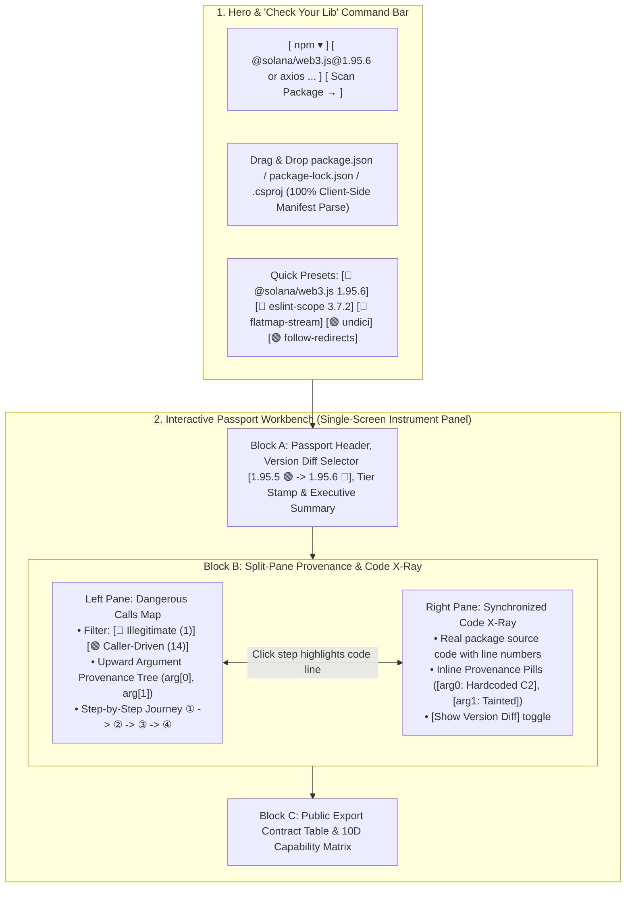

# Proposal: Expanding `code-explorer.app` with the Interactive CodePassport Workbench & "Check Your Lib" Scanner

- **Document Version:** 1.0.0
- **Status:** Draft / Product & Marketing Blueprint
- **Target Surface:** `https://code-explorer.app/passport` (and `https://passport.code-explorer.app`)
- **Design System:** Hallmark `Console: graphite` (`Host Grotesk` + `Atkinson Hyperlegible Mono`, OKLCH warm graphite surfaces, 1px rules)
- **Related Proposals:**
  - [`supply-chain-radar-and-capability-drift-proposal.md`](./supply-chain-radar-and-capability-drift-proposal.md)
  - [`code-passport-ontology-layers-refactoring-proposal.md`](./code-passport-ontology-layers-refactoring-proposal.md)
  - [`uast-completion-and-lightweight-flow-analysis-proposal.md`](./uast-completion-and-lightweight-flow-analysis-proposal.md)

---

## 1. Executive Summary & Strategic Rationale

### 1.1. Breaking the "Local Install" Barrier in Developer Marketing
Currently, `code-explorer.app` showcases **CodeExplorer (`ce`)** as an architectural intelligence engine, VS Code cockpit, and MCP server. While compelling, evaluating `ce` on a user's own project requires:
1. Downloading and installing the CLI or VS Code extension locally, and
2. Running the parser against a proprietary repository.

By contrast, open-source packages (`npm`, `NuGet`, `PyPI`, `Crates.io`, `Go`) are **100% public**. Expanding `code-explorer.app` with an interactive **CodePassport Workbench** and a **"Check Your Lib"** live scanner removes every adoption barrier:
- **Zero-Install "Aha!" Moment in 5 Seconds:** Visitors click through real-world supply-chain attacks (`@solana/web3.js@1.95.6`, `eslint-scope@3.7.2`, `flatmap-stream`, `Shai-Hulud 2.0`) or type the name of any public library they use daily and inspect its behavioral X-ray directly in the browser.
- **Zero Crash Risk on Private Code:** During the preview phase, parsing runs against public package tarballs in a controlled environment (or pre-computed JSON passports), eliminating the risk of a first-time visitor hitting an unhandled edge case on an exotic proprietary monorepo.
- **Direct Entry into Enterprise AppSec & CISO Budgets:** In regulated industries (banking, fintech, enterprise SaaS), security teams desperately need deterministic verification of third-party packages entering internal artifact registries (Nexus / Artifactory) *before* a CVE exists.

---

## 2. Core Positioning & Messaging Strategy

### 2.1. The Primary Value Proposition: "Zero-Noise Intent Verification"
Existing supply-chain scanners (Socket.dev, Snyk, `npm audit`) suffer from a fatal flaw:
- **CVE scanners are reactive** (blind for 3–14 days after a zero-day release).
- **Naive AST scanners drown developers in false positives** (flagging every `fetch()` in `axios` or `undici` and every `spawn()` in `esbuild` as "high risk").

**CodePassport's Unfair Advantage:** Instead of merely detecting that a package calls `fetch()` or `child_process.exec()`, CodePassport traces **upward argument provenance** from every dangerous call to its root origin, answering two questions:
1. **Who controls the target destination (`arg[0]`)?** Did the URL, file path, or shell command come from a **caller parameter** passed by the developer (`🟢 Caller-Driven`), or is it a **hardcoded / decoded internal constant** inside the library (`🟡/🔴 Autonomous`)?
2. **What data flows into the payload (`arg[1..N]`)?** Does the call transmit sensitive environment variables (`process.env.NPM_TOKEN`), local credentials (`~/.npmrc`, `~/.ssh`), or cryptographic keys (`secretKey`) (`🔴 Exfiltration`)?

### 2.2. Translating Compiler Terminology into Market-Ready Language
To maximize clarity for senior engineers, tech leads, and CISO/AppSec buyers, internal engine concepts are mapped to crisp product terminology on the website:

| Internal Engine Term | Website / Marketing Term | One-Sentence User Explanation |
| :--- | :--- | :--- |
| `BackwardProvenanceSlicer` | **Intent & Provenance Verification** | Traces every argument of a network, file, or process call upward to prove whether it is controlled by your code or hardcoded by an attacker. |
| `SinkInputProvenance.CallerParameter` | **`🟢 Caller-Driven (Legitimate)`** | The target URL, path, or command is passed in by the application calling the library (e.g., `axios.get(url)`). |
| `SinkInputProvenance.InternalConstant` | **`🟡 Autonomous Endpoint`** | The library connects to a hardcoded internal host or path without caller input (normal for vendor SDKs like `stripe`, fatal inside a crypto/utility function). |
| `SensitiveSourceTaint` / `DecodedConstant` | **`🔴 Critical Exfiltration / Backdoor`** | Secrets (`process.env`, `~/.ssh`, private keys) or Base64-obfuscated payloads flow into an outbound network or shell sink. |
| `DIST.SHADOW_CAPABILITY` | **Source-to-Bundle Parity (`src/` vs `dist/`)** | Detects hidden capabilities injected into compiled `.min.js` or `dist/` bundles that do not exist in the unminified `src/` tree. |
| `BehavioralTier (0..3)` | **Behavioral Tier Stamp (`Tier 0` – `Tier 3`)** | Instant 4-level classification from `Tier 0: Pure Computation (Zero I/O)` to `Tier 3: Privileged System/Build Tool`. |

### 2.3. Reputation-Safe 3-Level Verdict Gradation (Preventing False-Positive Backlash)
When users scan arbitrary packages via **"Check Your Lib"**, the UI must never falsely accuse a legitimate vendor SDK (e.g., `stripe` or `sentry` calling its own hardcoded API domain) of being "malware." We enforce a strict, factual 3-tier visual verdict:
1. **`🟢 SAFE (Caller-Driven or Pure)`**:
   - `Tier 0` / `Tier 1` packages, or `Tier 2` / `Tier 3` libraries where **100% of privileged calls trace back to caller parameters** (e.g., `undici`, `follow-redirects`, `axios`).
2. **`🟡 AUTONOMOUS CAPABILITIES (Review Endpoints)`**:
   - The package contains hardcoded target URLs, paths, or install hooks, **but zero secret taint flows, zero Base64/Hex evasion, and zero `src/ != dist/` shadow mismatches**. Displayed neutrally: *"Contains 2 autonomous endpoints (`api.stripe.com`) — verify these match the vendor's expected domain."*
3. **`🔴 CRITICAL SUPPLY-CHAIN RISK (Confirmed Anomaly)`**:
   - Triggered only on high-certainty indicators:
     - **Secret / Key Exfiltration** (`ENV.SECRET_READ` / `FS.SENSITIVE_PATH` / crypto key parameter flowing into `NET.*` or `PROC.*`),
     - **Shadow Bundle Tampering** (`DIST.SHADOW_CAPABILITY`: privileged calls in `.min.js`/`dist/` absent from `src/`),
     - **Obfuscated Dropper** (`DecodedConstant` via Base64/Hex/CharCode feeding `eval()`, `require()`, `spawn()`, or `fetch()`),
     - **Version Tier Jump / Pure Export Mutation** (a previously `Tier 0 Pure` package or pure function like `Keypair.fromSecretKey` suddenly acquiring `NET` or `PROC` capabilities in a patch release).

---

## 3. Website Information Architecture & Navigation

### 3.1. Top Slab Navigation Integration (`code-explorer.app`)
In [`site/index.html`](../../site/index.html), the top slab navigation (`slab-links`) is extended with a prominent **CodePassport** entry:
- `Architecture Cockpit` (`#cockpit`)
- `AI & MCP` (`#mcp`)
- `Invariant Gates` (`#gates`)
- **`CodePassport` (`/passport` — with a subtle `NEW` / `LIVE` mono chip)**
- `Benchmarks` (`#benchmarks`)
- `Presentation` (`/presentation.html`)

Additionally, a dedicated **Supply-Chain & Package Passport** band is added to the main landing page (`site/index.html`) featuring a mini "Check Your Lib" input box that routes directly into `/passport?pkg=<input>`.

### 3.2. URL Routing Structure
| URL Pattern | Purpose | Caching & SEO Strategy |
| :--- | :--- | :--- |
| `code-explorer.app/passport` | Main interactive CodePassport hub: **"Check Your Lib"** scanner bar, manifest dropzone, and curated interactive workbench. | Edge-cached static shell + dynamic JSON hydration. |
| `code-explorer.app/passport/<eco>/<pkg>/<ver>` | Permalink to a specific package release passport (e.g. `/passport/npm/@solana/web3.js/1.95.6`). | Immutable (`Cache-Control: public, max-age=31536000, immutable`), indexable by Google & shared on social/PRs. |
| `code-explorer.app/passport/diff/<eco>/<pkg>/<v1>...<v2>` | Differential behavioral drift report between two versions (`1.95.5...1.95.6`). | Immutable edge cache; ideal for Hacker News / LinkedIn incident post-mortems. |
| `code-explorer.app/passport/badge/<eco>/<pkg>.svg` | Dynamic SVG badge for open-source maintainers (`CodePassport | Tier 0 Pure 🟢`). | Cached 1h at Cloudflare edge; drives passive backlink traffic from GitHub READMEs. |

---

## 4. Detailed UI/UX Specification (`code-explorer.app/passport`)

The `/passport` page follows the exact **Hallmark `Console: graphite`** visual language established on `code-explorer.app`: warm graphite OKLCH surfaces (`15%` / `20%` / `12%`), `1px` structural hairlines, `Host Grotesk` display headers, and `Atkinson Hyperlegible Mono` (`tabular-nums`) for all call traces, metrics, and code views.



---

### 4.1. Section 1: The "Check Your Lib" Command Bar & Manifest Dropzone

At the top of the page, above the workbench, sits the interactive command bar with two input modes:

#### Mode A — Single Package or Version Diff Input
- **Ecosystem Selector:** `npm` (default), `NuGet`, `PyPI`, `Crates.io`, `Go`.
- **Omni-Input Field:** Accepts:
  - A package name (`axios`, `undici`, `lodash`) $\to$ resolves latest version and compares against previous release.
  - A pinned version (`@solana/web3.js@1.95.6`).
  - A version range (`@solana/web3.js@1.95.5...1.95.6`) $\to$ opens Differential Drift mode.
- **Live Terminal Progress Strip (shown during on-demand scans):**
  ```text
  [1/4] Fetching tarball @solana/web3.js@1.95.6 (142 KB)... ✓ 80ms
  [2/4] Parsing 18 files into Universal AST (src/ + dist/)... ✓ 110ms
  [3/4] Slicing upward provenance for 15 privileged sinks... ✓ 45ms
  [4/4] Computing diff against v1.95.5... ✓ Done (235ms)
  ```

#### Mode B — Drag & Drop Project Manifest (`package.json` / `package-lock.json` / `.csproj`)
- A compact dropzone right below the search bar: *"Or drop your `package.json`, `package-lock.json`, or `.csproj` to audit all project dependencies in 2 seconds (parsed locally in your browser — zero source code uploaded)."*
- Renders a **Dependency Risk Matrix** grouping all dependencies by Tier (`Tier 0 Pure` $\dots$ `Tier 3 System`) and highlighting any packages with `🟡 Autonomous` or `🔴 Critical` findings, with a 1-click drill-down into each package's full passport.

#### Curated Preset Pills ("Hall of Infamy" vs. "Zero False-Positive Benchmarks")
For visitors who want to explore immediately without typing, two groups of preset pills sit right under the input bar:
- **Real-World Supply-Chain Attacks:**
  - `🔴 @solana/web3.js@1.95.6` *(Secret Key Exfiltration via CloudFront Headers)*
  - `🔴 eslint-scope@3.7.2` *(Postinstall Pastebin Eval & `.npmrc` Stealer)*
  - `🔴 flatmap-stream@0.1.1` *(Shadow Capability in `.min.js` + AES Dropper)*
  - `🔴 lottie-player@2.0.5` *(Minified Bundle Web3 Wallet Drainer)*
  - `🔴 Shai-Hulud 2.0` *(Multi-Stage `preinstall` $\to$ `setup_bun.js` $\to$ `bun_environment.js`)*
- **Zero False-Positive SDK Benchmarks (Proving Precision):**
  - `🟢 undici` *(Factory Closures & Destructured `tls.connect` Params — 0 False Positives)*
  - `🟢 follow-redirects` *(ES5 Prototypes & Dynamic Protocol Map — 0 False Positives)*
  - `🟢 prebuild-install` *(Nested Lexical Closures — 0 False Positives)*

---

### 4.2. Section 2: Block A — Passport Header & Verdict Slab

The top bar of the workbench summarizes the package in a single glance:
- **Left:** Ecosystem badge (`npm`), package name (`@solana/web3.js`), version selector with diff comparison (`v1.95.5 🟢` $\to$ `v1.95.6 🔴`), and **Behavioral Tier Stamp** (`Tier 2: Network Client SDK`).
- **Right Actions:** `[ Copy Permalink ]`, `[ Copy Markdown Badge ]`, `[ View Raw Passport JSON ]`.
- **Verdict Callout Banner:**
  - Color-coded left border (`--color-bad` red, `--color-accent` amber, or `--color-ok` green).
  - **Headline:** `🔴 CRITICAL DRIFT DETECTED IN v1.95.6 — 1 Illegitimate Autonomous Call Added`
  - **Plain-English Explanation:** *"While 14 network calls in `Connection` legitimately trace their URL to the caller's `endpoint` parameter, v1.95.6 injected a new `fetch()` inside `Keypair.addToQueue` targeting a hardcoded external host (`sol-rpc.xyz`) and transmitting caller parameters `secretKey` and `seed`."*
  - **4 Summary Metric Chips (`tabular-nums`):**
    - `Illegitimate Calls: 1 🔴`
    - `Caller-Driven Calls: 14 🟢`
    - `Bundle Parity (src = dist): Verified 🟢`
    - `Lifecycle Hooks: 0 🟢`

---

### 4.3. Section 3: Block B — Split-Pane `Dangerous Calls & Provenance Journey` $\leftrightarrow$ `Code X-Ray`

This is the centerpiece of the interactive report, combining a structured **Provenance Journey** on the left with a synchronized **Code X-Ray** on the right.

#### Left Pane: Dangerous Calls Map & Upward Argument Provenance
1. **Filter Tabs:**
   - `[ 🔴 Illegitimate / Exfiltration (1) ]`
   - `[ 🟡 Autonomous Endpoints (0) ]`
   - `[ 🟢 Caller-Driven Legitimate (14) ]`
2. **Expandable Sink Card (e.g. `fetch("https://sol-rpc.xyz/api/rpc/queue", ...)`):**
   - Shows enclosing function (`Keypair.addToQueue`), file & line (`lib/index.cjs.js:329`), and capability tag (`NET.HTTP_CLIENT`).
   - **Argument-by-Argument Provenance Breakdown:**
     - **`arg[0]` (Destination Target):**
       - Badge: `🔴 HARDCODED INTERNAL CONSTANT`
       - Value: `"https://sol-rpc.xyz/api/rpc/queue"`
       - Explanation: *Target host is hardcoded inside the package and cannot be overridden by the caller.*
     - **`arg[1]` (Request Options / Headers):**
       - Badge: `🔴 TAINTED BY CALLER SECRET PARAMETER`
       - **Interactive Step-by-Step Upward Journey (clicking any step scrolls & highlights the Right Pane):**
         1. `① Entry Export:` `Keypair.fromSecretKey(secretKey)` & `Keypair.fromSeed(seed)` *(line 338)*
         2. `② Interprocedural Call:` `Keypair.addToQueue(secretKey)` *(line 339)*
         3. `③ Encoding Transform:` `const b = bs58.encode(process)` *(line 326)*
         4. `④ Outbound Sink:` `headers["x-amz-cf-id" / "x-session-id"]` $\to$ `fetch()` *(line 329)*
   - **Crowdsourced QA Action:** A subtle link at the bottom of the card: `[ Flag as False Positive ]` (sends package name, version, and sink ID to telemetry so we can continuously harden our ontology rules).

#### Right Pane: Synchronized Code X-Ray
- Displays the relevant source file (`lib/index.cjs.js`) in `Atkinson Hyperlegible Mono` with syntax highlighting and line numbers.
- **Interactive Synchronization:**
  - Clicking step `①`, `②`, `③`, or `④` in the left journey highlights the corresponding AST lines in the code viewer and displays inline annotation badges directly in the code margin:
    - Line 326: `[Transform: bs58.encode(secretKey)]`
    - Line 329: `[🔴 Sink: Hardcoded C2 "https://sol-rpc.xyz/api/rpc/queue"]`
    - Line 332: `[🔴 Exfiltration: secretKey slice injected into x-amz-cf-id header]`
- **View Mode Toggle:** `[ Source X-Ray ]` | `[ Version Diff (1.95.5 -> 1.95.6) ]` | `[ Raw AST / Provenance JSON ]`.

---

### 4.4. Section 4: Block C — Public Export Contract Mutation Table

Below the split-pane X-ray, a clean tabular panel shows the **Public Export Surface (`exports`)** of the package and how each exported symbol's capability contract behaves:

| Exported Symbol | File & Line | Previous (`v1.95.5`) | Current (`v1.95.6`) | Argument Provenance Contract |
| :--- | :--- | :--- | :--- | :--- |
| `Connection.sendRpcRequest(method, params)` | `lib/index.cjs.js:292` | `NET.HTTP_CLIENT` | `NET.HTTP_CLIENT` | `🟢 Caller-Driven` (`this._rpcEndpoint` $\leftarrow$ `constructor(endpoint)`) |
| `Keypair.fromSecretKey(secretKey)` | `lib/index.cjs.js:338` | `💎 Pure (0x0)` | `🔴 +NET.HTTP_CLIENT` | `🔴 Autonomous C2` (`https://sol-rpc.xyz/api/rpc/queue`) |
| `Keypair.fromSeed(seed)` | `lib/index.cjs.js:342` | `💎 Pure (0x0)` | `🔴 +NET.HTTP_CLIENT` | `🔴 Autonomous C2` (`https://sol-rpc.xyz/api/rpc/queue`) |

**Why this table is a conversion magnet:** It visually demonstrates **Compositional Export-Level Analysis** — proving that even inside a networking package, a pure cryptographic helper like `Keypair.fromSecretKey` has its own isolated `0x0 Pure` contract, making any injected I/O capability stick out immediately.

---

### 4.5. Section 5: Bottom CTA — From Browser Inspection to CI/CD & IDE Protection

At the bottom of the report, a dual-track conversion banner bridges `CodePassport` back to the core `CodeExplorer` ecosystem:
1. **For Individual Developers & Open-Source Maintainers:**
   - Copy CLI command to audit your local lockfile: `$ ce passport audit package-lock.json`
   - Copy Markdown badge for your repository's `README.md`.
2. **For Engineering Teams & Enterprise AppSec (Banking / On-Premise):**
   - *"Enforce Behavioral Passports and Semantic Invariant Gates automatically on every Merge Request in GitLab CI / GitHub Actions in `< 2 seconds` — 100% air-gapped and on-premise."*
   - Links to `/presentation.html` and enterprise pilot contact.

---

## 5. Phased Implementation & Rollout Plan

To ship fast, validate user engagement, and maintain 100% production stability, the expansion of `code-explorer.app` is divided into three phases:

### Phase 1: Interactive Workbench with Pre-Computed Passports (1–2 Days, Zero Server Risk)
- **What we ship:**
  - Build `site/passport.html` (served at `https://code-explorer.app/passport`) using the Hallmark `Console: graphite` design system.
  - Pre-compute real `PackagePassport.json` and `PassportDiffResult.json` bundles using `CodePassport.Engine` for **10 flagship packages** (6 famous supply-chain attacks + 4 complex legitimate SDKs: `undici`, `follow-redirects`, `prebuild-install`, `axios`).
  - Include the **"Check Your Lib"** search bar:
    - If the user searches one of the pre-indexed packages (top 100 popular npm packages pre-generated offline), it loads the full interactive X-Ray in `0ms`.
    - If the user types a custom package not yet in the static index, it logs the requested package name via a lightweight Nginx beacon (`/event/request-pkg?name=...`) and offers a 1-click CLI command (`ce passport inspect <pkg>`) while queuing the package for indexing.
- **Marketing Goal:** Immediately gives us a live, interactive URL (`code-explorer.app/passport`) to share in LinkedIn posts, Hacker News comments, and enterprise banking demos with **zero backend attack surface**.

### Phase 2: Live On-Demand "Check Your Lib" Worker & Manifest Dropzone (3–5 Days)
- **What we ship:**
  - Deploy a lightweight, sandboxed background service on the server (`127.0.0.1:8090`, proxied by Nginx at `/api/passport/scan`) that:
    1. Checks SQLite cache for `(ecosystem, package, version)`.
    2. On cache miss, downloads the registry tarball into an isolated `/dev/shm` RAM directory (with strict size/timeout caps and `--no-scripts`), runs `CodePassport.Cli inspect`, stores the `1.5 KB` JSON passport in SQLite, and deletes the temporary files.
  - Enable client-side `package.json` / `package-lock.json` / `.csproj` drag-and-drop batch auditing against the cached passport API.
  - Enable the `[ Flag as False Positive ]` button to collect real-world AST edge cases from users.

### Phase 3: Viral Badges, Permalink SEO & Newsjacking Playbook (Ongoing)
- **What we ship:**
  - Dynamic SVG badge endpoint (`/passport/badge/npm/<pkg>.svg`) cached at Cloudflare edge.
  - Sitemap generation for all scanned `(package, version)` permalinks so Google indexes `code-explorer.app/passport/npm/<pkg>` for queries like *"`<pkg>` security audit"* or *"`<pkg>` supply chain analysis"*.
  - **Rapid Incident Response ("Newsjacking"):** Whenever a new npm/PyPI supply-chain compromise is reported in the wild, publish the interactive diff link (`code-explorer.app/passport/diff/npm/<pkg>/<v1>...<v2>`) within 15 minutes on LinkedIn, X, Reddit, and Hacker News.
