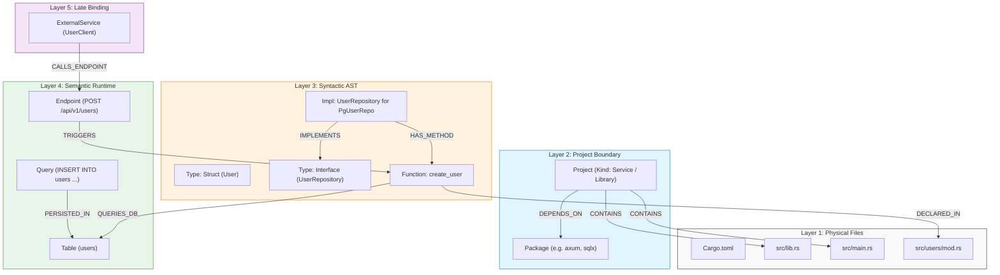

# Rust Language Support Engineering Roadmap (`CodeExplorer.Parser.Rust`) 🦀🗺️

> **Epic Specification & Architectural Blueprint**  
> **Status:** 📋 Approved / Ready for Implementation  
> **Target Release:** `v1.45.0` (Planned Minor Epic)  
> **Core Component:** `cli/src/Parsers/CodeExplorer.Parser.Rust/`  
> **Related Architecture Specs:** [5-Layer Graph Ontology Specification](../architecture/ontology-model.md) • [Fractal Orthogonal Invariant Matrix (FOIM)](../architecture/fractal-orthogonal-invariant-matrix.md) • [Ingestion Pipeline](../architecture/ingestion-pipeline.md)

---

## 📌 Executive Summary & Strategic Goals

Rust has evolved into a premier systems, cloud-native, and high-concurrency language powering modern enterprise backends, distributed microservices, network proxies, high-throughput message brokers, and developer tooling. As modern software engineering teams transition critical compute paths and API gateways to Rust, enterprise architectures frequently combine **Rust** with **C# (.NET)**, **Go**, **TypeScript**, and **Python**.

Today, CodeExplorer provides high-fidelity, polyglot architectural analysis across all five layers of its graph ontology for .NET, Go, TypeScript/JavaScript, Python, Java, Kotlin, SQL, and ColdFusion. However, Rust projects currently lack dedicated syntactic and semantic representation, falling back to basic physical file discovery (`Layer 1`).

This roadmap specifies the design, architecture, and step-by-step implementation for adding full, production-grade **Rust Language Support (`CodeExplorer.Parser.Rust`)** to CodeExplorer with **100% parity across all 5 Ontology Layers**.

```
┌────────────────────────────────────────────────────────────────────────────────────────┐
│                        5-LAYER ONTOLOGY PARITY FOR RUST                                 │
├────────────────────────────────────────────────────────────────────────────────────────┤
│ Layer 5: Cross-Project Late Binding  │ Service calls (reqwest/hyper ➔ axum/actix)      │
│                                      │ Data lineage (sqlx/sea-orm ➔ Postgres/MySQL)    │
│                                      │ Event flow (rdkafka/lapin ➔ Kafka/RabbitMQ)     │
├──────────────────────────────────────┼─────────────────────────────────────────────────┤
│ Layer 4: Semantic Runtime            │ Endpoints, Databases, Tables, Queries, Topics,  │
│                                      │ ExternalServices, and ConfigStore mappings      │
├──────────────────────────────────────┼─────────────────────────────────────────────────┤
│ Layer 3: Syntactic AST Structure     │ Tree-sitter Rust AST: Structs, Enums (ADT),     │
│                                      │ Traits, Impls, Functions, Macros, Modules       │
├──────────────────────────────────────┼─────────────────────────────────────────────────┤
│ Layer 2: Project Boundary            │ Cargo.toml: Virtual Workspaces, Crates, Targets │
│                                      │ ([[bin]], [lib]), Dependencies, Classification  │
├──────────────────────────────────────┼─────────────────────────────────────────────────┤
│ Layer 1: Physical File Topology      │ Files (.rs), Directories, Gitignore, Target dir │
└──────────────────────────────────────┴─────────────────────────────────────────────────┘
```

### Strategic Objectives & Quality Attributes
1. **Full 5-Layer Parity**: Deliver the exact same depth of modeling for Rust as existing mature parsers (`CSharpParser`, `GoParser`, `TypeScriptParser`).
2. **Evidence-Based Classification**: Classify Rust crates into `Service`, `CliTool`, `Worker`, `Library`, `TestSuite`, or `DatabaseMigration` using manifest, entrypoint, source, and capability evidence rather than repository-specific names.
3. **Pure In-Memory AST Safety**: Execute purely in-memory Tree-sitter traversal, respecting `SIG-C-I-001` (In-Memory AST Visitor IO Purity) and guaranteeing zero native memory leaks across the 6 supported RIDs.
4. **Rich Ecosystem Understanding**: Deep semantic support for standard Rust frameworks (`axum`, `actix-web`, `rocket`, `tonic`, `reqwest`, `sqlx`, `sea-orm`, `diesel`, `rdkafka`, `lapin`, `async-nats`).
5. **Architectural Guardrails (SIG)**: Deliver first-class Semantic Invariant Gates for Rust, enforcing Unsafe Code Isolation, Clean Architecture Crate Boundaries, and Async Runtime Purity.

---

## 🏛️ 5-Layer Graph Ontology Mapping for Rust

The following diagram illustrates how Rust constructs map seamlessly into CodeExplorer's 5-Layer Ontology:



---

## 📦 Phase 1: Native Tree-Sitter Integration & Project Manifests (Layers 1 & 2)

### 1.1 Native Runtime Grammar Binding across 6 RIDs

CodeExplorer relies on high-performance native Tree-sitter parsers bundled via `TreeSitter.DotNet` (v1.3.0). Inspection of the runtime distributions reveals that `tree-sitter-rust` native binaries are already present across all 6 target Runtime Identifiers (RIDs):

| Platform / RID | Native Dynamic Library | Status in `TreeSitter.DotNet` 1.3.0 |
| :--- | :--- | :--- |
| **`win-x64`** | `tree-sitter-rust.dll` | ✅ Verified Present (`1,217,024` bytes) |
| **`win-arm64`** | `tree-sitter-rust.dll` | ✅ Verified Present |
| **`linux-x64`** | `libtree-sitter-rust.so` | ✅ Verified Present (`1,145,296` bytes) |
| **`linux-arm64`** | `libtree-sitter-rust.so` | ✅ Verified Present |
| **`osx-x64`** | `libtree-sitter-rust.dylib` | ✅ Verified Present |
| **`osx-arm64`** (Apple Silicon) | `libtree-sitter-rust.dylib` | ✅ Verified Present |

#### Implementation Tasks:
- Configure `LanguageName => "rust"` in `RustParser.cs`.
- Verify runtime initialization via `SyntaxTree.GetLanguage("rust")`.
- Update `LanguageSyntaxProfileRegistry` to register `RustSyntaxProfile.Instance` under `"rust"`.
- Ensure deterministic memory reclamation: each `SyntaxTree` created for `.rs` files must be freed during Layer 3 Pass 2 via `syntaxTree.Dispose()` to prevent native memory exhaustion during 100k+ line indexing runs.

---

### 1.2 `Cargo.toml` Architecture & Workspace Manifest Parsing

Rust projects are declared and orchestrated via `Cargo.toml`. Cargo supports both **single-crate packages** and **multi-crate virtual workspaces**.

#### 1.2.1 Virtual Workspaces (`[workspace]`)
A Cargo virtual workspace contains no root package code, only orchestrating sub-crates:
```toml
[workspace]
members = [
    "crates/*",
    "services/auth-service",
    "services/billing-service",
]
default-members = ["services/auth-service"]
exclude = ["legacy-crate"]

[workspace.package]
version = "2.1.0"
edition = "2021"
authors = ["Engineering Team"]

[workspace.dependencies]
tokio = { version = "1.38", features = ["full"] }
serde = { version = "1.0", features = ["derive"] }
tracing = "0.1"
```

#### 1.2.2 Crate Targets & Manifest Sections
Each package crate defines its metadata and entry points:
- `[package]`: `name`, `version`, `edition` (e.g. `2018`, `2021`, `2024`), `authors`, `description`.
- `[workspace]`: Inheritance flags (e.g., `version.workspace = true`, `edition.workspace = true`).
- `[lib]`: Library definition (`name`, `path = "src/lib.rs"`, `crate-type = ["rlib", "cdylib"]`).
- `[[bin]]`: Executable binaries (`name = "server"`, `path = "src/main.rs"` or `path = "src/bin/server.rs"`).
- `[[test]]`: Integration tests (`tests/integration_tests.rs`).
- `[[bench]]`: Performance benchmarks (`benches/perf.rs`).
- `[[example]]`: Executable examples (`examples/demo.rs`).

#### 1.2.4 Multi-Binary Processes & Architectural Subsystems

When one package declares multiple `[[bin]]` targets, each existing target entrypoint is projected as its own process candidate instead of classifying the package from the union of all target code. Runtime `ENTRYPOINT`/`CMD` references, server-path and server-binding evidence, explicit worker names, and finite-task/CLI names determine each candidate's role; a Docker build command alone does not imply a service.

Library crates with infrastructure capability or a domain-oriented name and at least 1,500 non-empty Rust source lines are retained as semantic architectural subsystems. Generic `common` and `utils` crates are not promoted by size alone. Default architecture views keep these marked subsystems visible while continuing to hide ordinary libraries.

Layer 4 also models AWS buckets and KMS key sets when both the runtime SDK dependency and resource-specific configuration usage are present; SQS/SNS remain message `Topic` entities. A `PeerMesh` is synthesized only when at least two independent signals agree (peer configuration, bidirectional transport, repeated Compose participants, or distributed collective compute). Participant count and protocols are derived from the workspace evidence, and C1 preserves the typed resource and `COORDINATES_WITH` edges.

#### 1.2.3 Dependency Classifications: Local vs External Crates
Cargo dependencies appear in multiple sections:
- `[dependencies]` — Runtime production dependencies.
- `[dev-dependencies]` — Testing and benchmarking dependencies.
- `[build-dependencies]` — Build-script (`build.rs`) dependencies.
- `[target.'cfg(...)'.dependencies]` — Platform-specific dependencies.

`RustParser.ParseDependenciesAsync` must distinguish between:
1. **Local Crate Dependencies**:
   ```toml
   [dependencies]
   shared-kernel = { path = "../shared-kernel" }
   auth-client = { path = "../../crates/auth-client", version = "1.0" }
   ```
   *Action:* Resolves the relative path to an absolute workspace directory. Emits `(srcCrate)-[:DEPENDS_ON { dependency_type: "project" }]->(targetCrate)`.
2. **External crates.io / Git Dependencies**:
   ```toml
   [dependencies]
   axum = "0.7"
   sqlx = { version = "0.7", features = ["postgres", "runtime-tokio"] }
   custom-lib = { git = "https://github.com/org/custom-lib", branch = "main" }
   ```
   *Action:* Emits `(pkg:Package { name: "axum", version: "0.7", language: "rust" })` and `(crate)-[:DEPENDS_ON { dependency_type: "package" }]->(pkg)`.
3. **Workspace Inherited Dependencies**:
   ```toml
   [dependencies]
   tokio = { workspace = true }
   ```
   *Action:* Ascends directory tree to root `Cargo.toml`, extracts version from `[workspace.dependencies.tokio]`, and binds correctly.

#### 1.2.4 Robust TOML Parsing: `Tomlyn` Integration
Instead of brittle ad-hoc regex line parsers, `CodeExplorer.Parser.Rust` will leverage `Tomlyn` (high-performance, zero-allocation, fully compliant TOML 1.0 parser for .NET):
```csharp
var doc = Toml.Parse(File.ReadAllText(cargoTomlPath));
var tomlTable = doc.ToModel();
```
Fallback: If `Cargo.lock` is present, versions for workspace and external packages can be pinned with exact fidelity.

---

### 1.3 Evidence-Based Workload Classification (`ProjectRoleDetector`)

In accordance with CodeExplorer's zero-hack classification standard, Rust crates are categorized via the `ProjectEntityClassifierRegistry` based on concrete manifest sections, imported frameworks, and filesystem artifacts:

| Classification | Manifest & Dependency Criteria | Archetypal Examples |
| :--- | :--- | :--- |
| **`Service`** | `[[bin]]` target or `src/main.rs` present **AND** depends on HTTP/RPC frameworks: `axum`, `actix-web`, `rocket`, `warp`, `poem`, `salvo`, `tonic`, `tarpc`. | Web APIs, REST microservices, gRPC backends. |
| **`CliTool`** | `[[bin]]` target or files in `src/bin/` or `cmd/` **AND** depends on CLI/TUI crates: `clap`, `structopt`, `argh`, `ratatui`, `crossterm`, `dialoguer`. | CLI utilities, operational tools, devops binaries. |
| **`Worker`** | `[[bin]]` target or files containing `worker`/`consumer`/`scheduler` in name **AND** depends on: `rdkafka`, `lapin`, `async-nats`, `fang`, `apalis`. | Background queue consumers, cron event processors. |
| **`Library`** | `[lib]` target (e.g. `src/lib.rs`) present **AND** NO `[[bin]]` or `src/main.rs`. | Shared business domain models, client SDKs, utility crates. |
| **`TestSuite`** | Located in `tests/`, `benches/`, or manifest type explicitly tagged `test` / contains only `[dev-dependencies]`. | Integration test harnesses, benchmark suites. |
| **`DatabaseMigration`**| Depends on `refinery`, `diesel_migrations`, or directory contains `.sql` migration files under `migrations/`. | Standalone DB schema migration crates. |

```csharp
// RustParser.ExtractManifestProperties implementation snippet
props["manifest_type"] = hasBin ? (isService ? "application" : isCli ? "cli" : isWorker ? "worker" : "application") : "library";
props["framework_type"] = isWeb ? "web" : isGrpc ? "rpc" : isCli ? "cli" : isWorker ? "worker" : "library";
if (hasBin) props["has_cli_bin"] = "true";
if (isGrpc) props["has_grpc"] = "true";
```

---

## 🌲 Phase 2: Syntactic AST & Rust Type System Mapping (Layer 3)

### 2.1 Tree-sitter Rust AST Node Vocabulary (`TreeSitterSyntax.Rust`)

The Tree-sitter grammar for Rust produces a rich, concrete syntax tree. We define `TreeSitterSyntax.Rust` in `CodeExplorer.Core`:

```csharp
public static class Rust
{
    // Item Declarations
    public const string SourceFile = "source_file";
    public const string ModItem = "mod_item";
    public const string StructItem = "struct_item";
    public const string EnumItem = "enum_item";
    public const string EnumVariant = "enum_variant";
    public const string EnumVariantList = "enum_variant_list";
    public const string UnionItem = "union_item";
    public const string TraitItem = "trait_item";
    public const string ImplItem = "impl_item";
    public const string FunctionItem = "function_item";
    public const string FunctionSignatureItem = "function_signature_item";
    public const string MacroDefinition = "macro_definition";
    public const string MacroInvocation = "macro_invocation";
    public const string ConstItem = "const_item";
    public const string StaticItem = "static_item";
    public const string TypeItem = "type_item";
    public const string UseDeclaration = "use_declaration";
    public const string ExternCrateDeclaration = "extern_crate_declaration";
    public const string ForeignModItem = "foreign_mod_item";

    // Structural Elements & Bodies
    public const string DeclarationList = "declaration_list";
    public const string FieldDeclarationList = "field_declaration_list";
    public const string FieldDeclaration = "field_declaration";
    public const string OrderedFieldDeclarationList = "ordered_field_declaration_list";
    public const string Parameters = "parameters";
    public const string Parameter = "parameter";
    public const string SelfParameter = "self_parameter";
    public const string Block = "block";
    public const string TypeParameters = "type_parameters";
    public const string WhereClause = "where_clause";
    public const string VisibilityModifier = "visibility_modifier";
    public const string AttributeItem = "attribute_item";
    public const string InnerAttributeItem = "inner_attribute_item";

    // Expressions & Calls
    public const string CallExpression = "call_expression";
    public const string FieldExpression = "field_expression";
    public const string AwaitExpression = "await_expression";
    public const string TryExpression = "try_expression";
    public const string ClosureExpression = "closure_expression";
    public const string MatchExpression = "match_expression";
    public const string LetDeclaration = "let_declaration";
    public const string AssignmentExpression = "assignment_expression";
    public const string BinaryExpression = "binary_expression";
    public const string UnaryExpression = "unary_expression";
    public const string ReturnExpression = "return_expression";
    public const string GenericFunction = "generic_function";

    // Literals & Identifiers
    public const string Identifier = "identifier";
    public const string TypeIdentifier = "type_identifier";
    public const string FieldIdentifier = "field_identifier";
    public const string ScopedIdentifier = "scoped_identifier";
    public const string ScopedTypeIdentifier = "scoped_type_identifier";
    public const string StringLiteral = "string_literal";
    public const string RawStringLiteral = "raw_string_literal";
    public const string IntegerLiteral = "integer_literal";
    public const string BooleanLiteral = "boolean_literal";

    // Fields
    public const string Trait = "trait";
    public const string ReturnType = "return_type";
    public const string GenericType = "generic_type";
}
```

---

### 2.2 Rust Module Hierarchy & File Layout Resolution

Rust's module system differs fundamentally from C# namespaces or Go packages. Modules form a strict hierarchical tree where visibility and symbol resolution follow module ownership:

```
src/
├── main.rs                 # Root of binary crate (crate::)
├── lib.rs                  # Root of library crate (crate::)
├── config.rs               # mod config; (Rust 2018/2021 modern file-module)
├── models/
│   ├── mod.rs              # mod models; (Rust 2015/classic directory-module)
│   └── user.rs             # mod user; inside models
└── services/
    ├── order.rs            # mod order; inside services (Rust 2018 path style)
    └── order/              # Submodules of services::order
        └── processor.rs    # mod processor; inside order
```

#### Resolution Algorithm in `RustModuleResolver`:
1. **Crate Roots**:
   - Binary crate root: `src/main.rs` (or specified in `[[bin]]`).
   - Library crate root: `src/lib.rs` (or specified in `[lib]`).
2. **Explicit Module Declarations (`mod foo;`)**:
   - Search for `foo.rs` in the current module's directory.
   - Search for `foo/mod.rs` in the current module's directory.
3. **Inline Modules (`mod foo { ... }`)**:
   - Scope symbols within `current_module::foo`.
4. **`use` Path Resolution**:
   - `crate::a::b::C` ➔ Resolves from the root `src/lib.rs` or `src/main.rs`.
   - `super::a::B` ➔ Ascends one level in the module tree.
   - `self::a::B` ➔ Relative to the declaring module.
   - External crates (`use tokio::sync::Mutex;`) ➔ External package reference.

---

### 2.3 Rust Type System Mapping: Structs, Enums (ADT) & Traits

```
Rust Construct                CodeExplorer Ontology Node          Edge Relationships Emitted
─────────────────────────────────────────────────────────────────────────────────────────────
struct Foo { x: i32 }         Type (Kind: Struct)                (File)-[:CONTAINS]->(Type)
struct Bar(i32, String);      Type (Kind: Struct)                (File)-[:CONTAINS]->(Type)
enum Status { Ok, Err(e) }    Type (Kind: Enum)                  (File)-[:CONTAINS]->(Type)
trait Greeter { fn greet(); } Type (Kind: Interface)             (File)-[:CONTAINS]->(Type)
impl Greeter for MyGreeter    (Trait Impl Block)                 (MyGreeter)-[:IMPLEMENTS]->(Greeter)
impl MyGreeter { ... }        (Inherent Impl Block)              (MyGreeter)-[:HAS_METHOD]->(Function)
fn free_function()            Function                           (File)-[:CONTAINS]->(Function)
macro_rules! my_macro         Function / Macro                   (File)-[:CONTAINS]->(Macro)
const TIMEOUT: u64 = 30;      Member (ConstantRegistry entry)    (File)-[:CONTAINS]->(Member)
```

#### Handling `impl_item` Traversal
In Rust, methods are not declared inside the struct body; they are attached via `impl` blocks:
- **Inherent Impl**: `impl User { pub fn new() -> Self { ... } }`
  - Tree-sitter node: `impl_item` with child `type: type_identifier (User)`.
  - Action: Discovered methods become children of the existing `Type(User)` node.
- **Trait Impl**: `impl UserRepository for PostgresUserRepo { ... }`
  - Tree-sitter node: `impl_item` with child `trait: type_identifier (UserRepository)` and `type: type_identifier (PostgresUserRepo)`.
  - Action: Emits relationship `(PostgresUserRepo)-[:IMPLEMENTS]->(UserRepository)` and links method implementations.

---

### 2.4 Call Graph & Member Invocation Extraction

Rust syntax features diverse call expressions that must be normalized into `[:CALLS]` edges:

1. **Receiver Method Calls**:
   ```rust
   user_service.create_user(&user).await?;
   ```
   *Tree-sitter AST:* `try_expression` ➔ `await_expression` ➔ `call_expression` ➔ `field_expression` (`argument: user_service`, `field: create_user`).  
   *Action:* Unwraps async `.await` and try `?` expressions, extracts method name `create_user` and operand `user_service`, emits `[:CALLS]` edge.

2. **Universal Function Call Syntax (UFCS) / Associated Functions**:
   ```rust
   let user = User::new("Alice");
   let res = <PostgresRepo as Repository>::find(&repo, id);
   ```
   *Tree-sitter AST:* `call_expression` ➔ `scoped_identifier` (`path: User`, `name: new`).  
   *Action:* Emits `[:CALLS]` targeting associated function `User::new`.

3. **Macro Invocations**:
   ```rust
   tracing::info!("Processing order id: {}", id);
   let data = vec![1, 2, 3];
   ```
   *Tree-sitter AST:* `macro_invocation` (`macro: scoped_identifier`, `token_tree: (...)`).  
   *Action:* Indexed as syntactic calls or logged into `CallLiteralNode` for audit analysis.

---

## 🌐 Phase 3: Ecosystem & Library Parsers (Layer 4 & Layer 5)

CodeExplorer uses modular `ISemanticExtension` parsers to detect runtime entities: HTTP endpoints, gRPC services, external web clients, relational and document databases, and messaging queues.

The following table summarizes the 11 native Rust library parsers to implement:

```
┌──────────────────────────────────────────────────────────────────────────────────────────┐
│                             RUST ECOSYSTEM LIBRARY PARSERS                               │
├──────────────────────────────────────┬───────────────────────────┬───────────────────────┤
│ Library Parser                       │ Crate / Ecosystem Pattern │ Ontological Role      │
├──────────────────────────────────────┼───────────────────────────┼───────────────────────┤
│ AxumLibraryParser                    │ axum                      │ WebService (Ingress)  │
│ ActixWebLibraryParser                │ actix-web                 │ WebService (Ingress)  │
│ RocketLibraryParser                  │ rocket                    │ WebService (Ingress)  │
│ TonicLibraryParser                   │ tonic, tonic-build        │ WebService & RPC      │
│ ReqwestLibraryParser                 │ reqwest                   │ Egress HTTP Client    │
│ HyperLibraryParser                   │ hyper                     │ Low-level HTTP Client │
│ SqlxLibraryParser                    │ sqlx                      │ Relational Database   │
│ SeaOrmLibraryParser                  │ sea-orm                   │ ORM / Data Lineage    │
│ DieselLibraryParser                  │ diesel                    │ ORM / Data Lineage    │
│ RdKafkaRustLibraryParser             │ rdkafka                   │ Event Bus (Kafka)     │
│ LapinLibraryParser                   │ lapin                     │ Event Bus (RabbitMQ)  │
│ AsyncNatsLibraryParser               │ async-nats                │ Message Broker (NATS) │
└──────────────────────────────────────┴───────────────────────────┴───────────────────────┘
```

---

### 3.1 Web & HTTP Ingress Frameworks

#### 3.1.1 `AxumLibraryParser` (`axum`)
Axum uses declarative route construction by chaining method routers:
```rust
let app = Router::new()
    .route("/users", get(list_users).post(create_user))
    .route("/users/:id", get(get_user).delete(delete_user))
    .nest("/api/v1", v1_routes);
```
- **AST Matching**: Detects `call_expression` where receiver is `Router` and method is `.route(path, handler)` or `.nest(prefix, router)`.
- **Extraction**:
  - Route path: string literal in first argument (`"/users"`).
  - Nested prefixes: resolves route prefixes up the fluent builder chain (e.g. `"/api/v1"` + `"/users"` ➔ `"/api/v1/users"`).
  - HTTP Methods: inspects handler wrapper functions (`get(...)` ➔ `GET`, `post(...)` ➔ `POST`, `delete(...)` ➔ `DELETE`).
  - Handler Function: extracts identifier passed into the method wrapper (`list_users`).
- **Graph Output**:
  - Creates `(ep:Endpoint { route_template: "/api/v1/users", http_method: "GET", protocol: "HTTP" })`.
  - Emits `(ep)-[:TRIGGERS]->(list_users:Function)`.

#### 3.1.2 `ActixWebLibraryParser` (`actix-web`)
Actix-web supports both declarative attributes and fluent routing:
```rust
#[get("/items/{id}")]
async fn get_item(path: web::Path<u32>) -> impl Responder { ... }

#[post("/items")]
async fn create_item(item: web::Json<NewItem>) -> impl Responder { ... }

// Scoped in App
App::new()
    .service(web::scope("/api").service(get_item).service(create_item));
```
- **AST Matching**:
  - Outer attributes: `attribute_item` matching `#[get("...")]`, `#[post("...")]`, `#[put("...")]`, `#[delete("...")]`.
  - Fluent scopes: `.service(web::scope("/api"))`.
- **Graph Output**:
  - Creates `(ep:Endpoint)` with combined route `/api/items/{id}` and links `[:TRIGGERS]` to the annotated async function.

#### 3.1.3 `RocketLibraryParser` (`rocket`)
- **AST Matching**: Inspects `#[get("/<id>")]`, `#[post("/new", data = "<input>")]` attributes and `rocket::build().mount("/base", routes![...])`.
- **Graph Output**: Extracts endpoints and associates base mounts with handler routes.

---

### 3.2 gRPC & RPC Frameworks

#### 3.2.1 `TonicLibraryParser` (`tonic`)
Tonic is the standard gRPC library for Rust, using `prost` code-generation via `build.rs`:
```rust
// In service implementation:
#[derive(Default)]
pub struct MyGreeter {}

#[tonic::async_trait]
impl Greeter for MyGreeter {
    async fn say_hello(&self, request: Request<HelloRequest>) -> Result<Response<HelloReply>, Status> {
        ...
    }
}

// In client call:
let mut client = GreeterClient::connect("http://auth-service:50051").await?;
let response = client.say_hello(request).await?;
```
- **Server Side**:
  - Detects `#[tonic::async_trait]` applied to `impl <Service> for <Struct>`.
  - Emits `(ep:Endpoint { protocol: "gRPC", route_template: "/Greeter/SayHello", http_method: "POST" })`.
  - Links `(ep)-[:TRIGGERS]->(say_hello:Function)`.
- **Client Side**:
  - Detects `GreeterClient::connect(...)` and `client.say_hello(...)`.
  - Resolves target host from string literal or environment configuration via `ConfigStore`.
  - Emits `(es:ExternalService { protocol: "gRPC", service_name: "auth-service" })` and late-binds `(es)-[:CALLS_ENDPOINT]->(ep)`.

---

### 3.3 Outbound HTTP Clients

#### 3.3.1 `ReqwestLibraryParser` (`reqwest`)
```rust
let client = reqwest::Client::new();
let res = client.get("https://api.stripe.com/v1/charges")
    .bearer_auth(api_key)
    .send()
    .await?;
```
- **AST Matching**: Detects `call_expression` matching `.get(url)`, `.post(url)`, `.put(url)`, `.delete(url)` on `reqwest::Client` or standalone `reqwest::get(url)`.
- **URL Extraction & Constant Resolution**:
  - Direct string literals: `"https://api.stripe.com/v1/charges"`.
  - `format!("http://{}/v1/orders", host)` template strings.
  - Constants resolved via `AstValueResolver` and `ConstantRegistry`.
- **Graph Output**:
  - Emits `(es:ExternalService { url: "https://api.stripe.com", host: "api.stripe.com", protocol: "HTTP" })`.
  - Emits `(enclosingFunction)-[:CALLS]->(es)`.
  - In Layer 5, resolves against local service endpoints to emit `(es)-[:CALLS_ENDPOINT]->(ep)`.

---

### 3.4 Relational & Document Databases (Data Lineage)

#### 3.4.1 `SqlxLibraryParser` (`sqlx`)
`sqlx` is the most popular async SQL toolkit in Rust, famous for its compile-time checked queries:
```rust
// Macro query
let user = sqlx::query_as!(
    User,
    "SELECT id, name, email FROM users WHERE id = $1 AND active = true",
    user_id
).fetch_one(&pool).await?;

// Dynamic query
sqlx::query("INSERT INTO orders (user_id, total) VALUES ($1, $2)")
    .bind(user_id)
    .bind(total)
    .execute(&pool)
    .await?;
```
- **AST Matching**:
  - Macro invocations: `sqlx::query!`, `sqlx::query_as!`, `sqlx::query_scalar!`.
  - Function calls: `sqlx::query(...)`, `sqlx::query_as(...)`.
  - Pool initialization: `PgPoolOptions::new().connect(...)`, `MySqlPool::connect(...)`, `SqlitePool::connect(...)`.
- **SQL Lineage Extraction**:
  - Extracts the SQL string literal argument.
  - Passes query string to CodeExplorer's `NestedSqlParser.TryParseSql(...)`.
  - Discovers SQL operations: `SELECT`, `INSERT`, `UPDATE`, `DELETE`, and touched table names (`users`, `orders`).
- **Graph Output**:
  - Emits `(db:Database { engine: "PostgreSQL" })`.
  - Emits `(tbl:Table { name: "users" })` with `(tbl)-[:PERSISTED_IN]->(db)`.
  - Emits `(q:Query { operation: "SELECT", raw_sql: "SELECT ... FROM users ..." })`.
  - Emits `(enclosingFunction)-[:QUERIES_DB]->(tbl)`.

#### 3.4.2 `SeaOrmLibraryParser` (`sea-orm`)
`sea-orm` is an async dynamic ORM for Rust built on `sqlx`:
```rust
#[derive(Clone, Debug, PartialEq, DeriveEntityModel)]
#[sea_orm(table_name = "customers", schema_name = "sales")]
pub struct Model {
    #[sea_orm(primary_key)]
    pub id: i32,
    pub name: String,
}
```
- **AST Matching**: Detects `struct_item` annotated with `#[derive(..., DeriveEntityModel, ...)]` and extracts table name from `#[sea_orm(table_name = "customers")]`.
- **Graph Output**: Emits `(tbl:Table { name: "customers", schema: "sales" })` and links `(Model:Type)-[:PERSISTED_IN]->(tbl)`.

#### 3.4.3 `DieselLibraryParser` (`diesel`)
- **AST Matching**: Detects `table! { users (id) { id -> Integer, name -> Text, } }` schema macros and `#[diesel(table_name = users)]` model attributes.
- **Graph Output**: Maps tables and schema models into the database lineage layer.

---

### 3.5 Messaging & Event Brokers

#### 3.5.1 `RdKafkaRustLibraryParser` (`rdkafka`)
```rust
// Producer:
producer.send(
    FutureRecord::to("order-events")
        .payload(&payload)
        .key(&key),
    Duration::from_secs(0),
).await?;

// Consumer:
consumer.subscribe(&["order-events", "payment-events"])?;
```
- **AST Matching**:
  - Producer: `.to("topic-name")` on `FutureRecord` or `BaseRecord`.
  - Consumer: `.subscribe(&["topic-name"])` on `StreamConsumer`.
- **Graph Output**:
  - Emits `(top:Topic { name: "order-events", broker: "Kafka" })`.
  - Producer function: `(fn)-[:PUBLISHES_TO]->(top)`.
  - Consumer function: `(fn)-[:SUBSCRIBES_TO]->(top)`.

#### 3.5.2 `LapinLibraryParser` (`lapin` / RabbitMQ)
- **AST Matching**: Extracts exchange and routing keys from `channel.basic_publish("exchange", "routing_key", ...)`, queue subscriptions from `channel.basic_consume("queue_name", ...)`.
- **Graph Output**: Emits `(top:Topic { name: "routing_key", broker: "RabbitMQ" })` with publish/subscribe edges.

#### 3.5.3 `AsyncNatsLibraryParser` (`async-nats`)
- **AST Matching**: Extracts subject strings from `client.publish("orders.created", ...)` and `client.subscribe("orders.*")`.
- **Graph Output**: Emits `(top:Topic { name: "orders.created", broker: "NATS" })`.

---

## 🛡️ Phase 4: Semantic Invariant Gates (SIG) for Rust Architectures

With the semantic graph populated with Rust nodes and relationships, CodeExplorer can enforce compile-free, sub-millisecond architectural constraints using **Semantic Invariant Gates (SIG)**:

### Gate 1: `SIG-R-S-001` — Unsafe Code Isolation Invariant
* **Rationale**: Memory safety is Rust's primary value proposition. `unsafe { ... }` blocks and `unsafe fn` must be isolated to low-level hardware or foreign abstraction crates (`sys/`, `native/`), strictly forbidden in business logic, HTTP handlers, or application services.
* **OpenCypher Invariant Query**:
```cypher
MATCH (fn:Function)-[:DECLARED_IN]->(f:File)<-[:CONTAINS]-(p:Project)
WHERE fn.is_unsafe = true
  AND NOT p.path CONTAINS "sys"
  AND NOT p.path CONTAINS "native"
  AND NOT p.path CONTAINS "ffi"
  AND NOT coalesce(fn.is_test, false)
RETURN 
  f.path AS file,
  fn.line_number AS line,
  fn.name AS symbol,
  "Unsafe function declared outside approved FFI/sys boundary: " + fn.name AS message
```

---

### Gate 2: `SIG-R-A-001` — Clean Architecture Crate Boundary Invariant
* **Rationale**: Domain crates (`core`, `domain`) must remain pure and decoupled from infrastructure. A domain crate must never import web frameworks (`axum`, `actix-web`) or database drivers (`sqlx`, `diesel`).
* **OpenCypher Invariant Query**:
```cypher
MATCH (p:Project)-[:DEPENDS_ON]->(pkg:Package)
WHERE (p.name CONTAINS "domain" OR p.name CONTAINS "core")
  AND pkg.name IN ["axum", "actix-web", "rocket", "sqlx", "diesel", "sea-orm"]
RETURN 
  p.name AS project,
  pkg.name AS illegal_dependency,
  "Domain project violates Clean Architecture by depending on infrastructure crate: " + pkg.name AS message
```

---

### Gate 3: `SIG-R-C-001` — Async Tokio Runtime Anti-Blocking Invariant
* **Rationale**: Invoking synchronous blocking functions (e.g. `std::thread::sleep`, `std::fs::read`, `std::net::TcpStream`) inside an async function running on Tokio starves executor worker threads.
* **OpenCypher Invariant Query**:
```cypher
MATCH (fn:Function)-[:CALLS]->(target:Function)
WHERE fn.is_async = true
  AND target.full_name IN [
    "std::thread::sleep",
    "std::fs::read",
    "std::fs::write",
    "std::fs::read_to_string",
    "reqwest::blocking"
  ]
  AND NOT coalesce(fn.is_test, false)
RETURN 
  fn.file_path AS file,
  fn.name AS symbol,
  target.full_name AS blocking_target,
  "Async function invokes blocking standard library call: " + target.full_name AS message
```

---

### Gate 4: `SIG-R-D-001` — Unparameterized SQL Query Invariance
* **Rationale**: Enforce parameter binding in `sqlx` and `diesel` queries. String formatting (`format!("SELECT ... WHERE id = {}", id)`) within a database query represents a critical SQL injection vulnerability.
* **OpenCypher Invariant Query**:
```cypher
MATCH (fn:Function)-[:QUERIES_DB]->(tbl:Table),
      (fn)-[:CALLS]->(lit:CallLiteral)
WHERE lit.text CONTAINS "format!"
  AND (lit.text CONTAINS "SELECT " OR lit.text CONTAINS "DELETE " OR lit.text CONTAINS "UPDATE ")
RETURN 
  fn.file_path AS file,
  fn.name AS symbol,
  "Dynamic string formatting detected in SQL query: " + lit.text AS message
```

---

## 🧪 Phase 5: Verification, Synthetic Benchmarks & Golden Test Suite

### 5.1 Comprehensive Unit & Integration Test Plan

The implementation must include dedicated test suites in `cli/tests/CodeExplorer.Tests/`:

```
cli/tests/CodeExplorer.Tests/
├── RustParserTests.cs                     # Layer 1 & 2: Cargo.toml virtual workspaces, crates, packages
├── RustFileVisitorTests.cs                # Layer 3: AST structs, enums, traits, impls, calls, modules
├── RustSemanticLibraryTests.cs            # Layer 4: Axum, Actix, Tonic, Sqlx, Reqwest, RdKafka
├── RustSemanticInvariantGateTests.cs      # Layer 5 & Gates: SIG-R-S-001, SIG-R-A-001, SIG-R-C-001
└── SampleProjects/rust/                   # Multi-crate test fixture fixtures
    ├── microservices-workspace/
    │   ├── Cargo.toml                     # Virtual workspace
    │   ├── crates/
    │   │   ├── domain-models/             # Library crate ([lib])
    │   │   ├── auth-service/              # Axum + Sqlx Service
    │   │   ├── order-processor/           # RdKafka + SeaOrm Worker
    │   │   ├── payment-gateway/           # Tonic gRPC Service
    │   │   └── admin-cli/                 # Clap CliTool
    │   └── tests/e2e/                     # TestSuite
```

#### Verification Assertions
1. **Workspace & Crate Boundary Assertions**:
   - `Cargo.toml` virtual workspace correctly discovers 5 projects with proper names.
   - `domain-models` classified as `Library`.
   - `auth-service` classified as `Service`.
   - `order-processor` classified as `Worker`.
   - `payment-gateway` classified as `Service`.
   - `admin-cli` classified as `CliTool`.
2. **Syntactic AST Assertions**:
   - Structs with named, tuple, and unit fields map to `Type(Struct)`.
   - Algebraic Data Types (Enums with associated data) map to `Type(Enum)`.
   - Inherent `impl` methods correctly become children of the target `Type`.
   - Trait `impl` blocks emit `[:IMPLEMENTS]` edges to the `Trait` interface.
3. **Semantic Lineage Assertions**:
   - `Axum` routes emit `(Endpoint)` and `[:TRIGGERS]` to handler functions.
   - `Sqlx` queries emit `(Table)` and `(fn)-[:QUERIES_DB]->(Table)`.
   - `Reqwest` outbound calls emit `(ExternalService)` and link via `[:CALLS_ENDPOINT]` in Layer 5.
   - `Tonic` services emit gRPC endpoints and RPC caller links.

---

### 5.2 Performance & SLA Benchmarks

CodeExplorer enforces strict performance budgets for all parsers:

| Metric | Target SLA Budget |
| :--- | :--- |
| **AST Parse Throughput** | $\ge 50,000$ lines of Rust / second (multi-threaded Pass 1 & 2). |
| **Full Scan 100k LoC Workspace** | $\le 2.0$ seconds (Layers 1 through 5, SQLite persistence). |
| **Memory Allocation** | Immediate native disposal; zero RSS drift between workspace scans. |
| **Gate Evaluation SLA** | $\le 30$ ms across entire Rust semantic graph in SQLite. |

---

## 📂 Project Directory Structure

The new project will be created in `cli/src/Parsers/CodeExplorer.Parser.Rust/`:

```
cli/src/Parsers/CodeExplorer.Parser.Rust/
├── CodeExplorer.Parser.Rust.csproj
├── RustParser.cs                          # Implements IProjectParser, IFileParser
├── RustFileVisitor.cs                     # Inherits BaseParserVisitor (AST traversal)
├── RustSyntaxProfile.cs                   # Defines LanguageSyntaxProfile for Rust
├── RustDeclarationExtractor.cs            # Early Pass 1 symbol & constant extraction
├── CargoManifestParser.cs                 # Tomlyn-based Cargo.toml workspace & crate parser
├── RustModuleResolver.cs                  # Rust 2018/2021 module tree & path resolution
├── Libraries/
│   ├── RustAstHelper.cs                   # String, route & expression helper utilities
│   ├── AxumLibraryParser.cs               # axum HTTP web framework
│   ├── ActixWebLibraryParser.cs           # actix-web HTTP web framework
│   ├── RocketLibraryParser.cs             # rocket HTTP web framework
│   ├── TonicLibraryParser.cs              # tonic gRPC server & client
│   ├── ReqwestLibraryParser.cs            # reqwest HTTP client
│   ├── HyperLibraryParser.cs              # hyper HTTP client
│   ├── SqlxLibraryParser.cs               # sqlx compile-time SQL queries & pools
│   ├── SeaOrmLibraryParser.cs             # sea-orm dynamic entity models
│   ├── DieselLibraryParser.cs             # diesel relational ORM
│   ├── RdKafkaRustLibraryParser.cs        # rdkafka Kafka producer & consumer
│   ├── LapinLibraryParser.cs              # lapin RabbitMQ client
│   └── AsyncNatsLibraryParser.cs          # async-nats NATS message broker
```

---

## 📋 Granular Implementation Task Backlog

```
┌────────────────────────────────────────────────────────────────────────────────────────┐
│ PHASE 1: NATIVE GRAMMAR & PROJECT BOUNDARIES (LAYERS 1 & 2)                            │
├────────────────────────────────────────────────────────────────────────────────────────┤
│ [ ] 1.1 Create cli/src/Parsers/CodeExplorer.Parser.Rust/CodeExplorer.Parser.Rust.csproj│
│ [ ] 1.2 Add ProjectReference to cli/CodeExplorer.slnx and cli/src/UI/CodeExplorer.csproj│
│ [ ] 1.3 Add PackageReference to Tomlyn (v0.17+) for Cargo.toml parsing                │
│ [ ] 1.4 Implement CargoManifestParser: virtual workspaces, crates, dependencies       │
│ [ ] 1.5 Implement RustParser : IProjectParser, IFileParser                            │
│ [ ] 1.6 Implement Evidence-Based Workload Classifier for Rust in ProjectRoleDetector   │
│ [ ] 1.7 Register RustParser in WorkspaceIndexer reflection discovery system            │
├────────────────────────────────────────────────────────────────────────────────────────┤
│ PHASE 2: SYNTACTIC AST & RUST TYPE SYSTEM (LAYER 3)                                    │
├────────────────────────────────────────────────────────────────────────────────────────┤
│ [ ] 2.1 Add TreeSitterSyntax.Rust node types and fields to TreeSitterSyntax.cs         │
│ [ ] 2.2 Implement RustSyntaxProfile and register in LanguageSyntaxProfileRegistry      │
│ [ ] 2.3 Implement RustDeclarationExtractor for Pass 1 constants and enums             │
│ [ ] 2.4 Implement RustModuleResolver (crate::, super::, file vs dir module layout)     │
│ [ ] 2.5 Implement RustFileVisitor : BaseParserVisitor                                  │
│         • StructItem (named, tuple, unit) ➔ Type(Struct)                               │
│         • EnumItem & EnumVariant ➔ Type(Enum)                                          │
│         • TraitItem ➔ Type(Interface)                                                  │
│         • Inherent ImplItem ➔ Type methods attachment                                  │
│         • Trait ImplItem ➔ [:IMPLEMENTS] edge + method bindings                       │
│         • FunctionItem (async fn, pub fn, unsafe fn) ➔ Function                        │
│         • CallExpression & Method Dispatch (receiver.method() & UFCS)                  │
│         • Async .await expression unwrapping & call linking                            │
│         • UseDeclaration symbol resolution                                             │
├────────────────────────────────────────────────────────────────────────────────────────┤
│ PHASE 3: ECOSYSTEM & LIBRARY PARSERS (LAYERS 4 & 5)                                    │
├────────────────────────────────────────────────────────────────────────────────────────┤
│ [ ] 3.1 Implement AxumLibraryParser (Router, .route, .nest, get/post/delete handlers)  │
│ [ ] 3.2 Implement ActixWebLibraryParser (#[get], #[post], web::scope, web::resource)  │
│ [ ] 3.3 Implement RocketLibraryParser (#[get], #[post], routes![...], mount)           │
│ [ ] 3.4 Implement TonicLibraryParser (#[tonic::async_trait], gRPC endpoints, clients)  │
│ [ ] 3.5 Implement ReqwestLibraryParser (get, post, client calls, URL resolution)       │
│ [ ] 3.6 Implement HyperLibraryParser (low-level HTTP request builders)                 │
│ [ ] 3.7 Implement SqlxLibraryParser (sqlx::query!, query_as!, NestedSqlParser)        │
│ [ ] 3.8 Implement SeaOrmLibraryParser (DeriveEntityModel, table_name attributes)       │
│ [ ] 3.9 Implement DieselLibraryParser (table! macro, #[diesel(table_name)])            │
│ [ ] 3.10 Implement RdKafkaRustLibraryParser (FutureRecord, StreamConsumer topics)      │
│ [ ] 3.11 Implement LapinLibraryParser (RabbitMQ exchanges, queues, routing keys)       │
│ [ ] 3.12 Implement AsyncNatsLibraryParser (NATS subjects, publish, subscribe)          │
├────────────────────────────────────────────────────────────────────────────────────────┤
│ PHASE 4: SEMANTIC INVARIANT GATES (SIG) FOR RUST                                       │
├────────────────────────────────────────────────────────────────────────────────────────┤
│ [ ] 4.1 Author SIG-R-S-001 (Unsafe Code Isolation Gate) YAML & Cypher Query            │
│ [ ] 4.2 Author SIG-R-A-001 (Clean Architecture Crate Boundary Gate) YAML & Cypher     │
│ [ ] 4.3 Author SIG-R-C-001 (Async Tokio Anti-Blocking Invariant Gate) YAML & Cypher    │
│ [ ] 4.4 Author SIG-R-D-001 (Unparameterized SQL Invariance Gate) YAML & Cypher        │
├────────────────────────────────────────────────────────────────────────────────────────┤
│ PHASE 5: VERIFICATION, BENCHMARKS & RELEASE                                            │
├────────────────────────────────────────────────────────────────────────────────────────┤
│ [ ] 5.1 Create sample multi-crate Rust workspace fixture in tests/SampleProjects/rust/ │
│ [ ] 5.2 Implement RustParserTests.cs (Cargo.toml workspaces, crates, packages)         │
│ [ ] 5.3 Implement RustFileVisitorTests.cs (AST nodes, traits, impls, calls)            │
│ [ ] 5.4 Implement RustSemanticLibraryTests.cs (Axum, Sqlx, Tonic, Reqwest, RdKafka)    │
│ [ ] 5.5 Implement RustSemanticInvariantGateTests.cs (Zero-match & Ratchets)           │
│ [ ] 5.6 Execute dotnet test suite with 0 warnings & 0 errors                           │
│ [ ] 5.7 Bump version via SemVer (Minor v1.45.0) in props, package.json, package-lock   │
│ [ ] 5.8 Update CHANGELOG.md, README.md, and documentation sitemap                      │
└────────────────────────────────────────────────────────────────────────────────────────┘
```

---

## 🏁 Delivery & Milestones Summary

| Milestone | Deliverables | Verification Criteria | Target Version |
| :--- | :--- | :--- | :--- |
| **M1: Core Engine & Boundaries** | `CodeExplorer.Parser.Rust.csproj`, `CargoManifestParser`, `RustParser`, `Tomlyn` integration, Workload Classifier. | Passes virtual workspace parsing tests across single and multi-crate fixtures. | `v1.45.0-alpha.1` |
| **M2: Syntactic AST Tree** | `TreeSitterSyntax.Rust`, `RustSyntaxProfile`, `RustFileVisitor`, structs, enums, traits, inherent/trait impls, module resolver. | 100% of Rust language constructs correctly parsed and indexed into Layer 3. | `v1.45.0-alpha.2` |
| **M3: Semantic Ecosystem** | 11 `ISemanticExtension` parsers (Axum, Actix, Tonic, Reqwest, Sqlx, SeaOrm, Diesel, RdKafka, Lapin, NATS). | End-to-end endpoint triggering, DB table lineage, and cross-service traces confirmed. | `v1.45.0-beta.1` |
| **M4: Architectural Gates** | 4 Rust Semantic Invariant Gates (`SIG-R-S-001`, `SIG-R-A-001`, `SIG-R-C-001`, `SIG-R-D-001`). | Zero-match evaluation and monotonic debt ratcheting verified on test repos. | `v1.45.0-rc.1` |
| **M5: Production Release** | Full test suite execution, benchmark verification, documentation updates, unified release tag. | `dotnet build` with 0 warnings, all tests pass, CI multi-RID single-file build succeeds. | `v1.45.0` |

---
*Roadmap created for CodeExplorer (`ce`) architectural evolution.*
